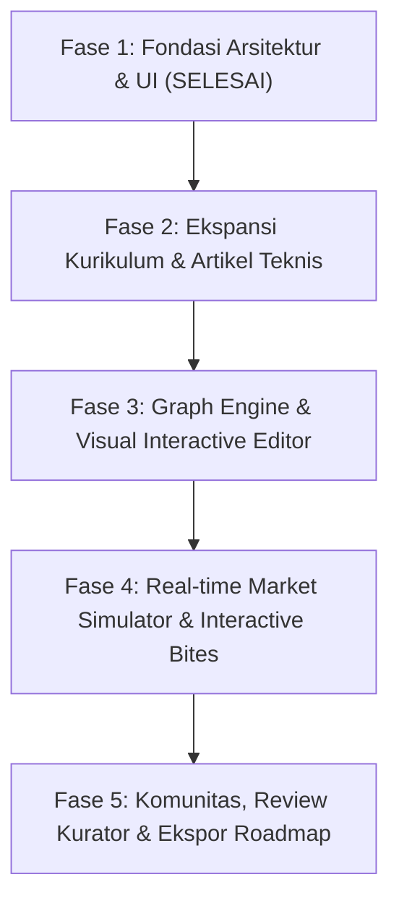

# Trading Learning Path — Master Development Backlog & Roadmap

Dokumen ini adalah **Master Backlog & Rencana Pengembangan Jangka Panjang** untuk aplikasi **Trading Learning Path** (terinspirasi oleh arsitektur edukasi terbuka `roadmap.sh` dan standar estetika finansial berkelas tinggi). Dokumen ini berfungsi sebagai peta eksekusi persisten agar seluruh pengerjaan fitur dapat diselesaikan secara berkelanjutan tanpa kehilangan konteks.

---

## 🗺️ Roadmap Fase Pengembangan

---

## ✅ Fase 1: Fondasi Arsitektur & UI (Selesai Dikerjakan)
- [x] **Backend & Basis Data**: SQLite WAL mode berkecepatan tinggi dengan Bun/Node runtime fallback otomatis.
- [x] **Skema Database Relasional**: Tabel `roadmaps`, `roadmap_nodes`, `node_checklists`, `node_resources`, `user_node_progress`, `community_roadmaps`.
- [x] **Arsitektur Roadmap-First (roadmap.sh)**: Transformasi dari landing page marketing SaaS biasa menjadi Knowledge Discovery Atlas & Peta Jalan Visual Terbuka.
- [x] **Dedicated Documentation Reader (`DocReader.tsx`)**: Layout 3-kolom standar dokumentasi teknis (Topik kiri, Pembahasan tengah, TOC kanan) dengan diagram SVG, studi kasus riil, kesalahan fatal, dan referensi literatur.
- [x] **Bahan Bacaan Komprehensif Awal**: 12 modul Price Action & Market Structure (Auction Market Theory, BSL/SSL, BOS/CHoCH, MTF Fractality, FVG, Order Blocks, Aturan Risiko 1%, Psikologi Trading).
- [x] **Elemen Mikro-Interaktif React Bits**:
  - `SpotlightCard`: Efek hover laser radial spotlight untuk kartu kurikulum.
  - `BorderBeam`: Animasi perimeter cahaya laser untuk kanvas peta aktif.
  - `DecryptedText`: Efek dekripsi teks sandi terminal untuk ticker finansial.
  - `MagnetButton`: Tombol interaktif dengan gaya tarik magnetik halus.
  - `InteractiveChartBite`: Widget lilin interaktif untuk scrubbing harga dan visualisasi lelang mikro.
- [x] **Akses Publik 100%**: Tidak ada pembatas registrasi paksa bagi pengunjung; otentikasi dikhususkan bagi kontributor materi.

---

## 📌 Fase 2: Ekspansi Kurikulum & Modul Artikel (Next Milestones)

### 1. Jalur Smart Money Concepts (SMC) & ICT Algorithms
- [ ] **Modul 2.1**: *Interbank Price Delivery Algorithm (IPDA)* — Teori efisiensi algoritma penetapan harga bank sentral.
- [ ] **Modul 2.2**: *Dealing Ranges, Equilibrium & Premium vs. Discount Array* — Menentukan zona diskon 50% fibonacci secara mekanis.
- [ ] **Modul 2.3**: *Killzones & Time-Price Alignment* — Sesi lelang London Open, New York Open, dan Asian Range Consolidation.
- [ ] **Modul 2.4**: *Breaker Blocks & Mitigation Blocks* — Sumbu pembalikan yang gagal dan menjadi dinding pertahanan baru.
- [ ] **Modul 2.5**: *Judas Swing / Silver Bullet Setups* — Manipulasi awal sesi untuk menjebak likuiditas sebelum ekspansi arah sebenarnya.

### 2. Jalur Wyckoff Method & Volume Spread Analysis (VSA)
- [ ] **Modul 3.1**: *Tiga Hukum Wyckoff* — Supply vs Demand, Cause vs Effect, Effort vs Result.
- [ ] **Modul 3.2**: *Siklus Akumulasi & Distribusi* — Preliminary Supply (PSY), Selling Climax (SC), Automatic Rally (AR), Secondary Test (ST).
- [ ] **Modul 3.3**: *Spring & Upthrust (UTAD)* — Pengujian likuiditas batas rentang horizontal sebelum fase markup/markdown.
- [ ] **Modul 3.4**: *Volume Spread Analysis* — Membaca volume tinggi pada spread sempit (*No Demand / Stopping Volume*).

### 3. Jalur Analisis Fundamental Makro & Sentimen Pasar
- [ ] **Modul 4.1**: *Suku Bunga Bank Sentral & Yield Curve* — Pengaruh The Fed, ECB, BOJ, dan inversi yield obligasi.
- [ ] **Modul 4.2**: *Kalender Ekonomi Berdampak Tinggi* — Menavigasi rilis Non-Farm Payrolls (NFP), Consumer Price Index (CPI), dan FOMC Rate Decisions.
- [ ] **Modul 4.3**: *Commitments of Traders (COT Report)* — Membaca posisi bersih Commercial vs Non-Commercial di pasar berjangka CFTC.

### 4. Jalur Kuantitatif & Algorithmic Trading
- [ ] **Modul 5.1**: *Python untuk Analisis Deret Waktu Finansial* — Pemanfaatan `pandas`, `numpy`, dan perhitungan Moving Averages eksponensial.
- [ ] **Modul 5.2**: *Pine Script v5 TradingView* — Membangun indikator custom pendeteksi BOS dan FVG secara otomatis.
- [ ] **Modul 5.3**: *Backtesting Tanpa Bias* — Mengeliminasi *Look-ahead Bias*, *Survivorship Bias*, dan *Overfitting (Curve Fitting)*.

---

## ⚡ Fase 3: Peningkatan Kanvas Graf Visual (Graph Engine)

- [ ] **Integrasi `@xyflow/react` (React Flow v12)**:
  - Menggantikan koordinat manual dengan auto-layout DAG (Dagre / ElkJS).
  - Garis konektor kurva bezier dinamis dengan animasi aliran partikel (*flowing particles on active paths*).
  - Fitur Mini-map di pojok kanan bawah dengan kontrol zoom level intuitif.
- [ ] **Simpul Bersyarat & Cabang Pilihan (Branching Paths)**:
  - Menandai simpul wajib (*Core / Prerequisite*) vs simpul pelengkap (*Optional / Elective*).
  - Indikator prasyarat gembok transparan: dapat dibaca kapan saja namun memberikan peringatan rekomendasi topik dasar.
- [ ] **Ekspor Visual Roadmap**:
  - Tombol simpan peta sebagai gambar resolusi tinggi (PNG/SVG/PDF) untuk dicetak atau dibagikan ke media sosial.

---

## 🧪 Fase 4: Real-time Market Simulator & Advanced Interactive Bites

- [ ] **Interactive Candlestick Replay Player**:
  - Fitur bar-replay sederhana berbasis data historis sintetis untuk menguji kemampuan membaca struktur candle demi candle.
- [ ] **Dynamic Position Size & Margin Calculator**:
  - Input ukuran saldo akun, % toleransi risiko, jarak pips stop loss -> Output instan ukuran lot dan nilai uang yang dipertaruhkan.
- [ ] **Order Book Depth & Heatmap Visualizer Bite**:
  - Visualisasi simulasi order book level 2 (bid/ask limit walls) untuk memahami penyerapan likuiditas secara visual.
- [ ] **Drawdown Simulator & Expectancy Calculator**:
  - Simulasi Monte Carlo 1,000 transaksi acak berdasarkan rasio Win Rate dan Risk:Reward untuk mengilustrasikan kurva ekuitas.

---

## 👥 Fase 5: Komunitas, Kurasi & Sinkronisasi Progress

- [ ] **Editor Visual Peta Komunitas (Roadmap Creator Studio)**:
  - Antarmuka drag-and-drop bagi kontributor terverifikasi untuk menyusun roadmap metode trading mereka sendiri.
- [ ] **Review Kurator & Sistem Reputasi**:
  - Alur moderasi pengajuan kurikulum sebelum dipublikasikan ke katalog komunitas.
  - Sistem upvote dan komentar konstruktif per modul edukasi.
- [ ] **Penyimpanan Progres Fleksibel**:
  - Otomatis tersimpan di LocalStorage peramban (tanpa perlu akun).
  - Opsi ekspor/impor file JSON profil progres agar pengguna dapat memindahkan status belajar antar perangkat.
- [ ] **PWA (Progressive Web App)**:
  - Dukungan offline reading untuk seluruh dokumentasi teknis via Service Worker.

---

## 🛠️ Standar Kualitas & Arsitektur Kode (Maintenance Rules)

1. **Zero AI Slop**: Jangan menambahkan komentar dekoratif klise atau teks pengisi yang tidak berbobot teknis.
2. **Type Safety Ketat**: Setiap interface dan model data finansial wajib memiliki type definition di `src/types/index.ts`.
3. **Commit Atomik**: Setiap kali menyelesaikan satu item checklist di atas, wajib lakukan git commit dengan Conventional Commits (`feat(...)`, `fix(...)`, `docs(...)`).
4. **Verifikasi Build**: Jalankan `bun run build` sebelum dan sesudah perubahan untuk memastikan tidak ada pemutusan dependensi atau error TypeScript.
