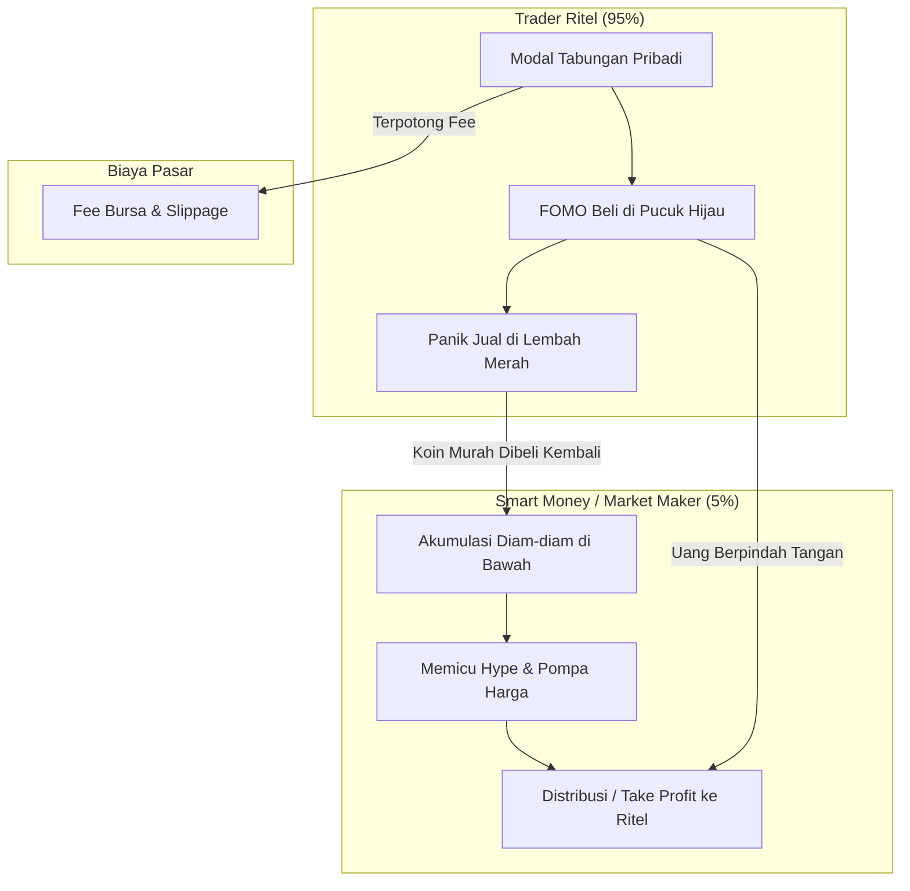
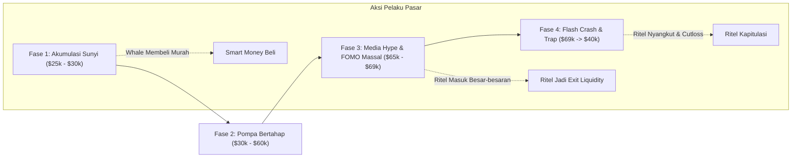

# Bab 1: Introduction (Mengapa 95% Ritel Kalah di Pasar Kripto)

---

## 1. Realitas Pahit: Ilusi Cepat Kaya vs Fakta Lapangan

Banyak orang masuk ke dunia kripto dengan mimpi yang sama: membeli koin receh yang direkomendasikan influencer di media sosial, lalu bangun keesokan harinya sebagai miliarder baru. Media kerap menyorot kisah spektakuler tentang seorang pemuda yang mengubah modal ratusan ribu rupiah menjadi miliaran rupiah hanya dari memecoin anjing atau katak.

Namun, data statistik pasar finansial mengungkapkan realitas yang sangat berlawanan:
> **Fakta Statistik**: Lebih dari **95% trader ritel mengalami kerugian total (rugi modal/bocor portofolio)** dalam 1 hingga 2 tahun pertama mereka berdagang di pasar kripto. Hanya sekitar 5% yang mampu konsisten mengamankan keuntungan jangka panjang.

Mengapa angka kegagalan ini begitu luar biasa tinggi? Apakah pasar kripto itu sebuah penipuan raksasa? Jawabannya bukan pada teknologinya (blockchain adalah inovasi teknologi yang nyata), melainkan pada **mekanisme pasar dan pola pikir partisipan di dalamnya**.

Pasar kripto bukanlah lembaga filantropi yang membagikan uang cuma-cuma. Di balik grafik harga yang naik-turun dengan warna hijau dan merah yang memikat, terdapat pertarungan sengit memperebutkan modal antara dua kubu yang kekuatannya sangat timpang.

---

## 2. Karakteristik Unik Pasar Kripto: Mengapa Medan Ini Jauh Lebih Liar?

Jika Anda pernah berdagang saham konvensional (misalnya IHSG di Indonesia atau NYSE di Amerika Serikat), Anda akan menemukan bahwa pasar kripto beroperasi dengan aturan main yang sama sekali berbeda:

### A. Operasional 24 Jam Sehari, 7 Hari Seminggu (24/7 Non-Stop)
Pasar saham memiliki jam buka dan tutup, serta libur akhir pekan dan tanggal merah. Ada waktu bagi psikologis trader untuk beristirahat dan mendinginkan kepala. 
Sebaliknya, **pasar kripto tidak pernah tidur**. Likuiditas mengalir tanpa henti dari Tokyo, London, New York, hingga kembali ke Asia. Ketika Anda terlelap di malam hari, portofolio Anda bisa anjlok 40% akibat peristiwa likuidasi massal di belahan dunia lain.

### B. Volatilitas Ekstrem Tanpa Batas Auto-Rejection (Ketiadaan Circuit Breaker)
Di bursa saham teratur, terdapat mekanisme rem pengaman (*circuit breaker* atau *auto-rejection* batas atas dan bawah). Jika suatu saham turun 7% atau 10% dalam sehari, perdagangan saham tersebut akan dibekukan sementara untuk meredam kepanikan massal.
Di pasar kripto, **tidak ada polisi lalu lintas atau rem darurat**. Harga sebuah aset bisa terapresiasi +300% dalam dua jam, lalu runtuh -80% pada jam berikutnya. Siapapun yang tidak siap dengan volatilitas ini akan terguncang secara psikologis.

### C. Ketiadaan Regulasi Protektif & Maraknya Manipulasi
Pasar tradisional diawasi ketat oleh regulator sekuritas untuk mencegah insider trading, *wash trading* (jual-beli palsu untuk memompa volume), dan *pump-and-dump*. Di pasar kripto, terutama pada altcoin berkapitalisasi kecil, manipulasi harga oleh entitas berdana besar (*Whale* dan *Market Maker*) adalah pemandangan harian yang lumrah.

### D. Keberadaan Leverage dan Pasar Derivatif (Futures) yang Masif
Mayoritas pergerakan liar di kripto tidak lagi digerakkan oleh jual-beli spot (koin asli), melainkan oleh pasar derivatif (*Perpetuals/Futures*). Bursa menawarkan daya ungkit (*leverage*) hingga 50x, 100x, bahkan 125x. 
Leverage tinggi adalah pisau bermata dua yang mayoritas mengiris leher penggunanya sendiri. Penurunan harga sekecil 1% pada posisi 100x leverage akan langsung menghabiskan seluruh modal Anda (*Margin Call / Liquidation*).

---

## 3. Realitas Zero-Sum Game dan Konsep "Exit Liquidity"

Untuk memahami Smart Money Concept (SMC), kita harus membedah hukum kekekalan uang di pasar finansial:

### A. Pasar Kripto adalah Zero-Sum Game (Bahkan Minus-Sum)
Kecuali ada suntikan dana segar (*inflow*) dari adopsi institusi baru, pasar trading pada hakikatnya adalah **Zero-Sum Game**:
$$\text{Keuntungan Anda} = \text{Kerugian Orang Lain}$$

Bahkan, jika memperhitungkan biaya transaksi bursa (*trading fee*), biaya pendanaan derivatif (*funding fee*), dan selisih kurs (*slippage*), pasar trading sebenarnya adalah **Minus-Sum Game**. Uang tidak tercipta dari udara kosong di dalam chart; uang hanya berpindah kantong dari trader yang tidak sabar dan emosional ke kantong pelaku pasar yang disiplin dan memiliki rencana.

### B. Konsep Kunci: Exit Liquidity (Likuiditas Keluar)
Pernahkah Anda bertanya: **"Jika seorang konglomerat kripto (Whale) memiliki Bitcoin senilai $500 juta dan ingin merealisasikan keuntungannya (menjual ke tunai), siapa yang akan membeli barang sebanyak itu?"**

Jika Whale tersebut langsung menekan tombol *Market Sell* di bursa pada kondisi pasar sepi, harga akan terjun bebas seketika dan Whale tersebut akan menjual di harga yang semakin murah (*slippage* buruk). 

Oleh karena itu, institusi besar **membutuhkan lautan pembeli yang rakus** agar mereka bisa melepas aset raksasanya di harga tertinggi tanpa merusak harga pasar. **Kumpulan pembeli ritel yang sedang histeris dan FOMO inilah yang disebut sebagai Exit Liquidity**.

> **Definisi Sederhana Exit Liquidity**:
> Posisi di mana trader ritel dijadikan penampung barang buangan milik paus institusi pada saat harga berada di puncak (*All-Time High*), tepat sebelum harga dijatuhkan.

---

## 4. Analogi Membumi: Kasino Mewah vs Pemain Tabungan

Bayangkan pasar kripto sebagai sebuah **Kasino Megah di Las Vegas**:

1. **Bandar Kasino (Market Maker & Whale)**:
   - Memiliki modal puluhan triliun rupiah yang seolah tak terbatas.
   - Mengetahui probabilitas matematika dari setiap permainan.
   - Memiliki akses informasi lebih awal, algoritma superkomputer, dan melihat posisi kartu semua pemain di meja (data *order book* dan titik likuidasi).
   - Tidak pernah bermain dengan emosi atau rasa dendam.

2. **Pengunjung Kasino (Trader Ritel 95%)**:
   - Membawa uang tabungan hasil kerja keras, uang kuliah, atau bahkan pinjaman online.
   - Bermain berdasarkan firasat, rumor dari grup telegram, atau rasa serakah ingin melipatgandakan uang dalam semalam.
   - Saat menang sekali dua kali, mereka merasa jenius (*overconfidence*).
   - Saat kalah, mereka melipatgandakan taruhan (*revenge trading*) hingga akhirnya bangkrut (*busted*).

Smart Money Concept (SMC) mengajarkan kita untuk **berhenti bertindak sebagai penjudi yang mabuk**, dan mulai berpikir serta bertindak seperti **operator yang duduk bersama bandar**, mengamati kartu apa yang sedang dibagikan di atas meja.

---

## 5. Pergeseran Pola Pikir: Dari Domba Menjadi Pembaca Jejak Serigala

Untuk bertahan dan menang di pasar ini, Anda harus mengubah identitas trading Anda secara radikal:

| Aspek | Trader Ritel Tradisional | Penganut Smart Money Concept (SMC) |
| :--- | :--- | :--- |
| **Pola Pikir** | "Koin ini beritanya bagus, pasti to the moon!" | "Siapa yang mendanai berita ini, dan di mana institusi akan mendistribusikan barangnya?" |
| **Respon terhadap Hijau** | FOMO langsung hajar beli saat lilin hijau panjang. | Sabar menunggu harga masuk ke area diskon/Order Block institusi. |
| **Respon terhadap Merah** | Panik cutloss di harga terendah karena takut koin jadi nol. | Mengamati apakah ini pembersihan likuiditas (*Stop Hunt*) sebelum pembalikan arah. |
| **Penggunaan Indikator** | Menumpuk 10 indikator (RSI, MACD, Stoch, Bollinger Bands) hingga chart penuh warna. | Chart bersih (*Naked Chart*), hanya membaca struktur harga (*Market Structure*) dan Likuiditas. |
| **Stop Loss** | Menaruh Stop Loss tepat di bawah jarum swing low yang jelas terlihat semua orang. | Menyadari level tersebut adalah sarang likuiditas empuk yang akan disapu institusi terlebih dahulu. |

---

## 6. Glosarium Pemula Bab 1

Agar Anda tidak bingung saat membaca bab-bab berikutnya, hafalkan istilah fundamental berikut:

1. **Market Maker (MM)**: Entitas finansial berdana raksasa atau algoritma institusi yang bertugas menyediakan likuiditas di pasar, sekaligus mencari keuntungan dari selisih spread dan perburuan inefisiensi harga.
2. **Whale (Paus)**: Individu atau entitas yang memiliki kepemilikan koin dalam jumlah sangat besar sehingga transaksi jual-belinya sanggup mengguncang harga pasar.
3. **Exit Liquidity**: Kumpulan order beli trader ritel yang dimanfaatkan oleh institusi untuk melepas posisi jual dalam skala besar di puncak harga.
4. **Leverage**: Fitur pinjaman modal dari bursa berjangka (Futures) untuk memperbesar daya beli transaksi (misal: modal $100 dengan leverage 10x memiliki daya beli $1.000).
5. **Zero-Sum Game**: Situasi di mana keuntungan satu pihak persis sebanding dengan kerugian pihak lain; tidak ada kekayaan baru yang tercipta di dalam putaran sistem.
6. **Volatilitas**: Tingkat kecepatan dan besarnya persentase naik-turunnya harga suatu aset dalam rentang waktu tertentu.
7. **FOMO (Fear of Missing Out)**: Ketakutan emosional akan tertinggal tren kenaikan harga, yang mendorong seseorang membeli secara impulsif di harga pucuk.
8. **FUD (Fear, Uncertainty, and Doubt)**: Penyebaran berita negatif, rumor pesimis, atau ketidakpastian yang bertujuan memicu aksi panik jual di kalangan ritel.

---

## 7. Studi Kasus Konkret: Jebakan "All-Time High" Bitcoin

Mari kita bedah anatomi pergerakan Bitcoin saat mencetak rekor tertinggi baru:

### Kronologi Peristiwa:
1. **Di Bawah ($25.000)**: Berita media massa dipenuhi sentimen suram ("Kripto sudah mati", "Musim dingin abadi"). Trader ritel takut menyentuh pasar. Di sinilah Smart Money mengakumulasi jutaan dolar koin secara senyap.
2. **Perjalanan Naik ($30.000 - $60.000)**: Harga perlahan dinaikkan. Ritel mulai melirik tapi masih ragu-ragu (*disbelief*).
3. **Puncak All-Time High ($69.000)**: Semua portal berita mainstream, influencer TikTok, dan grup keluarga membicarakan Bitcoin. Prediksi bombastis bermunculan: "Bitcoin menuju $100.000 akhir pekan ini!". 
4. **Jebakan Selesai**: Ritel menyerbu bursa dan melakukan *Market Buy*. Smart Money tersenyum dan menyodorkan seluruh koin murah yang mereka beli di $25.000 kepada ritel di harga $69.000. 
5. **Kejatuhan**: Begitu order beli ritel habis terserap, harga ditinggalkan tanpa penopang. Terjadi long-squeeze berantai dan pasar runtuh ke $40.000 hingga $16.000. Ritel tertinggal di pucuk dengan kerugian portofolio -70%.

---

## 8. 4 Newbie Traps (Perangkap Pemula) yang Wajib Dihindari

Bagi Anda yang baru memulai perjalanan trading, waspadai 4 jebakan mematikan ini:

### Perangkap #1: Membeli Lilin Hijau Raksasa (Green God Candle)
Melihat grafik Bitcoin naik tajam sebesar +15% dalam 15 menit menimbulkan lonjakan hormon dopamin. Pemula langsung menekan tombol *Buy* karena takut ketinggalan kereta.
*Hukum SMC*: Lilin hijau panjang yang muncul tiba-tiba hampir selalu merupakan upaya Market Maker menyentuh titik likuidasi atas atau memancing minat beli ritel untuk kemudian dibanting (*dump*). Jangan pernah mengejar harga yang sedang terbang!

### Perangkap #2: Menggunakan Leverage Tinggi Tanpa Pemahaman Margin
Banyak pemula tergoda leverage 50x atau 100x demi melipatgandakan $100 menjadi $10.000 dalam sehari.
*Hukum SMC*: Leverage tinggi menjamin kebangkrutan matematis. Pada leverage 50x, pergerakan berlawanan sebesar 2% saja sudah membuat uang Anda hangus 100%. Institusi besar hanya menggunakan leverage rendah (1x - 3x) atau bermain di pasar spot dengan kalkulasi risiko presisi.

### Perangkap #3: Percaya Buta pada "Signal Callers" & Guru Medsos
Bergabung dengan grup sinyal berbayar yang menjanjikan "Akurasi 99% pasti profit". Faktanya, banyak oknum pembuat sinyal memanfaatkan anggota grupnya sebagai likuiditas keluar untuk koin-koin sampah yang sudah mereka beli terlebih dahulu.
*Hukum SMC*: Mandiri dalam analisa. Jika Anda tidak tahu mengapa Anda masuk ke dalam suatu posisi, Anda tidak akan pernah tahu kapan harus keluar dengan selamat.

### Perangkap #4: "Averaging Down" pada Posisi yang Merugi Tanpa Stop Loss
Ketika harga turun berlawanan arah, pemula terus menambah modal beli dengan harapan harga akan balik ke titik impas (*break-even*).
*Hukum SMC*: Menambah posisi pada aset yang strukturnya sudah patah (*Market Structure Break*) adalah tindakan bunuh diri finansial. Selalu batasi risiko dengan Stop Loss yang terukur di area invalidasi teknikal yang valid.

---

## Rangkuman Inti Bab 1
1. Pasar kripto bergerak 24/7 tanpa circuit breaker, menjadikannya arena yang sangat volatil dan keras.
2. Pasar adalah pertarungan zero-sum game: jika Anda tidak tahu siapa *Exit Liquidity* di pasar, maka **Andalah exit liquidity tersebut**.
3. Smart Money Concept bukan sekadar indikator, melainkan kacamata logika untuk membaca jejak transaksi institusi besar dan berenang searah dengan arus mereka.
