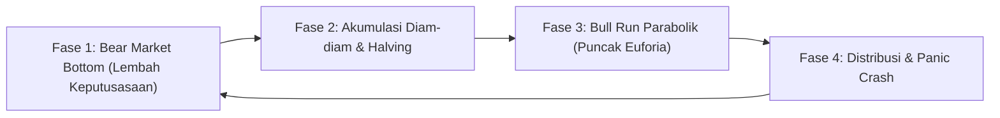
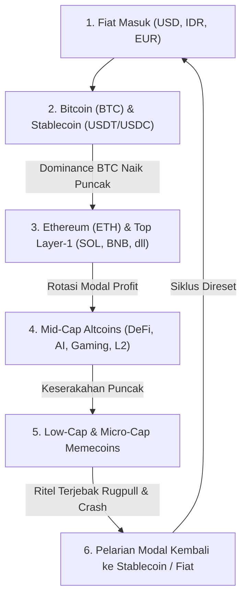
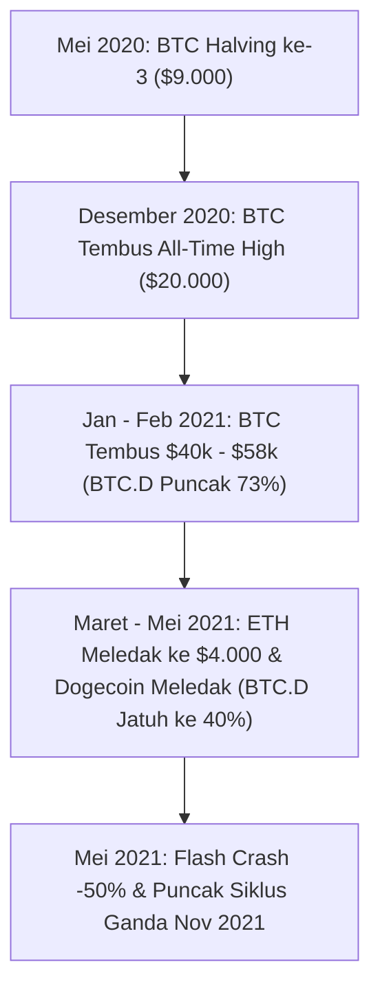

# Bab 2: Pendahuluan #1 (Anatomi Siklus 4-Tahun Bitcoin & Rotasi Likuiditas)

---

## 1. Mengapa Siklus Makro adalah Kompas Utama Trader Kripto?

Banyak trader pemula gagal memahami bahwa **pasar kripto bergerak dalam irama pasang-surut yang sangat terstruktur**. Mereka memperlakukan trading harian seperti menebak lemparan koin di udara, tanpa menyadari apakah mereka sedang berada di musim semi (awal kenaikan), musim panas (puncak euforia), atau musim dingin membeku (bear market).

Jika Anda tidak tahu di mana posisi Anda dalam kalender siklus makro:
- Anda akan membeli altcoin di puncak siklus saat institusi bersiap keluar.
- Anda akan ketakutan dan menjual seluruh aset di dasar siklus (*market bottom*), tepat saat akumulasi institusional dimulai.

Bitcoin (BTC) adalah episentrum gravitasi dari seluruh ekosistem aset digital. Ke mana arah Bitcoin melangkah, 99% altcoin akan mengikutinya dengan amplitudo yang jauh lebih liar. Dan detak jantung dari siklus Bitcoin ini diatur oleh sebuah mekanisme matematis terprogram: **Halving 4 Tahunan**.

---

## 2. Teori Siklus 4-Tahun Bitcoin (Halving & Supply Shock)

Satoshi Nakamoto mendesain moneter Bitcoin dengan prinsip kelangkaan absolut (*hard money*), berbanding terbalik dengan mata uang fiat (seperti Rupiah atau Dolar AS) yang bisa dicetak tanpa batas oleh bank sentral.

### A. Mekanisme Halving
Setiap **210.000 blok** ditambang oleh jaringan penambang (memakan waktu rata-rata sekitar 4 tahun), imbalan blok (*block reward*) yang diberikan kepada miner dipangkas sebesar **50%**.

| Peristiwa Halving | Tahun | Imbalan Blok per 10 Menit | Pasokan BTC Harian Baru |
| :--- | :--- | :--- | :--- |
| **Genesis (Awal)** | 2009 | 50 BTC | 7.200 BTC / hari |
| **Halving 1** | 2012 | 25 BTC | 3.600 BTC / hari |
| **Halving 2** | 2016 | 12.5 BTC | 1.800 BTC / hari |
| **Halving 3** | 2020 | 6.25 BTC | 900 BTC / hari |
| **Halving 4** | 2024 | 3.125 BTC | 450 BTC / hari |
| **Halving 5 (Est.)**| 2028 | 1.5625 BTC | 225 BTC / hari |

### B. Konsep Supply Shock (Kejutan Pasokan)
Hukum dasar ekonomi menyatakan bahwa jika permintaan (*demand*) terhadap suatu barang tetap konstan atau meningkat, sementara pasokan baru yang masuk ke pasar tiba-tiba dipotong setengahnya (*supply shock*), maka **harga secara matematis dipaksa untuk merangkak naik tajam**.

Setelah halving terjadi, efek kelangkaan ini tidak langsung meledak dalam semalam. Butuh waktu sekitar 6 hingga 18 bulan bagi penipisan cadangan bursa (*exchange reserves*) untuk menciptakan gelombang reli parabolik baru.

---

## 3. Empat Fase Makro Siklus Pasar Kripto

Setiap siklus 4 tahunan Bitcoin dapat dibagi menjadi 4 fase psikologis dan likuiditas yang berulang dengan presisi mengejutkan:

### Fase 1: Bear Market Bottom (Lembah Keputusasaan & Kapitulasi)
- **Ciri-ciri**: Terjadi penurunan harga -75% hingga -85% dari puncak tertinggi untuk Bitcoin, dan -95% hingga -99% untuk altcoin.
- **Sentimen**: Media massa menyatakan kripto sudah tamat. Banyak perusahaan kripto besar dan hedge fund bangkrut (seperti kasus runtuhnya Terra-Luna dan FTX pada 2022).
- **Perilaku Ritel**: Ritel mengalami trauma mendalam, menghapus aplikasi bursa, dan mengutuk industri kripto.
- **Aksi Smart Money**: Mengaktifkan pembelian berkala (*Dollar-Cost Averaging*) dalam senyap di rentang harga dasar.

### Fase 2: Akumulasi & Re-Accumulation (Tahun Halving)
- **Ciri-ciri**: Volatilitas mereda, harga bergerak mendatar (*ranging / consolidation*) dalam rentang harga yang lebar selama berbulan-bulan.
- **Sentimen**: Keraguan mendalam (*Disbelief*). Setiap kali harga naik sedikit, ritel mengira itu hanya *dead-cat bounce* (kenaikan tipuan) dan buru-buru menjual.
- **Aksi Smart Money**: Menjaga harga agar tidak meledak terlalu cepat demi mengisi penuh kantong perbendaharaan mereka (*building inventory*).

### Fase 3: Post-Halving Parabolic Run (Musim Bullish Liar)
- **Ciri-ciri**: Penembusan rekor tertinggi lama (*Breakout All-Time High*). Harga naik membentuk tren tangga vertikal tanpa koreksi yang dalam.
- **Sentimen**: Optimisme berubah menjadi keserakahan (*Greed*) dan euforia murni. Ritel baru membanjiri bursa dalam jutaan akun per hari.
- **Aksi Smart Money**: Memulai proses distribusi parsial secara bertahap kepada pembeli baru yang antusias.

### Fase 4: Distribution & Panic Crash (Pemberian Beban ke Pundak Ritel)
- **Ciri-ciri**: Terbentuk pola *Blow-off Top* (kenaikan vertikal gila-gilaan yang langsung disusul penolakan tajam) atau pola konsolidasi gergaji di pucuk (*distribution range*).
- **Sentimen**: Ritel yakin "kali ini siklusnya berbeda, kita akan menuju jutaan dolar!".
- **Aksi Smart Money**: Melepas seluruh sisa inventaris mereka. Begitu Smart Money selesai menjual, likuiditas penopang ditarik, memicu air terjun likuidasi berantai.

---

## 4. Alur Rotasi Likuiditas Kripto (The Money Flow Waterfall)

Uang di pasar kripto tidak membanjiri semua koin secara serempak. Likuiditas bergerak layaknya **air terjun bertingkat (*waterfall*)**, mengalir dari waduk penampungan air terbesar menuju kanal-kanal irigasi yang semakin sempit:

### Tahapan Rotasi Likuiditas:

1. **Tahap 1: Gerbang Masuk Fiat ke Bitcoin (BTC Run)**
   - Modal institusi dan uang segar dari dunia perbankan pertama kali masuk ke Bitcoin karena BTC adalah aset paling aman, paling likuid, dan memiliki regulasi terjelas (ETF spot).
   - Metrik **Bitcoin Dominance (BTC.D)** melesat naik tajam. Altcoin berdarah atau mandek meskipun BTC naik.

2. **Tahap 2: Rotasi ke Ethereum & Mega-Cap Layer-1**
   - Setelah Bitcoin mencetak reli masif dan mulai berkonsolidasi di harga tinggi, keuntungan (*profit*) dari perdagangan Bitcoin dialirkan ke aset dengan kapitalisasi pasar terbesar kedua: Ethereum (ETH), Solana (SOL), dan koin utilitas utama.

3. **Tahap 3: Ledakan Altseason (Mid-Cap Altcoins)**
   - Likuiditas merembes ke sektor-sektor tematik populer: decentralized finance (DeFi), kecerdasan buatan (AI crypto), gaming, dan layer-2. Koin-koin di sektor ini mulai mencatatkan kenaikan +50% hingga +200% dalam hitungan hari.

4. **Tahap 4: Kegilaan Memecoin (Tanda Bahaya Akhir Siklus)**
   - Ketika keserakahan mencapai titik tertinggi, trader tidak lagi memedulikan fundamental, teknologi, atau kertas putih (*whitepaper*). Modal spekulatif mengalir ke koin-koin meme berkepala anjing, kucing, atau karakter lucu tanpa utilitas. Koin bisa naik 100x dalam 24 jam.
   - **Peringatan Kritis**: Ketika koin lelucon tak berguna menjadi trending nomor satu di mana-mana, ini adalah **alarm merah bahwa siklus likuiditas telah mendekati garis akhir**.

5. **Tahap 5: Kapitulasi & Pelarian ke Stablecoin**
   - Ritel yang serakah terjebak membeli memecoin di pucuk. Smart Money menarik likuiditasnya kembali ke Stablecoin (USDT/USDC) atau mencairkannya ke rekening fiat perbankan. Pasar runtuh, mengunci jutaan ritel dalam status *nyangkut*.

---

## 5. Analogi Membumi: Air Terjun Bertingkat ke Sawah Tani

Bayangkan sebuah **Sistem Irigasi Sawah di Pedesaan**:

- **Danau Utama di Gunung (Bitcoin)**: Memiliki volume air paling melimpah. Ketika pintu air dibuka, air mengalir deras memenuhi danau utama terlebih dahulu.
- **Sungai Primer (Ethereum & Top L1)**: Luapan air dari danau utama mulai mengairi sungai-sungai besar di bawahnya.
- **Kanal Irigasi Desa (Mid-Cap Altcoins)**: Air mengalir mengairi parit-parit desa. Tanaman padi mulai tumbuh subur.
- **Petak Sawah Paling Ujung (Memecoins & Low-Caps)**: Petak sawah terpencil ini hanya mendapat air jika banjir bandang meluap hebat. Petak ini cepat sekali basah, namun airnya juga paling pertama mengering dan menguap saat kemarau datang.

Jika Anda menaruh bibit padi Anda hanya di petak sawah paling ujung tanpa menyadari bahwa pintu air utama di danau gunung sudah ditutup oleh sang penguasa air (Whale), tanaman modal Anda dipastikan mati kekeringan!

---

## 6. Glosarium Pemula Bab 2

Kuasai istilah-istilah siklus makro berikut:

1. **Bitcoin Halving**: Peristiwa pemotongan 50% imbalan penambangan Bitcoin yang terjadi secara otomatis setiap 210.000 blok (kurang lebih setiap 4 tahun sekali).
2. **Bitcoin Dominance (BTC.D)**: Persentase perbandingan antara kapitalisasi pasar Bitcoin terhadap total seluruh kapitalisasi pasar kripto dunia.
3. **Altseason (Alternative Coin Season)**: Periode emas di mana mayoritas altcoin mengungguli kinerja persentase kenaikan Bitcoin secara signifikan.
4. **Supply Shock**: Kejadian di mana pasokan suatu aset di pasar mendadak berkurang drastis sementara permintaan pembeli tetap tinggi atau bertambah.
5. **Stablecoin**: Aset kripto yang nilainya dipatok 1:1 terhadap mata uang fiat (contoh: USDT, USDC, FDUSD) yang berfungsi sebagai tempat berlindung dari volatilitas.
6. **Market Capitalization (Market Cap)**: Total nilai pasar dari sebuah koin, dihitung dari formula: $\text{Harga Koin} \times \text{Jumlah Koin Beredar}$.
7. **Dead-Cat Bounce**: Kenaikan harga sementara yang terjadi di tengah tren penurunan tajam (*bear market*), yang sering menjebak pembeli sebelum harga anjlok lebih dalam lagi.

---

## 7. Studi Kasus Historis: Anatomi Siklus 2020 - 2021

Untuk melihat rotasi ini secara nyata, mari kita kaji data siklus 2020–2021:

1. **Mei 2020**: Bitcoin mengalami halving ke-3 di harga sekitar $9.000. Publik bersikap dingin dan skeptis karena dunia sedang dilanda pandemi Covid-19.
2. **Kuartal 4 2020**: Pasokan BTC di bursa mulai mengering. Institusi seperti MicroStrategy dan Tesla mulai membeli miliaran dolar BTC. Harga melesat dari $10.000 menembus $20.000 (rekor 2017).
3. **Awal 2021**: Bitcoin Dominance menyentuh angka 73%. Bitcoin menjadi raja panggung, sementara altcoin belum banyak bergerak.
4. **April - Mei 2021 (Altseason Puncak)**: Bitcoin mulai melambat di $60.000. Likuiditas meluncur deras ke Ethereum (naik dari $1.000 ke $4.000) dan Dogecoin (naik ribuan persen hingga dipromosikan di acara TV nasional AS).
5. **Kehancuran**: Hanya berselang hitungan hari setelah hype Dogecoin di televisi, seluruh pasar ambruk lebih dari 50% dalam hitungan hari. Trader ritel yang baru membeli altcoin di bulan Mei kehilangan tabungan mereka seketika.

---

## 8. Newbie Traps: Perangkap Siklus yang Menghabisi Modal Pemula

### Perangkap #1: Menikahi Koin (Marrying Your Bag)
Pemula sering jatuh cinta secara emosional pada proyek koin tertentu karena membaca kertas putihnya atau terpesona oleh figur foundernya. Mereka menolak menjual koin tersebut bahkan ketika siklus bull market sudah berakhir.
*Hukum SMC*: Koin hanyalah instrumen spekulasi untuk menghasilkan keuntungan. Tidak ada koin yang kebal dari gravitasi bear market. Amankan keuntungan (*Take Profit*) ke dalam Stablecoin atau fiat secara teratur!

### Perangkap #2: Mengira Altcoin Murah Hanya Karena Harganya di Bawah Rp 100
Melihat koin X berharga Rp 10 per butir, pemula berpikir: *"Kalau koin ini naik ke Rp 1.000 saja, saya sudah kaya raya!"*. Mereka tidak paham konsep **Market Cap** dan jumlah pasokan yang beredar (*circulating supply*). Jika pasokan koin tersebut ada 10 triliun butir, maka untuk mencapai Rp 1.000 dibutuhkan uang yang lebih besar dari cadangan devisa negara.
*Hukum SMC*: Evaluasi aset berdasarkan Market Cap dan Fully Diluted Valuation (FDV), bukan dari harga nominal per butir koinnya!

### Perangkap #3: Membeli Altcoin Saat Bitcoin Sedang Terjun Bebas
Ketika Bitcoin turun tajam, pemula melihat altcoin turun -30% dan menganggapnya sebagai "diskon besar".
*Hukum SMC*: Ketika Bitcoin batuk, altcoin terkena pneumonia. Jangan pernah menangkap pisau jatuh pada altcoin ketika struktur Bitcoin di timeframe tinggi sedang mengalami kerusakan (*bearish breakdown*).

### Perangkap #4: Mengabaikan Metrik Bitcoin Dominance (BTC.D)
Membeli altcoin secara agresif pada saat tren BTC.D sedang naik vertikal.
*Hukum SMC*: Ketika BTC.D sedang melesat kuat, sebagian besar altcoin akan berdarah terhadap nilai pairing BTC mereka (ALT/BTC). Tunggu hingga BTC.D mencapai area *resistance* makro dan mulai berbelok turun sebelum Anda memburu eksposur altcoin.

---

## Rangkuman Inti Bab 2
1. Siklus kripto dipandu oleh mekanisme Halving Bitcoin 4-tahunan yang memicu *supply shock*.
2. Empat fase makro pasar adalah: **Bear Market Bottom $\rightarrow$ Akumulasi $\rightarrow$ Bull Run Parabolik $\rightarrow$ Distribusi & Panic Crash**.
3. Likuiditas mengalir secara bertahap: dari **Fiat $\rightarrow$ Bitcoin $\rightarrow$ Ethereum & Top L1 $\rightarrow$ Mid-Cap Altcoins $\rightarrow$ Low-Cap Memecoins $\rightarrow$ Kembali ke Stablecoin**.
4. Pahami posisi Anda dalam siklus, jangan pernah menjadi pembeli terakhir di gerbong kereta yang hendak masuk jurang!
