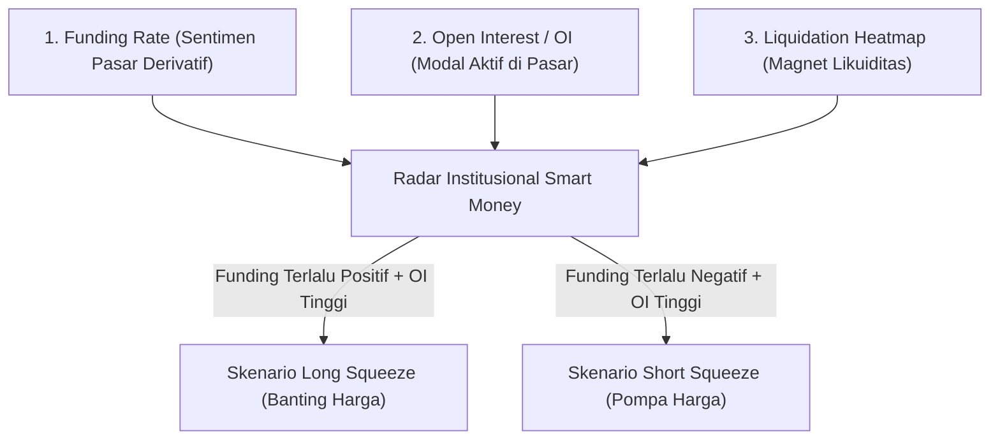
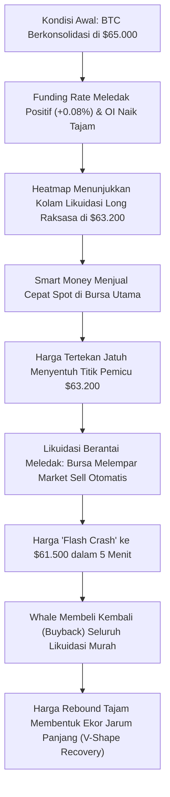

# Bab 3: Pendahuluan #2 (Order Flow Kripto, CEX/DEX & Heatmap Likuidasi)

---

## 1. Menembus Ilusi Chart Lilin (Candlestick)

Bagi mata trader pemula, chart harga hanyalah susunan batang lilin (*candlestick*) berwarna hijau dan merah yang bergerak acak. Mereka menggambar garis-garis tren imajiner, segitiga, dan pola kepala-dan-pundak (*Head and Shoulders*), berharap masa depan dapat ditebak dari geometri masa lalu.

Namun bagi Smart Money, candlestick hanyalah **jejak visual dari eksekusi pesanan (*Order Flow*)**. 

Harga suatu aset tidak naik karena ada garis garis tren yang indah. **Harga naik karena agresivitas pesanan beli pasar melahap seluruh persediaan pesanan jual yang tersedia**. Sebaliknya, harga turun karena pesanan jual pasar melindas seluruh antrean pesanan beli.

Untuk memahami bagaimana pasar kripto beroperasi di balik layar, kita harus menyelami dapur mekanisnya: pertukaran CEX vs DEX, pasar Spot vs Perpetuals (Futures), Order Book, dan metrik institusional seperti Funding Rates, Open Interest, serta Liquidation Heatmap.

---

## 2. Ekosistem Pertukaran: Centralized Exchange (CEX) vs Decentralized Exchange (DEX)

Pasar kripto terbelah menjadi dua arena utama perdagangan:

| Karakteristik | Centralized Exchange (CEX) | Decentralized Exchange (DEX) |
| :--- | :--- | :--- |
| **Contoh Platform** | Binance, Bybit, OKX, Coinbase, Indodax | Uniswap, Raydium, PancakeSwap, GMX |
| **Penguasaan Dana** | Kustodian bursa (*Not your keys, not your coins*) | Dompet pribadi non-kustodial (MetaMask, Phantom) |
| **Pencocokan Pesanan** | Mesin pencocok terpusat (*Central Limit Order Book*) | Automated Market Maker (AMM) / Smart Contract Pool |
| **Biaya & Kecepatan** | Sangat cepat (mikrodetik), fee trading rendah | Tergantung kemacetan rantai blok & gas fee jaringan |
| **Manipulasi & Transparansi** | Transaksi internal bursa bersifat *off-chain* (tertutup) | Semua transaksi tercatat publik di *blockchain ledger* |
| **Instrumen Utama** | Spot, Derivatif Berjangka (Futures), Leverage tinggi | Swap Spot instan, Liquidity Pool staking, Perps on-chain |

Sebagai penganut Smart Money Concept, Anda harus menyadari bahwa volume perdagangan terbesar di dunia kripto (lebih dari 80%) saat ini masih dieksekusi di **CEX terpusat**, di mana bandar bursa memiliki visibilitas sempurna terhadap buku pesanan dan posisi margin para penggunanya.

---

## 3. Spot Market vs Pasar Derivatif (Perpetual Futures)

Dua pasar ini memiliki dinamika fundamental yang sangat berbeda:

### A. Spot Market (Pasar Fisik/Tunai)
Di pasar spot, Anda membeli aset dasar yang sebenarnya. Jika Anda membeli 1 Bitcoin seharga $60.000, Anda menyerahkan $60.000 tunai dan menerima 1 BTC fisik ke dalam dompet Anda.
- **Risiko Likuidasi**: **Nol (0%)**. Sekalipun harga Bitcoin turun ke $10.000, Anda tetap memiliki 1 keping Bitcoin. Anda tidak bisa dipaksa bangkrut oleh bursa selama Anda tidak menjualnya secara manual.

### B. Perpetual Futures (Pasar Kontrak Tanpa Batas Waktu)
Di pasar perpetual futures (disingkat *Perps*), Anda tidak membeli atau menjual koin sungguhan. Anda memperdagangkan **kontrak perjanjian harga** yang memprediksi apakah harga aset akan naik (*Long*) atau turun (*Short*).
- **Mekanisme Margin**: Anda hanya menyetorkan uang jaminan (*Collateral/Margin*), lalu bursa meminjamkan daya ungkit (*Leverage*).
- **Risiko Likuidasi**: **Sangat Tinggi**. Jika pasar bergerak berlawanan dengan arah posisi Anda melebihi batas toleransi margin, bursa akan menutup paksa posisi Anda secara otomatis dan menyita modal Anda (*Liquidation Event*).

---

## 4. Anatomi Order Book: Bids, Asks, dan Mesin Lelang

Pasar finansial pada dasarnya adalah sebuah **pasar lelang kontinu**.

```
[ASKS - Antrean Penjual (Limit Sell)] -> Ingin jual setinggi mungkin
$61.200 : [15.5 BTC]
$61.100 : [28.2 BTC]
$61.000 : [45.0 BTC]  <-- Harga Penawaran Terendah (Best Ask)
-----------------------------------------------------------  Spreed Harga
$60.950 : [50.0 BTC]  <-- Harga Permintaan Tertinggi (Best Bid)
$60.900 : [32.1 BTC]
$60.800 : [18.4 BTC]
[BIDS - Antrean Pembeli (Limit Buy)]  -> Ingin beli semurah mungkin
```

### Dua Jenis Pesanan Utama:
1. **Limit Orders (Penyedia Likuiditas / Passive Orders)**: 
   - Pesanan yang mengantre di buku order pada harga tertentu. Mereka tidak langsung dieksekusi sampai ada orang lain yang bersedia mencocokkan harganya.
2. **Market Orders (Pengambil Likuiditas / Aggressive Orders)**: 
   - Pesanan instan yang langsung mengeksekusi harga terbaik yang tersedia saat itu di buku order. Pesanan inilah yang menggeser jarum harga naik atau turun.

> **Hukum SMC**: Lilin harga bergerak BUKAN karena banyaknya order limit yang berjejer, melainkan karena ada **Volume Agresif (Market Order) yang melahap habis lapisan antrean limit** di sisi berlawanan!

---

## 5. Tiga Metrik Vital Institusi: Membaca Dapur Pasar Kripto

Untuk mengetahui apa yang sedang direncanakan oleh Smart Money, kita wajib memantau 3 metrik derivatif utama:



### 1. Funding Rate (Biaya Pendanaan)
Karena kontrak perpetual tidak memiliki tanggal kedaluwarsa, bursa menciptakan mekanisme **Funding Rate** untuk menjaga agar harga kontrak futures tidak melenceng terlalu jauh dari harga spot aslinya. Biaya ini dibayarkan antar-trader setiap 8 jam sekali:
- **Funding Rate Positif (Hijau/Tinggi)**: Posisi *Long* jauh lebih mendominasi daripada *Short*. Trader yang memasang Long wajib membayar bunga kas berkala kepada trader Short. Ini mencerminkan pasar yang sedang **terlalu rakus dan kepedean (*Over-leveraged Greed*)**.
- **Funding Rate Negatif (Merah/Rendah)**: Posisi *Short* jauh lebih mendominasi daripada *Long*. Trader Short wajib membayar bunga kepada trader Long. Ini mencerminkan pasar yang sedang **terlalu pesimis dan panik (*Over-leveraged Fear*)**.

### 2. Open Interest (OI)
Open Interest adalah **jumlah total nilai kontrak derivatif (Long dan Short) yang saat ini masih terbuka dan aktif** di bursa, belum diselesaikan atau ditutup.
- **Harga Naik + OI Naik Tajam**: Uang baru sedang mengalir deras membuka posisi spekulatif agresif. Pasar sedang membangun tenaga ledakan besar.
- **Harga Turun + OI Turun Drastis**: Posisi-posisi leverage sedang dibasmi dan dipaksa likuidasi. Terjadi *deleveraging massal*.

### 3. Liquidation Heatmap (Peta Panas Likuidasi)
Bursa kripto adalah sistem komputasi yang mencatat secara presisi di harga berapa setiap pengguna akan terlikuidasi. Data ini divisualisasikan oleh perangkat lunak analisis (seperti Coinglass atau Kingfisher) sebagai **Peta Panas Likuidasi (Liquidation Heatmap)**.
- Tingkat likuidasi bertindak sebagai **magnet raksasa bagi harga**. 
- Mengapa? Karena ketika posisi terlikuidasi, bursa secara otomatis melempar *Market Order* darurat untuk menutup posisi tersebut. Bagi Market Maker, area dengan jutaan dolar likuidasi adalah **sumber likuiditas instan terbesar** untuk memenuhi pesanan institusi mereka.

---

## 6. Analogi Membumi: Pasar Pelelangan Ikan vs Tiket Pacuan Kuda

Bayangkan sebuah kota pelabuhan nelayan:

1. **Pasar Ikan Fisik (Spot Market)**:
   - Nelayan membawa tong berisi ikan tongkol segar. Ibu rumah tangga dan pemilik restoran datang membawa uang tunai, menawar, dan membawa pulang tongkol asli untuk dimasak. Tidak ada utang, tidak ada margin, tidak ada risiko ikan hilang dari kantong.

2. **Warung Taruhan di Seberang Pelabuhan (Perpetual Futures)**:
   - Di seberang pelabuhan, para penjudi berkumpul bertaruh pada pertanyaan: *"Apakah harga sekilo tongkol besok pagi akan lebih mahal dari Rp 50.000?"*.
   - Bandar taruhan mengizinkan pemain bertaruh Rp 10 juta hanya dengan modal jaminan Rp 100.000 (leverage 100x).
   - Jika tebakan meleset Rp 500 saja, bandar langsung menyita seluruh uang taruhan si penjudi.
   - Yang mengerikan: sang bandar taruhan memiliki koneksi dengan pemilik kapal nelayan besar, dan sengaja membeli borong seluruh ikan di pelelangan fisik hanya untuk mempermainkan harga agar para penjudi di warungnya bangkrut seketika!

---

## 7. Glosarium Pemula Bab 3

Pahami istilah-istilah order flow berikut:

1. **CEX (Centralized Exchange)**: Bursa aset digital terpusat yang dikelola oleh korporasi tunggal (contoh: Binance, Indodax).
2. **DEX (Decentralized Exchange)**: Protokol pertukaran peer-to-peer terdesentralisasi yang berjalan di atas smart contract blockchain tanpa perantara institusi.
3. **Perpetual Contract (Perps)**: Kontrak perdagangan derivatif berjangka di kripto yang tidak memiliki batas waktu jatuh tempo (*expiry date*).
4. **Funding Rate**: Mekanisme pembayaran bunga berkala antara trader posisi long dan short untuk menjaga keseimbangan harga futures terhadap pasar spot.
5. **Open Interest (OI)**: Nilai total akumulasi dari seluruh kontrak derivatif yang masih terbuka di pasar pada waktu tertentu.
6. **Liquidation (Likuidasi)**: Penutupan paksa posisi perdagangan leverage oleh bursa akibat margin jaminan tidak lagi mencukupi untuk menanggung kerugian yang terjadi.
7. **Long Squeeze**: Fenomena jatuhnya harga secara mendadak akibat banyaknya order stop-loss dan likuidasi dari para trader posisi Long yang terpicu secara beruntun.
8. **Short Squeeze**: Fenomena lonjakan harga tajam secara mendadak akibat para trader posisi Short dipaksa membeli kembali aset untuk menutup posisi mereka yang merugi atau terlikuidasi.

---

## 8. Studi Kasus Konkret: Rekayasa Long Squeeze pada Bitcoin

Mari kita bedah peristiwa klasik bagaimana Smart Money mengeksekusi aksi pembantaian likuiditas (*Liquidation Hunt*):



### Kronologi Skenario:
1. **Penumpukan Posisi Serakah**: Bitcoin bergerak santai di kisaran $65.000. Ritel merasa sangat percaya diri bahwa harga akan terbang ke $70.000. Ribuan trader ritel membuka posisi *Long* dengan leverage 20x hingga 50x.
2. **Gejala Abnormal di Data**: Funding rate melonjak sangat tinggi. Peta likuidasi (*Liquidation Heatmap*) menunjukkan ada lebih dari $800 juta likuidasi posisi long yang bertumpuk rapi tepat di bawah level support psikologis $63.200.
3. **Aksi Serangan Paus**: Whale tidak perlu membuang modal besar untuk menghancurkan pasar secara permanen. Mereka hanya perlu melakukan penjualan spot agresif sesaat senilai $50 juta untuk menekan harga turun menembus $63.200.
4. **Efek Domino Likuidasi**: Begitu level $63.200 tersentuh, sistem otomatis bursa mulai mengeksekusi likuidasi paksa ratusan juta dolar posisi long ritel. Ingat: **Likuidasi posisi Long dieksekusi oleh bursa sebagai Market Order SELL**.
5. **Air Terjun Penjualan Otomatis**: Pesanan jual paksa dari bursa ini menabrak sisa order beli di order book, membanting harga lebih dalam lagi hingga $61.500 hanya dalam tempo 5 menit.
6. **Panen Raya Whale**: Di harga $61.500, sang Whale sudah memasang antrean *Limit Buy* besar untuk menampung seluruh koin yang diobral paksa oleh bursa dari akun ritel yang hangus.
7. **Hasil Akhir**: Chart 1-jam ditutup meninggalkan bayangan ekor bawah (*wick*) yang sangat panjang. Ritel menangis modalnya lenyap, sementara Whale tersenyum membawa pulang koin diskon dalam jumlah masif.

---

## 9. Newbie Traps: Perangkap Order Flow yang Mematikan

### Perangkap #1: Membuka Posisi Long Saat Funding Rate Sangat Tinggi
Pemula melihat harga naik kencang dan langsung ikut *Long*, tanpa memeriksa bahwa funding rate tahunan sudah mencapai +100% atau lebih.
*Hukum SMC*: Funding rate yang terlalu mahal adalah indikasi bahwa pasar sudah jenuh dengan spekulan Long. Pasar seperti perahu yang terlalu miring ke kanan dan siap terbalik seketika (*Long Squeeze*).

### Perangkap #2: Mengira Support Tebal di Order Book Selalu Aman (*Spoofing Trap*)
Melihat ada antrean beli (*Bid*) sebanyak 1.000 BTC di harga $60.000 pada layar bursa, pemula merasa aman dan langsung membeli tepat di atasnya.
*Hukum SMC*: Antrean limit order palsu (*Spoofing*) sangat sering dipasang oleh bot manipulasi untuk memberi rasa aman semu kepada ritel. Begitu harga mendekati level tersebut, antrean 1.000 BTC itu akan dibatalkan dalam 1 milidetik, membiarkan harga ambles menembus support tanpa perlawanan.

### Perangkap #3: Memasang Stop Loss di Tempat yang Terlalu Rapi & Jelas
Menaruh Stop Loss tepat 1 dolar di bawah level swing low yang terlihat jelas oleh jutaan orang di seluruh dunia.
*Hukum SMC*: Di mana ada kerumunan Stop Loss ritel, di situlah bursa dan Market Maker melihat pesta likuidasi gratis. Stop Loss ritel adalah target buruan utama institusi sebelum mereka membawa harga ke arah yang sesungguhnya.

---

## Rangkuman Inti Bab 3
1. Pasar kripto digerakkan oleh *Order Flow* (agresivitas Market Order melibas Limit Order di Order Book), bukan oleh garis-garis gambar manual.
2. Pasar futures perpetual mendominasi volume kripto, di mana posisi leverage membawa risiko likuidasi paksa.
3. Funding Rate, Open Interest, dan Liquidation Heatmap adalah alat rontgen yang memungkinkan Anda melihat titik-titik jebakan dan magnet likuiditas yang diincar oleh Smart Money.
