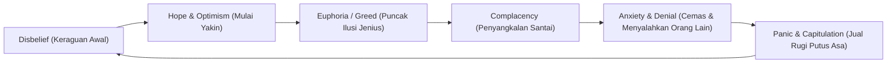
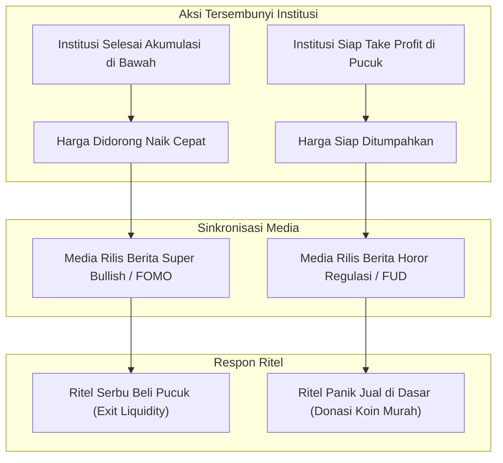
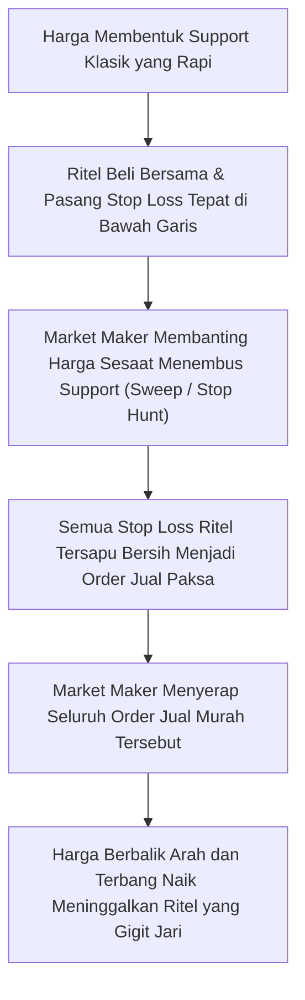
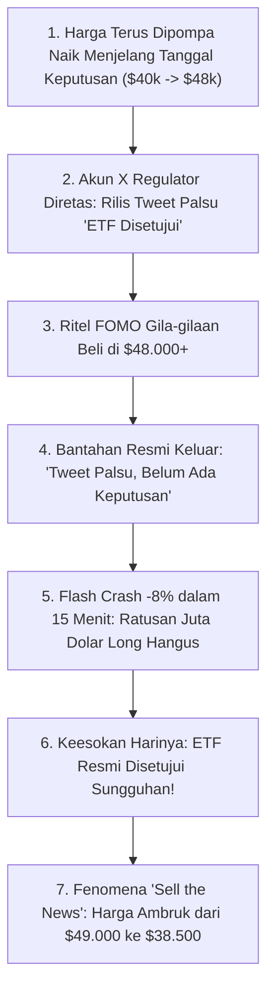

# Bab 4: Pendahuluan #3 (Psikologi Ritel vs Jebakan Market Maker)

---

## 1. Medan Perang Finansial Adalah Medan Perang Pikiran

Sebuah pepatah klasik di pasar finansial menyatakan:
> *"Pasar adalah alat untuk memindahkan modal dari orang yang tidak sabar dan emosional kepada orang yang tenang dan memiliki rencana."*

Kebanyakan orang mengira kekalahan mereka dalam trading disebabkan oleh kurangnya indikator teknikal di layar mereka. Mereka menghabiskan waktu berbulan-bulan mencari "indikator ajaib" (*Holy Grail*) yang bisa memberikan sinyal 100% akurat. 

Namun fakta psikologis membuktikan sebaliknya: **Musuh terbesar seorang trader bukanlah chart atau pergerakan harga, melainkan biologi otak mereka sendiri**. 

Otak manusia berevolusi ribuan tahun untuk bertahan hidup di alam liar dengan insting mencari rasa aman dalam kawanan (*herd mentality*) dan menghindari ancaman secara instan. Ironisnya, di pasar finansial, **setiap insting alamiah manusia tersebut bekerja 180 derajat terbalik**:
- Ketika kawanan merasa aman dan gembira (di pucuk pasar), di situlah bahaya kehancuran berada.
- Ketika kawanan merasa ketakutan setengah mati (di dasar jurang pasar), di situlah peluang kekayaan terbesar terbentang.

Market Maker dan Smart Money sangat memahami psikologi neuro-sains ini. Mereka tidak hanya merancang strategi pergerakan likuiditas, tetapi juga **secara aktif merekayasa emosi massa** agar ritel bertindak persis sesuai skenario yang menguntungkan institusi.

---

## 2. Siklus Emosi Investor Ritel: Peta Perjalanan Menuju Kehancuran

Perjalanan emosional seorang trader ritel yang tidak terlatih mengikuti kurva psikologis klasik yang dikenal sebagai *The Wall Street Cheat Sheet*:

### Bedah Tahapan Siklus Emosi:

1. **Disbelief (Ketidakpercayaan)**:
   - Pasar mulai bangkit dari dasar bear market. Ritel berkata: *"Ah, ini cuma dead-cat bounce murahan, nanti juga jatuh ke nol lagi. Jangan beli!"*. Smart Money mulai menyerap barang.
2. **Hope & Optimism (Harapan dan Optimisme)**:
   - Harga terus merangkak naik dan menembus resistance kunci. Ritel mulai melirik: *"Wah, sepertinya pemulihannya nyata. Beli sedikit ah."*
3. **Euphoria (Euforia / Puncak Keserakahan)**:
   - Harga mencetak rekor tertinggi baru secara eksponensial. Ritel merasa dirinya adalah trader jenius. Mereka meminjam uang, menggunakan leverage maksimal, dan membeli setiap koin yang disebut di media sosial. Di sinilah ritel berteriak: *"Kali ini berbeda, kripto akan menggantikan seluruh uang dunia tahun depan!"*.
4. **Complacency (Puas Diri / Terlena)**:
   - Terjadi koreksi tajam pertama dari puncak. Ritel tersenyum santai: *"Santai saja, ini cuma koreksi sehat sebelum terbang ke angkasa lagi."* Mereka menolak mengambil keuntungan (*take profit*).
5. **Anxiety & Denial (Kecemasan dan Penyangkalan)**:
   - Harga terus merosot turun menembus titik modal awal mereka. Kerugian belum direalisasikan (*floating loss*) membengkak. Ritel mulai mencari pembenaran di grup Telegram: *"Proyek ini fundamentalnya bagus, developer-nya doxxed, saya HODL untuk anak cucu!"*.
6. **Panic & Capitulation (Kepanikan dan Menyerah Total)**:
   - Berita buruk bermunculan serentak di media. Harga terjun bebas tak terbendung. Ketakutan akan kehilangan seluruh uang simpanan membuat psikologis ritel hancur. Mereka menekan tombol *Sell All* di dasar jurang hanya demi bisa tidur nyenyak.
7. **Siklus Reset**: Begitu mayoritas ritel selesai menjual koin mereka di dasar lembah (*Capitulation*), tekanan jual di pasar habis. Smart Money kembali masuk menampung koin murah tersebut, dan siklus kembali berulang ke fase *Disbelief*.

---

## 3. Manipulasi Berita Media: Koreografi FUD & FOMO

Salah satu kebohongan terbesar yang dipercayai oleh trader pemula adalah: *"Berita menggerakkan arah harga pasar"*.

Di dalam paradigma Smart Money Concept: **Harga digerakkan terlebih dahulu oleh pesanan institusi, baru kemudian berita media dirilis sebagai alat justifikasi naratif untuk memancing likuiditas ritel!**

### Anatomi Narasi Media:
- **Di Puncak Siklus (Distribusi)**: Media arus utama serentak menampilkan artikel tentang bank multinasional yang membuka meja perdagangan kripto, miliarder yang membeli koin, atau negara baru yang mengadopsi kripto. Narasi ini dirancang untuk menciptakan **FOMO instan** agar ritel rela membeli koin di harga termahal dalam sejarah.
- **Di Dasar Siklus (Akumulasi)**: Media memberitakan ancaman pelarangan total oleh pemerintah, investigasi kriminal bursa, atau rumor kebangkrutan aset cadangan. Tujuannya adalah menciptakan **FUD ekstrem** agar ritel melepaskan koin terakhir mereka dengan diskon 85%.

---

## 4. Mengapa Garis Support & Resistance Buku Teks Kerap Menjadi Sarang Jebakan?

Buku-buku panduan analisis teknikal konvensional mengajarkan aturan sederhana:
> *"Belilah saat harga menyentuh Support, dan pasang Stop Loss beberapa pips tepat di bawah garis Support tersebut."*

Pertanyaannya: **Jika jutaan trader di seluruh dunia diajarkan teori yang sama persis oleh buku teks yang sama, di mana jutaan Stop Loss tersebut akan berkumpul?**

Tepat di bawah garis Support tersebut!

Dan apa hakikat dari perintah Stop Loss untuk posisi beli (Buy)? Stop Loss untuk posisi Buy adalah **Market Order SELL**.

Bagi Market Maker yang membutuhkan jutaan dolar likuiditas jual untuk menutup posisi atau mengumpulkan koin dalam partai besar, kumpulan Stop Loss ritel di bawah support klasik bagaikan **kolam madu yang menggiurkan**.

Pola pembersihan ini dalam Smart Money Concept dikenal sebagai **Liquidity Sweep (Penyapuan Likuiditas)** atau **Turtle Soup**. Buku teks ritel menyebutnya sebagai *false breakout*, namun bagi SMC, ini adalah **operasi terencana institusi untuk mengumpulkan pasokan bahan bakar**.

---

## 5. Analogi Membumi: Umpan Cacing Kail Pancing vs Ikan Lapar

Bayangkan Anda sedang memancing di sebuah danau yang luas:

1. **Sang Nelayan (Market Maker)**:
   - Nelayan tidak menceburkan diri ke dalam air untuk mengejar ikan satu per satu.
   - Nelayan memasang seekor cacing merah yang gemuk dan bergoyang lincah di ujung kail tajam (Umpan: Pola breakout lilin hijau atau garis support rapi).
   - Nelayan melempar kail ke tempat ikan-ikan kecil biasa berkumpul.

2. **Ikan-Ikan Kecil (Trader Ritel)**:
   - Ikan kecil melihat cacing dan hanya berpikir satu hal: *"Makanan gratis yang lezat! Kalau aku tidak cepat menyambarnya, temanku yang lain akan memakannya!"* (FOMO).
   - Ikan menyambar cacing tersebut dengan rakus.
   - Sesaat kemudian, kail tersentak tajam menembus bibirnya, dan ikan tersebut ditarik keluar dari air untuk menjadi hidangan malam sang nelayan.

Setiap kali Anda melihat pola grafik buku teks yang terlihat "terlalu mudah dan terlalu indah untuk menjadi kenyataan", tanyakan pada diri Anda: **Apakah saya sedang melihat cacing pancingan, ataukah saya sedang melihat arus air yang sebenarnya?**

---

## 6. Glosarium Pemula Bab 4

Kuasai istilah-istilah perangkap psikologis ini:

1. **Capitulation (Kapitulasi)**: Momen keputusasaan ekstrem di mana investor dan trader ritel menyerah secara massal dan menjual seluruh portofolio mereka dalam keadaan rugi besar.
2. **Complacency**: Kondisi rasa puas diri dan keyakinan semu pada trader saat terjadi penurunan pertama dari puncak siklus, mengira tren naik akan segera berlanjut.
3. **Liquidity Trap (Jebakan Likuiditas)**: Kondisi pasar yang sengaja dimanipulasi untuk memicu order beli atau jual trader ritel ke arah yang salah sebelum harga berbalik tajam.
4. **Liquidity Sweep (Penyapuan Likuiditas)**: Pergerakan harga agresif yang menembus level penting (high/low lama) hanya untuk menyerap Stop Loss dan likuidasi sebelum berbalik arah.
5. **Smart Money vs Dumb Money**: Istilah pasar finansial untuk membedakan modal institusional berpengalaman yang beroperasi secara metodis (*Smart Money*) dengan modal spekulatif ritel yang digerakkan oleh emosi sesaat (*Dumb Money*).
6. **Fakeout (Breakout Palsu)**: Pergerakan harga yang seolah-olah menembus garis resistance/support penting untuk menarik pembeli/penjual breakout, yang segera disusul oleh pembalikan arah drastis.

---

## 7. Studi Kasus Konkret: Rekayasa Berita Persetujuan ETF Bitcoin

Pada awal tahun 2024, menjelang persetujuan resmi ETF Spot Bitcoin di Amerika Serikat, dunia menyaksikan pertunjukan perangkap likuiditas berita paling nyata di zaman modern:

### Anatomi Perangkap "Sell The News":
1. **Pembangunan Ekspektasi**: Selama berbulan-bulan, Smart Money membeli Bitcoin di kisaran $25.000 hingga $35.000 dengan narasi adopsi ETF institusional.
2. **Puncak Kejadian**: Ketika pengumuman persetujuan resmi benar-benar dirilis, jutaan ritel berpikir: *"Sekarang BlackRock dan Wall Street sudah masuk secara resmi, Bitcoin tidak mungkin turun lagi! Ayo beli sekarang di $49.000!"*.
3. **Penyergapan Institusi**: Siapa yang menjual koin kepada ritel di $49.000 tersebut? Smart Money dan dana besar (seperti Grayscale GBTC) yang merealisasikan miliaran dolar keuntungan mereka!
4. **Hasil Akhir**: Ritel yang membeli di hari pengumuman bersejarah tersebut langsung mengalami penurunan portofolio hingga ke level $38.500 dalam tempo dua pekan, membuat banyak pemula panik cutloss sebelum reli sejati dimulai berbulan-bulan kemudian.

---

## 8. 4 Newbie Traps: Perangkap Psikologi Ritel

### Perangkap #1: Berdagang Berdasarkan Judul Berita Utama (Trading The Headlines)
Membaca berita "Aset X Bermitra dengan Perusahaan Raksasa Y" di portal berita, lalu langsung membuka bursa untuk membeli koin tersebut.
*Hukum SMC*: Pada saat sebuah berita positif sampai ke layar ponsel Anda melalui media gratisan, berita tersebut sudah basi dan harganya sudah selesai dipompa oleh institusi berjam-jam atau berhari-hari sebelumnya. Anda hanya datang untuk mencuci piring kotor pesta orang lain!

### Perangkap #2: Mentalitas Balas Dendam (Revenge Trading)
Setelah mengalami kerugian akibat tersapu stop-loss, pemula merasa terhina dan emosional. Mereka langsung membuka posisi baru dengan ukuran lot dua kali lipat lebih besar tanpa analisa terstruktur demi mengembalikan uang yang hilang secepatnya.
*Hukum SMC*: Pasar tidak memiliki perasaan personal terhadap Anda. Revenge trading adalah jaminan kilat untuk menghanguskan sisa portofolio Anda dalam hitungan menit.

### Perangkap #3: Mengabaikan Rencana Trading Saat Masuk Posisi (No Trade Plan)
Membuka posisi hanya karena "merasa harga sudah murah", tanpa menentukan di mana titik invalidasi (*Stop Loss*), di mana target pengambilan keuntungan (*Take Profit*), dan berapa rasio risiko terhadap keuntungan (*Risk-to-Reward Ratio*).
*Hukum SMC*: Jika Anda tidak memiliki rencana keluar sebelum masuk, pasar akan memaksa Anda keluar di titik paling menyakitkan bagi dompet Anda.

### Perangkap #4: Mengubah Posisi Scalping Menjadi "Investor Jangka Panjang"
Awalnya membuka posisi trading cepat untuk mengambil keuntungan 2%, namun ketika harga turun berlawanan arah dan menembus batas toleransi, pemula menolak cutloss dan berkata: *"Tidak apa-apa, saya ganti status jadi investor jangka panjang saja."*
*Hukum SMC*: Ini adalah bentuk pertahanan ego yang paling destruktif. Koin yang strukturnya rusak bisa terus turun -90% dan tidak pernah kembali lagi ke harga modal Anda.

---

## Rangkuman Inti Bab 4
1. Musuh terbesar dalam trading bukan grafik harga, melainkan bias psikologis bawaan manusia (*FOMO*, *Greed*, *Fear*, dan *Ego*).
2. Smart Money memanfaatkan psikologi massa dan siklus berita (FUD/FOMO) untuk merekayasa *Exit Liquidity*.
3. Support dan Resistance klasik buku teks sering dijadikan sarang jebakan empuk (*Liquidity Sweep*) sebelum harga bergerak ke arah yang sesungguhnya.
4. Kuasai diri Anda sebelum mencoba menguasai pasar; berpikirlah seperti operator yang tenang, bukan seperti domba yang mengikuti kawanan ke rumah jagal!
