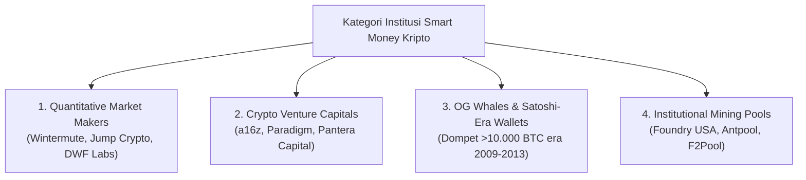
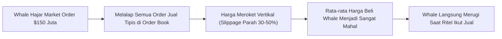
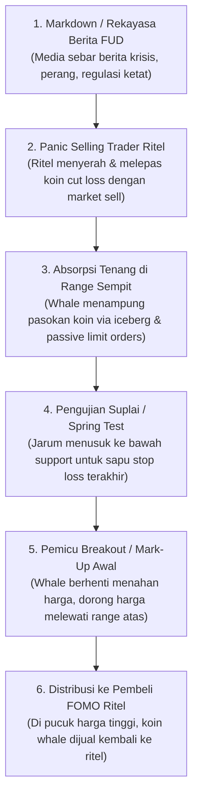

# Bab 5: Crypto Smart Money (Siapa Whales & Cara Mereka Akumulasi)

Selamat datang di inti terdalam dari metode **Crypto Smart Money Concept (CSM)**. Jika di bab-bab pendahuluan kita telah membedah bagaimana pasar kripto bekerja secara makro, siklus 4 tahunan, dan psikologi trader pemula yang sering terjebak FOMO, maka di bab ini kita akan menyingkap tirai panggung utama: **Siapa sebenarnya dalang di balik pergerakan harga ratusan persen di kripto, dan bagaimana cara mereka mengumpulkan koin tanpa disadari publik?**

---

## 1. Siapa Sebenarnya "Smart Money" di Pasar Kripto?

Istilah *Smart Money* sering kali dianggap mistis oleh trader ritel. Banyak yang mengira Smart Money adalah satu orang atau perkumpulan rahasia ala Illuminati yang memencet tombol pompa (*pump*) dan buang (*dump*) sesuka hati. Realitasnya jauh lebih terstruktur, matematis, dan terinstitusionalisasi.

Di pasar kripto modern, Smart Money terbagi ke dalam empat kelompok entitas raksasa:



### A. Quantitative Market Makers (MM)
*Contoh: Wintermute, Jump Trading / Jump Crypto, DWF Labs, GSR Markets, Cumberland.*
- **Peran Utama:** Menyediakan likuiditas dua arah (Bid dan Ask) di Centralized Exchanges (Binance, Bybit, OKX) maupun protokol Decentralized (Uniswap, Curve).
- **Karakteristik Operasional:** Menggunakan algoritma *High-Frequency Trading* (HFT) dengan latensi milidetik. Mereka tidak berspekulasi seperti penjudi; tujuan mereka adalah memanen *spread* (selisih beli dan jual) dan biaya *maker rebate*.
- **Kekuatan Pasar:** Mereka dikontrak langsung oleh yayasan token (*token foundation*) untuk menjaga kestabilan harga atau mengelola *order book*. Merekalah yang memasang dinding order palsu (*spoofing*) untuk memandu emosi ritel ke arah tertentu.

### B. Crypto Venture Capitals (VC)
*Contoh: Andreessen Horowitz (a16z Crypto), Paradigm, Pantera Capital, Polychain Capital.*
- **Peran Utama:** Pemegang modal awal (Seed, Private Round) proyek-proyek Layer 1, Layer 2, DeFi, dan AI Web3.
- **Karakteristik Operasional:** Memiliki jutaan hingga miliaran token dengan harga perolehan yang sangat murah (sering kali 90–99% diskon dari harga listing publik). Mereka tunduk pada jadwal pembukaan token (*token vesting schedule*).
- **Kekuatan Pasar:** Ketika masa *cliff* selesai dan token *unlock*, mereka membutuhkan likuiditas pembeli ritel raksasa untuk merealisasikan keuntungan (*exit liquidity*).

### C. OG Whales (Dompet Paus Era Satoshi)
*Contoh: Dompet dingin (*cold wallet*) yang menyimpan 5.000 hingga 50.000+ BTC sejak era 2010–2014.*
- **Peran Utama:** Pemegang cadangan suplai terbesar Bitcoin di dunia.
- **Karakteristik Operasional:** Jarang sekali aktif bertransaksi setiap hari. Namun, sekali mereka memindahkan 2.000 BTC ke bursa, sistem *on-chain alert* di seluruh dunia membunyikan sirine bahaya, memicu kepanikan ritel seketika.

### D. Institutional Mining Pools
*Contoh: Foundry USA, Antpool, F2Pool, Marathon Digital (MARA).*
- **Peran Utama:** Produsen koin baru yang menerima hadiah blok (*block reward*).
- **Karakteristik Operasional:** Memiliki biaya operasional harian yang masif berupa tagihan listrik jutaan dolar dan cicilan mesin ASIC. Mereka harus menjual koin secara teratur atau melakukan lindung nilai (*hedging*) di pasar derivatif/futures.

---

## 2. Masalah Likuiditas: Mengapa Whale Tidak Bisa Beli Langsung?

Bayangkan Anda memiliki modal sebesar **US$ 150.000.000 (Rp 2,4 Triliun)** dan ingin memborong altcoin tertentu seperti SOL, ARB, atau INJ.

Apa yang terjadi jika Anda membuka aplikasi bursa, memilih menu *Market Buy*, dan menekan tombol hijau dengan ukuran order penuh?



### Masalah Slippage dan Likuiditas Tipis
Di bursa kripto, buku pesanan (*order book*) tidak memiliki ketebalan tak terbatas:
1. Total penawaran jual (*asks*) di harga saat ini mungkin hanya bernilai $500.000.
2. Jika order $150 juta dipaksakan masuk sekaligus, sistem pencocokan order bursa akan terus menyapu harga ke atas hingga 20%, 40%, bahkan 60% lebih tinggi dari harga awal.
3. Fenomena ini disebut **Slippage Ekstrem**. Akibatnya, harga rata-rata masuk (*Average Entry Price*) sang paus menjadi sangat buruk di pucuk, dan begitu ordernya selesai dieksekusi, harga langsung ambruk kembali ke bawah karena tidak ada pembeli lanjutan.

> [!IMPORTANT]
> **Hukum Besi Smart Money:**
> Whale dan Market Maker **TIDAK PERNAH** bisa membeli dalam satu kali klik. Mereka harus membeli secara perlahan (*akumulasi bertahap*) ketika mayoritas trader ritel sedang panik menjual koin mereka (*panic selling*).

---

## 3. Analogi Membumi: Kapal Tanker Minyak Raksasa vs Perahu Kano Lincah

Untuk memahami cara kerja Smart Money, perhatikan analogi fisika sederhana ini:

```
+------------------------------------------------------------------------+
| ANALOGI PERAHU VS KAPAL TANKER                                         |
|                                                                        |
|   Trader Ritel = Perahu Kano Kayak Lincah                              |
|   - Modal kecil ($100 - $10.000).                                      |
|   - Bisa putar balik arah haluan 180 derajat dalam 1 detik.            |
|   - Bisa beli/jual seluruh saldo portofolio instan tanpa menggeser     |
|     harga pasar 1 sen pun.                                             |
|                                                                        |
|   Smart Money / Whale = Kapal Kargo Tanker Minyak Raksasa (SuperTanker)|
|   - Bobot 300.000 ton muatan (ratusan juta dolar modal).              |
|   - Berlayar di selat yang sempit dan dangkal (kedalaman likuiditas).  |
|   - Butuh waktu berminggu-minggu, belokan perlahan, dan ruang manuver  |
|     air yang tenang agar kapal tidak kandas dan pecah karam.           |
+------------------------------------------------------------------------+
```

Karena ukurannya yang kolosal:
- **Whale butuh waktu berminggu-minggu hingga berbulan-bulan** untuk mengakumulasi posisi (*fase konsolidasi/range-bound*).
- **Whale butuh volume penjualan ritel yang masif** agar order beli limit (*limit buy order*) milik mereka yang tersusun di bawah bisa terisi (*filled*) tanpa mendongkrak harga pasar.

---

## 4. Taktik Manipulasi Pasar Kripto

Bagaimana cara whale membuat jutaan trader ritel rela menjual koinnya di harga murah? Mereka menggunakan rekayasa psikologis dan mekanis:

### A. Wash Trading
- **Mekanisme:** Entitas Smart Money menggunakan beberapa akun atau dompet yang mereka kendalikan sendiri untuk saling jual-beli aset pada harga tertentu.
- **Tujuan:** Menciptakan ilusi volume perdagangan harian yang sangat tinggi di CoinMarketCap atau CoinGecko. Ritel melihat koin tersebut "sedang ramai ditransaksikan" dan tertarik masuk karena mengira ada lonjakan minat organik.

### B. Spoofing Orders
- **Mekanisme:** Market Maker menaruh pesanan beli limit (*limit buy wall*) raksasa sebesar 500 BTC di level $62.000 di order book. Ritel yang memantau order book merasa aman karena mengira ada "tembok penahan harga yang kokoh". Namun, tepat ketika harga menyentuh $62.050, order limit 500 BTC tersebut tiba-tiba **dibatalkan (cancel)** dalam hitungan milidetik.
- **Tujuan:** Menjebak pembeli ritel untuk masuk lebih awal, lalu membiarkan harga longsor ke bawah menabrak stop loss mereka.

### C. Inducement (Umpan Pancingan)
- **Mekanisme:** Membentuk formasi chart yang terlihat sangat cantik dan menjanjikan bagi analisa teknikal ritel klasik (seperti pola Double Bottom, Bullish Flag, atau garis Support horizontal yang rapi).
- **Tujuan:** Mengundang ritel untuk meletakkan modal dan Stop Loss di titik-titik yang mudah ditebak. Begitu likuiditas stop loss berkumpul tebal di bawah garis support tersebut, whale akan menghantamkan harga sekejap untuk melahap semua stop loss itu.

---

## 5. Diagram Alur: Siklus Akumulasi Tenang Smart Money



---

## 6. Studi Kasus On-Chain & Newbie Traps

### Studi Kasus: Akumulasi Bitcoin Musim Gugur 2023 ($26.000 – $28.000)
Sebelum Bitcoin terbang menuju level $73.000 di awal 2024:
1. **FUD & Kebosanan Ritel:** Selama bulan Agustus hingga Oktober 2023, harga BTC terjebak membosankan di rentang $25.000 – $27.000. Volume perdagangan bursa turun ke titik terendah tahunan. Berita penundaan ETF Spot oleh SEC berulang kali disebarkan.
2. **Aktivitas On-Chain:** Data dari Glassnode dan CryptoQuant menunjukkan metrik *Exchange Inflow* terus menurun tajam, sementara dompet institusi (kategori *Whale Wallets >1.000 BTC*) secara konsisten mencatatkan saldo bertambah setiap hari secara bertahap (*DCA Akumulasi Pasif*).
3. **Hasil:** Ketika ritel lelah dan mencemooh bahwa "Kripto sudah mati", pasokan Bitcoin di bursa telah kering tersedot ke dompet dingin Smart Money. Sekali berita approval ETF meledak, harga melesat vertikal tanpa memberi kesempatan ritel masuk di harga bawah.

### Newbie Traps: Jebakan Emosi Ritel yang Wajib Dihindari

| Jebakan Ritel Klasik | Fakta di Lapangan Smart Money | Solusi Trader CSM |
|:---|:---|:---|
| **Menjual di Dasar saat Berita Sangat Buruk (FUD)** | Media besar sering kali dimanfaatkan oleh institusi untuk menciptakan *liquidity exit* bagi short atau *liquidity entry* bagi akumulasi murah. | Jangan pernah menekan tombol jual karena headline berita sensasional jika harga sudah berada di area *Extreme Discount*. |
| **Melihat Order Book Tebal Sebagai Jaminan Keamanan** | Order limit tebal di order book sering kali hanyalah pesanan tipuan (*spoofing*) yang akan ditarik mundur sebelum harga tiba. | Gunakan data Footprint atau volume transaksi riil yang telah tereksekusi (*delta volume*), bukan order yang masih mengapung di book. |
| **Membeli Saat Lilin Hijau Raksasa Meledak (FOMO)** | Lilin hijau masif 15 menit sering kali merupakan akhir dari fase *mark-up* lokal di mana whale mulai mendistribusikan koinnya kepada Anda. | Tunggu harga melakukan koreksi sehat ke area diskon atau Order Block institusi sebelum mencari peluang masuk. |

---

## 7. Glosarium Pemula Bab 5

- **Smart Money:** Entitas bermodal besar (Market Maker, Hedge Fund, VC, OG Whales) yang memiliki kapasitas menggeser dinamika penawaran dan permintaan di pasar finansial.
- **Market Maker (MM):** Penyedia likuiditas profesional yang memasang kuotasi beli dan jual terus-menerus guna menjaga kelancaran pasar dan mengekstrak keuntungan dari selisih spread.
- **Slippage:** Selisih antara harga eksekusi yang diharapkan trader dengan harga aktual di mana order tersebut benar-benar terisi di pasar.
- **Wash Trading:** Tindakan ilegal atau manipulatif di mana satu pihak bertindak sebagai pembeli sekaligus penjual untuk memalsukan volume dan minat pasar.
- **Spoofing:** Taktik manipulasi dengan menaruh pesanan palsu berskala besar tanpa ada niat mengeksekusinya, semata-mata untuk menakut-nakuti pelaku pasar lain.
- **Inducement:** Pergerakan harga sengaja yang dirancang untuk memancing trader ritel mengambil posisi lebih awal di area yang salah sehingga menjadi sasaran panen likuiditas berikutnya.

---

> **Rangkuman Bab 5:**
> Pasar kripto bukan arena adil antara Anda dan teman Anda; ini adalah ekosistem di mana predator puncak (Whales & Market Makers) membutuhkan likuiditas Anda untuk mengisi amunisi kapal tanker mereka. Dengan memahami anatomi akumulasi mereka, kita berhenti menjadi santapan dan mulai belajar mengekor di belakang haluan kapal mereka.
