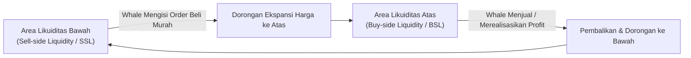
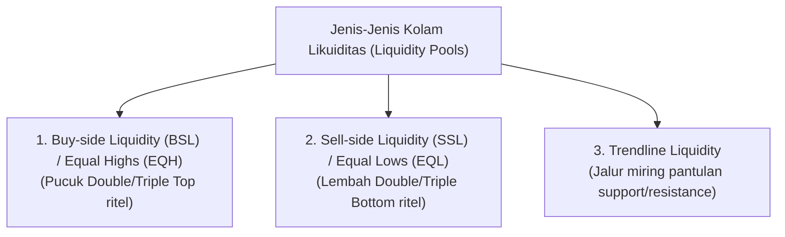
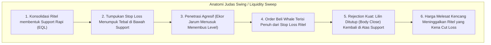

# Bab 6: Liquidity Concept (EQH, EQL, Trendline Liquidity & Sweeps)

Di dunia trading ritel konvensional, Anda diajarkan bahwa garis *Support* dan *Resistance* adalah tembok pelindung baja yang memantulkan harga. Namun di mata **Smart Money**, garis-garis tersebut tidak ubahnya papan tanda bertuliskan: *"Makanan Gratis Tersedia di Sini!"*

Dalam bab ini, kita akan mempelajari konsep paling krusial dalam Smart Money Concept (SMC): **Likuiditas**. Tanpa memahami likuiditas, Anda tidak akan pernah tahu mengapa Stop Loss Anda sering tersentuh tepat beberapa detik sebelum harga terbang ke target keuntungan Anda.

---

## 1. Doktrin Fundamental SMC: Jalur Pergerakan Harga

Pasar keuangan tidak bergerak secara acak (*random walk*), dan pasar juga tidak bergerak sekadar mengikuti garis indikator moving average. 

> [!IMPORTANT]
> **Doktrin Inti Smart Money:**
> *"Harga di pasar kripto hanya bergerak dari satu kolam likuiditas (Liquidity Pool) ke kolam likuiditas berikutnya."*

Pasar kripto digerakkan oleh mesin lelang (*auction market principle*). Agar pesanan beli institusi senilai ratusan juta dolar bisa tereksekusi, harus ada pihak lain yang menjual dalam jumlah yang sama besar. Di manakah pesanan jual dalam jumlah masif tersebut berkumpul? **Tepat di atas pucuk-pucuk resistensi ritel dan di bawah lembah-lembah support ritel.**



---

## 2. Tipe-Tipe Kolam Likuiditas Utama

Untuk membaca pergerakan paus, kita harus melatih mata kita untuk melihat titik-titik di mana uang ritel tertumpuk:



### A. Equal Highs (EQH) & Buy-side Liquidity (BSL)
- **Definisi:** Dua atau lebih pucuk harga (*swing high*) yang berada pada level harga yang hampir persis sama (sering disebut ritel sebagai *Double Top* atau *Triple Top*).
- **Apa yang Tersimpan di Atas EQH?**
  1. **Stop Loss para Shorter (Penjual):** Stop loss dari posisi jual (*short position*) secara mekanis adalah **Order Beli Stop (*Buy Stop*)**.
  2. **Buy Stop para Breakout Trader:** Trader ritel yang memasang order beli otomatis jika resistance jebol ke atas.
- **Tindakan Smart Money:** Smart Money dengan sengaja mendorong harga sedikit menembus EQH untuk memicu semua order beli tersebut. Di sanalah Smart Money melepas atau membuka posisi jual besar mereka.

### B. Equal Lows (EQL) & Sell-side Liquidity (SSL)
- **Definisi:** Dua atau lebih lembah harga (*swing low*) yang berada pada level horizontal yang sejajar (dikenal ritel sebagai *Double Bottom* atau *Support Kuat*).
- **Apa yang Tersimpan di Bawah EQL?**
  1. **Stop Loss para Buyer (Pembeli):** Stop loss dari posisi beli (*long position*) secara mekanis adalah **Order Jual Stop (*Sell Stop*)**.
  2. **Sell Stop para Breakdown Trader:** Trader panik yang ikut membuka order jual pendek saat garis support patah.
- **Tindakan Smart Money:** Whale menyodok harga menembus EQL sekejap untuk melahap ribuan order jual darurat ritel dengan harga super murah.

### C. Trendline Liquidity (Likuiditas Garis Tren)
- **Definisi:** Garis diagonal miring yang menghubungkan 3 titik pantulan harga berturut-turut. Buku teks ritel mengajarkan: *"Semakin sering garis tren disentuh, semakin kuat garis tersebut."*
- **Realitas SMC:** Justru sebaliknya! Semakin sering garis tren disentuh, semakin banyak tumpukan stop loss yang dipasang rapat persis di balik garis tren tersebut.
- Garis tren yang rapi adalah magnet likuiditas yang siap dilibas dalam satu gerakan tajam (*liquidity run*).

---

## 3. Anatomi Liquidity Sweep & Judas Swing

Pernahkah Anda mengalami peristiwa menjengkelkan: Anda pasang Stop Loss di bawah support, tiba-tiba ada satu batang lilin dengan jarum bawah (*wick*) yang sangat panjang menusuk stop loss Anda, lalu sedetik kemudian lilin ditutup hijau dan harga meroket 10% tanpa Anda?

Peristiwa tersebut dinamakan **Liquidity Sweep** (Sapuan Likuiditas) atau dalam tradisi SMC sering disebut **Judas Swing**.



### Ciri-Ciri Utama Liquidity Sweep yang Valid:
1. **Pelepasan Ekor Jarum (*Wick Only*):** Hanya jarum lilin (*shadow/wick*) yang menembus level EQH/EQL, sementara badan lilin (*candle body*) ditutup kembali ke dalam zona struktur sebelumnya.
2. **Reaksi Cepat (*Instant Rejection*):** Harga tidak bertahan lama di luar zona likuiditas; langsung terjadi perlawanan arah dalam hitungan menit/jam berikutnya.
3. **Peningkatan Volume Riil:** Jarum sweep selalu disertai lonjakan volume transaksi besar karena jutaan dolar stop loss terpicu bersamaan.

---

## 4. Analogi Membumi: Stasiun Pengisian Bahan Bakar Kereta Ekspres

Bayangkan sebuah kereta api cepat pengangkut barang antar-provinsi yang beratnya ribuan ton:

```
+------------------------------------------------------------------------+
| ANALOGI STASIUN PENGISIAN BAHAN BAKAR (LOKOMOTIF KERETA EKSPRES)       |
|                                                                        |
|   Kereta Ekspres = Pergerakan Tren Besar Smart Money (Bullish Trend)   |
|   Bahan Bakar Diesel = Likuiditas (Stop Loss Ritel yang Tersapu)      |
|                                                                        |
|   - Kereta tidak bisa melaju 1.000 km tanpa tangki solar penuh.        |
|   - Sebelum melaju kencang ke tujuan akhir (Target Take Profit Jauh),   |
|     masinis kereta (Whale) harus MUNDUR SEJENAK memasuki stasiun      |
|     pengisian bahan bakar (Area Support EQL / Tumpukan Stop Loss).     |
|   - Begitu selang solar diisi penuh (Stop loss ritel ludes tersedot),  |
|     barulah lokomotif tancap gas maju ke depan dengan kecepatan penuh! |
+------------------------------------------------------------------------+
```

Jika Anda melihat harga tiba-tiba berbalik arah menabrak titik terendah beberapa hari lalu, jangan panik mengira tren telah hancur. Sadarilah bahwa sang paus sedang "mengisi tangki solar" sebelum melanjutkan perjalanan besarnya.

---

## 5. Diagram Alur: Mekanisme Sapuan Likuiditas Bearish vs Bullish

```mermaid
flowchart LR
    subgraph Bullish Liquidity Sweep (Sapu ke Bawah lalu Terbang)
        B1["Harga Sideways"] --> B2["Menghantam EQL / SSL"]
        B2 --> B3["Sapu Stop Loss Buyer"]
        B3 --> B4["Tutup di Atas Level Support"]
        B4 --> B5["Ekspansi Bullish Kencang"]
    end

    subgraph Bearish Liquidity Sweep (Sapu ke Atas lalu Longsor)
        S1["Harga Rally"] --> S2["Menghantam EQH / BSL"]
        S2 --> S3["Sapu Stop Loss Shorter"]
        S3 --> S4["Tutup di Bawah Level Resistance"]
        S4 --> S5["Ekspansi Bearish Parah"]
    end
```

---

## 6. Studi Kasus Konkret & Newbie Traps

### Studi Kasus: Sapuan Likuiditas Bitcoin $60.000 (Maret 2024)
Pada pertengahan Maret 2024, Bitcoin berada dalam perjalanan menembus rekor harga tertinggi (*All-Time High*):
1. **Formasi Ritel:** Di time frame H4, terbentuk level resistensi psikologis kuat di kisaran $69.000 – $69.200 yang merupakan puncak ATH tahun 2021. Jutaan trader menaruh order *Buy Stop* di atas $69.500 dan shorters memasang Stop Loss tepat di $69.300.
2. **Sapuan Likuiditas Atas:** Lilin BTC tiba-tiba melonjak menyentuh $69.324 (hanya ekor jarum yang menembus ATH 2021). Order Stop Loss para shorter meledak dan jutaan dolar breakout buyer masuk secara instan.
3. **Reversal Kilat:** Dalam waktu kurang dari 4 jam, harga Bitcoin langsung dibanting turun lebih dari $8.000 hingga ke area $60.800! Badan lilin H4 ditutup jauh di bawah $68.000.
4. **Hasil:** Para pembeli breakout di pucuk tersangkut parah, sementara Smart Money berhasil melikuidasi miliaran dolar posisi leverage ritel dalam satu sapuan jarum tunggal.

### Newbie Traps: Mengapa Ritel Selalu Jadi Korban?

| Kesalahan Fatal Pemula | Fakta Mekanika SMC | Solusi Disiplin Trader CSM |
|:---|:---|:---|
| **Menaruh Stop Loss tepat 1 tick di bawah swing low terdekat.** | Ini adalah titik paling mudah diprediksi di seluruh dunia. Smart Money memiliki data heatmap likuidasi bursa. | Beri ruang napas (*buffer*) atau gunakan invalidasi penutupan badan lilin (*Candle Close*), bukan ekor jarum sesaat. |
| **Beli langsung saat resistance baru saja ditembus (Breakout Trading Ritel).** | Lebih dari 70% breakout di kripto adalah *False Breakout / Liquidity Sweep* yang dirancang untuk memancing likuiditas. | Tunggu penutupan badan lilin yang tegas, lalu tunggu terjadinya *retest* ke area diskon sebelum masuk. |
| **Panik menekan Cut Loss manual tepat di ujung ekor jarum terbawah.** | Saat panik mencapai puncak di grup media sosial, biasanya ekor jarum sweep baru saja selesai mengeksekusi order whale. | Jika melihat jarum menusuk sangat cepat dengan volume besar, jangan langsung panik; amati apakah badan lilin berhasil kembali ditutup ke zona aman. |

---

## 7. Glosarium Pemula Bab 6

- **Liquidity Pool:** Kumpulan pesanan pending (Stop Loss, Take Profit, Limit Orders) yang berkumpul dalam volume tebal di level harga tertentu.
- **Buy-side Liquidity (BSL):** Likuiditas yang berada di atas harga pasar saat ini, terutama terdiri dari order stop loss penjual dan order buy stop para pembeli breakout.
- **Sell-side Liquidity (SSL):** Likuiditas yang berada di bawah harga pasar saat ini, terutama terdiri dari order stop loss pembeli dan order sell stop para penjual breakdown.
- **Equal Highs (EQH):** Titik-titik puncak harga yang sejajar secara horizontal, menandakan area tumpukan BSL yang sangat padat.
- **Equal Lows (EQL):** Titik-titik lembah harga yang sejajar secara horizontal, menandakan area tumpukan SSL yang sangat padat.
- **Liquidity Sweep (Raid):** Manuver harga yang menembus area likuiditas secara agresif hanya untuk memicu stop loss, sebelum berbalik arah dengan cepat.
- **Judas Swing:** Istilah pergerakan manipulasi palsu di awal sesi perdagangan yang berlawanan dengan arah pergerakan sejati yang akan terjadi hari itu.

---

> **Rangkuman Bab 6:**
> Jangan pernah melihat level Support dan Resistance sebagai dinding pemantul abadi. Anggaplah mereka sebagai ember-ember berisi bahan bakar likuiditas. Jika Anda tahu ember mana yang sedang ditargetkan oleh Smart Money, Anda tidak akan pernah lagi menjadi korban sapuan jarum bursa.
