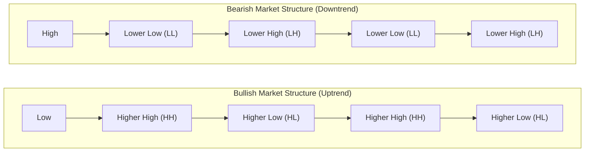
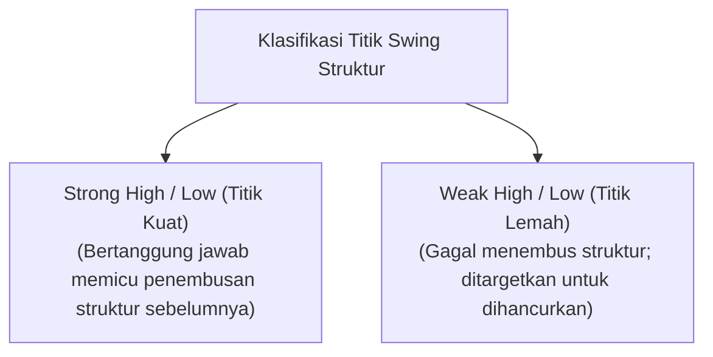
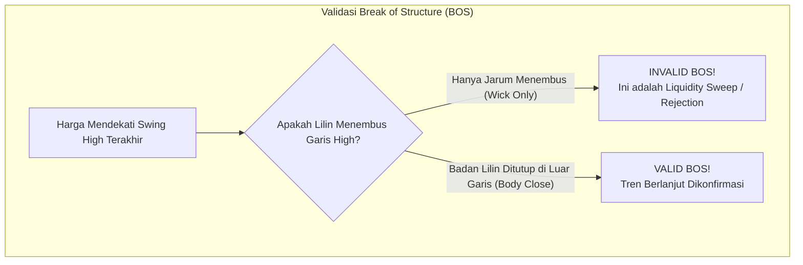
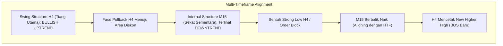

# Bab 7: Market Structure (Pemetaan Swing High/Low & Break of Structure / BOS)

Jika Anda membuka grafik harga kripto tanpa memahami **Struktur Pasar (Market Structure)**, Anda bagaikan seorang nakhoda kapal yang berlayar di tengah badai samudra tanpa kompas dan peta bintang. Segala bentuk indikator teknikal seperti RSI, MACD, atau Bollinger Bands akan memberikan sinyal palsu jika Anda salah membaca struktur tren dominan.

Di bab ini, kita akan mempelajari peta dasar navigasi seorang Smart Money Trader: cara memetakan puncak dan lembah secara objektif, serta memahami kapan sebuah tren benar-benar berlanjut lewat konfirmasi **Break of Structure (BOS)**.

---

## 1. Definisi Struktur Pasar: Siklus Gelombang Harga

Pasar kripto tidak pernah bergerak dalam satu garis lurus ke atas maupun ke bawah. Pasar bergerak dalam rangkaian gelombang ekspansi (*impulse wave*) dan gelombang koreksi (*pullback/retracement*).



### A. Struktur Tren Naik (Bullish Uptrend)
- **Karakteristik:** Harga secara konsisten mencetak puncak yang lebih tinggi (**Higher High / HH**) dan lembah yang lebih tinggi (**Higher Low / HL**).
- **Aturan Logika:** Setiap kali harga berhasil menembus puncak sebelumnya (HH), struktur tren naik dinyatakan berlanjut (*continuation*).

### B. Struktur Tren Turun (Bearish Downtrend)
- **Karakteristik:** Harga secara konsisten mencetak lembah yang lebih rendah (**Lower Low / LL**) dan puncak koreksi yang lebih rendah (**Lower High / LH**).
- **Aturan Logika:** Setiap kali harga berhasil menembus lembah sebelumnya (LL), struktur tren turun dinyatakan berlanjut.

---

## 2. Strong High/Low vs Weak High/Low: Membaca Kekuatan Dinding Struktur

Salah satu kesalahan paling umum trader pemula adalah menganggap setiap puncak dan lembah memiliki kekuatan yang sama. Dalam metodologi CSM, kita membagi titik swing menjadi dua kategori mutlak:



### A. Strong Low (Lembah Kuat)
- **Definisi:** Titik lembah (*Swing Low*) yang berhasil mendorong harga ke atas hingga menembus puncak sebelumnya (*menghasilkan BOS*).
- **Karakter Pasar:** Karena lembah ini adalah titik awal di mana Smart Money menyuntikkan modal masifnya untuk menciptakan rekor tertinggi baru, institusi **akan melindungi** area ini dari kejatuhan harga. Lembah ini menjadi area support yang sangat kokoh.

### B. Weak High (Puncak Lemah)
- **Definisi:** Titik puncak (*Swing High*) yang gagal menekan harga menembus lembah sebelumnya.
- **Karakter Pasar:** Puncak ini tidak memiliki daya dorong yang signifikan dan hanya menjadi target likuiditas (*target Take Profit*) yang akan dilibas oleh gelombang pembeli berikutnya.

### Tabel Perbandingan Objektif:

| Karakteristik | Strong High / Strong Low | Weak High / Weak Low |
|:---|:---|:---|
| **Pencapaian Struktur** | Berhasil memicu Break of Structure (BOS) baru. | Gagal memicu Break of Structure baru. |
| **Sikap Smart Money** | Dilindungi dengan order limit institusi tebal. | Dibiarkan tembus sebagai likuiditas panen. |
| **Fungsi bagi Trader** | Tempat aman meletakkan batas risiko (Stop Loss). | Target realistis untuk merealisasikan keuntungan (Take Profit). |

---

## 3. Break of Structure (BOS): Konfirmasi Penembusan Sah

Kapan sebuah penembusan struktur dianggap **sah dan terkonfirmasi**, dan kapan penembusan tersebut hanyalah jebakan sapuan likuiditas (*sweep*)?

> [!IMPORTANT]
> **Aturan Emas BOS Akademi Crypto (Body Close Rule):**
> Sebuah Break of Structure (BOS) HANYA dinyatakan valid jika **Badan Lilin (Candle Body)** ditutup secara tegas (*close above/below*) menembus level puncak atau lembah swing sebelumnya pada time frame yang dianalisa. Ekor jarum (*wick*) saja HANYALAH sapuan likuiditas (*sweep*), bukan BOS!



### Mengapa Aturan Badan Lilin Begitu Vital?
- **Badan Lilin (Body):** Mencerminkan volume perdagangan yang menetap dan kesepakatan nilai (*acceptance of value*) antar pelaku pasar institusi pada periode waktu tersebut.
- **Ekor Jarum (Wick):** Mencerminkan penolakan harga (*rejection*) dan aktivitas eksekusi stop loss darurat yang bersifat sementara.

---

## 4. Struktur Fraktal: Swing Structure (HTF) vs Internal Structure (LTF)

Pasar kripto bersifat **fraktal** (*fractal*), artinya pola struktur yang sama berulang di semua skala waktu, dari grafik Bulanan (Monthly) hingga grafik 1 Menit (M1).

```
+------------------------------------------------------------------------+
| ANALOGI PONDASI RUMAH BERTINGKAT VS SEKAT TRIPLEK                      |
|                                                                        |
|   Higher Timeframe (H4 / Daily) = Tiang Beton & Kolom Utama Gedung     |
|   - Struktur kokoh penentu arah gravitasi utama pasar.                 |
|   - Tidak mudah patah oleh sentimen berita jangka pendek.              |
|                                                                        |
|   Lower Timeframe (M15 / M5) = Sekat Dinding Triplek / Partisi Ruangan|
|   - Sangat fleksibel, mudah digeser, dan sering berubah bentuk.        |
|   - Di dalam satu gelombang H4, terdapat puluhan swing kecil M15.      |
|   - Sekat triplek M15 boleh runtuh berkali-kali, asalkan tiang beton   |
|     H4 tetap utuh berdiri!                                             |
+------------------------------------------------------------------------+
```



Seorang trader cerdas tidak pernah melawan tiang beton H4 hanya karena melihat sekat triplek M15 sedang bergoyang ke arah berlawanan.

---

## 5. Studi Kasus Konkret & Newbie Traps

### Studi Kasus: Pemetaan Struktur ETH/USDT H4
Perhatikan skenario pergerakan Ethereum pada time frame 4 Jam (H4):
1. ETH berada dalam tren bullish dengan Swing High terakhir di $3.500 dan Swing Low di $3.200.
2. Lembah di $3.200 adalah **Strong Low** karena dari titik inilah harga berhasil terbang mencetak rekor baru di $3.500 (menghasilkan BOS Bullish valid).
3. Harga kemudian mengalami koreksi turun menuju $3.250. Di grafik 15 menit (M15), harga tampak mencetak *Lower Low* dan *Lower High* beruntun (tampak seperti keruntuhan pasar bagi pemula).
4. Namun, selama level $3.200 (Strong Low H4) tidak tertembus oleh penutupan badan lilin H4, struktur makro ETH tetap 100% **BULLISH**.
5. Tepat di $3.250, pembeli institusi masuk kembali. ETH berbalik melesat menembus $3.500 dan mencetak BOS baru di $3.800.

### Newbie Traps: Jebakan Pemetaan Struktur Pemula

| Kesalahan Fatal Pemula | Mengapa Terjadi? | Cara Memperbaiki |
|:---|:---|:---|
| **Mengira tren berbalik arah hanya karena satu lilin merah besar di M5.** | Bingung membedakan antara *Internal Pullback* dengan pembalikan tren sejati (*Macro Shift*). | Selalu tandai Strong Low/High pada time frame lebih tinggi (H4/Daily) sebelum turun ke M15. |
| **Menandai BOS saat harga hanya menusuk jarum 1 detik.** | Tidak sabar menunggu lilin ditutup (*candle close*), langsung membuka posisi saat lilin masih berjalan. | Jangan pernah membuat keputusan sebelum waktu lilin resmi berakhir (perhatikan *countdown timer* candle). |
| **Menandai setiap lekukan kecil di grafik sebagai Swing High/Low.** | Grafik menjadi penuh coretan rumit (*chart noise*) dan membingungkan otak sendiri. | Gunakan aturan swing minimal: sebuah swing high yang valid harus diapit oleh setidaknya 2 lilin dengan titik puncak lebih rendah di kiri dan kanannya. |

---

## 6. Glosarium Pemula Bab 7

- **Market Structure:** Pola hierarki puncak dan lembah yang menunjukkan arah tren dominan aliran uang di pasar.
- **Swing High:** Titik puncak tertinggi lokal sebelum harga berbalik turun mengalami koreksi.
- **Swing Low:** Titik lembah terendah lokal sebelum harga berbalik naik mengalami ekspansi.
- **Strong Low:** Titik lembah yang berhasil memicu terbentuknya Higher High baru; dilindungi oleh Smart Money.
- **Strong High:** Titik puncak yang berhasil memicu terbentuknya Lower Low baru dalam tren turun.
- **Weak High / Weak Low:** Titik swing yang gagal memecahkan struktur sebelumnya; bertindak sebagai target likuiditas empuk.
- **Break of Structure (BOS):** Penembusan level swing terluar searah dengan tren utama yang telah dikonfirmasi oleh penutupan badan lilin.
- **Fractal Market:** Sifat pasar keuangan di mana struktur pergerakan yang sama berulang di berbagai tingkatan time frame.

---

> **Rangkuman Bab 7:**
> Struktur pasar adalah hukum gravitasi trading. Jangan pernah menebak-nebak ke mana arah pasar jika peta strukturnya belum memberikan izin. Tandai Strong High dan Strong Low Anda, tunggu badan lilin mengonfirmasi penembusan (BOS), dan berlayarlah selalu searah dengan angin tiang beton HTF Anda.
