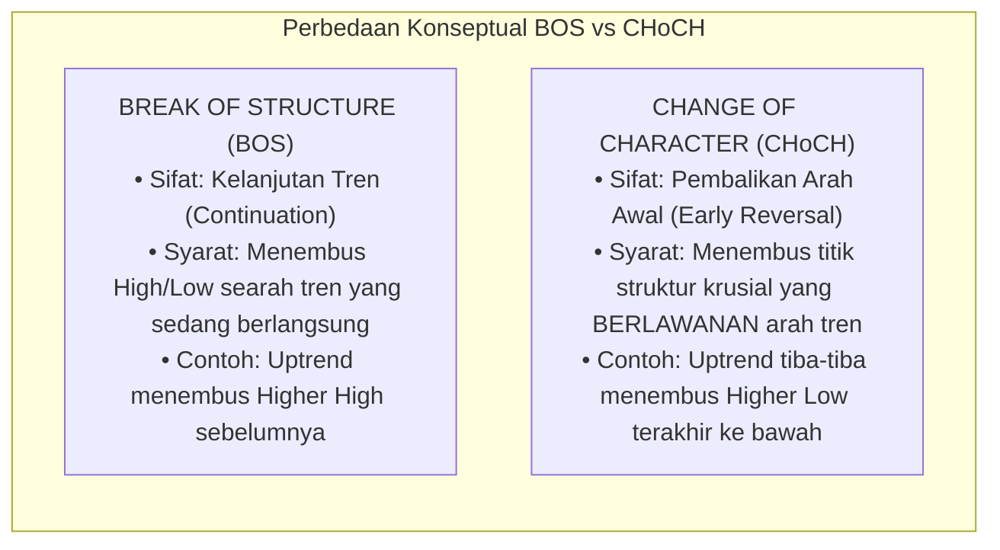
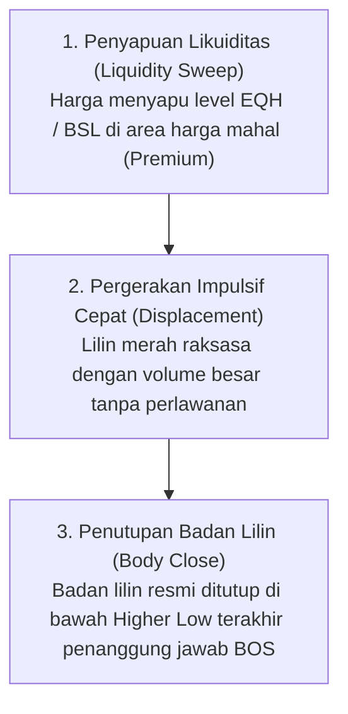
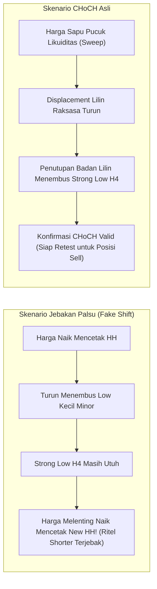
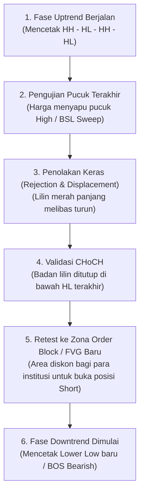

# Bab 8: Change of Character (CHoCH: Sinyal Dini Pembalikan Arah)

Jika **Break of Structure (BOS)** adalah sinyal bahwa kereta ekspres pasar sedang melaju kencang melanjutkan perjalanannya searah tren, maka **Change of Character (CHoCH)** adalah rem darurat sekaligus tanda bahwa lokomotif kereta telah berputar haluan 180 derajat ke arah sebaliknya.

Bagi seorang trader Crypto Smart Money, CHoCH adalah salah satu instrumen paling berharga di dalam kotak perkakas analisanya. Pola inilah yang memungkinkan kita masuk di awal tren baru sebelum 95% trader ritel lainnya menyadari bahwa pasar telah berbalik arah.

---

## 1. Perbedaan Mendasar: BOS vs CHoCH

Banyak pemula yang mencampuradukkan kedua istilah ini hingga berakhir dengan kebingungan. Mari kita bedah perbedaannya dengan sangat tegas:



| Parameter Analisa | Break of Structure (BOS) | Change of Character (CHoCH) |
|:---|:---|:---|
| **Pesan Pasar** | *"Tren saat ini sehat dan terus berlanjut."* | *"Karakter tren saat ini rusak; kekuasaan beralih."* |
| **Arah Penembusan** | Searah tren berjalan (*Trend-following*). | Menembus batas pembatas tren (*Counter-structure*). |
| **Titik yang Ditembus** | Higher High (pada Uptrend) atau Lower Low (pada Downtrend). | Higher Low terakhir (pada Uptrend) atau Lower High terakhir (pada Downtrend). |
| **Aksi Trading** | Mencari entri searah tren pada saat retest. | Menutup posisi lama, waspada pembalikan tren total. |

---

## 2. Anatomi CHoCH Berkualitas Tinggi (High-Probability CHoCH)

Tidak semua penembusan Higher Low atau Lower High layak disebut sebagai sinyal pembalikan arah yang sah. Di pasar kripto yang penuh manipulasi, sering kali terjadi pergerakan palsu yang sekadar menyentuh swing low lalu melanjutkan tren naiknya (*Fakeout / Minor Shift*).

Sebuah CHoCH berprobabilitas tinggi (grade A+) **wajib memiliki 3 elemen mutlak**:



### Elemen 1: Diawali Liquidity Sweep di Zona Penting
Pembalikan arah yang sejati selalu membutuhkan bahan bakar penutup posisi dari Smart Money. Oleh karena itu, sebelum harga membanting ke bawah merusak struktur, Smart Money hampir selalu menyapu pucuk tertinggi sebelumnya (*High Sweep*) terlebih dahulu untuk melahap semua stop loss shorters.

### Elemen 2: Terjadi Displacement (Lompatan Impulsif)
Harga tidak turun perlahan atau tersendat-sendat; harga menembus level struktur dengan lilin berbadan besar (*Expansion Candle*) yang menyisakan celah ketidakseimbangan harga (*Fair Value Gap / FVG*). Ini adalah tanda tangan nyata dari jejak kaki institusi (*institutional footprint*).

### Elemen 3: Menembus "The Valid Swing" (Bukan Struktur Minor)
Level yang ditembus haruslah titik **Strong Low** yang bertanggung jawab langsung mencetak Higher High terakhir, bukan sekadar riak gelombang kecil di tengah jalan.

---

## 3. Membedakan CHoCH Asli vs Fake Shift (Jebakan Struktur Minor)

Banyak trader pemula tertipu oleh apa yang disebut *Internal Noise*. Mari kita bandingkan keduanya:

```
+------------------------------------------------------------------------+
| ANALOGI PERGANTIAN NAHKODA KAPAL / PERALIHAN TONGKAT ESTAFET           |
|                                                                        |
|   Fake Shift (Jebakan Palsu) = Angin Kencang Sesaat di Tengah Laut     |
|   - Kapal sedikit oleng ke kiri karena ombak sesaat.                   |
|   - Sang nakhoda (Bulls) masih memegang penuh kemudi kendali.          |
|   - Penurunan harga hanya koreksi internal sebelum melaju lebih jauh.  |
|                                                                        |
|   CHoCH Asli (Pembalikan Sejati) = Kudeta Resmi di Ruang Kemudi       |
|   - Tongkat komando nakhoda resmi direbut oleh kawanan Beruang (Bears).|
|   - Benteng pertahanan terakhir sang nakhoda (Strong Low) telah roboh. |
|   - Kompas kapal resmi diputar arah menuju kutub selatan (Downtrend).  |
+------------------------------------------------------------------------+
```



---

## 4. Panduan Step-by-Step: Membaca CHoCH dari Layar Kosong

Saat Anda membuka chart kripto dari nol, ikuti 4 langkah terstruktur ini:

1. **Langkah 1 (Identifikasi Tren HTF):** Tentukan apakah tren pada time frame acuan (misal H4) sedang Uptrend atau Downtrend. Cari titik Strong Low dan Strong High utamanya.
2. **Langkah 2 (Amati Reaksi di Zona Kunci):** Apakah harga baru saja menyentuh area Premium / Diskon yang ekstrem atau menyapu titik likuiditas penting (EQH/EQL)?
3. **Langkah 3 (Cari Titik Retak Struktur Pertama):** Jika sedang Uptrend, tandai lembah Higher Low terakhir yang melahirkan puncak tertinggi tersebut. Pasang garis horizontal bertuliskan `CHoCH Line`.
4. **Langkah 4 (Tunggu Konfirmasi Candle Close):** Jangan tergesa-gesa! Tunggu hingga satu lilin penuh menutup badannya (*body close*) melewati garis tersebut. Begitu terkonfirmasi, bersiaplah mencari entri pembalikan saat harga melakukan koreksi balik (*retest*).

---

## 5. Diagram Alur: Siklus Lengkap Transisi Tren



---

## 6. Studi Kasus Konkret & Newbie Traps

### Studi Kasus: Reversal Solana (SOL/USDT) di Puncak $210 (Maret 2024)
Perhatikan dinamika pembalikan harga Solana dari $210 menuju $120:
1. **Latar Belakang:** SOL berada dalam euforia tren bullish masif, naik dari $100 menuju $200 didorong oleh tren memecoin.
2. **Sapuan Likuiditas Pucuk:** Harga menyentuh level psikologis $210, sedikit menyapu puncak sebelumnya di $205, lalu segera muncul ekor jarum panjang penolakan (*wick rejection*).
3. **Patahan Struktur (CHoCH):** Lembah Strong Low H4 terakhir Solana berada di level $192 (titik yang memicu dorongan ke $210). Dua hari kemudian, lilin H4 dengan volume raksasa ditutup tegas di level $185 (menembus $192 dengan badan lilin penuh).
4. **SOP Entri:** Trader CSM menandai terbentuknya **Bearish CHoCH**. Saat harga melakukan koreksi naik lemah (*pullback*) ke area FVG di kisaran $195 – $198, itu adalah peluang emas untuk membuka posisi *Short* atau keluar dari *Spot*.
5. **Hasil:** Solana tidak pernah kembali ke $210 selama berbulan-bulan dan meluncur turun secara bertahap hingga menyentuh $120.

### Newbie Traps: Kesalahan Fatal Saat Menghadapi CHoCH

| Jebakan Pemula | Mengapa Berbahaya? | Solusi Disiplin Trader CSM |
|:---|:---|:---|
| **Langsung hajar posisi Sell seketika lilin menembus garis tanpa menunggu retest.** | Harga sering kali mengalami *overextended*; risiko Stop Loss Anda menjadi sangat lebar dan rawan terkena pantulan koreksi. | Sabar! Setelah CHoCH terkonfirmasi, biarkan harga menarik napas (*retracement*) ke area premium/diskon atau Order Block sebelum entri. |
| **Menandai CHoCH pada time frame 1 menit padahal tren H4 sangat kuat.** | Perubahan karakter di M1 hanyalah riak kecil yang bisa dihancurkan kembali oleh arus air H4 dalam hitungan detik. | Selalu prioritaskan CHoCH pada time frame eksekusi yang selaras dengan bias time frame lebih tinggi (HTF Alignment). |
| **Tidak mau menerima kenyataan bahwa tren telah berakhir (Bargaining Bias).** | Ritel sering kali terus melakukan *Averaging Down* pembelian karena yakin koin favoritnya "pasti akan naik lagi", padahal struktur sudah CHoCH Bearish. | Hormati struktur grafik. Jika CHoCH valid telah terjadi, buang bias emosional dan lindungi modal portofolio Anda. |

---

## 7. Glosarium Pemula Bab 8

- **Change of Character (CHoCH):** Tanda awal perubahan arah tren yang ditandai dengan penembusan titik swing low (pada uptrend) atau swing high (pada downtrend) penanggung jawab tren sebelumnya.
- **Minor Shift:** Penembusan struktur kecil di dalam struktur internal yang sering kali hanyalah koreksi minor sementara, bukan pembalikan tren makro.
- **Reversal Trigger:** Peristiwa teknikal yang memicu dimulainya fase pembalikan arah pasar.
- **Displacement:** Pergerakan harga yang sangat tajam dan agresif satu arah yang ditandai dengan lilin-lilin bervolume tebal dan minim perlawanan.
- **Validation:** Konfirmasi akhir dari suatu sinyal teknikal (misalnya penutupan badan lilin secara resmi).
- **Retest / Return to Origin:** Pergerakan harga kembali menguji zona asal terjadinya pergerakan impulsif sebelum melanjutkan arah barunya.

---

> **Rangkuman Bab 8:**
> BOS memberi tahu Anda kapan harus terus memegang kemudi; CHoCH memberi tahu Anda kapan harus bersiap memutar haluan atau menginjak pedal rem. Kuasai sinyal transisi ini, gabungkan dengan sapuan likuiditas, dan Anda akan selalu selangkah lebih maju daripada massa pasar ritel.
