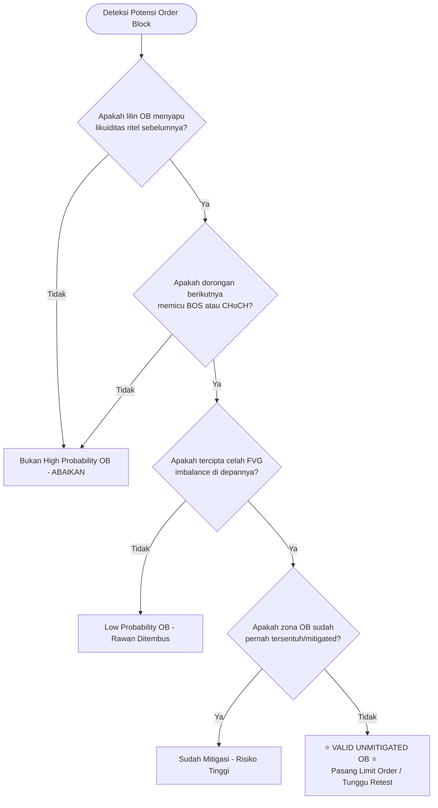

# Bab 9: Order Block (Jejak Akumulasi & Distribusi Institusi)

> *"Gajah tidak bisa bersembunyi di kolam renang anak-anak tanpa membuat airnya tumpah ke mana-mana. Begitu pula institusi keuangan raksasa: pesanan miliaran dolar mereka selalu meninggalkan jejak kaki permanen di grafik harga—jejak itulah yang kita sebut Order Block."*  
> — **Akademi Crypto, Modul Crypto Smart Money Concept**

---

## 1. Pengantar & Definisi Sejati Order Block (OB)

Bagi trader ritel pemula yang terbiasa dengan analisis teknikal klasik, pembalikan harga sering dianggap terjadi di level *Support* atau *Resistance* statis horizontal. Namun, seringkali harga menembus level support tersebut, memicu *stop loss* semua orang, lalu berbalik arah dengan kecepatan roket. Mengapa hal ini terjadi?

Jawabannya adalah **Order Block (OB)**.

### Apa Itu Order Block?
Secara teknis dalam metodologi *Smart Money Concept (SMC)*:
**Order Block adalah lilin (*candlestick*) terakhir yang berlawanan arah sebelum terjadinya dorongan harga agresif (*displacement*) yang memicu penembusan struktur pasar (*Break of Structure / BOS* atau *Change of Character / CHoCH*).**

- **Bullish Order Block**: Lilin **merah (bearish)** terakhir sebelum terjadi lonjakan harga impulsif ke atas yang memecahkan *Swing High* sebelumnya.
- **Bearish Order Block**: Lilin **hijau (bullish)** terakhir sebelum terjadi kejatuhan harga impulsif ke bawah yang memecahkan *Swing Low* sebelumnya.

```
         BULLISH ORDER BLOCK                       BEARISH ORDER BLOCK
      (Area Beli Smart Money)                    (Area Jual Smart Money)

          [Lilin Hijau Kuat]                          [Lilin Merah Kuat]
                 │                                            │
          [Lilin Hijau Kuat]                          [Lilin Merah Kuat]
                 │                                            │
     ┌───────────────────────┐                    ┌───────────────────────┐
     │ Lilin Merah Terakhir  │ ◄── Bullish OB     │ Lilin Hijau Terakhir  │ ◄── Bearish OB
     │ (Order Beli Raksasa)  │                    │ (Order Jual Raksasa)  │
     └───────────────────────┘                    └───────────────────────┘
```

---

## 2. Analogi Membumi: Jejak Kaki Gajah & Brankas Order Tertunda

Untuk memahami mengapa Order Block bekerja, bayangkan dua analogi sederhana berikut:

### Analogi 1: Jejak Kaki Gajah di Tanah Basah
Bayangkan seekor gajah seberat 6 ton berjalan melewati halaman tanah basah. Gajah tersebut tidak bisa melangkah tanpa meninggalkan cekungan jejak kaki yang dalam. Ketika hujan turun atau air mengalir kembali, air akan menggenang di cekungan tersebut terlebih dahulu.
- **Gajah** = Institusi / Whale / Market Maker dengan dana ratusan juta dolar.
- **Langkah Kaki** = Eksekusi order akumulasi/distribusi masif.
- **Cekungan Jejak Kaki** = Order Block pada grafik candle.
- **Genangan Air Kembali** = Retest/Mitigasi harga kembali ke area jejak kaki tersebut sebelum melanjutkan perjalanan.

### Analogi 2: Brankas Penyimpanan Order Tertunda (*Unfilled Orders*)
Ketika sebuah whale ingin membeli 50.000 Bitcoin di harga $60.000, likuiditas jual yang tersedia di buku pesanan (*order book*) pasar terbuka mungkin hanya ada 15.000 BTC. 
Jika whale langsung membeli semuanya sekaligus dengan *Market Order*, harga akan melonjak liar ke $65.000 (*slippage* buruk).
Oleh karena itu, whale mengeksekusi secara bertahap:
1. Mereka menyerap likuiditas yang ada pada lilin merah terakhir (misal 20.000 BTC).
2. Dorongan pembelian mereka memicu pergerakan eksplosif (*displacement*) ke atas.
3. Namun, sisa pesanan mereka (30.000 BTC) **masih tertinggal di brankas harga asal ($60.000)** dalam bentuk *limit order* yang belum terisi (*unfilled buy orders*).
4. Di masa depan, institusi membiarkan harga turun kembali (*retrace*) ke brankas tersebut untuk menjemput sisa order beli yang tertinggal (*mitigation*), sebelum harga meroket jauh lebih tinggi!

---

## 3. Empat Kriteria Order Block Valid (High-Probability OB)

Tidak semua lilin berlawanan arah adalah Order Block yang layak dijadikan tempat entry. Trader pemula sering gagal karena menandai setiap lilin merah sebelum kenaikan sebagai OB. 

Di Akademi Crypto, sebuah Order Block diklasifikasikan sebagai **High-Probability Valid OB** hanya jika memenuhi **4 filter wajib** berikut:

```
┌────────────────────────────────────────────────────────────────────────┐
│               4 PILAR VALIDITAS ORDER BLOCK (AKADEMI CRYPTO)           │
├────────────────────────────────────────────────────────────────────────┤
│ 1. Liquidity Sweep        : Menyapu stop loss / swing high-low ritel.  │
│ 2. Market Structure Break : Menciptakan BOS atau CHoCH yang jelas.     │
│ 3. Fair Value Gap (FVG)   : Menyisakan ketidakseimbangan harga/imbalance│
│ 4. Unmitigated Status     : Belum pernah tersentuh sama sekali oleh wick│
└────────────────────────────────────────────────────────────────────────┘
```

### 1. Menyapu Likuiditas (*Liquidity Sweep*)
OB yang berkualitas tinggi selalu bertindak sebagai "pembersih likuiditas". Sebelum harga melesat ke atas, lilin OB tersebut biasanya membuat sumbu (*wick*) ke bawah yang menembus *Equal Lows (EQL)* atau *Support* ritel untuk melikuidasi posisi *long* dan memicu *stop loss*.

### 2. Memicu Penembusan Struktur (*BOS / CHoCH*)
Lilin setelah OB harus bergerak dengan momentum tinggi (*displacement*) dan mampu menembus *Swing High* terdekat (untuk Bullish OB) atau *Swing Low* terdekat (untuk Bearish OB). Jika tidak terjadi penembusan struktur, lilin tersebut hanyalah konsolidasi biasa, bukan OB institusi.

### 3. Meninggalkan Ketidakseimbangan (*Fair Value Gap / FVG*)
Ledakan harga yang dipicu oleh OB harus menciptakan celah kosong antara lilin ke-1 dan lilin ke-3 (akan dibahas tuntas di Bab 10). Adanya FVG membuktikan adanya agresi pembelian/penjualan satu arah dari Smart Money tanpa adanya perlawanan dari pihak lawan.

### 4. Belum Pernah Tersentuh (*Unmitigated OB*)
Sebuah OB dianggap masih "segar" (*fresh / virgin / unmitigated*) jika harga belum pernah kembali menyentuh batas zona lilin tersebut sejak pertama kali terbentuk. Jika harga sudah pernah memantul dari lilin tersebut di masa lalu, order tertunda di dalamnya sudah habis terisi (*mitigated*), dan kekuatan zona tersebut melemah drastis.

---

## 4. Diagram Alur Identifikasi Validitas Order Block

Gunakan alur keputusan (*decision tree*) di bawah ini sebelum Anda menandai grafik Anda:



---

## 5. Studi Kasus Konkret: Eksekusi Retest Bullish OB pada BTC/USDT

Mari kita bedah skenario nyata pembentukan Bullish Order Block pada time frame H1 Bitcoin (BTC/USDT):

### Skenario Lapangan:
1. **Fase Likuidasi (Sweep)**: BTC berada dalam tren turun santai menuju level psikologis $62.000. Terdapat banyak trader ritel memasang posisi *Buy* dengan Stop Loss tepat di bawah $62.000. Tiba-tiba muncul satu lilin merah H1 yang menembus turun hingga $61.600, menjilat semua *stop loss* ritel.
2. **Displacement Agresif**: Tepat setelah lilin merah jam 14:00 UTC ditutup di $61.750, muncul lilin hijau raksasa H1 jam 15:00 dan 16:00 yang melonjak drastis hingga $64.500. Lonjakan ini mematahkan *Swing High* sebelumnya di $63.200 (CHoCH Terkonfirmasi) dan meninggalkan rongga *Fair Value Gap* (FVG) yang lebar.
3. **Identifikasi Zona OB**: Kita menandai badan (*body*) hingga sumbu (*wick*) dari lilin merah H1 jam 14:00 ($61.600 - $62.100) sebagai **Bullish Order Block H1**.
4. **Fase Retest & Entry**:
   - Tiga hari kemudian, harga BTC perlahan terkoreksi turun tanpa momentum agresif (*corrective pull-back*).
   - Trader ritel panik mengira BTC akan *dump* kembali.
   - Namun, trader Akademi Crypto memasang **Limit Order Buy** di bagian atas zona OB ($62.050) dengan **Stop Loss ketat di $61.500** (sedikit di bawah sumbu terendah OB).
   - Begitu harga menyentuh $61.900 (masuk ke zona OB), harga langsung bereaksi seperti bola basket membentur lantai beton dan melesat kembali ke $66.000.
   - **Hasil**: Risk to Reward Ratio (RRR) mencapai **1:7.5** hanya dalam kurun waktu 48 jam!

---

## 6. Newbie Traps (Kesalahan Fatal Trader Pemula pada Order Block)

Banyak pemula yang baru belajar SMC mengalami kekalahan beruntun karena jatuh ke dalam jebakan-jebakan berikut:

| No | Jebakan Pemula (Newbie Trap) | Mengapa Itu Salah? | Solusi Akademi Crypto |
|:--:|:---|:---|:---|
| **1** | **Menandai Semua Lilin Sebagai OB** | Menandai setiap lilin merah sebelum lilin hijau di grafik membuat chart penuh coretan dan memicu kebingungan analisis (*analysis paralysis*). | Hanya tandai lilin yang memenuhi 4 Kriteria Validitas (Sweep + BOS + FVG + Unmitigated). |
| **2** | **Melawan Tren Utama (Counter-Trend OB)** | Mencari Bullish OB di time frame M5 saat time frame H4 dan Daily sedang dalam tren *Bearish* ekstrem. | Selalu prioritaskan OB yang searah (*pro-trend*) dengan struktur Higher Timeframe (HTF). |
| **3** | **Mengabaikan Status Mitigasi** | Memasang limit order di OB yang sudah tersentuh 2–3 kali sebelumnya. | Ingat: Setiap kali OB disentuh, pesanan tertunda di dalamnya terserap habis. Gunakan hanya *Fresh / Unmitigated OB*. |
| **4** | **Stop Loss Terlalu Rapat di Badan Candle** | Memasang SL tepat di garis bawah *body* lilin OB, sehingga sering terkena sumbu *wick hunt* sebelum harga terbang. | Berikan ruang napas bagi harga; pasang Stop Loss beberapa pips/poin di bawah ujung sumbu terluar lilin OB. |

---

## 7. Glosarium Istilah Bab 9

- **Order Block (OB)**: Zona harga lilin terakhir berlawanan arah tempat institusi menumpuk order sebelum pergerakan tren eksplosif.
- **Bullish OB**: Lilin turun terakhir sebelum reli kenaikan; bertindak sebagai zona permintaan (*demand*) berkekuatan tinggi.
- **Bearish OB**: Lilin naik terakhir sebelum aksi jual masif; bertindak sebagai zona penawaran (*supply*) berkekuatan tinggi.
- **Displacement**: Pergerakan harga satu arah yang sangat kuat, cepat, dan bervolume tinggi, ditandai oleh lilin bertubuh panjang.
- **Mitigation**: Proses kembalinya harga ke area Order Block untuk menjemput order yang tertinggal sekaligus menutup kerugian dari posisi lindung nilai institusi.
- **Unmitigated**: Kondisi Order Block yang masih murni/perawan, belum pernah dikunjungi kembali oleh pergerakan harga setelah terbentuk.
- **Liquidity Sweep**: Aksi pergerakan harga sesaat yang sengaja menembus level penting ritel untuk mengambil likuiditas stop loss.

---
*Lanjutkan ke **Bab 10: Momentum & Imbalance (Fair Value Gap / FVG & Premium/Discount)** untuk memahami bahan bakar pendorong pergerakan harga institusi.*
