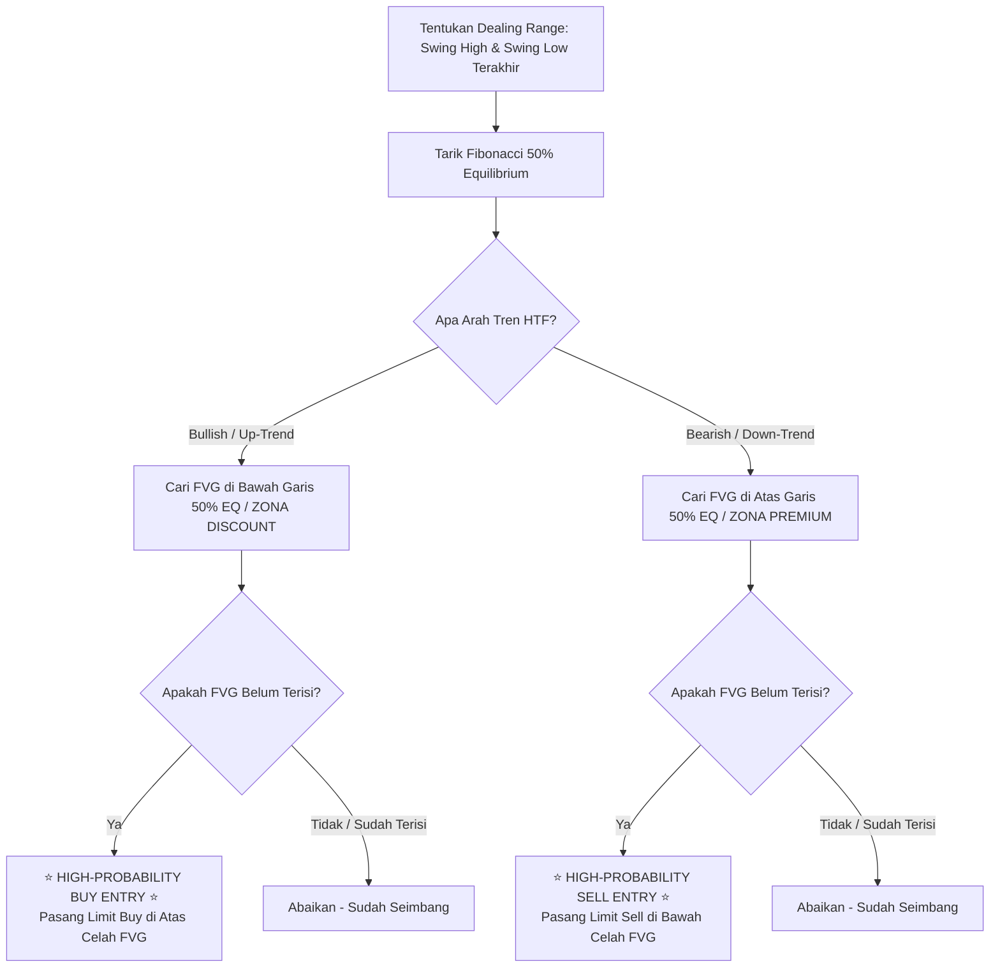

# Bab 10: Momentum & Imbalance (Fair Value Gap / FVG & Premium/Discount)

> *"Pasar keuangan pada hakikatnya adalah mekanisme lelang dua arah. Jika pembeli dan penjual bertransaksi secara seimbang, harga bergerak tenang. Namun, saat institusi menginjak pedal gas penuh, terjadi kekosongan transaksi sepihak yang meninggalkan 'lubang harga'. Cepat atau lambat, hukum gravitasi pasar akan menarik harga kembali untuk menambal lubang tersebut."*  
> — **Akademi Crypto, Modul Crypto Smart Money Concept**

---

## 1. Konsep Ketidakseimbangan Lelang Pasar (*Market Inefficiency*)

Dalam pasar modal konvensional maupun pasar kripto, harga bergerak naik karena ada pembeli yang bersedia membayar di harga penawaran (*ask*), dan turun karena ada penjual yang bersedia melepas di harga permintaan (*bid*).

Pada kondisi normal, setiap kenaikan harga diimbangi oleh transaksi jual yang proporsional di setiap tick harga (*Efficient Market*). Lilin candle yang terbentuk biasanya memiliki sumbu atas dan sumbu bawah yang saling bertumpukan (*overlapping*).

Namun, apa yang terjadi saat **Smart Money** (institusi besar / algoritma HFT) mengeksekusi order miliaran dolar dalam hitungan detik?
- Terjadi **Displacement** (lonjakan satu arah ekstrem).
- Order beli institusi begitu dominan sehingga tidak ada cukup penjual di setiap rentang harga.
- Akibatnya, harga melompati beberapa tick harga tanpa ada transaksi dua arah yang seimbang.
- Kondisi ini menciptakan **Inefficiency / Imbalance** yang di dalam metodologi SMC kita kenal sebagai **Fair Value Gap (FVG)**.

---

## 2. Anatomi 3 Lilin Pembentuk Fair Value Gap (FVG)

Mengidentifikasi Fair Value Gap bukan berdasarkan intuisi, melainkan rumus geometris 3 lilin berurutan (*3-Candle Pattern*):

```
       BULLISH FAIR VALUE GAP (FVG)               BEARISH FAIR VALUE GAP (FVG)
       
              [ Candle 3 ]                                [ Candle 1 ]
             ┌────────────┐                              ┌────────────┐
             │    Wick    │                              │    Wick    │
             └─────┬──────┘                              └─────┬──────┘
                   │  ◄── Titik Terendah (Low C3)              │  ◄── Titik Terendah (Low C1)
       ════════════╪═══════════════════════       ═════════════╪═══════════════════════
       ▒▒▒▒▒▒▒▒▒▒▒▒│▒▒▒▒▒▒▒▒▒▒▒▒▒▒▒▒▒▒▒▒▒▒▒       ▒▒▒▒▒▒▒▒▒▒▒▒▒│▒▒▒▒▒▒▒▒▒▒▒▒▒▒▒▒▒▒▒▒▒▒▒
       ▒▒ AREA KOSONG (BULLISH FVG) ▒▒▒▒▒▒▒       ▒▒ AREA KOSONG (BEARISH FVG) ▒▒▒▒▒▒▒
       ▒▒ (Belum Ada Penjual Seimbang) ▒▒▒▒       ▒▒ (Belum Ada Pembeli Seimbang) ▒▒▒▒
       ▒▒▒▒▒▒▒▒▒▒▒▒│▒▒▒▒▒▒▒▒▒▒▒▒▒▒▒▒▒▒▒▒▒▒▒       ▒▒▒▒▒▒▒▒▒▒▒▒▒│▒▒▒▒▒▒▒▒▒▒▒▒▒▒▒▒▒▒▒▒▒▒▒
       ════════════╪═══════════════════════       ═════════════╪═══════════════════════
                   │  ◄── Titik Tertinggi (High C1)            │  ◄── Titik Tertinggi (High C3)
             ┌─────┴──────┐                              ┌─────┴──────┐
             │    Wick    │                              │    Wick    │
             └────────────┘                              └────────────┘
              [ Candle 1 ]                                [ Candle 3 ]
              
         (Candle 2 adalah Lilin                    (Candle 2 adalah Lilin
         Displacement Raksasa)                     Displacement Raksasa)
```

### Rumus Matematis Pengukuran FVG:
1. **Bullish FVG**:
   - Amati 3 lilin berurutan (Lilin 1, Lilin 2, Lilin 3).
   - Lilin 2 adalah lilin hijau berbadan panjang (*impulsive candle*).
   - Ukur jarak antara **ujung sumbu tertinggi Lilin 1 (*High Candle 1*)** dengan **ujung sumbu terendah Lilin 3 (*Low Candle 3*)**.
   - Jika *Low Candle 3* lebih tinggi daripada *High Candle 1*, celah kosong di antara keduanya adalah **Bullish FVG**.

2. **Bearish FVG**:
   - Lilin 2 adalah lilin merah berbadan panjang (*impulsive candle*).
   - Ukur jarak antara **ujung sumbu terendah Lilin 1 (*Low Candle 1*)** dengan **ujung sumbu tertinggi Lilin 3 (*High Candle 3*)**.
   - Jika *High Candle 3* lebih rendah daripada *Low Candle 1*, celah kosong di antara keduanya adalah **Bearish FVG**.

---

## 3. Analogi Membumi: Lubang Jalan Aspal & Truk Semen

Untuk memahami cara kerja FVG, gunakan analogi perbaikan jalan raya:

> Bayangkan jalan raya aspal baru saja dilintasi oleh konvoi truk raksasa dengan kecepatan tinggi. Karena bebannya yang sangat berat, jalan tersebut retak dan meninggalkan lubang-lubang besar di tengah jalan.  
> 
> Lubang-lubang ini tidak bisa dibiarkan begitu saja oleh Dinas Pekerjaan Umum, karena jika dibiarkan, jalan tersebut akan rusak total dan membahayakan pengguna jalan lainnya. Oleh karena itu, cepat atau lambat, **truk semen pemerintah akan dikirim kembali untuk menuangkan aspal dan menambal lubang tersebut hingga rata**.  
> 
> Setelah lubang terisi semen dan mengering, barulah arus lalu lintas bisa melaju dengan kencang dan aman.

- **Konvoi Truk Berat** = Pergerakan institusi (Smart Money Displacement).
- **Lubang di Aspal** = Fair Value Gap (FVG) / Imbalance.
- **Truk Semen yang Datang Menambal** = Pergerakan koreksi harga yang kembali untuk mengisi kekosongan order (*rebalance / mitigate*).
- **Arus Lalu Lintas Melaju Lagi** = Kelanjutan tren utama setelah FVG terisi.

---

## 4. Konsep Premium vs Discount Array (PD Array)

Salah satu prinsip dasar Smart Money yang sering dilupakan trader ritel adalah: **Whale selalu berpikir seperti pedagang grosir profesional, bukan penjudi.**

Pedagang grosir tidak pernah membeli barang saat harganya mahal di rak toko. Mereka membeli di gudang grosir saat harga sedang diskon besar-besaran, dan menjualnya kembali kepada konsumen ritel saat harganya menyentuh level premium.

Untuk menentukan apakah harga saat ini sedang Murah (*Discount*) atau Mahal (*Premium*), Akademi Crypto menggunakan **Garis Keseimbangan 50% Equilibrium (EQ)** dari rentang ayunan harga (*Dealing Range*):

```
       RANGKAIAN DEALING RANGE & EQUILIBRIUM (50%)
       
 100% ┌────────────────────────────────────────────────────────┐ Swing High (Puncak)
      │                                                        │
      │                  ZONA PREMIUM                          │ 🔴 HANYA CARI PELUANG SELL
      │                 (Harga Mahal)                          │    (Bearish OB / Bearish FVG)
      │                                                        │
  50% ├────────────────────────────────────────────────────────┤ EQUILIBRIUM (Keseimbangan)
      │                                                        │
      │                  ZONA DISCOUNT                         │ 🟢 HANYA CARI PELUANG BUY
      │                 (Harga Murah)                          │    (Bullish OB / Bullish FVG)
      │                                                        │
   0% └────────────────────────────────────────────────────────┘ Swing Low (Lembah)
```

### Cara Menarik Alat Fibonacci Retracement (PD Array Tool):
1. Tarik dari **Swing Low** ke **Swing High** untuk mencari setup *Buy* saat tren naik.
2. Tarik dari **Swing High** ke **Swing Low** untuk mencari setup *Sell* saat tren turun.
3. Garis 0.5 (50%) adalah titik pembagi:
   - **Zona Premium (> 50% sampai 100%)**: Wilayah di mana harga dianggap mahal. Jangan pernah membuka posisi *Long/Buy* di zona ini! Ini adalah tempat ideal untuk mencari setup *Short/Sell*.
   - **Zona Discount (0% sampai < 50%)**: Wilayah di mana harga dianggap murah. Jangan pernah membuka posisi *Short/Sell* di zona ini! Ini adalah tempat ideal untuk mencari setup *Long/Buy*.

---

## 5. Diagram Alur Gabungan FVG & Premium/Discount

Diagram berikut menunjukkan bagaimana menyaring FVG yang layak diambil menggunakan filter Premium/Discount:



---

## 6. Studi Kasus Konkret: Pengisian FVG pada ETH/USDT

Mari kita telaah pergerakan Ethereum (ETH/USDT) pada time frame H4:

### Kronologi Kejadian:
1. **Titik Awal**: ETH membentuk *Swing Low* di $3.000 dan meledak secara agresif hingga membentuk *Swing High* di $3.600 setelah pengumuman penting pasar.
2. **Identifikasi FVG**:
   - Lilin H4 jam 08:00 membuat High di $3.150.
   - Lilin H4 jam 12:00 melonjak masif dengan badan hijau raksasa dari $3.150 ke $3.450.
   - Lilin H4 jam 16:00 memiliki Low di $3.300.
   - **Celah FVG terbentuk** antara $3.150 (*High Candle 1*) hingga $3.300 (*Low Candle 3*). Lebar celah imbalance adalah $150.
3. **Analisis PD Array**:
   - Dealing Range: $3.000 (Low) ke $3.600 (High) = Rentang $600.
   - Garis Equilibrium 50% = $3.300.
   - Seluruh celah FVG ($3.150 – $3.300) berada **di bawah 50%**, artinya FVG ini terletak murni di **ZONA DISCOUNT**!
4. **Eksekusi Smart Money**:
   - Trader Akademi Crypto menaruh order *Limit Buy* di level $3.280 (masuk ke dalam FVG) dengan Stop Loss di $3.120 (di bawah FVG dan batas lilin 1).
   - Satu minggu kemudian, harga ETH terkoreksi perlahan ke bawah $3.300.
   - Harga masuk ke dalam FVG, menyentuh level $3.220 (mengisi 50% celah FVG / *Consequent Encroachment*), lalu seketika berbalik memantul kencang ke $3.800.
   - **Hasil**: Posisi aman tanpa terkena stop loss, menghasilkan Risk to Reward Ratio (RRR) **1:5.2**!

---

## 7. Newbie Traps (Jebakan Pemula Seputar FVG)

Hindari 4 kekeliruan fatal yang sering menguras saldo akun trader pemula:

| No | Jebakan Pemula (Newbie Trap) | Konsekuensi Buruk | Prinsip Benar Akademi Crypto |
|:--:|:---|:---|:---|
| **1** | **Membeli FVG di Zona Premium** | Mengambil posisi Buy saat FVG terbentuk di atas garis 50% EQ. Rawan terbanting koreksi dalam. | Hanya Buy pada FVG di zona **Discount**, dan hanya Sell pada FVG di zona **Premium**. |
| **2** | **Mengira Semua FVG Pasti Terisi 100%** | Menunggu FVG tertutup rapat hingga ujung terbawah sebelum entry, sehingga sering ketinggalan kereta. | Seringkali harga hanya menyentuh ujung FVG (*open gap*) atau titik tengah 50% FVG (*Consequent Encroachment / CE*) lalu langsung jalan. |
| **3** | **Trading FVG Tanpa Konteks Struktur** | Mencari FVG di chart M1 tanpa mengetahui arah tren pasar di chart Daily / H4. | FVG hanyalah alat bantu entry. Arah kompas utama tetap dipegang oleh struktur pasar HTF (BOS / CHoCH). |
| **4** | **Memperlakukan FVG Sebagai Support/Resistance Kebal** | Mengira FVG tidak bisa ditembus dan enggan memasang Stop Loss. | Jika FVG tertembus telak oleh lilin berbadan tebal, itu adalah sinyal bahwa arah order flow berubah (*Inversion FVG*). SL wajib terpasang! |

---

## 8. Glosarium Istilah Bab 10

- **Fair Value Gap (FVG)**: Celah ketidakseimbangan harga antara sumbu lilin ke-1 dan sumbu lilin ke-3 yang terjadi akibat dorongan satu arah yang agresif.
- **Imbalance / Inefficiency**: Situasi di mana pasar hanya melayani satu sisi pesanan (hanya beli atau hanya jual), menciptakan kekosongan likuiditas.
- **Equilibrium (EQ)**: Level tengah 50% dari suatu rentang harga (*Dealing Range*) yang memisahkan zona murah dan zona mahal.
- **Discount Zone**: Area harga di bawah garis 50% Equilibrium; zona terbaik untuk mencari posisi akumulasi/Buy.
- **Premium Zone**: Area harga di atas garis 50% Equilibrium; zona terbaik untuk mencari posisi distribusi/Sell.
- **Consequent Encroachment (CE)**: Titik tengah 50% dari suatu rentang Fair Value Gap yang sering menjadi level reaksi pembalikan harga terkuat.
- **Dealing Range**: Rentang jarak antara titik terendah terkonfirmasi (*Swing Low*) hingga titik tertinggi terkonfirmasi (*Swing High*).

---
*Lanjutkan ke **Bab 11: Smart Money Application (SOP Eksekusi Trading Sistematis)** untuk merangkai semua instrumen ini ke dalam 1 algoritma eksekusi trading yang teruji.*
