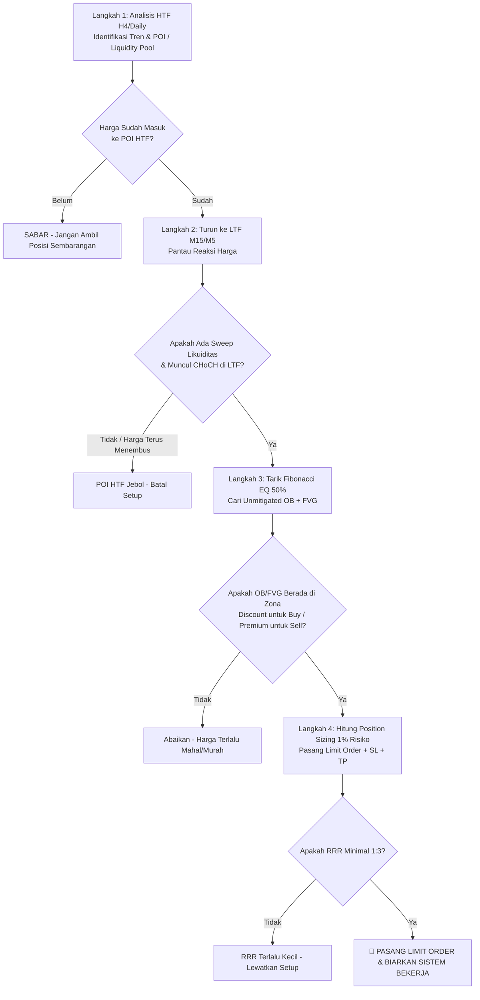

# Bab 11: Smart Money Application (SOP Eksekusi Trading Sistematis)

> *"Trading bukanlah seni menebak masa depan atau berjudi dengan firasat. Di tangan trader profesional Akademi Crypto, trading adalah sebuah proses manufaktur probabilitas tinggi: Anda memiliki Standar Operasional Prosedur (SOP) yang kaku, mengikuti langkah demi langkah tanpa melompat, dan membiarkan keunggulan statistik (*mathematical edge*) bekerja untuk akun Anda."*  
> — **Akademi Crypto, Modul Crypto Smart Money Concept**

---

## 1. Menyatukan Potongan Puzzle: Mengapa SOP Wajib Ada?

Pada bab-bab sebelumnya, Anda telah mempelajari elemen-elemen kunci Smart Money Concept:
- **Likuiditas** (Bab 6): Kolam stop loss ritel (*Equal Highs/Lows*, Trendline).
- **Struktur Pasar & BOS** (Bab 7): Arah tren jangka panjang.
- **Change of Character / CHoCH** (Bab 8): Sinyal awal perubahan nakhoda pasar.
- **Order Block** (Bab 9): Brankas sisa order Smart Money.
- **Fair Value Gap & PD Array** (Bab 10): Magnet harga dan filter wilayah diskon/premium.

Namun, mengetahui potongan-potongan puzzle tersebut tidak ada gunanya jika Anda tidak tahu urutan merangkainya saat layar monitor dibuka. Tanpa SOP tertulis, trader cenderung emosional, FOMO (*Fear of Missing Out*), dan memaksakan order di tempat yang salah.

---

## 2. Analogi Membumi: Resep Masakan Chef Bintang Lima

Bayangkan Anda bekerja di dapur restoran berbintang Michelin:
- Anda tidak bisa memasukkan daging sapi panggang ke dalam piring sebelum oven dipanaskan ke suhu yang tepat.
- Anda tidak bisa menuangkan saus sebelum daging dipotong dengan benar.
- Jika ada satu saja langkah atau bumbu rahasia yang Anda lompati karena terburu-buru, rasa masakan akan hancur dan tamu restoran akan kecewa.

Begitu pula dengan SOP Eksekusi Smart Money Concept: **Setiap langkah bergantung pada konfirmasi langkah sebelumnya.** Jika Langkah 1 belum terpenuhi, Anda dilarang keras melompat ke Langkah 2 atau Langkah 3!

---

## 3. Algoritma 4 Langkah Eksekusi Akademi Crypto

Sistem trading Akademi Crypto dirancang dengan alur multi-timeframe (*Top-Down Analysis*) yang menggabungkan pandangan makro institusi dengan eksekusi mikro yang presisi:

```
┌────────────────────────────────────────────────────────────────────────┐
│             ALGORITMA 4 LANGKAH EKSEKUSI (AKADEMI CRYPTO)              │
├────────────────────────────────────────────────────────────────────────┤
│ LANGKAH 1 : HTF (H4 / Daily) Liquidity Hunt & Direction                │
│             Tentukan arah tren makro dan cari kolam likuiditas target. │
├────────────────────────────────────────────────────────────────────────┤
│ LANGKAH 2 : LTF (M15 / M5) Structural Shift (CHoCH + Sweep)            │
│             Tunggu harga menyapu likuiditas lalu membuat CHoCH di LTF. │
├────────────────────────────────────────────────────────────────────────┤
│ LANGKAH 3 : Menemukan Unmitigated OB + FVG di Zona Diskon/Premium      │
│             Tandai titik entry di wilayah PD Array yang tepat (< 50%). │
├────────────────────────────────────────────────────────────────────────┤
│ LANGKAH 4 : Eksekusi Limit Order & Formula Sizing 1% Risiko            │
│             Hitung ukuran lot/margin presisi, SL di luar wick, TP di Opp. Pool│
└────────────────────────────────────────────────────────────────────────┘
```

### Langkah 1: Higher Timeframe (H4 / Daily) Liquidity Hunt
- Buka grafik H4 atau Daily.
- Tentukan kemana Smart Money sedang bergerak. Cari di mana terdapat tumpukan likuiditas ritel yang belum tersapu (*Unswept Liquidity Pools*), seperti *Equal Highs (EQH)*, *Equal Lows (EQL)*, atau garis tren ritel yang jelas.
- Tandai area minat (*Point of Interest / POI*) besar: H4 Order Block atau H4 FVG.

### Langkah 2: Lower Timeframe (M15 / M5) Structural Shift
- **Jangan langsung entry ketika harga baru menyentuh POI H4!** Seringkali harga menembus lebih dalam untuk memburu likuiditas ritel lokal.
- Turunkan grafik ke time frame operasional (M15 atau M5).
- Tunggu terjadinya **Liquidity Sweep lokal** di LTF, diikuti oleh lilin penembusan struktur pembalikan arah yang kuat: **Change of Character (CHoCH)**.
- Penutupan badan lilin (*candle body close*) di atas swing high (untuk sinyal buy) memvalidasi bahwa kendali pasar telah beralih ke tangan pembeli.

### Langkah 3: Menemukan Unmitigated OB + FVG di Zona yang Sesuai
- Setelah CHoCH terkonfirmasi di M15/M5, tarik garis Fibonacci dari titik swing low terendah (titik sweep) ke titik swing high tertinggi hasil lonjakan CHoCH.
- Periksa garis **50% Equilibrium**:
  - Untuk setup BUY: Hanya cari Order Block atau FVG yang berada di **Zona Discount (< 50%)**.
  - Untuk setup SELL: Hanya cari Order Block atau FVG yang berada di **Zona Premium (> 50%)**.
- Pastikan OB tersebut masih berstatus *Unmitigated* (perawan) dan memiliki celah FVG di depannya (*confluence*).

### Langkah 4: Eksekusi Limit Order, Stop Loss & Take Profit Target
- Pasang **Limit Order** di tepi atas zona OB/FVG tersebut.
- Pasang **Stop Loss (SL)** secara objektif dan matematis beberapa pip di bawah ujung sumbu (*wick*) terluar swing sweep. **Jangan pernah menggeser SL!**
- Tentukan **Take Profit (TP)** pada kolam likuiditas berikutnya di sisi berlawanan (*Opposite Liquidity Pool* atau H4 Swing High).
- **Syarat Mutlak**: Nilai *Risk-to-Reward Ratio (RRR)* harus **minimal 1:3** (berisiko $100 untuk potensi keuntungan minimal $300).

---

## 4. Diagram Alur SOP Eksekusi Lengkap



---

## 5. Formula Position Sizing Kripto: Kebal dari Likuidasi Margin Call

Salah satu kesalahan paling mematikan bagi pemula di pasar futures kripto adalah menggunakan leverage 20x, 50x, atau 100x secara sembrono tanpa menghitung risiko per trade. 

Di Akademi Crypto, aturan mutlak manajemen risiko adalah: **Maksimal risiko per trade adalah 1% dari total modal akun (ekuitas).**

### Rumus Matematis Menghitung Nilai Posisi (*Position Size*):

$$\text{Maksimal Risiko (\$) } = \text{Total Modal Akun} \times 1\%$$

$$\text{Jarak Stop Loss (\%)} = \left| \frac{\text{Harga Entry} - \text{Harga Stop Loss}}{\text{Harga Entry}} \right| \times 100\%$$

$$\text{Total Nilai Posisi (\$) } = \frac{\text{Maksimal Risiko (\$) }}{\text{Jarak Stop Loss (\%) / 100}}$$

$$\text{Margin yang Dipasang} = \frac{\text{Total Nilai Posisi}}{\text{Leverage}}$$

> **Hukum Besi Margin Kripto**: Jarak likuidasi bursa (*Liquidation Price*) **HARUS** selalu berada jauh di belakang garis Stop Loss Anda. Jika Anda terkena Stop Loss, Anda hanya kehilangan 1% modal, dan akun Anda tidak akan pernah terkena *Margin Call* (*Liquidation*)!

---

## 6. Studi Kasus Konkret: Live Setup BTC/USDT Lengkap

Berikut adalah simulasi kasus nyata dengan angka matematis riil:

### Data Portofolio:
- **Total Modal Akun (Equity)**: $10.000 USD
- **Risiko per Transaksi (1%)**: $100 USD

### Jalannya Analisis & Eksekusi:
1. **Langkah 1 (H4)**: BTC berada dalam tren naik jangka panjang. Harga turun menuju zona diskon H4 dan terdapat kolam likuiditas ritel *Equal Lows* di $64.000.
2. **Langkah 2 (M15)**: Harga menusuk turun ke $63.800 (menyapu likuiditas EQL $64.000). Lima belas menit kemudian, muncul lilin hijau raksasa yang menembus *Swing High* terdekat di $64.500 dengan *candle close*. **CHoCH Valid terkonfirmasi!**
3. **Langkah 3 (M15)**:
   - Tarik Fibonacci dari Low $63.800 ke High $65.000. Garis 50% Equilibrium ada di $64.400.
   - Ditemukan lilin merah terakhir sebelum lonjakan di harga **$64.000 - $64.200** yang memiliki celah FVG dan belum pernah disentuh (*Unmitigated Bullish OB di Zona Discount*).
4. **Langkah 4 (Kalkulasi Matriks Order)**:
   - **Harga Entry (Limit Buy)**: $64.150
   - **Harga Stop Loss (SL)**: $63.750 (400 poin di bawah harga entry, di bawah ujung wick sweep $63.800).
   - **Harga Take Profit 1 (TP1 - 50% posisi)**: $65.350 (RRR 1:3)
   - **Harga Take Profit 2 (TP2 - 50% posisi)**: $66.550 (RRR 1:6 - Menyapu *Equal Highs* H4)

### Kalkulasi Ukuran Posisi:
- Jarak Stop Loss = $(64.150 - 63.750) / 64.150 = 0,623\%$
- Total Nilai Posisi (Notional) = $\$100 / 0,00623 = \$16.051$ USD
- Ukuran Koin (BTC) = $\$16.051 / 64.150 \approx 0,25$ BTC
- Jika menggunakan leverage 10x, Margin yang dijaminkan = $\$16.051 / 10 = \$1.605$ USD.
- **Hasil Skenario**:
  - Harga menjemput Limit Order di $64.150, bereaksi cepat, dan melesat ke target TP2 di $66.550.
  - Keuntungan yang diperoleh: $\$600$ USD (Kenaikan +6% pada akun modal hanya dalam satu transaksi berisiko 1%!).

---

## 7. Newbie Traps (Jebakan Pemula dalam Eksekusi SOP)

| No | Jebakan Pemula (Newbie Trap) | Mengapa Berbahaya? | Solusi Akademi Crypto |
|:--:|:---|:---|:---|
| **1** | **Market Order Karena FOMO** | Menekan tombol "Buy Market" saat lilin hijau sedang terbang tinggi karena takut ketinggalan. RRR menjadi sangat jelek dan rawan terbanting koreksi. | Pasang **Limit Order** di area OB/FVG Discount. Jika harga tidak menjemput, ikhlaskan! Pasar selalu menyediakan peluang baru setiap hari. |
| **2** | **Memperlebar Stop Loss Saat Tertinggal** | Menggeser SL semakin jauh saat harga mendekati titik invalidasi karena tidak mau mengakui analisa salah. Ini awal mula kebangkrutan akun. | Stop Loss adalah biaya operasional bisnis Anda. Begitu SL tersentuh, terima dengan lapang dada dan evaluasi jurnal. |
| **3** | **Over-leveraging (50x - 100x Tanpa Ukur Risiko)** | Menempatkan margin besar dengan leverage tinggi demi ingin cepat kaya. Sekali sumbu bursa berguncang 1%, seluruh modal hangus seketika. | Disiplin gunakan formula sizing 1% risiko. Leverage hanyalah alat efisiensi modal, bukan jalan pintas perjudian. |
| **4** | **Revenge Trading** | Langsung membuka posisi baru secara agresif sesaat setelah terkena SL untuk membalas dendam kepada pasar. | Terapkan aturan "Maksimal 2 Loss Sehari". Jika terkena 2 SL berturut-turut, matikan komputer dan rehat hingga keesokan harinya. |

---

## 8. Glosarium Istilah Bab 11

- **Confluence**: Pertemuan beberapa faktor konfirmasi teknikal di area harga yang sama (misal: H4 POI + M15 Sweep + CHoCH + Discount OB + FVG).
- **Risk-to-Reward Ratio (RRR)**: Perbandingan antara potensi kerugian yang siap ditanggung dengan potensi keuntungan yang ditargetkan (standar minimal 1:3).
- **Invalidation Point**: Level harga di mana skenario analisis teknikal Anda terbukti salah secara objektif (titik penempatan Stop Loss).
- **Position Sizing**: Perhitungan matematis untuk menentukan besaran nominal kontrak yang dibuka berdasarkan batasan toleransi risiko akun.
- **Margin**: Uang jaminan riil dari modal Anda yang dikunci oleh bursa saat membuka posisi berleverage.
- **Leverage**: Fasilitas pengganda daya beli yang disediakan oleh bursa pertukaran kripto.
- **Top-Down Analysis**: Metodologi analisis grafik yang dimulai dari time frame besar (Daily/H4) untuk menentukan bias arah, lalu turun ke time frame kecil (M15/M5) untuk presisi entri.

---
*Lanjutkan ke bab penutup **Bab 12: Closing (Mindset Whale, Manajemen Portofolio & Kelangsungan Hidup Kripto)** untuk mengunci kesuksesan jangka panjang Anda di industri aset digital.*
