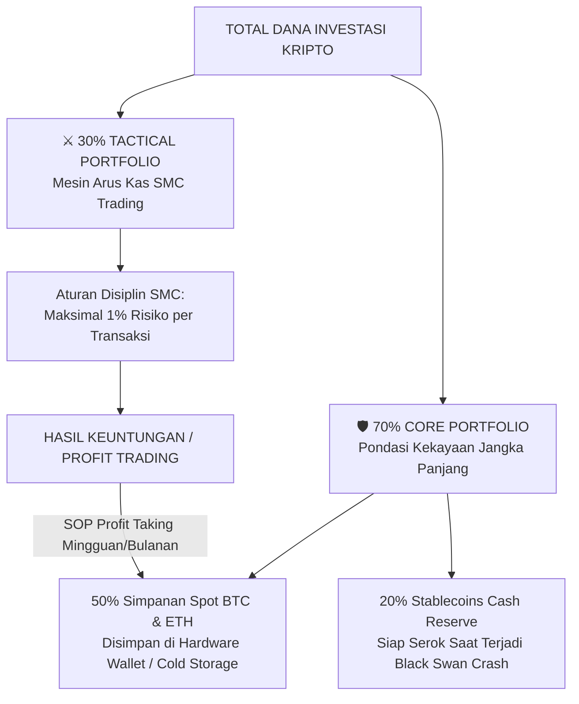
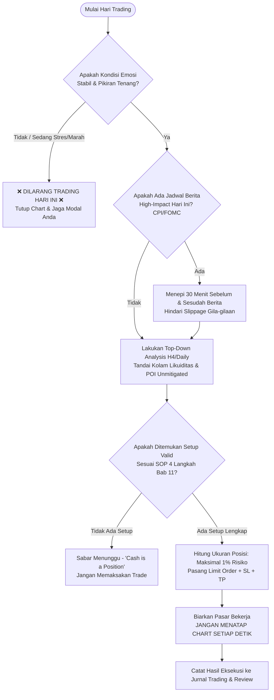

# Bab 12: Closing (Mindset Whale, Manajemen Portofolio & Kelangsungan Hidup Kripto)

> *"Tujuan utama seorang trader sejati di pasar kripto bukanlah menjadi kaya dalam semalam melalui satu koin jackpot. Tujuan utamanya adalah **bertahan hidup cukup lama** agar keajaiban bunga majemuk (*compound interest*) dan asimetri teknologi terdesentralisasi dapat mengubah takdir finansial keluarga Anda selamanya."*  
> — **Akademi Crypto, Modul Crypto Smart Money Concept**

---

## 1. Filosofi Kemerdekaan Finansial Versi Akademi Crypto

Banyak orang masuk ke dunia kripto dengan ilusi kekayaan instan. Mereka melihat tangkapan layar keuntungan 1.000% di media sosial, lalu menjual seluruh aset riil mereka untuk berjudi di koin meme (*meme coins*) atau memasang leverage 100x di kontrak futures. 

Hasilnya? **95% dari mereka kehilangan seluruh modalnya dalam waktu kurang dari 90 hari.**

Pasar kripto adalah arena pertarungan finansial paling brutal di muka bumi karena pasar ini buka 24 jam sehari, 7 hari seminggu, tanpa ada batas penghentian perdagangan (*circuit breaker*). Di sini, emosi ketakutan (*fear*) dan keserakahan (*greed*) manusia dieksploitasi habis-habisan oleh algoritma Market Maker.

### Prinsip Utama: Survival First, Profit Second
Untuk menjadi seorang Smart Money Trader, Anda harus mengubah paradigma berpikir Anda:
- Seorang amatir fokus pada: *"Berapa banyak uang yang bisa saya menangkan hari ini?"*
- Seorang master/whale fokus pada: *"Berapa banyak risiko kerugian maksimal yang bisa saya kendalikan agar besok saya masih bisa bermain?"*

Jika Anda tidak pernah bangkrut (*zero risk of ruin*), waktu akan selalu berpihak kepada Anda. Setiap siklus 4-tahun Bitcoin (Halving Cycle) terbukti memberikan kesempatan akumulasi kekayaan generasi baru bagi mereka yang masih memegang modal dan bertahan hidup.

---

## 2. Analogi Membumi: Prajurit Baju Zirah Baja vs Petarung Nekat Tanpa Busana

Bayangkan sebuah medan pertempuran kolosal:
- **Petarung Nekat Tanpa Busana (Trader Ritel Penjudi)**: Dia melompat ke tengah medan pertempuran tanpa mengenakan baju zirah, hanya berteriak sambil mengayunkan pedang tumpul. Satu panah liar saja yang mengenainya sudah cukup untuk membuatnya tewas seketika. Ini mencerminkan trader yang menaruh 100% uangnya di futures dengan leverage tinggi tanpa Stop Loss.
- **Prajurit Berbaju Zirah Baja & Perisai Kokoh (Trader Smart Money)**: Dia berdiri di garis pertahanan yang solid. Dia mengenakan helm baja tahan benturan, membawa perisai besar (*Stop Loss & Risk Management*), dan bertarung di dalam formasi benteng yang kokoh (*Core Portfolio Spot*). Ketika panah musuh datang menghujani, perisai menepisnya tanpa rasa panik. Dia menyerang hanya ketika barisan musuh terbuka (*high-probability setup*).

---

## 3. Alokasi Portofolio Ideal Akademi Crypto: Strategi Barbel 70/30

Salah satu rahasia terbesar mengapa para mentor dan lulusan terbaik Akademi Crypto bisa tenang saat pasar kripto mengalami keruntuhan (*crash*) hingga 50%–70% adalah karena penerapan **Strategi Barbel Portofolio (70/30 Rule)**:

```
┌────────────────────────────────────────────────────────────────────────┐
│             STRUKTUR ALOKASI PORTOFOLIO AKADEMI CRYPTO                 │
├────────────────────────────────────────────────────────────────────────┤
│ 70% CORE PORTFOLIO (Pilar Pondasi Kekayaan Jangka Panjang)             │
│  - 50% Bitcoin (BTC) & Ethereum (ETH) murni di Cold Storage.           │
│  - 20% Cadangan Tunai / Stablecoins (USDT/USDC) untuk jaring crash.    │
│  * SIFAT: DILARANG DISENTUH UNTUK TRADING HARIAN / LEVERAGE!          │
├────────────────────────────────────────────────────────────────────────┤
│ 30% TACTICAL TRADING PORTFOLIO (Mesin Arus Kas & Pertumbuhan Aktif)    │
│  - 100% Digunakan untuk Eksekusi Smart Money Concept (SMC).            │
│  - Menggunakan disiplin ketat risiko 1% modal per transaksi.           │
│  - Keuntungan (profit) ditarik berkala dan dialirkan ke Core Portfolio!│
└────────────────────────────────────────────────────────────────────────┘
```



Dengan struktur barbel ini:
1. Jika akun trading Anda mengalami hari yang buruk atau rentetan *drawdown*, 70% kekayaan Anda tetap aman terlindungi di brankas digital dingin (*Cold Storage*).
2. Jika terjadi krisis global atau *black swan crash*, cadangan 20% stablecoin Anda memungkinkan Anda memborong Bitcoin di dasar lembah diskon.
3. Setiap kali portofolio trading 30% menghasilkan profit, sebagian profit tersebut ditarik (*cashout*) untuk membeli lebih banyak spot BTC/ETH, sehingga fondasi kekayaan Anda semakin membesar dari waktu ke waktu!

---

## 4. Bahaya Candu Judi Leverage 50x–100x & Terapi Overtrading

Mengapa bursa kripto (CEX) selalu mempromosikan fitur leverage 50x hingga 125x di halaman depan aplikasi mereka?
Karena bursa tahu persis secara psikologis bahwa: **Manusia memiliki kecenderungan bawaan menjadi kecanduan dopamin dari perjudian.**

### Gejala Candu Trading (*Trading Addiction / Overtrading*):
1. Merasa gelisah, cemas, atau tidak tenang jika tidak memiliki posisi terbuka di bursa.
2. Membuka aplikasi bursa puluhan kali dalam satu jam, termasuk saat makan bersama keluarga atau menjelang tidur.
3. Mencoba membalas dendam (*revenge trade*) segera setelah terkena Stop Loss dengan ukuran posisi dua kali lipat lebih besar.
4. Terus merenungkan kerugian masa lalu dan bermimpi memulihkannya dalam satu kali transaksi ajaib.

### Tiga Langkah Terapi Pemulihan Akademi Crypto:
- **Langkah 1: Karantina Finansial (Detoks Layar)**: Jika Anda mengalami 3 kekalahan beruntun dalam 1 hari, tutup laptop, hapus aplikasi trading dari ponsel Anda selama 48 jam penuh, dan berolahragalah atau berjalan di alam terbuka.
- **Langkah 2: Turunkan Ukuran Posisi ke Risiko 0,5%**: Jika psikologi Anda terguncang, jangan berhenti trading sepenuhnya, melainkan perkecil risiko menjadi hanya 0,5% atau 0,25% per trade hingga rasa percaya diri Anda terhadap SOP pulih.
- **Langkah 3: Fokus pada Proses, Bukan Uang**: Tutup nominal Dolar ($) pada tampilan PnL aplikasi Anda, ubah menjadi satuan poin RRR (*Risk-to-Reward*). Nilai keberhasilan Anda bukan dari berapa dolar yang Anda hasilkan, melainkan dari **seberapa disiplin Anda mematuhi SOP 4 Langkah Bab 11**.

---

## 5. Jurnal Trading Kripto & Audit Psikologi Mingguan

Trader tanpa jurnal trading ibarat sebuah perusahaan multinasional yang beroperasi tanpa pembukuan keuangan. Tanpa pencatatan, Anda tidak akan pernah tahu apakah kekalahan Anda disebabkan oleh strategi yang cacat atau emosi yang tidak stabil.

### Format Standar Jurnal Trading Akademi Crypto:

| Tanggal | Pair | Arah | Konfluensi SMC (H4 POI + LTF CHoCH) | Risk ($) | Entry | Stop Loss | Take Profit | Hasil (R) | Catatan Psikologi & Emosi |
|:---:|:---:|:---:|:---|:---:|:---:|:---:|:---:|:---:|:---|
| 10/11 | BTC/USDT | Long | H4 Sweep EQL + M15 CHoCH + Discount OB | $100 | $64.150 | $63.750 | $66.550 | +6R (+$600) | Sabar menunggu limit order. Tenang tidak menyentuh layar. |
| 12/11 | ETH/USDT | Short | H4 Supply FVG + M5 CHoCH | $100 | $3.450 | $3.500 | $3.300 | -1R (-$100) | Setup valid tapi kena sweep wick berita CPI. Disiplin cut loss. |

### Rutinitas Audit Mingguan (Setiap Hari Minggu):
1. Hitung total transaksi minggu ini (idealnya hanya 3–6 trade berkualitas tinggi).
2. Periksa rasio kemenangan (*Win Rate*) dan rata-rata *Risk-to-Reward Ratio (RRR)*.
3. Jawab pertanyaan evaluasi diri:
   - *Apakah ada trade yang saya ambil murni karena FOMO atau bisikan media sosial?*
   - *Apakah saya pernah menggeser Stop Loss menjauh saat harga mendekat?*
   - *Jika ada kesalahan, apa komitmen perbaikan saya untuk minggu depan?*

---

## 6. Diagram Checklist Harian Trader Smart Money

Tempelkan diagram checklist ini di depan meja kerja Anda sebelum Anda menyalakan aplikasi charting setiap pagi:



---

## 7. Glosarium Istilah Bab 12

- **Cold Storage / Hardware Wallet**: Dompet fisik terisolasi tanpa koneksi internet langsung (seperti Ledger atau Trezor) untuk menyimpan aset kripto spot dengan tingkat keamanan maksimal.
- **Drawdown**: Penurunan persentase modal dari titik puncak ekuitas tertinggi ke titik terendah selama periode trading tertentu.
- **Risk of Ruin**: Probabilitas matematis seorang trader kehilangan seluruh modalnya akibat rentetan kerugian dan ukuran risiko yang berlebihan.
- **Core Portfolio**: Bagian terbesar dari portofolio investasi yang dialokasikan pada aset fundamental utama (BTC/ETH) dengan orientasi penyimpanan bertahun-tahun.
- **Tactical Portfolio**: Porsi modal aktif yang dialokasikan untuk menghasilkan arus kas melalui perdagangan bersistem (SMC trading).
- **Asymmetrical Bet**: Situasi investasi atau perdagangan di mana potensi keuntungan jauh melampaui potensi risiko kerugian yang dibatasi (misal risiko 1R untuk potensi hasil 5R atau lebih).

---

## 8. Penutup Inspiratif: Mengubah Takdir Finansial Anda

Selamat! Anda telah menyelesaikan seluruh kurikulum **Crypto Smart Money Concept (CSM)** dari Akademi Crypto.

Anda kini bukan lagi seorang trader ritel yang tersesat di kegelapan, meraba-raba indikator yang tertinggal (*lagging indicators*), atau menjadi santapan empuk para paus (*whales*). Anda telah memiliki kacamata sinar-X untuk melihat jejak akumulasi institusi, membaca kolam likuiditas, dan mengeksekusi perdagangan dengan tenang seperti predator puncak di lautan luas.

Ingatlah selalu pesan kami:
> **Pasar kripto tidak berhutang apa pun kepada Anda.**  
> Pasar tidak peduli dengan impian Anda, tagihan bulanan Anda, atau seberapa keras Anda berdoa di depan grafik.  
> 
> Satu-satunya hal yang dihargai oleh pasar kripto adalah **DISIPLIN, KESABARAN, dan KERENDAHAN HATI**.  
> 
> Kuasai emosi Anda, hormati Stop Loss Anda, jaga Core Portfolio Anda, dan biarkan pemahaman Smart Money Concept ini membimbing Anda menuju kemerdekaan finansial yang sejati.

*Salam Kemerdekaan Finansial, Sampai Jumpa di Puncak Kesuksesan!*  
**— Tim Kurikulum & Master Trader Akademi Crypto**
