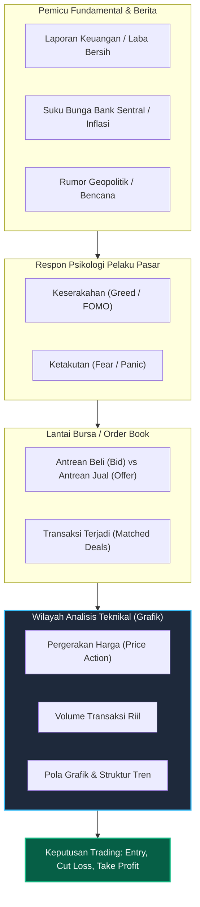
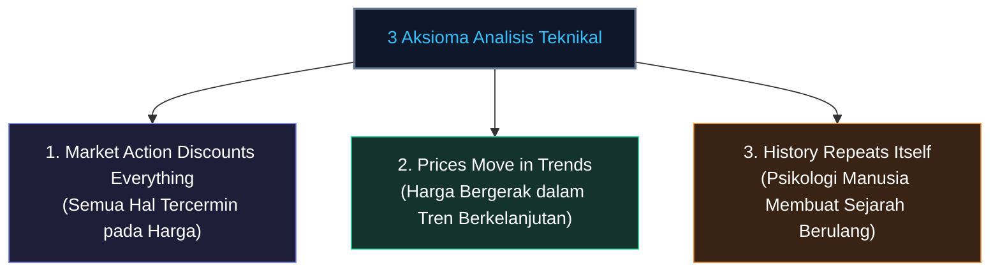
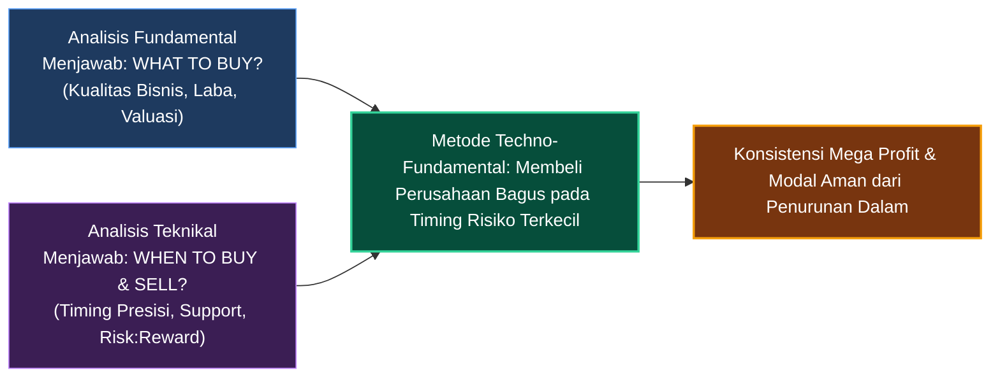
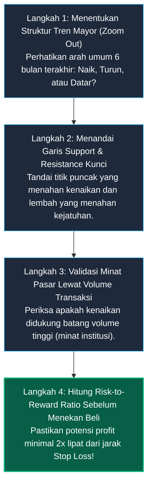

# Bab 1: Pengenalan Technical Analysis

> "Analisis teknikal bukanlah bola kristal untuk meramal masa depan dengan kepastian mutlak, melainkan sebuah seni dan disiplin ilmiah dalam membaca probabilitas perilaku manusia yang tercermin pada grafik harga."  
> — **Edianto Ong**, *Technical Analysis for Mega Profit*

---

## 1. Analogi Dunia Nyata: Membaca Dinamika Harga dari Pasar Tradisional

Bayangkan Anda sedang berdiri di tengah **Pasar Induk Kramat Jati** pada pukul 03.00 dini hari. Ratusan truk bermuatan cabe merah keriting dan bawang merah baru saja tiba dari Jawa Tengah.

Bagaimana harga cabe terbentuk di subuh hari itu?
* Jika ada 50 truk cabai tiba bersamaan sementara jumlah pembeli (pedagang sayur keliling dan katering) hanya sedikit, para tengkulak akan saling berebut menurunkan harga agar cabainya tidak busuk. Terjadilah **tekanan jual (selling pressure)**: harga cabe anjlok dari Rp60.000 menjadi Rp35.000 per kilogram.
* Sebaliknya, jika dikabarkan terjadi banjir bandang di sentra pertanian sehingga hanya ada 3 truk yang berhasil lolos, sementara puluhan pedagang antre berebut barang, tengkulak menaikkan harga setinggi langit. Terjadilah **kekuatan beli (buying pressure)**: harga melesat ke Rp90.000 per kilogram.

Apakah Anda perlu memeriksa sertifikat tanah petani cabai atau memeriksa kadar pupuk kimia cabai tersebut untuk mengetahui arah harga pagi itu? **Sama sekali tidak!** Cukup dengan mengamati:
1. Berapa harga transaksi yang disepakati saat ini (**Price**).
2. Seberapa banyak karung yang berpindah tangan (**Volume**).
3. Apakah pembeli yang mendesak menaikkan tawaran, atau penjual yang mengobral barang (**Supply vs Demand**).

Inilah hakikat dasar **Analisis Teknikal (Technical Analysis)**. Di bursa saham, pasar valuta asing (forex), maupun pasar komoditas emas dunia, grafik lilin (*candlestick*) dan histogram volume adalah rekaman jejak nyata pertarungan ribuan pedagang dan institusi keuangan besar di seluruh dunia.



---

## 2. Kamus Istilah Pemula (Glossary Box)

Sebelum melangkah lebih dalam, kenali istilah-istilah wajib yang sering digunakan oleh analis dan trader:

| Istilah | Terjemahan Bebas | Penjelasan Sederhana untuk Pemula |
| :--- | :--- | :--- |
| **Bullish** | Tren Naik | Pasar yang bergerak naik. Diambil dari analogi banteng (*bull*) yang menyeruduk musuhnya ke atas dengan tanduknya. |
| **Bearish** | Tren Turun | Pasar yang bergerak turun. Diambil dari analogi beruang (*bear*) yang mencakar mangsanya ke bawah. |
| **Price Action** | Perilaku Gerak Harga | Gerakan telanjang harga pada grafik tanpa ketergantungan pada indikator matematis rumit. |
| **Smart Money / Institusi** | Dana Kakap / Bandar | Pelaku pasar bermodal jumbo (bank investasi, dana pensiun, *hedge fund*) yang mampu menggerakkan harga pasar. |
| **Support** | Lantai / Penahan Bawah | Level harga di mana minat beli diperkirakan cukup kuat untuk menahan penurunan harga lebih lanjut. |
| **Resistance** | Atap / Penahan Atas | Level harga di mana tekanan jual diperkirakan cukup besar untuk menghentikan laju kenaikan harga. |
| **Stop Loss (SL)** | Batas Pengaman Modal | Perintah cut-loss otomatis untuk menutup posisi ketika analisis terbukti salah, guna mencegah kebangkrutan modal. |
| **Take Profit (TP)** | Target Penguncian Laba | Level harga yang telah direncanakan untuk menjual aset dan merealisasikan keuntungan (*cashing in*). |
| **Risk-to-Reward Ratio (RRR)** | Rasio Risiko terhadap Imbalan | Perbandingan antara potensi kerugian (risiko) dan potensi keuntungan pada suatu transaksi. Idealnya minimal 1:2. |

---

## 3. Tiga Aksioma Dasar Analisis Teknikal

Analisis teknikal modern yang dirumuskan sejak era Charles Dow dan dimatangkan oleh Edianto Ong berpijak pada **tiga aksioma (hukum dasar)** mutlak:



### Aksioma 1: *Market Action Discounts Everything* (Harga Mencerminkan Segalanya)
Analis teknikal meyakini bahwa **semua informasi**—kinerja keuangan emiten, keputusan suku bunga The Fed, isu geopolitik, skandal manajemen, bencana alam, hingga rumor di warung kopi—semuanya sudah diserap, dinilai, dan langsung terefleksi ke dalam harga pasar saat ini.

* **Mengapa demikian?** Pasar keuangan adalah mesin diskon masa depan (*forward-looking machine*). Pelaku pasar kakap (*smart money*) yang memiliki jaringan intelijen riset lebih dahulu mengalirkan modalnya. Akibatnya, jejak transaksi mereka sudah tampak di grafik berminggu-minggu sebelum laporan resmi atau berita koran dicetak untuk publik.
* **Fenomena "Buy the Rumor, Sell the News":** Seringkali pemula heran melihat sebuah saham melaporkan laba naik 100%, tetapi saat pengumuman harga sahamnya justru anjlok parah (*dumping*). Mengapa? Karena para profesional sudah membelinya sejak harga di bawah saat masih rumor, dan menjual saham tersebut kepada pemula yang baru membeli karena membaca berita euforia.

### Aksioma 2: *Prices Move in Trends* (Harga Bergerak Mengikuti Tren)
Harga tidak meloncat secara acak (*random walk*) setiap detiknya tanpa keteraturan. Harga bergerak dalam lintasan dinamis bernama **tren** (kecenderungan arah).
* Mengikuti **Hukum Inersia Newton**: Sebuah benda yang bergerak cenderung tetap bergerak searah sampai ada gaya luar yang membelokkannya.
* Begitu pula pasar: sebuah saham yang sedang berada dalam tren naik (*uptrend*) memiliki probabilitas jauh lebih besar untuk terus naik daripada mendadak anjlok, sampai ada kekuatan jual (*supply*) masif yang mematahkan tren tersebut.
* Tugas trader bukanlah meramal puncak atau dasar jurang, melainkan mendeteksi tren sejak awal dan menungganginya sampai sinyal pembalikan arah terkonfirmasi.

### Aksioma 3: *History Repeats Itself* (Sejarah Selalu Berulang)
Grafik harga dari bursa beras Jepang tahun 1750 memiliki pola formasi yang sama persis dengan grafik pergerakan harga saham Apple, Bitcoin, atau IHSG tahun 2026. Mengapa pola-pola grafik seperti *Double Bottom*, *Head and Shoulders*, dan *Breakout* terus berulang selama berabad-abad?

Kuncinya ada pada **sifat dasar manusia**:
* Rasa serakah (*greed*) saat melihat orang lain kaya mendadak.
* Rasa takut (*fear*) saat portofolio merosot dan uang tabungan menipis.
* Harapan palsu (*hope*) saat menahan posisi rugi dengan doa agar harga kembali ke modal.

Karena reaksi emosional manusia terhadap uang tidak pernah berubah sejak zaman peradaban kuno, maka jejak grafis dari reaksi emosi tersebut akan selalu menghasilkan pola visual yang sama berulang-ulang di masa depan.

---

## 4. Komparasi Mendalam: Fundamental Analysis vs Technical Analysis

Edianto Ong menekankan bahwa Analisis Fundamental dan Analisis Teknikal bukanlah dua kubu yang bermusuhan, melainkan dua instrumen komplementer yang menjawab pertanyaan berbeda dalam satu kesatuan rencana investasi:



| Parameter Evaluasi | Analisis Fundamental (FA) | Analisis Teknikal (TA) |
| :--- | :--- | :--- |
| **Pertanyaan Inti** | *"What to Buy?"* (Saham/aset apa yang perusahaannya bagus?) | *"When to Buy & When to Sell?"* (Kapan detik terbaik masuk & keluar pasar?) |
| **Objek Kajian** | Neraca laba/rugi, rasio PER, PBV, ROE, manajemen, regulasi industri. | Grafik pergerakan harga historis (*price action*), volume, dan tren. |
| **Waktu Respon** | Lambat. Laporan keuangan hanya terbit 3 bulan sekali (kuartalan). | Real-time. Detik per detik merekam keluar masuknya aliran dana bursa. |
| **Jangka Waktu** | Jangka panjang (tahunan hingga dekade). | Fleksibel: Menit (scalping), Hari (swing), hingga Bulanan (investasi). |
| **Kelemahan Kritis** | Terjebak fenomena *Value Trap* (saham murah terus makin murah selama bertahun-tahun karena ditinggal investor). | Risiko *False Breakout / Whipsaw* jika tidak disiplin menggunakan pembatasan risiko (*Stop Loss*). |

---

## 5. Panduan Step-by-Step Pemula: Menganalisis Layar Kosong (Blank Chart)

Banyak pemula grogi ketika pertama kali membuka aplikasi charting (seperti TradingView atau RTI) dan hanya melihat layar hitam dengan lilin warna-warni yang bergerak. Ikuti prosedur standar 4 langkah berikut:



1. **Langkah 1 (Zoom Out untuk Melihat Arah Jalan):**  
   Buka grafik periode harian (*Daily Chart*). Kecilkan grafik (*zoom out*) sampai Anda melihat pergerakan harga 6 bulan hingga 1 tahun ke belakang. Tentukan apakah harga sedang mendaki ke kanan atas (**Uptrend**), merosot ke kanan bawah (**Downtrend**), atau mondar-mandir di tempat (**Sideways**).
2. **Langkah 2 (Pasang Pagar Pembatas):**  
   Cari 2 atau 3 titik pantulan harga di masa lalu. Tarik garis horizontal di lantai paling bawah di mana harga enggan turun lagi (**Support**) dan tarik garis di atap atas di mana harga selalu terpental turun (**Resistance**).
3. **Langkah 3 (Cek Bahan Bakar Pergerakan):**  
   Perhatikan indikator volume di bagian bawah. Apakah saat lilin hijau besar muncul, volume transaksinya melonjak jauh di atas rata-rata 20 hari? Jika ya, itu adalah sinyal bahwa para pemain besar (*institusi/dana pensiun*) sedang ikut membeli.
4. **Langkah 4 (Rancang Rencana Tempur):**  
   Jangan pernah membeli tanpa tahu di mana batas toleransi salah. Ukur jarak harga beli ke titik *Stop Loss* (misal risiko rugi 3%). Pastikan jarak ke target profit (*Resistance*) minimal 6% atau 9% (Rasio Risk:Reward 1:2 atau 1:3).

---

## 6. Studi Kasus Konkret: Transaksi Saham Bank Central Asia (BBCA)

Mari kita bedah skenario riil transaksi pada saham berkapitalisasi terbesar di Bursa Efek Indonesia, **BBCA**:

```
Harga
  Rp10.500 |------------------------- Target Profit (Resistance Mayor) -> +7,14%
           |                     /
  Rp10.200 |                    /
           |         /\        /
   Rp9.800 |--------+--\------/------ Titik Beli / Entry (Rebound di Area Support)
           |        |   \    /
   Rp9.500 |========+====\==/======== Support Kuat (Titik Pantulan Masa Lalu)
   Rp9.450 |------------------------- Stop Loss (Batas Toleransi Risiko) -> -3,57%
```

* **Situasi Pasar:**  
  Saham BBCA sedang berada dalam fase tren naik jangka panjang (*primary uptrend*), namun mengalami koreksi sehat selama 2 minggu dari level Rp10.400 kembali mendekati area lantai support kuat di Rp9.500 - Rp9.600.
* **Titik Masuk (Entry):**  
  Pada grafik harian, muncul candle lilin hijau bertangkai bawah panjang (*Hammer*) di area Rp9.750 dengan konfirmasi lonjakan volume. Trader masuk posisi beli di harga **Rp9.800**.
* **Proteksi Risiko (Stop Loss):**  
  Level support kunci berada di Rp9.500. Trader memasang *Stop Loss* di level **Rp9.450** (sedikit di bawah support untuk mengantisipasi jarum palsu).
  * *Risiko Kerugian per Lembar:* Rp9.800 - Rp9.450 = Rp350 per lembar (-3,57%).
* **Target Keuntungan (Take Profit):**  
  Target resistensi sebelumnya berada di kisaran puncak **Rp10.500**.
  * *Potensi Keuntungan per Lembar:* Rp10.500 - Rp9.800 = Rp700 per lembar (+7,14%).
* **Evaluasi Rasio:**  
  Rasio *Risk to Reward* adalah **Rp350 : Rp700 = 1 : 2**.  
  Ini adalah transaksi berprobabilitas unggul (*high probability trade*). Bahkan jika trader hanya memiliki tingkat akurasi 50%, portofolio secara matematis akan terus bertumbuh karena saat untung mendapat Rp2, saat rugi hanya kehilangan Rp1.

---

## 7. Kesalahan Fatal Pemula (*Newbie Traps*)

Berikut adalah 4 jebakan utama yang paling sering membakar modal trader pemula di babak pengenalan:

1. **Sindrom Bola Kristal (*The Oracle Fallacy*):**  
   Pemula mengira belajar analisis teknikal akan membuat mereka bisa menebak masa depan dengan kepastian 100%. Ketika prediksi meleset sekali saja, mereka kecewa lalu menuduh analisis teknikal adalah "omong kosong". Padahal teknikal adalah manajemen kalkulasi probabilitas seperti bermain catur, bukan ramalan mistis.
2. ***Indicator Spaghetti* (Layar Penuh Coreng-Moreng):**  
   Memasang 8 hingga 10 indikator berbeda sekaligus di layar monitor: RSI, MACD, Stochastic, Bollinger Bands, Ichimoku, Parabolic SAR, dan Moving Average. Akhirnya terjadi kelumpuhan analisis (*analysis paralysis*): satu indikator menyuruh beli, indikator lain menyuruh jual. Gunakan prinsip *KISS (Keep It Simple, Stupid)*: fokus pada tren harga dan volume.
3. **Menangkap Pisau Jatuh (*Catching Falling Knives*):**  
   Membeli saham yang sedang dalam tren terjun bebas tajam (*downtrend*) hanya karena menganggap "harganya sudah murah sekali". Dalam pasar keuangan, harga yang tampak murah bisa menjadi jauh lebih murah hingga perusahaan tersebut terancam delisting. Jangan membeli sebelum terbentuk struktur pembalikan arah yang jelas.
4. **Trading Tanpa Rem Pengaman (*Riding without Stop Loss*):**  
   Tidak pernah menentukan titik potong rugi saat membeli. Ketika harga turun 3%, didiamkan dengan harapan akan balik. Saat turun 15%, mulai cemas. Saat turun 50%, pemula berubah status dari *trader* menjadi "investor terpaksa" yang modalnya terkunci bertahun-tahun.

---

## 8. Ringkasan Bab 1

* Analisis teknikal adalah seni dan sains untuk membaca probabilitas arah harga melalui rekaman transaksi historis (harga dan volume).
* Tiga aksioma mutlak: Pasar mendiskon segala berita, harga bergerak mengikuti tren yang konsisten, dan sejarah psikologi keserakahan/ketakutan selalu berulang.
* Analisis Fundamental menjawab aset apa yang bagus untuk dibeli (*What to Buy*), sedangkan Analisis Teknikal menjawab kapan waktu yang tepat dan aman untuk membelinya (*When to Buy*).
* Kunci keberhasilan jangka panjang bukanlah akurasi tebakan 100%, melainkan disiplin menjaga rasio keuntungan lebih besar daripada risiko kerugian di setiap transaksi.
