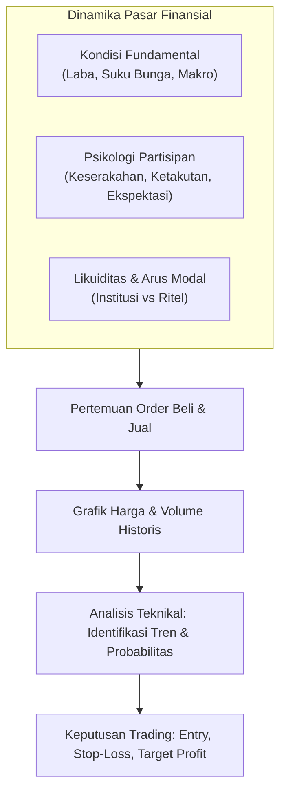
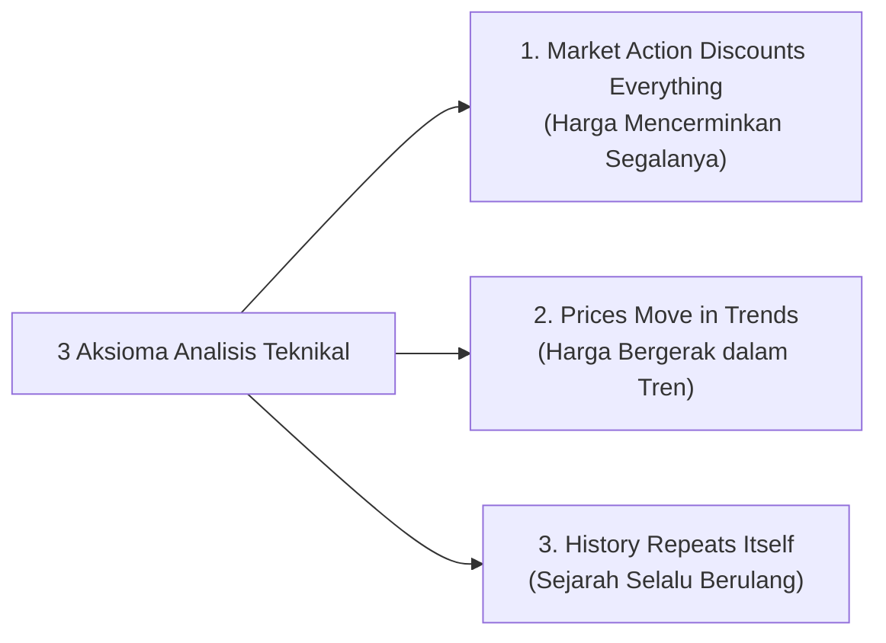
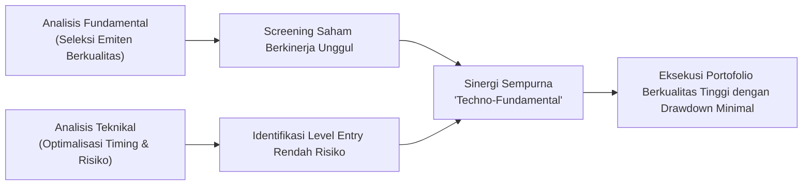

# Bab 1: Pengenalan Technical Analysis

> "Analisis teknikal bukanlah bola kristal untuk meramal masa depan dengan kepastian mutlak, melainkan sebuah seni dan disiplin ilmiah dalam membaca probabilitas perilaku manusia yang tercermin pada grafik harga."  
> — **Edianto Ong**, *Technical Analysis for Mega Profit*

---

## 1. Definisi & Hakikat Analisis Teknikal

Secara terminologi, **Analisis Teknikal (Technical Analysis)** adalah metodologi evaluasi instrumen finansial (saham, komoditas, valuta asing, maupun derivatif) dengan mempelajari data historis aktivitas pasar—terutama pergerakan harga (*price action*) dan volume transaksi—guna mengidentifikasi pola kecenderungan masa depan dengan tingkat probabilitas yang terukur.

Edianto Ong mendefinisikan analisis teknikal sebagai:
1. **Seni (Art):** Membutuhkan kepekaan visual, intuisi berbasis jam terbang, fleksibilitas membaca konteks sentimen pasar, serta manajemen disiplin mental. Dua analis dapat melihat grafik yang sama namun menarik interpretasi yang bernuansa berbeda tergantung pada profil risiko masing-masing.
2. **Ilmu (Science):** Berpijak pada hukum empiris probabilitas, statistik pergerakan harga, geometri fraktal pola pergerakan (*chart patterns*), serta psikologi massa (*mass psychology*) yang terukur secara matematis melalui berbagai indikator teknikal.

Grafik harga bukanlah sekadar garis acak; ia adalah rekaman jejak pertarungan nyata antara kekuatan beli (*bulls*) dan kekuatan jual (*bears*), ketakutan (*fear*), keserakahan (*greed*), optimisme, dan kepanikan kolektif seluruh partisipan pasar di seluruh dunia.

---

## 2. Tiga Aksioma Dasar Analisis Teknikal

Analisis teknikal modern berpijak pada fondasi kokoh berupa tiga prinsip dasar (aksioma) yang pertama kali dirumuskan secara sistematis dalam Teori Dow (*Dow Theory*) dan ditekankan kembali secara mendalam oleh Edianto Ong:

### Aksioma 1: *Market Action Discounts Everything* (Semua Faktor Terdiskon pada Harga)

Aksioma ini merupakan premis paling fundamental. Analis teknikal percaya bahwa setiap faktor yang dapat mempengaruhi nilai wajar suatu instrumen—apakah itu kondisi fundamental emiten, laporan keuangan kuartalan, kebijakan moneter bank sentral, rumor politik, sentimen geopolitik, hingga bencana alam—**telah diantisipasi, diserap, dan tercermin seketika pada harga pasar**.

* **Mekanisme Kerja:** Pasar tidak bergerak berdasarkan realitas saat ini, melainkan berdasarkan ekspektasi masa depan (*forward-looking mechanism*). Ketika informasi beredar, pelaku pasar yang paling berpengetahuan (*smart money/institusi*) melakukan transaksi lebih dahulu, menciptakan pergeseran volume dan harga sebelum rilis berita resmi muncul ke publik.
* **Contoh Riil Pasar:** Seringkali terjadi fenomena *"buy the rumor, sell the news"*. Suatu emiten melaporkan kenaikan laba bersih 200%, namun setelah pengumuman harga saham justru anjlok tajam. Dari sudut pandang fundamental murni, hal ini membingungkan; namun analis teknikal telah melihat aksi akumulasi berminggu-minggu sebelumnya dan pola distribusi (*selling pressure*) tepat saat berita euforia dirilis.

### Aksioma 2: *Prices Move in Trends* (Harga Bergerak Mengikuti Tren)

Harga tidak bergerak secara acak (*random walk*) tanpa arah; melainkan bergerak dalam lintasan dinamis yang membentuk kecenderungan arah atau **tren**. Tujuan utama analisis teknikal adalah mengidentifikasi tren sejak fase awal pembentukannya dan menunggangi tren tersebut hingga muncul sinyal pembalikan yang valid.

Sesuai hukum inersia fisika (Hukum Newton I), suatu tren yang sedang berjalan memiliki tendensi lebih besar untuk **melanjutkan perjalanannya** daripada berbalik arah, kecuali ada gaya penahan yang cukup besar (*supply/demand saturation*).

Tren pasar diklasifikasikan menjadi tiga kategori:
1. **Uptrend (Bullish):** Struktur pergerakan yang secara konsisten mencetak titik puncak yang lebih tinggi (*Higher High / HH*) dan lembah yang lebih tinggi (*Higher Low / HL*).
2. **Downtrend (Bearish):** Struktur pergerakan yang secara konsisten mencetak titik puncak yang lebih rendah (*Lower High / LH*) dan lembah yang lebih rendah (*Lower Low / LL*).
3. **Sideways / Range-bound:** Kondisi ekuilibrium di mana kekuatan beli dan jual berimbang, harga berosilasi di antara zona batas atas (*Resistance*) dan batas bawah (*Support*).

### Aksioma 3: *History Repeats Itself* (Sejarah Selalu Berulang)

Bentuk dan pola grafik yang terlihat ratusan tahun lalu pada pasar komoditas beras di Jepang abad ke-18 identik dengan pola grafik saham berteknologi tinggi di Wall Street saat ini. Mengapa hal ini bisa terjadi?

* **Akar Psikologis:** Penggerak utama pasar adalah psikologi manusia. Sifat dasar manusia—keserakahan (*greed*) saat harga reli, ketakutan (*fear*) saat portofolio merugi, dan penyesalan (*regret*) saat tertinggal momentum—tidak pernah berubah dari abad ke abad.
* **Pola Perilaku (Behavioral Patterns):** Karena respons emosional manusia terhadap fluktuasi uang bersifat konstan, formasi grafik seperti *Double Top*, *Head and Shoulders*, atau *Cup and Handle* terus bermunculan berulang-ulang dengan implikasi probabilitas hasil yang serupa.

---

## 3. Komparasi Mendalam: Fundamental vs Technical Analysis

Dalam dunia investasi dan trading, perdebatan antara kubu Fundamental dan Teknikal telah berlangsung puluhan tahun. Edianto Ong menekankan bahwa kedua metode ini bukanlah musuh yang saling meniadakan, melainkan instrumen komplementer yang menjawab dua pertanyaan yang sama sekali berbeda:

| Parameter Evaluasi | Analisis Fundamental (FA) | Analisis Teknikal (TA) |
| :--- | :--- | :--- |
| **Pertanyaan Pokok** | *"What to buy?"* (Instrumen apa yang bernilai wajar bagus?) | *"When to buy & sell?"* (Kapan waktu paling presisi untuk eksekusi?) |
| **Fokus Utama** | Nilai intrinsik, kinerja rasio (PER, PBV, ROE, DER), prospek industri, kepemimpinan manajemen. | Pola pergerakan harga, supply-demand balance, volume perdagangan, struktur tren. |
| **Data yang Digunakan** | Laporan keuangan kuartalan, data makroekonomi, regulasi industri. | Grafik historis, tick data, order flow, indikator statistik harga. |
| **Horizon Waktu** | Jangka panjang (tahunan hingga dekade). | Sangat fleksibel (dari hitungan menit, harian, mingguan, hingga bulanan). |
| **Kelemahan Kritis** | Sering mengabaikan *timing*. Saham bernilai murah (*undervalued*) bisa terus tertekan dalam tren turun bertahun-tahun (*value trap*). | Rentan terhadap sinyal palsu (*whipsaw*) jika pasar tidak memiliki tren (*choppy*) atau jika analis tidak menerapkan *risk management*. |
| **Kecepatan Respons** | Lambat merefleksikan perubahan cepat karena laporan keuangan hanya terbit secara periodik. | Instan merefleksikan perubahan sentimen dan aliran dana (*smart money flow*). |

> **Konsep Sinergi "Techno-Fundamental":**  
> Kombinasi paling mematikan bagi seorang investor/trader profesional adalah menggunakan Analisis Fundamental untuk menyaring instrumen terbaik (menjawab *What to Buy*), kemudian memanfaatkan Analisis Teknikal untuk menentukan waktu masuk paling aman di dekat level support atau fase awal *breakout* (menjawab *When to Buy*).

---

## 4. Jebakan Umum (*Common Pitfalls*) Pemula

Banyak pemula gagal dalam menerapkan analisis teknikal bukan karena analisanya salah, melainkan karena salah memahami esensi disiplin ini:

1. **Ilusi Kepastian (*Illusion of Certainty*):**  
   Menganggap pola teknikal menjamin 100% kepastian. Analisis teknikal hanyalah permainan kalkulasi probabilitas (*edge*). Kegagalan menyediakan ruang toleransi risiko (*Stop Loss*) akan berujung pada kejatuhan modal (*capital ruin*).
2. ***Indicator Paralysis* (Terlalu Banyak Indikator):**  
   Menumpuk 7 hingga 10 indikator berbeda di satu layar grafik (RSI, MACD, Stochastic, Bollinger Bands, Ichimoku, Parabolic SAR). Hal ini memicu konflik sinyal dan kebingungan keputusan. Prinsip terbaik adalah kesederhanaan (*keep it simple*): kuasai *price action*, volume, serta satu atau dua indikator pendukung.
3. **Mengabaikan Volume Konfirmasi:**  
   Membaca pergerakan harga tanpa memvalidasi volume transaksi. Kenaikan harga tanpa didukung peningkatan volume adalah tanda kelelahan tren (*exhaustion*) yang rawan pembalikan arah tajam.
4. **Trading Melawan Arah Tren Utama (*Fighting the Trend*):**  
   Mencoba menebak dasar jurang (*catching a falling knife*) pada saham yang sedang berada dalam tren turun (*downtrend*) ekstrem dengan dalih "harga sudah terlalu murah".

---

## 5. Ringkasan & Kaidah Utama (Key Takeaways)

* Analisis teknikal adalah studi tentang perilaku pasar yang terekam dalam grafik untuk mencari keunggulan probabilitas statistik.
* Pasar mendiskon segala hal; sebelum berita formal muncul ke publik, jejak volume dan pergerakan harga telah terlebih dahulu ditinggalkan oleh institusi besar.
* Tren adalah sahabat terbaik Anda (*The trend is your friend until it bends*). Jangan pernah mendebat tren yang sedang berlangsung.
* Sejarah terus berulang karena psikologi keserakahan dan ketakutan manusia tidak pernah berubah.
* Gunakan fundamental untuk mencari instrumen yang sehat, dan gunakan teknikal untuk mengeksekusi perdagangan dengan rasio *Risk-to-Reward* yang optimal.
