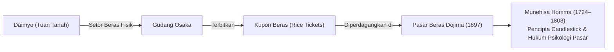
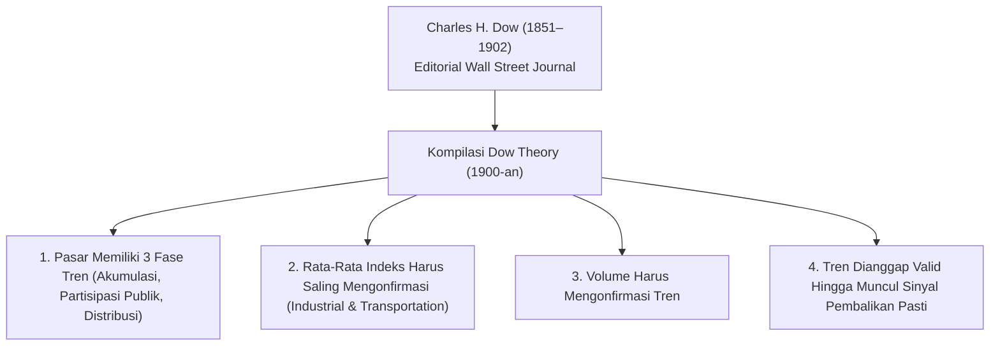
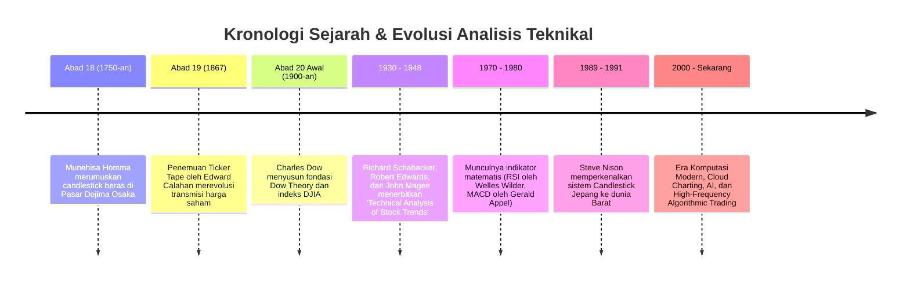

# Bab 2: Sejarah & Evolusi Analisis Teknikal

> "Untuk memahami masa kini dan memproyeksikan masa depan pasar, kita harus mempelajari jejak para pionir yang meletakkan batu pertama dalam membaca psikologi massa melalui grafik harga."  
> — **Edianto Ong**, *Technical Analysis for Mega Profit*

---

## 1. Asal-Usul Analisis Grafik: Pasar Beras Dojima (Osaka, Jepang)

Jauh sebelum bursa saham Wall Street berkembang di Amerika Serikat, akar terdalam dari analisis teknikal telah tumbuh di Jepang pada awal abad ke-18. Tonggak sejarah ini berpusat di **Pasar Beras Dojima (*Dojima Rice Exchange*)** di Osaka, yang didirikan secara resmi sekitar tahun 1697.

Pasar Dojima diakui oleh sejarawan ekonomi dunia sebagai bursa perdagangan berjangka (*futures exchange*) pertama di dunia. Para tuan tanah feodal (*daimyo*) dari seluruh penjuru Jepang mengirimkan hasil panen beras mereka ke gudang-gudang besar di Osaka, kemudian menerbitkan kupon tanda terima beras (*rice receipts*). Kupon ini kemudian diperjualbelikan secara bebas antar pedagang sebelum beras fisiknya tiba.

### Munehisa Homma: Sang Dewa Pasar Beras

Tokoh paling legendaris yang merevolusi analisis pasar di Dojima adalah **Munehisa Homma (1724–1803)**, seorang pedagang beras asal Sakata. Homma menyadari bahwa meskipun pasokan dan cuaca mempengaruhi harga beras, **faktor psikologis para pedagang memiliki dampak yang jauh lebih masif terhadap fluktuasi jangka pendek**.

Homma mengembangkan metode pencatatan harga empat dimensi (buka, tertinggi, terendah, tutup) yang kelak menjadi cikal bakal **Candlestick Charting**. Karya tulisnya yang terkenal, *The Fountain of Gold - The Three Monkey Record of Money* (1755), memuat prinsip-prinsip psikologi pasar:
* Ketika semua orang bersikap *bearish* (pesimis), di situlah bibit kenaikan harga mulai bersemi.
* Ketika semua orang bersikap *bullish* (euforia), di situlah potensi kejatuhan harga sedang dirancang.

Metodologi Homma berhasil membuatnya mencatatkan lebih dari 100 kemenangan perdagangan berturut-turut di Dojima dan mengangkatnya menjadi penasihat finansial pemerintah keshogunan Jepang.

---

## 2. Era Modern Barat: Charles Dow dan Fondasi Wall Street

Pada akhir abad ke-19, evolusi analisis teknikal di dunia Barat dipelopori oleh **Charles Henry Dow (1851–1902)**, jurnalis keuangan Amerika Serikat yang juga merupakan pendiri harian *The Wall Street Journal* dan pencipta indeks acuan *Dow Jones Industrial Average (DJIA)*.

Charles Dow tidak pernah menerbitkan buku formal tentang analisis teknikal. Namun, serangkaian artikel editorialnya di *The Wall Street Journal* dirangkum dan disistematisasi oleh para penerusnya—seperti William Peter Hamilton, Robert Rhea, dan E. George Schaefer—menjadi apa yang kini dikenal sebagai **Teori Dow (*Dow Theory*)**.

### Tiga Skala Waktu Gerakan Pasar Menurut Dow

Dow mengibaratkan pergerakan harga pasar dengan fenomena dinamika air laut:
1. **Primary Trend (Gelombang Pasang Laut / Tide):** Tren utama yang berlangsung dari hitungan satu tahun hingga beberapa tahun. Ini adalah arah fundamental jangka panjang.
2. **Secondary Trend (Ombak / Waves):** Koreksi intermediate yang berlawanan dengan arah *primary trend*, biasanya berlangsung dari tiga minggu hingga tiga bulan, mengoreksi 33% hingga 66% dari pergerakan sebelumnya.
3. **Minor Trend (Riak Air / Ripples):** Fluktuasi harian atau intraday yang berlangsung kurang dari tiga minggu. Seringkali dipenuhi oleh gangguan acak (*market noise*) dan spekulasi jangka pendek.

---

## 3. Garis Waktu Evolusi Pencatatan Grafik

Metode visualisasi data pasar mengalami metamorfosis bertahap dari pencatatan mekanis manual hingga algoritma digital modern berkecepatan tinggi:

### Dari Kertas Milimeter ke Komputasi Awan

1. **Era Ticker Tape & Kertas Milimeter (Abad 19 – Pertengahan Abad 20):**  
   Sebelum adanya layar monitor komputer, para analis menggambar chart secara manual setiap sore hari setelah bel bursa ditutup. Mereka mencatat angka dari pita kertas telegraf (*ticker tape*), lalu menandai titik Open, High, Low, dan Close pada lembaran kertas grafik milimeter besar. Pembuatan garis rata-rata (Moving Average) dihitung manual menggunakan pena dan kalkulator meja.
   
2. **Era Buku Grafik Cetak (Chart Books 1950–1980):**  
   Perusahaan penerbitan mencetak buku grafik tebal mingguan yang dikirim via pos kepada para manajer portofolio dan investor institusi di Wall Street. Keputusan trading seringkali memiliki jeda waktu (*time-lag*) beberapa hari.

3. **Revolusi Candlestick Barat (1989):**  
   Hingga akhir dekade 1980-an, dunia Barat hanya mengenal *Line Chart* dan *Bar Chart*. Analis bernama **Steve Nison** menerbitkan buku fenomenal *Japanese Candlestick Charting Techniques* (1991), membuka mata para trader Barat terhadap kekuatan visual dan psikologis formasi lilin Jepang yang telah teruji selama 250 tahun.

4. **Era Digital & High-Frequency Trading (Modern):**  
   Saat ini, pemrosesan data pasar dilakukan dalam fraksi mikrodetik (*nanoseconds*). Analis ritel maupun institusional memiliki akses ke platform cloud charting instan (TradingView, Bloomberg Terminal, MetaTrader) dengan ratusan indikator terprogram secara otomatis, order-flow footprint, hingga integrasi kecerdasan buatan (*machine learning*).

---

## 4. Pelajaran Abadi dari Sejarah Pasar

Memahami sejarah analisis teknikal memberikan satu wawasan fundamental:
Teknologi pengiriman data boleh berubah dari pita telegraf menjadi serat optik dan satelit orbit rendah, tampilan grafik boleh bertransformasi dari kertas milimeter kusam menjadi layar sentuh beresolusi 4K, namun **arketipe perilaku manusia di balik transaksi tersebut tetap identik**. 

Ketakutan akan kehilangan uang dan nafsu untuk melipatgandakan modal adalah emosi biologis yang tidak lekang oleh waktu. Selama manusia menjadi pengambil keputusan utama di pasar keuangan, prinsip-prinsip analisis teknikal yang dirumuskan oleh Munehisa Homma dan Charles Dow akan selalu relevan.
