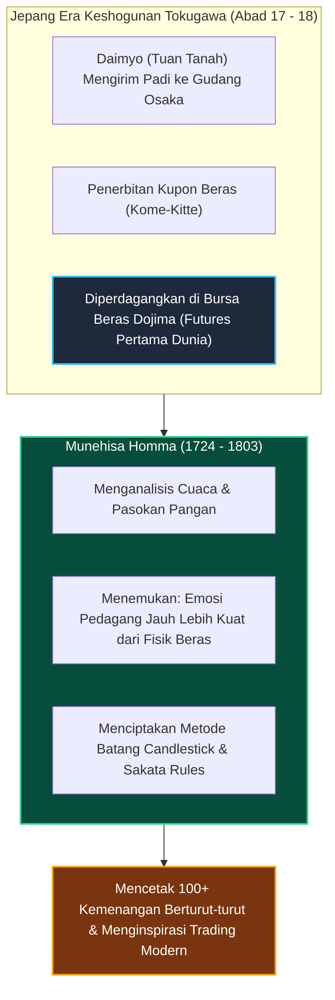
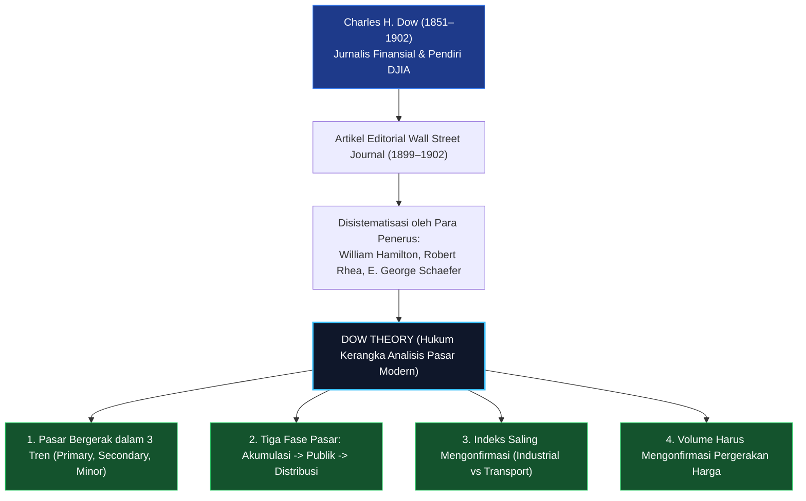
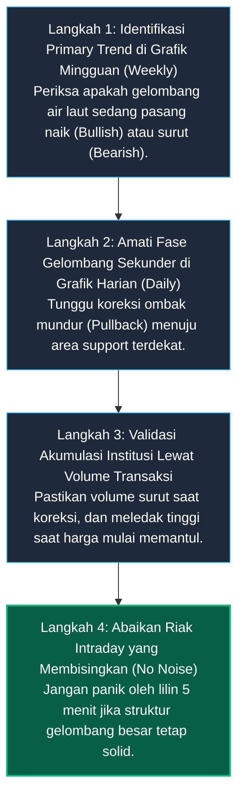

# Bab 2: Sejarah & Evolusi Analisis Teknikal

> "Untuk memahami dinamika pasar hari ini dan memproyeksikan masa depan, kita harus mempelajari jejak para pionir yang meletakkan batu pertama dalam membaca psikologi massa melalui grafik harga."  
> — **Edianto Ong**, *Technical Analysis for Mega Profit*

---

## 1. Analogi Dunia Nyata: Speedometer dan Jejak Roda di Jalan Berlumpur

Bayangkan Anda mengemudikan mobil di jalan pedesaan yang berkabut tebal dan berlumpur di malam hari. Jarak pandang Anda ke depan hanya 5 meter. Bagaimana cara Anda tetap melaju dengan aman tanpa menabrak jurang?

1. **Jejak Roda di Lumpur (*Price Action*):** Anda memperhatikan lekukan jejak ban mobil-mobil besar yang sudah lewat sebelumnya. Jejak tersebut memberi tahu Anda di mana tikungan tajam berada dan di mana aspal yang amblas.
2. **Speedometer dan Putaran Mesin / RPM (*Volume & Momentum*):** Walaupun jalan menanjak licin, jika jarum RPM tinggi dan mobil melaju stabil, Anda tahu mesin memiliki tenaga (*momentum*) untuk melewati tanjakan. Jika tanjakan curam tetapi jarum RPM drop drastis, mobil terancam mogok atau meluncur mundur.

Grafik teknikal bekerja persis seperti instrumen tersebut. Sejarah pergerakan harga bukanlah dongeng kuno; ia adalah rekaman jejak ban ribuan pengemudi pasar modal terdahulu. Selama ratusan tahun, reaksi manusia ketika menghadapi kabut ketidakpastian selalu sama: mereka mencari pegangan jejak masa lalu.

---

## 2. Kamus Istilah Pemula (Glossary Box)

Berikut adalah istilah kunci seputar sejarah dan instrumen awal analisis teknikal:

| Istilah | Konsep Sederhana | Penjelasan Praktis |
| :--- | :--- | :--- |
| **Dojima Rice Exchange** | Pasar Berjangka Pertama Dunia | Bursa komoditas beras di Osaka (1697) tempat pertama kali kontrak berjangka dan grafik lilin diciptakan. |
| **Candlestick (Lilin Jepang)** | Visualisasi 4 Dimensi Harga | Metode grafik temuan Munehisa Homma yang menampilkan Buka, Tertinggi, Terendah, dan Tutup dalam bentuk batang lilin. |
| **Ticker Tape** | Pita Kertas Berjalan | Mesin telegraf pencetak data transaksi harga saham real-time di Wall Street era akhir abad ke-19. |
| **Dow Theory** | Teori Dow | Doktrin fondasi analisis teknikal Barat yang dirumuskan dari tulisan Charles Dow di *The Wall Street Journal*. |
| **Primary Trend** | Tren Utama (Pasang Laut) | Arah pergerakan pasar jangka panjang yang berlangsung dari 1 hingga beberapa tahun. |
| **Secondary Trend** | Tren Menengah (Ombak) | Gelombang koreksi berlawanan arah dengan tren utama yang berlangsung 3 minggu hingga 3 bulan. |
| **Minor Trend** | Tren Mikro (Riak Air) | Fluktuasi harian atau intraday di bawah 3 minggu yang sering dipenuhi gangguan acak (*market noise*). |

---

## 3. Asal-Usul Timur: Pasar Beras Dojima & Legenda Munehisa Homma

Jauh sebelum bursa saham New York berdiri di bawah pohon buttonwood, analisis teknikal telah lahir dan mengakar kuat di Jepang pada awal abad ke-18. Tonggak sejarah ini bertempat di **Pasar Beras Dojima (*Dojima Rice Exchange*)** di Osaka, yang diresmikan sekitar tahun 1697.



### Kisah Munehisa Homma: Sang Dewa Pasar dari Sakata
Tokoh paling fenomenal dalam sejarah analisis teknikal adalah **Munehisa Homma (1724–1803)**. Berasal dari keluarga pedagang di kota pelabuhan Sakata, Homma datang ke Osaka untuk berdagang kupon beras. 

Homma membuat terobosan revolusioner:
1. **Mengabaikan Berita Permukaan:** Sementara pedagang lain sibuk mengamati cuaca harian, Homma mencatat sejarah harga beras puluhan tahun ke belakang di buku catatannya.
2. **Kekuatan Pikiran Kolektif (*The Mind of the Market*):** Dalam risalah klasiknya tahun 1755 (*The Fountain of Gold - The Three Monkey Record of Money*), Homma menulis:  
   > *"Ketika semua orang sangat pesimis dan merasa harga beras akan hancur lebur, itulah titik balik di mana harga akan melonjak tinggi. Ketika semua orang bernafsu membeli dan merasa harga akan naik tanpa batas, itulah saatnya harga bersiap untuk terjun."*
3. **Penciptaan Grafik Candlestick:** Homma merancang lilin bersumbu untuk melihat seketika siapa yang memenangkan sesi perdagangan antara pembeli (*bulls*) dan penjual (*bears*). Berkat metode ini, Homma melegenda karena berhasil membukukan lebih dari 100 transaksi berturut-turut tanpa mengalami satu kali pun kerugian.

---

## 4. Evolusi Barat: Charles Dow dan Fondasi Modern Wall Street

Di belahan bumi Barat, analisis teknikal modern dikembangkan secara independen pada akhir abad ke-19 oleh **Charles Henry Dow (1851–1902)**, pendiri *Dow Jones & Company* dan harian finansial terbesar dunia, *The Wall Street Journal*.



### Analogi Tiga Gelombang Air Laut Menurut Dow
Charles Dow memberikan perumpamaan paling membumi untuk memahami tingkatan tren pasar:
1. **Pasang Surut Air Laut (*The Tide / Primary Trend*):**  
   Ketika air laut sedang pasang, setiap deburan ombak akan maju lebih jauh ke bibir pantai daripada ombak sebelumnya. Ini adalah tren besar tahunan. Jangan pernah melawan pasang air laut jika Anda tidak ingin tersapu karang.
2. **Ombak Pantai (*The Waves / Secondary Trend*):**  
   Ombak sesekali bergulung mundur kembali ke tengah laut, tetapi kemunduran ini hanya sementara (*pullback*) sebelum ombak berikutnya menerjang lebih tinggi. Ini adalah koreksi sehat mingguan hingga bulanan.
3. **Riak Air (*The Ripples / Minor Trend*):**  
   Buih dan riak kecil di permukaan air yang bergoyang ditiup angin sepoi-sepoi. Riak ini tidak memiliki arti penting dan mudah mengecoh mata pemula. Inilah fluktuasi harian dan menit yang sering membuat panik.

---

## 5. Garis Waktu Evolusi Teknologi Pencatatan Grafik

Bagaimana para trader bekerja sebelum adanya laptop, smartphone, dan TradingView? Mari kita lihat metamorfosis alat kerja analis teknikal dari masa ke masa:

| Periode Waktu | Teknologi Alat Kerja | Cara Kerja Trader pada Masanya |
| :--- | :--- | :--- |
| **Abad 18 (1750-an)** | Kuas Tinta & Kertas Beras Jepang | Munehisa Homma mencatat harga beras Dojima secara manual setiap sore hari dengan kuas tinta di atas lembaran kertas gulung (*scrolls*). |
| **Abad 19 (1867–1930)** | Mesin Ticker Tape & Pita Kertas Telegraf | Pita kertas panjang mengalir keluar dari mesin telegraf mencetak kode saham dan harga. Jesse Livermore membaca pita kertas ini (*tape reading*) tanpa melihat gambar grafik. |
| **Pertengahan Abad 20 (1940–1980)** | Kertas Milimeter & Buku Grafik Cetak | Setiap sore setelah bursa tutup, analis menggambar grafik batang (OHLC) menggunakan penggaris dan pensil di atas kertas milimeter besar. Buku grafik (*chart books*) dicetak dan dikirim pos tiap akhir pekan. |
| **Akhir Abad 20 (1990-an)** | Masuknya Candlestick ke Barat & PC Monitor | Steve Nison menulis buku *Japanese Candlestick Charting Techniques* (1991), menggemparkan Wall Street. Komputer pribadi (PC) mulai menggantikan kertas milimeter. |
| **Abad 21 (2000–Sekarang)** | Cloud Charting, AI, & Algo Trading | Grafik interaktif real-time di cloud (TradingView), aplikasi smartphone, eksekusi algoritma berkecepatan mikrodetik (*High-Frequency Trading*). |

---

## 6. Panduan Step-by-Step Pemula: Menerapkan Prinsip Dow Theory dari Layar Kosong

Bagaimana seorang pemula di zaman modern dapat menerapkan kebijaksanaan ratusan tahun Charles Dow pada layar charting hari ini?



1. **Langkah 1 (Cek Pasang Air Laut):** Buka grafik saham pilihan Anda pada timeframe mingguan (*Weekly*). Jika harga secara konsisten membentuk tangga naik, Anda berada di perairan *Bullish*. Hindari berpikir untuk mencari posisi jual/short.
2. **Langkah 2 (Menunggu Ombak Mundur):** Beralih ke grafik harian (*Daily*). Jangan mengejar harga saat ombak sedang membubung tinggi di atas (*overbought*). Bersabarlah menunggu ombak koreksi bergulir surut mendekati lantai support.
3. **Langkah 3 (Konfirmasi Bahan Bakar Volume):** Periksa histogram volume. Ketika harga turun koreksi, volume harus mengering tipis (menandakan tidak ada aksi jual panik dari pemegang saham besar). Begitu harga mulai berbalik naik menyentuh support, volume harus melonjak drastis.
4. **Langkah 4 (Tutup Telinga dari Riak Menit):** Jangan habiskan waktu Anda memelototi grafik 1 menit atau 5 menit jika Anda seorang *swing trader*. Riak intraday penuh tipu daya dan kepanikan sesaat. Percayalah pada arah pasang laut utama Anda.

---

## 7. Studi Kasus Konkret: Membaca Siklus 3 Fase Dow pada Saham BBRI

Mari kita pelajari contoh riil pergerakan siklus pasar menurut Teori Dow pada saham **Bank Rakyat Indonesia (BBRI)**:

```
Harga
 Rp6.000 |                                       [FASE 3: DISTRIBUSI]
         |                                       Smart Money menjual ke publik euforia
 Rp5.500 |                        /\  /\
         |                       /  \/  \        <- Muncul berita fantastis di medsos
 Rp5.000 |                      /        \
         |       [FASE 2: PARTISIPASI PUBLIK]
 Rp4.500 |       Tren naik cepat, ritel mulai FOMO
         |             /\      /
 Rp4.000 |  ==========/==\====/================= Resistance Akumulasi ditembus
         | [FASE 1: AKUMULASI] 
 Rp3.800 | Diam-diam dikumpulkan Institusi saat berita suram
```

* **Fase 1: Akumulasi (*Accumulation Phase*):**  
  Ketika sentimen ekonomi makro sedang lesu dan pemberitaan media dipenuhi ketakutan, saham BBRI tertahan di area Rp3.700 - Rp3.900. Pelaku ritel takut membeli, namun grafik menunjukkan volume transaksi besar yang diserap diam-diam oleh investor institusi (*smart money*).
* **Fase 2: Partisipasi Publik (*Public Participation Phase*):**  
  Harga menembus level resistensi Rp4.000 dengan volume raksasa. Kinerja laba kuartalan mulai membaik. Analis sekuritas mulai menaikkan target harga. Masyarakat luas dan trader harian mulai berbondong-bondong membeli. Harga melesat kencang menuju Rp5.500.
* **Fase 3: Distribusi (*Distribution Phase*):**  
  Ketika saham BBRI menyentuh puncak rekor baru di Rp6.000, berita utama di televisi dan media sosial membicarakan betapa hebatnya prospek perbankan. Para pemula yang baru pertama kali membuka rekening saham berbondong-bondong membeli di harga Rp6.000 karena takut tertinggal (*FOMO*). Di saat inilah, institusi besar diam-diam melepas barang kepemilikan mereka kepada publik. Tak lama kemudian, tren berbalik menjadi *downtrend* tajam.

---

## 8. Kesalahan Fatal Pemula (*Newbie Traps*)

Dalam mempelajari sejarah dan siklus pasar, pemula sering kali terjebak dalam 4 lubang kesalahan ini:

1. **Terjebak Euforia di Puncak Fase Distribusi:**  
   Membeli saham justru saat seluruh orang di grup percakapan Telegram atau forum saham sedang memamerkan tangkapan layar keuntungan (*screenshot profit*). Mengabaikan fakta sejarah bahwa euforia publik adalah tanda paling akurat dari akhir sebuah tren (*Distribution Phase*).
2. **Mencoba Menjadi Pahlawan Melawan Tren Utama (*Fighting the Primary Tide*):**  
   Mencoba mencari posisi beli (*counter-trend buy*) pada instrumen yang sedang mengalami siklus *Bear Market* tahunan, hanya karena harga tampak turun 50%. Ingat dalil Dow: pasang air laut yang sedang surut bisa membawa harga turun jauh lebih dalam dari bayangan terliar Anda.
3. **Mengabaikan Indikator Volume Konfirmasi:**  
   Melihat harga saham melonjak 5% lalu langsung ikut membeli, tanpa menyadari volume transaksinya sangat kerdil. Kenaikan harga tanpa volume adalah perangkap ilusi (*fake rally*) yang sangat mudah dihempas badai keesokan harinya.
4. **Mabuk Fluktuasi Minor (*Micro-Timeframe Addiction*):**  
   Terpaku mengamati lilin 1 menit setiap detik sepanjang jam bursa sehingga mentalnya terkuras habis oleh kepanikan riak air (*ripples*), padahal tren mingguan (*tide*) saham tersebut sedang melaju tenang mencetak kenaikan puluhan persen.

---

## 9. Ringkasan Bab 2

* Analisis teknikal modern berakar dari tradisi Timur (Pasar Beras Dojima 1697 & Munehisa Homma) dan metodologi Barat (Teori Dow oleh Charles Dow 1900-an).
* Candlestick lahir dari pemahaman Munehisa Homma bahwa emosi psikologis pedagang jauh lebih berpengaruh daripada jumlah fisik panen komoditas.
* Teori Dow mengibaratkan pasar seperti air laut: *Primary Trend* adalah pasang laut, *Secondary Trend* adalah ombak koreksi, dan *Minor Trend* adalah riak buih air.
* Tiga fase siklus pasar: Akumulasi (saat sepi/takut), Partisipasi Publik (tren berjalan), dan Distribusi (saat euforia/puncak).
* Trader sukses tidak pernah menebak masa depan, melainkan menyelaraskan perahunya dengan arah pasang laut utama pasar.
