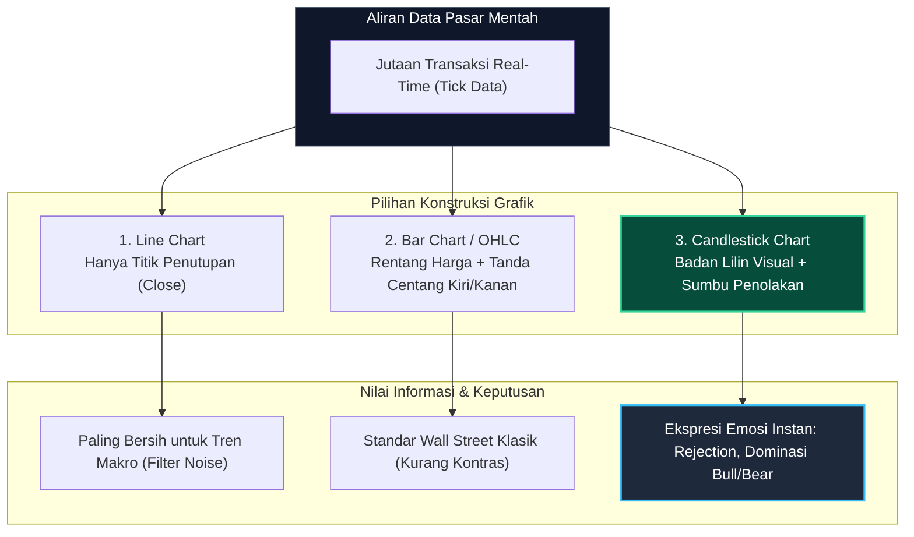
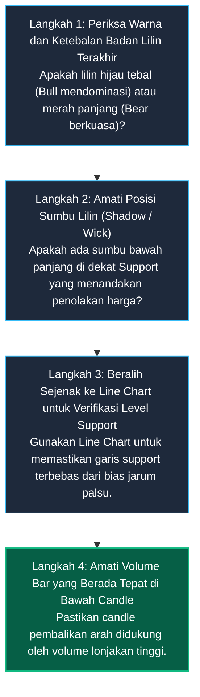

# Bab 3: Jenis dan Konstruksi Grafik Harga

> "Grafik bukan sekadar susunan gambar garis atau batang berwarna; ia adalah kanvas psikologis tempat pertarungan antara keserakahan para pembeli dan keputusasaan para penjual diproyeksikan secara transparan."  
> — **Edianto Ong**, *Technical Analysis for Mega Profit*

---

## 1. Analogi Dunia Nyata: Peta Topografi vs Peta Satelit

Bayangkan Anda seorang penjelajah rimba yang bersiap mendaki gunung berkabut:

1. **Peta Garis Garis Kasar (*Line Chart*):** Anda membuka peta sederhana yang hanya menghubungkan puncak-puncak bukit dengan garis lurus. Peta ini sangat bagus untuk melihat apakah gunung itu secara umum semakin tinggi atau semakin rendah. Namun, peta ini tidak memberi tahu Anda apakah di antara dua bukit ada tebing curam atau rawa berbahaya.
2. **Peta Kontur Batang (*Bar Chart / OHLC*):** Peta yang mencatat di mana pos awal pendakian dibuka, titik tertinggi yang sempat dipijak rombongan, jurang terdalam yang dilewati, dan di pos mana mereka bermalam. Semua informasi ada, tetapi simbol garisnya kaku dan butuh waktu lama untuk dicerna mata.
3. **Peta Citra Satelit Berwarna (*Candlestick Chart*):** Peta dengan warna kontras merah menyala untuk lereng curam berbahaya dan warna hijau terang untuk jalur landai yang aman. Hanya dengan sekilas pandang 1 detik, otak Anda langsung mengerti medan mana yang dikuasai oleh badai dan medan mana yang aman untuk dilalui.

Inilah mengapa di antara semua bentuk visualisasi data bursa finansial modern, **Candlestick** menjadi bahasa universal yang paling banyak dipakai oleh trader di seluruh dunia.



---

## 2. Kamus Istilah Pemula (Glossary Box)

Berikut adalah istilah esensial dalam anatomi pembentukan grafik harga:

| Istilah | Terjemahan Bebas | Penjelasan Praktis |
| :--- | :--- | :--- |
| **Open (O)** | Harga Pembukaan | Harga transaksi pertama yang disepakati ketika sesi waktu perdagangan baru dimulai. |
| **High (H)** | Harga Tertinggi | Titik harga tertinggi yang berhasil dicapai oleh kekuatan beli (*bulls*) selama sesi berlangsung. |
| **Low (L)** | Harga Terendah | Titik harga terendah yang sempat ditekan oleh kekuatan jual (*bears*) selama sesi berlangsung. |
| **Close (C)** | Harga Penutupan | Harga transaksi terakhir saat sesi resmi berakhir. Merupakan **harga paling penting** dalam analisis teknikal. |
| **Real Body** | Badan Lilin | Area persegi panjang tebal antara harga pembukaan dan harga penutupan pada candlestick. |
| **Upper Shadow (Wick)** | Sumbu / Jarum Atas | Garis tipis di atas body yang menunjukkan penolakan harga atas (*rejection of higher price*). |
| **Lower Shadow (Tail)** | Sumbu / Jarum Bawah | Garis tipis di bawah body yang menunjukkan penolakan harga bawah (*rejection of lower price*). |
| **OHLC** | Bar Chart Klasik | Singkatan dari empat komponen harga: Open, High, Low, Close. |

---

## 3. Komparasi Tiga Jenis Grafik Utama

Edianto Ong mengklasifikasikan tiga konstruksi grafik yang paling banyak digunakan sebagai berikut:

| Parameter | Line Chart | Bar Chart (OHLC) | Candlestick Chart |
| :--- | :--- | :--- | :--- |
| **Data yang Ditampilkan** | Hanya harga penutupan (*Close*). | Lengkap: Open, High, Low, Close. | Lengkap: Open, High, Low, Close. |
| **Tingkat Noise** | Sangat rendah (bersih). | Sedang. | Menampilkan seluruh fluktuasi riil. |
| **Kemudahan Membaca** | Sangat mudah untuk arah besar. | Cukup rumit (garis centang kecil). | **Sangat intuitif dan instan.** |
| **Membaca Psikologi** | Sangat buruk (tidak ada data ekor). | Cukup baik. | **Sangat superior (terlihat jelas dominasi pasar).** |
| **Fungsi Terbaik** | Menentukan garis Support & Resistance mayor jangka panjang. | Analisis pola teknikal klasik Barat. | Eksekusi harian (*timing entry*), membaca reaksi penolakan harga (*rejection*). |

---

## 4. Anatomi Mendalam Candlestick Jepang

Candlestick memiliki keunggulan visual karena membedakan siapa yang menang di akhir sesi melalui pewarnaan badan lilin (*real body*):

```
       BULLISH CANDLE (Hijau / Putih)              BEARISH CANDLE (Merah / Hitam)
                 [High]                                       [High]
                   |  <- Sumbu Atas (Upper Shadow)              |  <- Sumbu Atas
             +-----------+                                +-----------+
             |   CLOSE   |                                |   OPEN    |
             |           |                                |           |
             |   BADAN   |  (Kekuatan Beli                |   BADAN   |  (Kekuatan Jual
             |   LILIN   |   Mendominasi)                 |   LILIN   |   Mendominasi)
             |           |                                |           |
             |   OPEN    |                                |   CLOSE   |
             +-----------+                                +-----------+
                   |  <- Sumbu Bawah (Lower Shadow)             |  <- Sumbu Bawah
                 [Low]                                        [Low]
             (Close > Open)                               (Close < Open)
```

### Membaca Cerita di Balik Lilin (The Story behind the Candle)
Satu batang candlestick adalah drama pertarungan satu babak:
1. **Lilin Bullish Berbadan Besar Tanpa Sumbu (*Marubozu Bullish*):**  
   Pembeli memegang kendali mutlak sejak menit pertama bursa dibuka hingga bursa ditutup. Tidak ada perlawanan dari penjual. Tekanan beli sangat masif.
2. **Sumbu Bawah Panjang (*Rejection Tail / Hammer*):**  
   Penjual sempat membantai harga turun sangat dalam menyentuh titik terendah (*Low*). Namun di dasar jurang, pasukan pembeli dalam jumlah besar menghadang dan mendorong harga kembali naik mendekati harga pembukaan. Ini adalah sinyal perlawanan keras dari pembeli (*buying pressure*).
3. **Sumbu Atas Panjang (*Shooting Star*):**  
   Pembeli sempat membawa harga terbang tinggi, tetapi di puncak atas mereka kehabisan peluru dan dipukul mundur oleh aksi jual bertubi-tubi. Ini mengindikasikan atap jenuh dan potensi pembalikan arah turun.
4. **Badan Lilin Sangat Tipis (*Doji*):**  
   Harga penutupan kembali persis ke harga pembukaan ($Close \approx Open$). Terjadi kebuntuan (*standoff*) dan keraguan total di kalangan pelaku pasar (*indecision*).

---

## 5. Diagram Konstruksi Visual Candlestick (SVG Inline)

Berikut adalah diagram presisi konstruksi visual perbandingan Candlestick Bullish dan Bearish:

```xml
<svg width="650" height="400" viewBox="0 0 650 400" xmlns="http://www.w3.org/2000/svg" style="background:#0f172a; border-radius:12px; font-family:-apple-system,BlinkMacSystemFont,'Segoe UI',Roboto,sans-serif;">
  <style>
    .label { font-size: 13px; fill: #cbd5e1; font-weight: 500; }
    .sublabel { font-size: 11px; fill: #94a3b8; }
    .title { font-size: 15px; font-weight: bold; fill: #38bdf8; }
  </style>

  <!-- Background Grid Lines -->
  <line x1="40" y1="50" x2="610" y2="50" stroke="#1e293b" stroke-dasharray="4" />
  <line x1="40" y1="130" x2="610" y2="130" stroke="#1e293b" stroke-dasharray="4" />
  <line x1="40" y1="240" x2="610" y2="240" stroke="#1e293b" stroke-dasharray="4" />
  <line x1="40" y1="320" x2="610" y2="320" stroke="#1e293b" stroke-dasharray="4" />

  <!-- BULLISH CANDLE (LEFT) -->
  <line x1="180" y1="50" x2="180" y2="130" stroke="#10b981" stroke-width="3" stroke-linecap="round" />
  <rect x="140" y="130" width="80" height="110" rx="4" fill="#065f46" stroke="#10b981" stroke-width="2.5" />
  <line x1="180" y1="240" x2="180" y2="320" stroke="#10b981" stroke-width="3" stroke-linecap="round" />

  <text x="180" y="30" text-anchor="middle" class="title" fill="#34d399">LILIN BULLISH (HIJAU)</text>
  <text x="180" y="45" text-anchor="middle" class="sublabel">Close > Open (Dominasi Pembeli)</text>

  <!-- Labels for Bullish Candle -->
  <line x1="225" y1="50" x2="260" y2="50" stroke="#64748b" stroke-width="1.5" />
  <text x="270" y="54" class="label">High (Harga Tertinggi)</text>

  <line x1="225" y1="130" x2="260" y2="130" stroke="#64748b" stroke-width="1.5" />
  <text x="270" y="134" class="label">Close (Harga Penutupan)</text>

  <line x1="225" y1="185" x2="260" y2="185" stroke="#64748b" stroke-width="1.5" />
  <text x="270" y="189" class="label">Real Body (Badan Lilin)</text>

  <line x1="225" y1="240" x2="260" y2="240" stroke="#64748b" stroke-width="1.5" />
  <text x="270" y="244" class="label">Open (Harga Pembukaan)</text>

  <line x1="225" y1="320" x2="260" y2="320" stroke="#64748b" stroke-width="1.5" />
  <text x="270" y="324" class="label">Low (Harga Terendah)</text>

  <!-- BEARISH CANDLE (RIGHT) -->
  <line x1="470" y1="50" x2="470" y2="130" stroke="#ef4444" stroke-width="3" stroke-linecap="round" />
  <rect x="430" y="130" width="80" height="110" rx="4" fill="#7f1d1d" stroke="#ef4444" stroke-width="2.5" />
  <line x1="470" y1="240" x2="470" y2="320" stroke="#ef4444" stroke-width="3" stroke-linecap="round" />

  <text x="470" y="30" text-anchor="middle" class="title" fill="#f87171">LILIN BEARISH (MERAH)</text>
  <text x="470" y="45" text-anchor="middle" class="sublabel">Close < Open (Dominasi Penjual)</text>

  <!-- Labels for Bearish Candle -->
  <line x1="425" y1="130" x2="390" y2="130" stroke="#64748b" stroke-width="1.5" />
  <text x="380" y="134" text-anchor="end" class="label">Open (Harga Pembukaan)</text>

  <line x1="425" y1="240" x2="390" y2="240" stroke="#64748b" stroke-width="1.5" />
  <text x="380" y="244" text-anchor="end" class="label">Close (Harga Penutupan)</text>
</svg>
```

---

## 6. Panduan Step-by-Step Pemula: Membaca Grafik dari Nol

Ikuti 4 langkah taktis berikut saat Anda membuka grafik saham:



1. **Langkah 1:** Identifikasi siapa yang sedang memegang kendali hari ini. Jika badan lilin berwarna hijau tebal dan harga ditutup dekat dengan level tertingginya (*High*), pembeli sedang sangat percaya diri.
2. **Langkah 2:** Cari tahu apakah ada jejak perlawanan. Lilin merah dengan sumbu bawah yang sangat panjang (*long lower wick*) memberi tahu Anda bahwa meskipun harga sempat anjlok, pembeli telah memukul balik sebelum bel penutupan berbunyi.
3. **Langkah 3:** Jika Anda bingung menentukan garis lantai (*Support*) karena banyaknya jarum berseliweran, ubah grafik menjadi **Line Chart** selama 10 detik. Tandai titik belokan garis penutupan, lalu kembalikan grafik ke tampilan **Candlestick**.
4. **Langkah 4:** Jangan percaya pada lilin tanpa memeriksa histogram volumenya. Lilin pembalikan arah tanpa volume adalah gertakan semata.

---

## 7. Studi Kasus Konkret: Membaca Sumbu Penolakan pada Komoditas Emas (XAUUSD)

Mari kita amati pertarungan harga nyata pada pasar spot emas dunia (**XAUUSD**):

```
Harga (USD/oz)
 $2.350 |----------------------------- Target Profit (Resistance Kuat)
        |                         /
 $2.320 |                        /  <- Candlestick Bullish Mengikuti Tren
        |          /\           /
 $2.290 |---------+--\---------/------ Titik Beli (Konfirmasi Candle Berikutnya)
        |         |   \   |   /
 $2.270 |=========|====\==|==/======== Level Support Kunci ($2.270)
        |         |       +-- Candle Pinbar / Hammer
 $2.260 |---------|-------|----------- Jarum Terendah ($2.260) - Titik Stop Loss: $2.258
```

* **Situasi Awal:**  
  Harga emas terkoreksi dari puncak $2.340 turun mendekati area angka bulat psikologis di sekitar $2.270.
* **Pertarungan Intraday:**  
  Pada sesi London, penjual menyerang agresif hingga harga emas menembus ke bawah lantai support menuju $2.260. Para trader pemula panik dan berbondong-bondong melakukan aksi jual rugi (*panic selling*).
* **Munculnya Ekor Rejection (Hammer):**  
  Tepat di level $2.260, institusi kakap memborong emas secara masif. Sebelum pasar New York ditutup, harga didorong meroket kembali dan ditutup di $2.285.  
  Hasil akhir candle harian: sebuah lilin bertubuh kecil dengan **sumbu bawah sangat panjang (Hammer)**.
* **Eksekusi Trading Plan:**  
  * **Titik Beli (Entry):** Trader masuk di pembukaan candle berikutnya pada level **$2.290**.
  * **Titik Pengaman (Stop Loss):** Dipasang di **$2.258** (2 dolar di bawah ekor jarum terendah). Risiko rugi = $32.
  * **Target Keuntungan (Take Profit):** Level resistensi puncak di **$2.354**. Potensi keuntungan = $64.
  * **Rasio Risk-to-Reward:** 1 : 2. Transaksi sukses menyentuh TP dalam 4 hari perdagangan.

---

## 8. Kesalahan Fatal Pemula (*Newbie Traps*)

Hindari 4 jebakan mematikan seputar jenis dan pembacaan grafik harga berikut:

1. **Terburu-buru Menarik Kesimpulan Sebelum Candle Resmi Ditutup (*Premature Entry*):**  
   Melihat lilin hijau melompat tinggi pada pukul 14.00, pemula langsung menekan tombol beli. Pada pukul 15.55 sesi berakhir, harga mendadak dibanting turun menyisakan sumbu atas panjang (*Shooting Star*). Lilin belum sah memberikan sinyal sampai waktu periodenya resmi ditutup (*confirmed close*).
2. **Menghafal Puluhan Nama Pola Lilin Tanpa Memahami Logika Sumbu:**  
   Menghafal puluhan nama lilin seperti *Three White Soldiers*, *Morning Star*, *Hanging Man*, dsb secara mekanis tanpa memahami esensi pertarungan *Supply vs Demand* di balik sumbu lilin tersebut.
3. **Mengabaikan Posisi Munculnya Pola (*Context is Everything*):**  
   Melihat pola lilin *Hammer* di tengah-tengah tren turun yang baru saja mulai runtuh dari puncak, lalu mengira itu adalah dasar jurang. Pola lilin pembalikan arah hanya valid dan berkekuatan tinggi jika muncul di **area Support/Resistance signifikan**, bukan melayang tanpa pijakan di tengah ruang kosong.
4. **Salah Memilih Jenis Grafik untuk Konteks Analisis:**  
   Memaksa menggunakan *Line Chart* untuk eksekusi scalping menit, atau menggunakan *Candlestick* 1 menit untuk menganalisis prospek investasi tahunan.

---

## 9. Ringkasan Bab 3

* Line Chart sangat berguna untuk menyaring distorsi (*filter noise*) dan menentukan garis Support/Resistance mayor.
* Candlestick Chart adalah instrumen terlengkap dan paling superior untuk membaca pertarungan psikologis pasar secara instan.
* Komponen utama lilin: Open, High, Low, Close, Real Body (dominasi arah), dan Sumbu/Shadow (penolakan harga).
* Lilin belum memberikan sinyal sah sebelum sesi perdagangan resmi berakhir dan harga ditutup (*closed*).
* Analisis candle harus selalu diletakkan dalam konteks lokasinya: apakah berada di area Support, Resistance, atau di tengah tren yang kuat.
