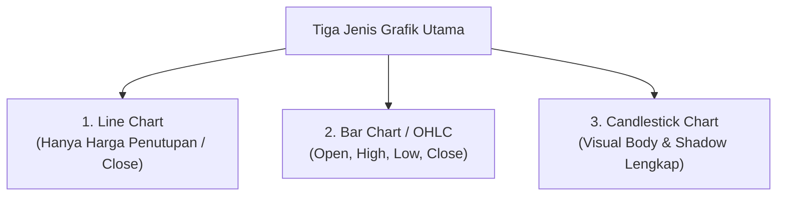

# Bab 3: Jenis dan Konstruksi Grafik Harga

> "Grafik bukan sekadar gambar garis; ia adalah kanvas psikologis tempat pertarungan antara harapan para pembeli dan keputusasaan para penjual diproyeksikan secara transparan."  
> — **Edianto Ong**, *Technical Analysis for Mega Profit*

---

## 1. Tiga Jenis Konstruksi Grafik Utama

Dalam praktiknya, data perdagangan pasar dirangkum ke dalam tiga format visualisasi utama: **Line Chart**, **Bar Chart (OHLC)**, dan **Candlestick Chart**. Masing-masing memiliki karakteristik, resolusi informasi, dan kegunaan tersendiri dalam membaca struktur pasar.



---

## 2. Line Chart (Grafik Garis)

### Karakteristik & Konstruksi
* Line chart dibentuk dengan cara menghubungkan **titik harga penutupan (*Close*)** dari suatu periode waktu tertentu secara berurutan menggunakan satu garis kontinu.
* Titik harga pembukaan (*Open*), harga tertinggi (*High*), dan harga terendah (*Low*) sepenuhnya diabaikan.

```text
Harga
  |                     /\
  |        /\          /  \
  |       /  \  /\    /    \
  |  /\  /    \/  \  /      \
  | /  \/          \/        \
  +---------------------------- Waktu
```

### Kelebihan & Kekurangan
* **Kelebihan:** Sangat bersih, menghilangkan gangguan acak (*noise filter*) intraday, sangat efektif untuk melihat gambaran besar arah tren jangka panjang (*macro trend*) dan mendeteksi level *Support/Resistance* mayor tanpa distorsi ekor jarum.
* **Kekurangan:** Informasi pertarungan harga sangat terbatas. Analis tidak dapat mengetahui volatilitas ekstrem yang terjadi di tengah sesi, titik harga tertinggi/terendah hari itu, maupun dominasi pembeli/penjual saat sesi berlangsung.

---

## 3. Bar Chart / OHLC (Grafik Batang)

### Karakteristik & Konstruksi
Bar Chart menyajikan empat data esensial dalam satu batang vertikal:
1. **Open (O):** Ditunjukkan oleh garis horizontal kecil mencuat ke sisi **kiri** batang.
2. **High (H):** Ujung paling atas dari garis vertikal (harga tertinggi selama periode tersebut).
3. **Low (L):** Ujung paling bawah dari garis vertikal (harga terendah selama periode tersebut).
4. **Close (C):** Ditunjukkan oleh garis horizontal kecil mencuat ke sisi **kanan** batang.

```text
        High
         |
  Open --+            (Bullish Bar: Close > Open)
         |
         +-- Close
         |
        Low
```

### Kelebihan & Kekurangan
* **Kelebihan:** Memberikan gambaran komprehensif rentang pergerakan harga (*volatility range*) dan rasio pergeseran antara pembukaan dan penutupan. Merupakan standar analisis klasik di Wall Street selama puluhan tahun.
* **Kekurangan:** Secara visual kurang intuitif dibandingkan candlestick, terutama jika dilihat dalam kumpulan ratusan bar di layar kecil karena garis centang kiri-kanan mudah menyatu (*eye strain*).

---

## 4. Candlestick Chart (Grafik Lilin Jepang)

Candlestick Chart adalah jenis grafik yang paling populer, disukai, dan diakui secara global saat ini karena keunggulannya yang tak tertandingi dalam memproyeksikan **psikologi emosi pasar secara instan**.

### Anatomi Komponen Candlestick

Setiap batang lilin (*candle*) terdiri dari dua elemen struktural:
1. **Badan Lilin (*Real Body*):** Area tebal berbentuk persegi panjang yang membentang di antara harga pembukaan (*Open*) dan harga penutupan (*Close*).
   * **Bullish Candle (Hijau/Putih):** Harga penutupan lebih tinggi daripada harga pembukaan ($Close > Open$). Mengindikasikan dominasi pembeli (*buyers control the market*).
   * **Bearish Candle (Merah/Hitam):** Harga penutupan lebih rendah daripada harga pembukaan ($Close < Open$). Mengindikasikan dominasi penjual (*sellers control the market*).
2. **Jarum / Ekor (*Upper & Lower Shadows / Wicks*):** Garis tipis vertikal yang memanjang di atas dan di bawah badan lilin.
   * **Upper Shadow:** Garis dari bagian atas *body* ke titik harga tertinggi (*High*). Merepresentasikan penolakan harga atas (*rejection of higher prices*).
   * **Lower Shadow:** Garis dari bagian bawah *body* ke titik harga terendah (*Low*). Merepresentasikan penolakan harga bawah (*rejection of lower prices*).

### Ilustrasi Anatomi Candlestick (SVG Inline)

```xml
<svg width="600" height="380" viewBox="0 0 600 380" xmlns="http://www.w3.org/2000/svg" style="background:#0f172a; border-radius:12px; font-family:-apple-system,BlinkMacSystemFont,'Segoe UI',Roboto,sans-serif;">
  <style>
    .label { font-size: 13px; fill: #cbd5e1; font-weight: 500; }
    .sublabel { font-size: 11px; fill: #94a3b8; }
    .title { font-size: 15px; font-weight: bold; fill: #38bdf8; }
  </style>

  <!-- Background Grid Lines -->
  <line x1="40" y1="50" x2="560" y2="50" stroke="#1e293b" stroke-dasharray="4" />
  <line x1="40" y1="130" x2="560" y2="130" stroke="#1e293b" stroke-dasharray="4" />
  <line x1="40" y1="230" x2="560" y2="230" stroke="#1e293b" stroke-dasharray="4" />
  <line x1="40" y1="310" x2="560" y2="310" stroke="#1e293b" stroke-dasharray="4" />

  <!-- BULLISH CANDLE -->
  <!-- Upper Wick -->
  <line x1="180" y1="50" x2="180" y2="130" stroke="#22c55e" stroke-width="3" stroke-linecap="round" />
  <!-- Body -->
  <rect x="140" y="130" width="80" height="100" rx="4" fill="#22c55e" fill-opacity="0.25" stroke="#22c55e" stroke-width="3" />
  <!-- Lower Wick -->
  <line x1="180" y1="230" x2="180" y2="310" stroke="#22c55e" stroke-width="3" stroke-linecap="round" />

  <!-- Labels Bullish -->
  <text x="180" y="30" text-anchor="middle" class="title">BULLISH CANDLE</text>
  <text x="125" y="55" text-anchor="end" class="label">High (Tertinggi)</text>
  <text x="125" y="135" text-anchor="end" class="label">Close (Penutupan)</text>
  <text x="125" y="235" text-anchor="end" class="label">Open (Pembukaan)</text>
  <text x="125" y="315" text-anchor="end" class="label">Low (Terendah)</text>

  <text x="235" y="85" class="sublabel">← Upper Shadow (Tekanan Jual)</text>
  <text x="235" y="185" class="sublabel">← Real Body (Kekuatan Pembeli)</text>
  <text x="235" y="275" class="sublabel">← Lower Shadow (Penolakan Penurunan)</text>

  <!-- BEARISH CANDLE -->
  <!-- Upper Wick -->
  <line x1="440" y1="50" x2="440" y2="130" stroke="#ef4444" stroke-width="3" stroke-linecap="round" />
  <!-- Body -->
  <rect x="400" y="130" width="80" height="100" rx="4" fill="#ef4444" fill-opacity="0.25" stroke="#ef4444" stroke-width="3" />
  <!-- Lower Wick -->
  <line x1="440" y1="230" x2="440" y2="310" stroke="#ef4444" stroke-width="3" stroke-linecap="round" />

  <!-- Labels Bearish -->
  <text x="440" y="30" text-anchor="middle" class="title" fill="#f87171">BEARISH CANDLE</text>
  <text x="385" y="55" text-anchor="end" class="label">High (Tertinggi)</text>
  <text x="385" y="135" text-anchor="end" class="label">Open (Pembukaan)</text>
  <text x="385" y="235" text-anchor="end" class="label">Close (Penutupan)</text>
  <text x="385" y="315" text-anchor="end" class="label">Low (Terendah)</text>

  <text x="495" y="85" class="sublabel">← Upper Shadow</text>
  <text x="495" y="185" class="sublabel">← Real Body (Kekuatan Penjual)</text>
  <text x="495" y="275" class="sublabel">← Lower Shadow</text>
</svg>
```

---

## 5. Membaca Psikologi di Balik Bentuk Lilin

Edianto Ong menekankan bahwa membaca candlestick bukanlah tentang menghafal puluhan nama pola aneh dalam bahasa Jepang, melainkan **memahami cerita di balik panjang badan dan bayangannya**:

1. **Ukuran Real Body:**
   * **Body Panjang:** Mengindikasikan momentum satu arah yang sangat agresif. Jika hijau panjang (*Long Bullish Body*), pembeli menguasai sesi tanpa ampun dari awal hingga akhir.
   * **Body Sangat Kecil / Garis Tipis (Doji):** Mengindikasikan ketidakpastian (*indecision*) ekstrem dan keseimbangan antara pembeli dan penjual. Seringkali menjadi sinyal awal pembalikan arah jika muncul di puncak uptrend atau dasar downtrend.
2. **Panjang Shadows (Jarum):**
   * **Upper Shadow Panjang di Area Resistance:** Pembeli sempat mendorong harga naik sangat tinggi, namun para penjual (*bears*) masuk secara masif dan menekan harga kembali ke bawah sebelum sesi berakhir. Ini adalah sinyal penolakan harga atas (*shooting star / exhaustion*).
   * **Lower Shadow Panjang di Area Support:** Penjual sempat memicu kepanikan dan menekan harga ke titik rendah, namun pembeli institusi masuk menyerap seluruh penawaran dan mendorong harga kembali naik (*hammer / absorption*).

---

## 6. Tabel Komparasi Karakteristik Ketiga Jenis Chart

| Kriteria Analisis | Line Chart | Bar Chart (OHLC) | Candlestick Chart |
| :--- | :--- | :--- | :--- |
| **Kelengkapan Data** | Rendah (Hanya Close) | Lengkap (O, H, L, C) | Lengkap (O, H, L, C) |
| **Kejelasan Visual Tren Utama** | Sangat Tinggi (Bebas noise) | Sedang | Tinggi |
| **Identifikasi Sentimen Psikologis** | Sangat Rendah | Sedang | Sangat Tinggi & Cepat |
| **Deteksi Pola Reversal Cepat** | Terlambat | Cukup Cepat | Sangat Presisi & Instan |
| **Beban Visual (Eye Strain)** | Minimal | Tinggi (Banyak garis tipis) | Ergonomis (Warna kontras) |
| **Rekomendasi Penggunaan** | Menentukan Support/Resistance makro | Perhitungan matematis algoritma | Analisis eksekusi trading harian/intraday |
