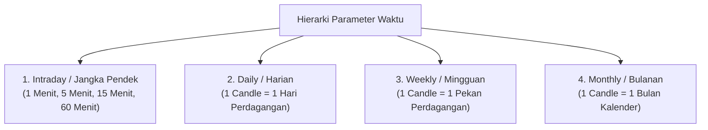
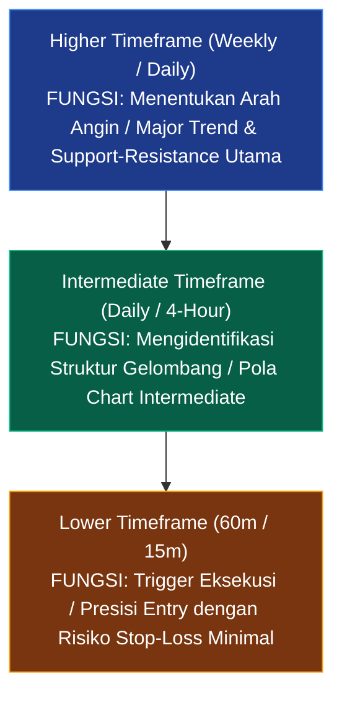
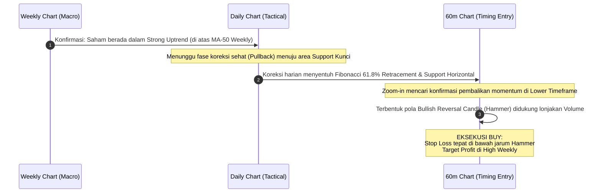

# Bab 4: Parameter Waktu & Multiple Timeframe Analysis

> "Melihat pasar hanya dari satu parameter waktu ibarat meneliti gajah di ruangan gelap dengan menyentuh belalainya saja. Tanpa perspektif helikopter dari time frame yang lebih tinggi, Anda akan mudah tersesat dalam debu fluktuasi intraday."  
> — **Edianto Ong**, *Technical Analysis for Mega Profit*

---

## 1. Parameter Waktu (*Timeframe*) pada Grafik

Setiap batang lilin (*candlestick*) atau batang bar mewakili rangkuman aktivitas harga dalam rentang durasi waktu tertentu. Parameter waktu dikelompokkan ke dalam beberapa hierarki:

1. **Intraday (1m, 5m, 15m, 60m):**  
   * Merefleksikan denyut mikro pasar per sesi bursa.
   * Dipenuhi oleh volatilitas instan, sentimen emosional kilat, dan *market noise*.
   * Sangat sensitif terhadap eksekusi algoritma dan berita mendadak.
2. **Daily (Harian - D1):**  
   * Merupakan standar tolok ukur universal bagi analis teknikal di seluruh dunia.
   * Mencerminkan konsensus akhir hari antara institusi, reksa dana, dan pelaku ritel.
   * Pola *Support/Resistance* dan garis tren harian memiliki bobot reliabilitas yang jauh lebih tinggi daripada grafik intraday.
3. **Weekly (Mingguan - W1) & Monthly (Bulanan - M1):**  
   * Menunjukkan gambaran makro siklus ekonomi (*business & credit cycles*).
   * Menghilangkan seluruh distorsi fluktuasi harian.
   * Digunakan oleh pengelola dana pensiun dan *sovereign wealth funds* untuk merancang alokasi aset strategis.

---

## 2. Siklus Waktu & Profil Gaya Trading

Edianto Ong menekankan bahwa kegagalan banyak trader pemula berakar dari **ketidakcocokan antara kepribadian, ketersediaan waktu luang, dan parameter waktu yang mereka pilih**. 

Tidak ada satu *timeframe* yang paling unggul; yang ada hanyalah *timeframe* yang paling sesuai dengan gaya hidup dan toleransi psikologis trader:

| Profil Trader | Timeframe Analisis | Rata-rata Durasi Posisi | Karakteristik & Tekanan Psikologis |
| :--- | :--- | :--- | :--- |
| **Scalper** | 1m – 5m | Beberapa detik hingga menit | Membutuhkan fokus 100% di depan layar, reaksi refleks secepat kilat, disiplin *cut-loss* ketat, dan komisi broker rendah. |
| **Day Trader** | 5m – 60m | Beberapa menit hingga jam (tutup posisi sebelum bursa tutup) | Tidak memiliki risiko celah harga (*overnight gap risk*), intensitas fokus tinggi selama jam buka bursa, memerlukan pemahaman *order book*. |
| **Swing Trader** | 60m, Daily, Weekly | Beberapa hari hingga beberapa minggu | Pilihan ideal bagi individu yang memiliki pekerjaan utama. Menangkap satu gelombang ayunan tren (*swing leg*), tidak perlu memantau layar setiap detik. |
| **Position Trader** | Daily, Weekly, Monthly | Beberapa bulan hingga tahunan | Bertindak menyerupai investor teknikal; mengeksploitasi *Primary Trend* besar suatu emiten, kebal terhadap kepanikan koreksi harian. |

---

## 3. Konsep Multiple Timeframe Analysis (Top-Down Analysis)

Prinsip dasar analisis multi-kerangka waktu (*Multiple Timeframe Analysis* / MTFA) adalah: **Grafik dengan timeframe lebih tinggi selalu mendominasi dan mengendalikan arah grafik dengan timeframe lebih rendah**.

Edianto Ong mengajarkan metodologi analisis dari atas ke bawah (*Top-Down Approach*):

### Kerangka Tiga Layar (The Rule of 3 Timeframes)
Sebagai panduan praktis, gunakan rasio pengali 4 hingga 6 kali lipat antar timeframe:
1. **Layar 1 (Macro Trend):** Misalnya grafik Mingguan (*Weekly*).
   * *Tugas:* Jawab pertanyaan tunggal: "Apakah tren utama sedang Bullish, Bearish, atau Sideways?" Jangan pernah mengambil posisi yang berlawanan dengan arah layar ini.
2. **Layar 2 (Tactical Wave):** Misalnya grafik Harian (*Daily*).
   * *Tugas:* Amati fase gelombang koreksi (*pullback/retracement*). Cari zona konvergensi antara garis Support tren dan indikator osilator yang mengalami *oversold*.
3. **Layar 3 (Execution Timing):** Misalnya grafik 60 Menit (*H1*) atau 15 Menit (*M15*).
   * *Tugas:* Cari sinyal pemicu (*trigger*) berupa pola candlestick pembalikan arah (*hammer, bullish engulfing*) atau penembusan garis tren minor (*minor trendline breakout*) untuk masuk posisi dengan *Stop Loss* yang sangat rapat.

---

## 4. Studi Kasus Penerapan Top-Down Analysis

Mari telaah simulasi riil penerapan strategi Top-Down Analysis pada skenario pembelian saham:

### Keunggulan Matematis Pendekatan Ini:
* **Optimalisasi Risk-to-Reward Ratio (RRR):** Dengan mengeksekusi di *Lower Timeframe*, jarak harga beli ke level *Stop Loss* sangat sempit (misalnya hanya 2–3%), sementara potensi keuntungan mengikuti target *Higher Timeframe* (bisa mencapai 15–30%). Hal ini menghasilkan rasio RRR yang sangat menguntungkan (1:5 atau lebih tinggi).
* **Menghilangkan Keraguan (*Conviction*):** Trader masuk pasar dengan keyakinan penuh karena tahu bahwa arus modal institusi besar di grafik mingguan sedang mendorong perahu mereka ke arah yang sama.

---

## 5. Ringkasan & Kaidah Utama (Key Takeaways)

* Jangan pernah mengeksekusi trading hanya berdasarkan satu tampilan layar grafik saja.
* *Higher Timeframe* memberikan peta jalan utama; *Lower Timeframe* memberikan mikroskop presisi untuk eksekusi.
* Selaraskan parameter waktu dengan jam biologis dan ketersediaan waktu Anda. Jika Anda adalah profesional dengan pekerjaan purna waktu, jadilah Swing Trader dengan timeframe Harian, bukan memaksakan diri menjadi Scalper 1 menit yang rentan stres.
* Sinergi terbaik dalam trading adalah: **Arah tren mengikuti grafik Mingguan, strategi posisi dirancang di grafik Harian, dan pemicu peluru entry ditarik di grafik Per Jam**.
