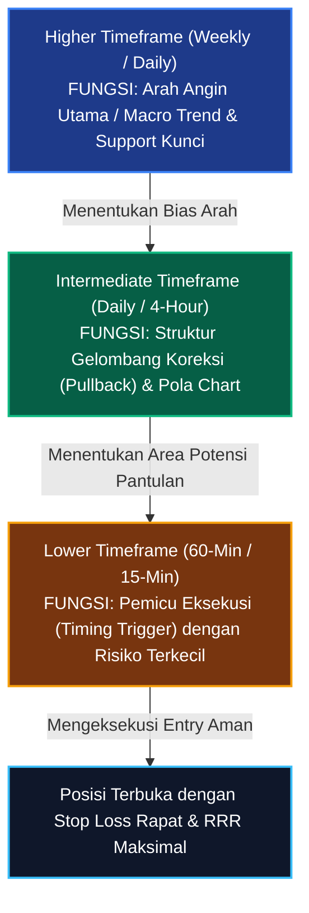
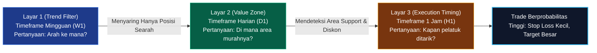
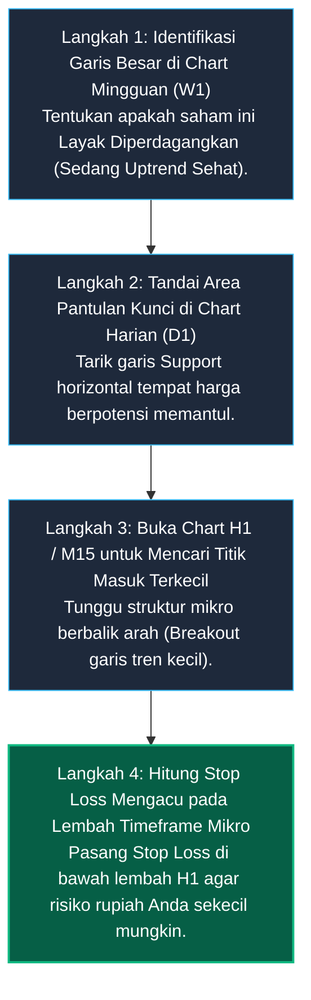

# Bab 4: Parameter Waktu & Multiple Timeframe Analysis

> "Melihat pasar hanya dari satu parameter waktu ibarat meneliti seekor gajah di dalam ruangan gelap dengan hanya menyentuh ujung ekornya saja. Tanpa perspektif helikopter dari kerangka waktu yang lebih tinggi, Anda akan mudah tersesat dan tertipu oleh debu fluktuasi jangka pendek."  
> — **Edianto Ong**, *Technical Analysis for Mega Profit*

---

## 1. Analogi Dunia Nyata: Perahu Nelayan, Ombak Pantai, dan Pasang Laut

Bayangkan Anda mengemudikan perahu nelayan bermesin kecil di laut lepas:

1. **Pasang Surut Air Laut (*Higher Timeframe / Weekly Chart*):** Pasang air laut adalah gaya gravitasi bulan yang mengendalikan jutaan ton air. Jika air laut sedang pasang menuju daratan, perahu Anda akan terbawa masuk dengan sangat mudah tanpa menguras bahan bakar mesin.
2. **Gelombang Ombak Pantai (*Intermediate Timeframe / Daily Chart*):** Di atas pasang laut, ada gelombang ombak yang bergulung setiap beberapa menit. Ombak ini sesekali tampak mundur ke belakang sebelum menerjang ke depan.
3. **Riak Buih dan Percikan Air (*Lower Timeframe / 15-Minute Chart*):** Di permukaan ombak, ada jutaan buih dan percikan air yang melompat ke segala arah tertiup angin sepoi-sepoi.

Apa yang terjadi jika Anda hanya memusatkan mata pada buih percikan air? Anda mengira laut sedang mengalir ke kiri karena buihnya terbang ke kiri. Anda membelokkan kemudi, lalu mendadak perahu Anda dihempaskan oleh ombak raksasa yang sedang melaju kencang ke arah kanan!

Banyak trader pemula mengalami nasib seperti nelayan tersebut. Mereka membeli saham karena melihat lilin hijau di grafik 5 menit, tanpa menyadari bahwa di grafik Mingguan (*Weekly*) saham tersebut sedang terjun bebas dalam badai *Bear Market* tahunan.



---

## 2. Kamus Istilah Pemula (Glossary Box)

Berikut adalah istilah kunci dalam pengelolaan parameter waktu trading:

| Istilah | Terjemahan Bebas | Penjelasan Sederhana |
| :--- | :--- | :--- |
| **Timeframe (TF)** | Kerangka Waktu | Rentang durasi waktu yang diwakili oleh satu batang lilin/bar (misal: 1 menit, 1 jam, 1 hari). |
| **Intraday** | Dalam Satu Hari | Aktivitas trading dan grafik yang bergerak dalam batas waktu sesi satu hari perdagangan. |
| **Top-Down Analysis** | Analisis dari Atas ke Bawah | Metode menganalisis grafik mulai dari kerangka waktu besar (Mingguan) lalu turun bertahap ke kerangka waktu kecil (Jam/Menit). |
| **Market Noise** | Gangguan Sinyal Palsu | Fluktuasi acak harga pada timeframe kerdil (1m-5m) yang tidak mencerminkan arah tren sebenarnya. |
| **Swing Trading** | Trading Ayunan Gelombang | Gaya perdagangan menahan posisi beberapa hari hingga minggu untuk menangkap satu ayunan tren (*swing*). |
| **Scalping** | Menangkap Margin Cepat | Gaya trading kilat hitungan detik hingga menit untuk mengambil keuntungan kecil berkali-kali. |
| **Pullback / Retracement** | Koreksi Sehat Sementara | Gerakan harga yang mundur sejenak berlawanan arah dengan tren utama sebelum melanjutkan perjalanan aslinya. |

---

## 3. Matriks Parameter Waktu & Profil Kepribadian Trader

Edianto Ong menekankan bahwa salah satu penyebab paling sering seorang pemula menderita stres berat adalah **salah memilih parameter waktu yang tidak cocok dengan kepribadian dan aktivitas hariannya**:

| Gaya Trading | Parameter Waktu Utama | Rata-rata Durasi Posisi | Profil Individu yang Cocok | Tekanan Mental & Beban Kerja |
| :--- | :--- | :--- | :--- | :--- |
| **Scalper** | 1 Menit – 5 Menit | Beberapa detik s/d 15 menit | Orang yang sangat agresif, menyukai adrenalin tinggi, dan memiliki waktu penuh memantau layar bursa tanpa gangguan. | Sangat ekstrem; rawan kelelahan mental (*burnout*) dan komisi fee transaksi membengkak. |
| **Day Trader** | 5 Menit – 1 Jam | 15 menit s/d beberapa jam (wajib tutup sebelum bursa tutup) | Orang yang disiplin tinggi dan tidak ingin menanggung risiko celah harga pembukaan esok hari (*overnight risk*). | Tinggi; menuntut konsentrasi penuh selama jam perdagangan aktif. |
| **Swing Trader** | 1 Jam – Harian (Daily) | 3 hari s/d 4 minggu | **Sangat ideal bagi karyawan, profesional, dan pengusaha** yang memiliki pekerjaan utama. Cukup evaluasi grafik sore hari setelah bursa tutup. | Rendah s/d Sedang; keputusan diambil secara tenang tanpa tergesa-gesa. |
| **Position Trader / Investor** | Harian, Mingguan, Bulanan | Beberapa bulan s/d tahunan | Individu yang sabar, tenang, dan ingin melipatgandakan modal mengikuti pertumbuhan siklus ekonomi emiten besar. | Sangat rendah; kebal terhadap fluktuasi harian dan berita sensasional jangka pendek. |

---

## 4. Kerangka Kerja Tiga Layar (The Rule of 3 Timeframes)

Bagaimana cara menyelaraskan beberapa parameter waktu secara harmonis tanpa membuat kepala pusing? Edianto Ong menyarankan penggunaan formula **Rasio Pengali 4 s/d 6** (*Factor of 4 to 6 Rule*):

```
       LAYAR 1: MACRO TREND (Weekly)
       Arah Pasang Laut Utama -> Bullish (Hanya Cari Peluang Beli)
                    |
                    v (Bagi 5)
       LAYAR 2: TACTICAL WAVE (Daily)
       Mengamati Ombak Koreksi -> Menunggu Harga Pullback ke Support
                    |
                    v (Bagi 5 s/d 6)
       LAYAR 3: EXECUTION TRIGGER (60-Min / H1)
       Membidik Titik Tembak Presisi -> Lilin Reversal + Stop Loss Rapat
```



### Prosedur Tiga Layar:
1. **Layar 1 (Mingguan - Filter Arah Tren):**  
   Buka grafik Mingguan (*Weekly*). Jika harga berada di atas rata-rata garis Moving Average dan mencetak puncak-lembah yang meninggi, maka **Bias Anda wajib 100% BULLISH**. Dilarang keras mencoba mencari posisi jual/short, betapapun menggiurkannya.
2. **Layar 2 (Harian - Zona Diskon):**  
   Buka grafik Harian (*Daily*). Jangan membeli ketika harga sedang melompat jauh di langit (*overbought*). Tunggu harga mengalami gelombang koreksi (*pullback*) turun mendekati garis Support atau garis tren harian.
3. **Layar 3 (Jam - Pemicu Eksekusi):**  
   Turun ke grafik 1 Jam (*H1*) atau 15 Menit (*M15*). Amati lilin di sekitar area support tersebut. Begitu muncul konfirmasi lilin pembalikan arah (*Hammer* atau *Bullish Engulfing*) disertai volume meningkat, tarik pelatuk beli.

---

## 5. Panduan Step-by-Step Pemula: Menerapkan Analisis Multi-Timeframe

Praktikkan 4 langkah berurutan ini setiap kali Anda hendak mengeksekusi rencana trading:



1. **Langkah 1 (Cek Izin dari Induk Tren):**  
   Buka chart Mingguan (*W1*). Pastikan Anda tidak melawan arus pasang laut. Jika chart Mingguan sedang dalam tren turun curam, batalkan niat trading dan cari saham lain.
2. **Langkah 2 (Menunggu di Halte):**  
   Buka chart Harian (*D1*). Tandai level-level Support kuat tempat harga kemungkinan besar akan mengerem penurunannya. Bersabarlah seperti menunggu bus tiba di halte.
3. **Langkah 3 (Mencari Tanda-Tanda Putar Balik):**  
   Ketika harga sudah tiba di halte Support pada chart harian, buka chart 1 Jam (*H1*). Amati apakah di chart H1 mulai terbentuk pola tangga naik (*Higher Low*).
4. **Langkah 4 (Memasang Rem Pengaman Super Rapat):**  
   Karena Anda masuk menggunakan konfirmasi grafik H1, Anda bisa meletakkan titik *Stop Loss* tepat beberapa tick di bawah lembah grafik H1 tersebut. Hal ini membuat risiko kerugian uang Anda sangat kecil, sementara target keuntungan Anda mengacu pada resistensi chart harian yang sangat lebar!

---

## 6. Studi Kasus Konkret: Mengincar Ayunan Tren Saham Telkom Indonesia (TLKM)

Mari kita bedah skenario riil multi-timeframe analysis pada saham **PT Telkom Indonesia Tbk (TLKM)**:

```
[WEEKLY CHART]: Primary Trend UPTREND (Harga bergerak di atas MA-50)
                Arah Strategis: HANYA BOLEH MENCARI POSISI BELI (BUY ONLY)

[DAILY CHART] : Terjadi koreksi ombak (Pullback) selama 8 hari bursa
                Harga meluncur turun dari Rp4.200 menuju Support Rp3.800

[H1 CHART]    : Terjadi konsolidasi mikro di area Rp3.800
                Muncul pola Double Bottom kecil + Breakout Rp3.840
-------------------------------------------------------------------------
EKSEKUSI TRANSAKSI:
* Titik Beli (Entry)      : Rp3.850 (saat konfirmasi breakout H1)
* Titik Stop Loss (SL)    : Rp3.780 (di bawah lembah mikro H1) -> Risiko: Rp70 (-1,8%)
* Titik Target Profit (TP): Rp4.190 (Resistance puncak Daily)  -> Laba   : Rp340 (+8,8%)
* Risk to Reward Ratio    : Rp70 : Rp340 = 1 : 4,8 (Hampir 1 banding 5!)
```

* **Keajaiban Efisiensi Modal:**  
  Jika trader membeli hanya mengandalkan chart harian tanpa multi-timeframe, Stop Loss harus diletakkan sangat jauh di bawah support mingguan (misal di Rp3.600, dengan risiko lebih dari 6%).  
  Namun dengan membedah chart menggunakan kacamata **H1**, trader memangkas risiko menjadi hanya **1,8%**, sehingga ukuran lot saham yang bisa dibeli menjadi jauh lebih optimal dengan perlindungan modal yang luar biasa ketat.

---

## 7. Kesalahan Fatal Pemula (*Newbie Traps*)

Kenali 4 jebakan mematikan yang sering dialami pemula terkait parameter waktu:

1. **Sindrom Buta Helikopter (*Helicopter Blindness*):**  
   Masuk pasar hanya berpatokan pada grafik 5 menit tanpa pernah membuka grafik harian atau mingguan. Trader merasa senang melihat sinyal beli di TF kecil, lalu terkejut saat posisinya langsung dilindas oleh gelombang jual masif dari resistensi TF harian.
2. **Kelumpuhan Banyak Layar (*Timeframe Paralysis*):**  
   Membuka 7 timeframe sekaligus (1m, 3m, 5m, 15m, 1h, 4h, Daily). Grafik 1m menyuruh beli, 5m menyuruh jual, 1h menyuruh tunggu. Trader menjadi pusing sendiri dan kehilangan momen emas. Gunakan maksimal 2 atau 3 timeframe yang memiliki keterikatan logis (aturan rasio 4-6).
3. **Mengubah Timeframe untuk Membenarkan Posisi yang Merugi (*Moving the Goalposts*):**  
   Awalnya masuk sebagai *Day Trader* dengan patokan stop loss grafik 15 menit. Ketika harga jebol menyentuh batas stop loss, trader enggan menerima kenyataan lalu bergumam: *"Ah tidak apa-apa, kalau dilihat di grafik Mingguan saham ini masih bagus kok!"* Akhirnya posisi day trading yang merugi dibiarkan mengendap menjadi investasi busuk berbulan-bulan.
4. **Mencocokkan Gaya Hidup yang Salah:**  
   Seorang dokter atau manajer kantor yang sibuk rapat sepanjang hari memaksakan diri menjadi *Scalper 1 menit*. Akibatnya, pekerjaan utama terbengkalai dan portofolio hancur karena tidak sempat melirik layar saat terjadi kepanikan kilat.

---

## 8. Ringkasan Bab 4

* Parameter waktu yang lebih tinggi (*Higher Timeframe*) selalu mengendalikan dan mendikte arah parameter waktu yang lebih rendah (*Lower Timeframe*).
* Sesuaikan pemilihan timeframe dengan kepribadian dan rutinitas hidup Anda; bagi pekerja kantoran, gaya *Swing Trading* berbasis grafik harian adalah pilihan paling sehat.
* Terapkan pendekatan Analisis dari Atas ke Bawah (*Top-Down Approach*): Gunakan TF Mingguan untuk arah tren, TF Harian untuk area nilai pantulan, dan TF Jam/Menit untuk pemicu eksekusi.
* Manfaat terbesar analisis multi-timeframe adalah memangkas jarak *Stop Loss* sekecil mungkin tanpa mempersempit potensi *Take Profit* yang lebar.
