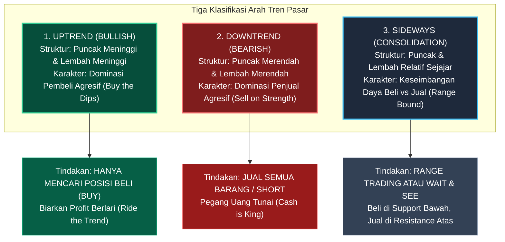
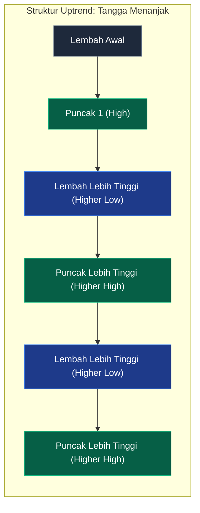
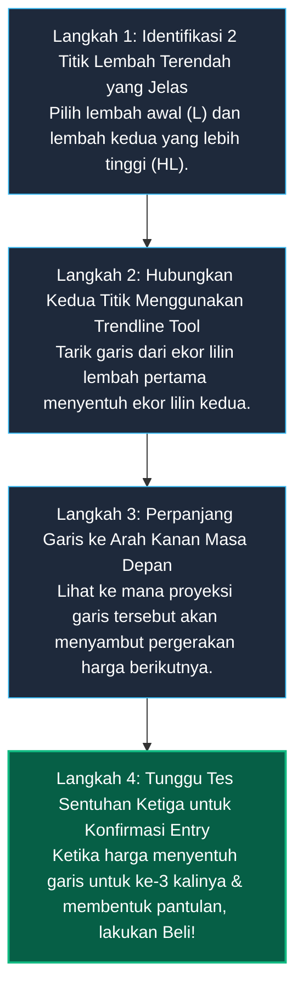

# Bab 5: Trend dan Klasifikasinya

> *"Trend is your friend until it bends."* (Tren adalah sahabat terbaik Anda, sampai ia berbelok arah). Pepatah klasik Wall Street ini bukan sekadar kata mutiara, melainkan hukum gravitasi terpenting dalam analisis teknikal. Mengarungi pasar finansial tanpa memahami arah tren ibarat berenang melawan arus air terjun Niagara: menguras seluruh tenaga hanya untuk berakhir tenggelam.  
> — **Edianto Ong**, *Technical Analysis for Mega Profit*

---

## 1. Analogi Dunia Nyata: Mendaki Anak Tangga di Gedung Bertingkat

Bayangkan Anda sedang berjalan di tangga darurat sebuah gedung bertingkat 50:

1. **Uptrend (Sedang Naik Tangga):**  
   Setiap kali kaki Anda melangkah naik, Anda menginjak anak tangga yang lebih tinggi (**Higher High**). Terkadang Anda berhenti sejenak untuk mengambil napas dan mengistirahatkan satu kaki di bordes tangga (**Higher Low**), tetapi Anda tidak pernah melangkah turun lebih rendah dari bordes lantai bawah tempat Anda mulai tadi. Selama kaki Anda berpijak di anak tangga yang terus meninggi, Anda pasti sedang bergerak menuju lantai paling atas.
2. **Downtrend (Sedang Terperosok Turun Tangga):**  
   Kaki Anda terpeleset dan tergelincir turun. Setiap kali Anda mencoba bangkit, kepala Anda terbentur anak tangga yang lebih rendah (**Lower High**), dan badan Anda merosot ke anak tangga yang semakin ke dasar basement (**Lower Low**).
3. **Sideways (Mondar-mandir di Lorong Datar):**  
   Anda tidak sedang naik atau turun tangga. Anda hanya berjalan bolak-balik di sebuah koridor lantai datar dari ujung pintu kamar A ke ujung pintu kamar B tanpa perubahan ketinggian gedung sama sekali.

Di pasar saham, pergerakan harga tidak pernah melesat tegak lurus 90 derajat seperti roket. Harga selalu mendaki anak tangga zig-zag. Memahami struktur anak tangga inilah kunci utama membaca **Tren**.



---

## 2. Kamus Istilah Pemula (Glossary Box)

Berikut adalah kamus istilah alfabetikal yang wajib dihafal luar kepala oleh setiap trader:

| Istilah | Kepanjangan | Arti Sederhana & Ciri Grafis |
| :--- | :--- | :--- |
| **HH** | *Higher High* | Titik puncak baru yang terbentuk lebih tinggi daripada titik puncak sebelumnya. Tanda mutlak pasar sedang kuat naik (*Uptrend*). |
| **HL** | *Higher Low* | Titik lembah penurunan yang terbentuk lebih tinggi daripada titik lembah sebelumnya. Menandakan koreksi yang sehat dan tidak merusak tren. |
| **LH** | *Lower High* | Titik puncak kenaikan yang terbentuk lebih rendah daripada puncak sebelumnya. Tanda bahwa pembeli mulai kehabisan tenaga (*Downtrend*). |
| **LL** | *Lower Low* | Titik lembah baru yang jebol lebih rendah daripada lembah sebelumnya. Mengonfirmasi penurunan harga berlanjut ke jurang lebih dalam. |
| **Trendline** | Garis Tren | Garis miring yang ditarik menghubungkan titik-titik lembah (pada uptrend) atau puncak (pada downtrend) sebagai pemandu arah. |
| **Dynamic Support** | Penahan Dinamis | Garis miring *uptrendline* atau garis Moving Average yang bergerak dinamis menahan koreksi penurunan harga. |
| **Dynamic Resistance** | Hambatan Dinamis | Garis miring *downtrendline* yang menekan setiap kali harga mencoba memantul naik. |
| **Breakout** | Penembusan Valid | Peristiwa ketika harga berhasil menembus garis tren atau batas resistensi ke arah atas dengan dorongan volume besar. |
| **Breakdown** | Penembusan ke Bawah | Peristiwa ketika harga jebol menembus ke bawah garis tren atau batas support, mengawali fase kejatuhan. |

---

## 3. Struktur Anatomi Puncak & Lembah

Edianto Ong menegaskan: jangan melihat indikator yang rumit sebelum Anda bisa mengidentifikasi secara telanjang apakah harga sedang mencetak **HH-HL** atau **LH-LL**.

```
STRUKTUR UPTREND (BULLISH):                  STRUKTUR DOWNTREND (BEARISH):
                HH2 (Puncak 2)               Puncak 1
                 /\                             /\
          HH1   /  \                           /  \    LH1 (Puncak Lebih Rendah)
          /\   /    \                         /    \   /\
         /  \ /      \                       /      \ /  \    LH2
        /    V        \                     /        V    \   /\
       /    HL1        \                   /        LL1    \ /  \
      /  (Lembah Baru   \                 /      (Lembah    V    \
     /    Lebih Tinggi)  \               /        Baru)    LL2    V
    V                     V             V               (Lebih Dalam)
  Lembah Awal            HL2          Lembah Awal
```



* **Hukum Mutlak Uptrend:**  
  Selama harga tidak pernah mencetak lembah yang lebih rendah dari lembah sebelumnya ($HL > Low\ Sebelumnya$), tren naik masih utuh 100%. Jangan pernah terburu-buru menjual seluruh barang hanya karena lilin merah sesaat.
* **Tanda Awal Pembalikan Arah (*Trend Reversal Warning*):**  
  Ketika dalam suatu tren naik harga gagal mencetak puncak baru yang lebih tinggi (gagal membuat *Higher High*), dan justru berbalik menjebol titik lembah sebelumnya (*Lower Low*), itu adalah alarm darurat bahwa tren naik telah berakhir dan tren turun baru saja dimulai.

---

## 4. Kaidah Menarik Garis Tren (*Trendline Drawing Rules*)

Menggambar garis tren (*trendline*) adalah keahlian tangan paling berharga bagi analis teknikal. Banyak pemula membuat kesalahan fatal dengan menarik garis sembarangan hanya untuk mencocok-cocokkan dengan keinginannya (*curve fitting*).

Ikuti aturan baku menurut Edianto Ong:

```
        UPTREND LINE (Support Dinamis)             DOWNTREND LINE (Resistance Dinamis)
        
              / (Puncak 2)                                \ (Puncak 1)
             / \                                          \   /
            /   \ (Titik Sentuh 2)                         \ / (Titik Sentuh 2)
           /     \                                          \   /
  (Puncak 1)/     \                                          \ / (Titik Sentuh 3)
   /\      /       \                                          \   
  /  \    /         \                                          \
 /    \  /           \                                          \
/      \/ (Titik Sentuh 1)                                       \
----------------------------------               ----------------------------------
GARIS DITARIK DI BAWAH LEMBAH-LEMBAH             GARIS DITARIK DI ATAS PUNCAK-PUNCAK
(Berfungsi sebagai Lantai Pantulan)              (Berfungsi sebagai Plafon Hambatan)
```

### A. Titik Tarik Garis
1. **Garis Uptrend:** Ditarik menghubungkan titik-titik **Lembah (*Lows*)** yang meninggi. Garis ini berada di **bawah** lilin harga dan berfungsi sebagai lantai penahan (*Support Dinamis*).
2. **Garis Downtrend:** Ditarik menghubungkan titik-titik **Puncak (*Highs*)** yang merendah. Garis ini berada di **atas** lilin harga dan berfungsi sebagai atap penahan (*Resistance Dinamis*).

### B. Validasi Jumlah Titik Sentuh (*Touch Points*)
* **2 Titik Sentuh (Garis Percobaan / Tentative Trendline):** Anda baru bisa menghubungkan dua titik lembah/puncak. Garis ini belum sah diakui oleh pasar, statusnya masih dugaan sementara.
* **3 Titik Sentuh (Garis Sah / Confirmed Trendline):** Ketika harga kembali turun mendekati garis tersebut untuk ketiga kalinya dan berhasil memantul (*rebound*) tanpa menembusnya, barulah garis tersebut resmi terkonfirmasi sah (*valid*).
* **Semakin banyak titik sentuh** yang berhasil diuji tanpa jebol, semakin keramat dan kokoh garis tren tersebut di mata para manajer investasi institusional dunia.

### C. Sudut Kemiringan Ideal (~45 Derajat)
* **Sudut Normal (~45 Derajat):** Menunjukkan laju apresiasi harga yang seimbang dan sehat antara kecepatan waktu dan dorongan modal. Tren dengan sudut ini dapat bertahan sangat awet berbulan-bulan hingga bertahun-tahun.
* **Sudut Terlalu Curam (> 60 Derajat):** Menunjukkan kenaikan spekulatif akibat keserakahan (*frenzy buying*). Tren seperti ini ibarat pelari cepat (sprinter) yang akan segera kehabisan napas dan berisiko jatuh terjungkal secara tiba-tiba (*flash crash*).
* **Sudut Terlalu Landai (< 20 Derajat):** Menunjukkan tren yang sangat lemah dan lesu, rawan berubah menjadi konsolidasi sideways tanpa arah.

---

## 5. Panduan Step-by-Step Pemula: Menggambar Trendline dari Layar Kosong

Ikuti 4 prosedur praktis berikut saat Anda menghadapi layar grafik kosong di platform TradingView atau sejenisnya:



1. **Langkah 1 (Cari Dua Jangkar):**  
   Perhatikan grafik harian. Temukan titik lembah paling bawah di mana reli harga dimulai (Titik 1). Kemudian temukan titik lembah berikutnya yang terbentuk di posisi lebih tinggi setelah terjadinya koreksi pertama (Titik 2).
2. **Langkah 2 (Bentangkan Tali):**  
   Pilih alat *Trendline* di menu charting Anda. Letakkan ujung pertama di ekor jarum terendah Titik 1, lalu tarik garis lurus menyentuh ekor jarum Titik 2.
3. **Langkah 3 (Proyeksikan ke Kanan):**  
   Aktifkan opsi perpanjang garis (*extend right*). Garis ini sekarang menjadi lantai dinamis tak kasat mata bagi pergerakan harga di masa depan.
4. **Langkah 4 (Sabar Menanti di Garis Pantul):**  
   Ketika beberapa minggu kemudian harga mengalami koreksi turun mendekati garis tren tersebut (Sentuhan ke-3), jangan panik menjual! Amati lilin di sekitar garis. Begitu muncul candle pembalikan arah (seperti *Hammer* hijau), itulah tiket masuk beli (*entry*) dengan rasio keuntungan terbesar.

---

## 6. Studi Kasus Konkret: Membeli Ayunan Trendline Saham Bank Mandiri (BMRI)

Mari kita pelajari skenario riil transaksi *Trend Following* pada saham **PT Bank Mandiri (Persero) Tbk (BMRI)**:

```
Harga
 Rp7.400 |                                              [Target TP: Puncak Baru]
         |                                                 /
 Rp7.000 |                               /-----\          /
         |                   /-----\    /       \        /
 Rp6.600 |                  /       \  /         \      /
         |      /-----\    /         \/           \    /
 Rp6.200 |     /       \  /       (Sentuh 2)       \  / <- TITIK BELI (Sentuh 3): Rp6.350
         |    /         \/                          \/    Rebound lilin Hammer di Trendline
 Rp5.800 |   /       (Sentuh 1)                     /\
         |  /                                      /  \
 Rp5.400 | V (Dasar Lembah Awal)                  /    \-- STOP LOSS: Rp6.150 (Jebol Trendline)
         +---------------------------------------/---------------------------------
          Garis Uptrendline Ditarik Menghubungkan Titik Pantulan Lembah
```

* **Struktur Tren:**  
  Saham BMRI sedang berada dalam tren naik yang sangat rapi dan konsisten dengan sudut kemiringan sekitar 40 derajat.
* **Titik Pembentukan Garis:**  
  * Titik Sentuh 1: Lembah di Rp5.800.
  * Titik Sentuh 2: Lembah di Rp6.050.  
  Trader menarik garis *Uptrendline* menghubungkan kedua titik ini dan memperpanjangnya ke masa depan.
* **Momen Masuk (Entry Point):**  
  Tiga minggu kemudian, harga terkoreksi turun dari puncak Rp6.800 dan mendarat mulus di garis trendline pada level **Rp6.300 - Rp6.350** (Sentuhan ke-3).  
  Muncul lilin hijau konfirmasi pantulan dengan volume transaksi kembali meningkat. Trader mengeksekusi pembelian di harga **Rp6.350**.
* **Manajemen Risiko (Stop Loss):**  
  Jika harga jebol menembus ke bawah garis tren, artinya tren naik telah rusak (*breakdown*). Maka titik *Stop Loss* dipasang secara disiplin di **Rp6.150** (sedikit di bawah garis tren).  
  * Risiko kerugian per lembar: Rp6.350 - Rp6.150 = Rp200 (-3,15%).
* **Target Keuntungan (Take Profit):**  
  Proyeksi target mengacu pada resistensi puncak sebelumnya di **Rp7.150**.  
  * Potensi keuntungan per lembar: Rp7.150 - Rp6.350 = Rp800 (+12,6%).
* **Hasil Transaksi:**  
  Rasio *Risk to Reward* adalah **1 : 4**. Saham BMRI berhasil memantul kencang menembus Rp7.200 dalam waktu kurang dari sebulan kalender.

---

## 7. Kesalahan Fatal Pemula (*Newbie Traps*)

Berikut adalah 4 kesalahan yang sering kali menguras habis modal trader pemula saat mempraktikkan analisis tren:

1. **Memaksakan Garis Menembus Badan Lilin (*Forced Curve Fitting*):**  
   Menarik garis tren yang memotong sembarangan bagian tengah badan lilin (*cutting bodies*) hanya demi membuat garis tersebut tampak tersentuh oleh banyak titik. Garis yang benar harus menghormati kontur terluar dari pergerakan harga tanpa membelah badan lilin.
2. **Membeli di Ujung Atas Tangga (*Chasing the Climax*):**  
   Membeli saham yang sudah melesat naik membentuk sudut 80 derajat tanpa koreksi sama sekali (*overextended*). Ingat: semakin curam garis tren, semakin cepat dan menyakitkan kejatuhan koreksinya. Belilah saat harga sedang beristirahat di dekat garis tren (*buy on pullback*), bukan saat harga sedang terbang tinggi menjauhi garis tren.
3. **Mengabaikan Tanda Rusaknya Tren (*Denial of Breakdown*):**  
   Ketika garis uptrendline yang kokoh akhirnya ditembus ke bawah dengan lilin merah raksasa disertai volume tinggi, trader menolak kenyataan dan tetap bertahan dengan harapan harga akan segera kembali naik. Menolak melakukan *cut-loss* saat tren patah adalah penyebab nomor satu akun trader musnah.
4. **Mencoba Meramal Puncak Tren (*Top Picking Syndrome*):**  
   Mencoba mencari posisi jual/short pada saham yang sedang melaju kencang mencetak rekor tertinggi sepanjang masa (*All-Time High*) dengan alasan "harga sudah terlalu mahal dan tidak masuk akal". Jangan pernah mendebat pasar; tren akan terus berjalan sampai muncul struktur pembalikan arah (*Lower Low*) yang nyata.

---

## 8. Ringkasan Bab 5

* Tren didefinisikan secara objektif oleh struktur puncak dan lembah: *Higher High & Higher Low* untuk Uptrend, dan *Lower High & Lower Low* untuk Downtrend.
* Tiga klasifikasi tren pasar: Uptrend (fokus beli), Downtrend (fokus simpan uang tunai), dan Sideways (konsolidasi/menunggu konfirmasi).
* Garis tren naik ditarik di bawah lembah sebagai support dinamis; garis tren turun ditarik di atas puncak sebagai resistance dinamis.
* Syarat garis tren valid membutuhkan minimal 3 titik sentuh yang teruji memantul.
* Sudut kemiringan terbaik adalah sekitar 45 derajat yang menandakan pertumbuhan modal sehat dan berkesinambungan.
* Jangan pernah melawan arah tren; tunggangi tren tersebut sampai terbukti berbelok arah secara definitif.
