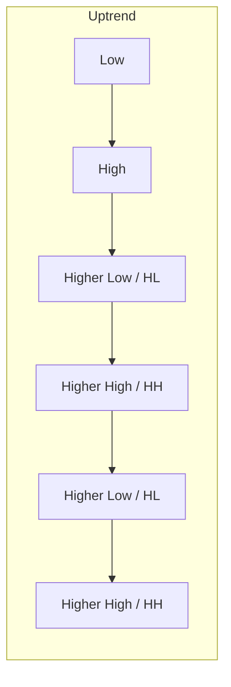
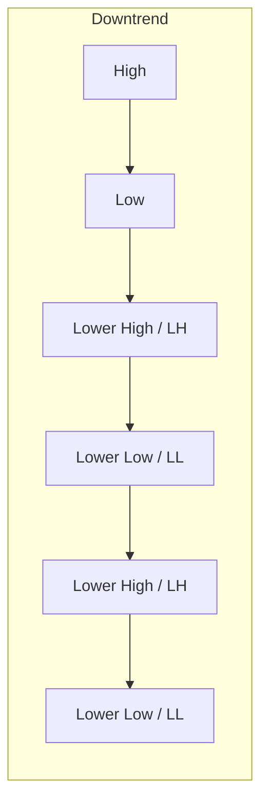
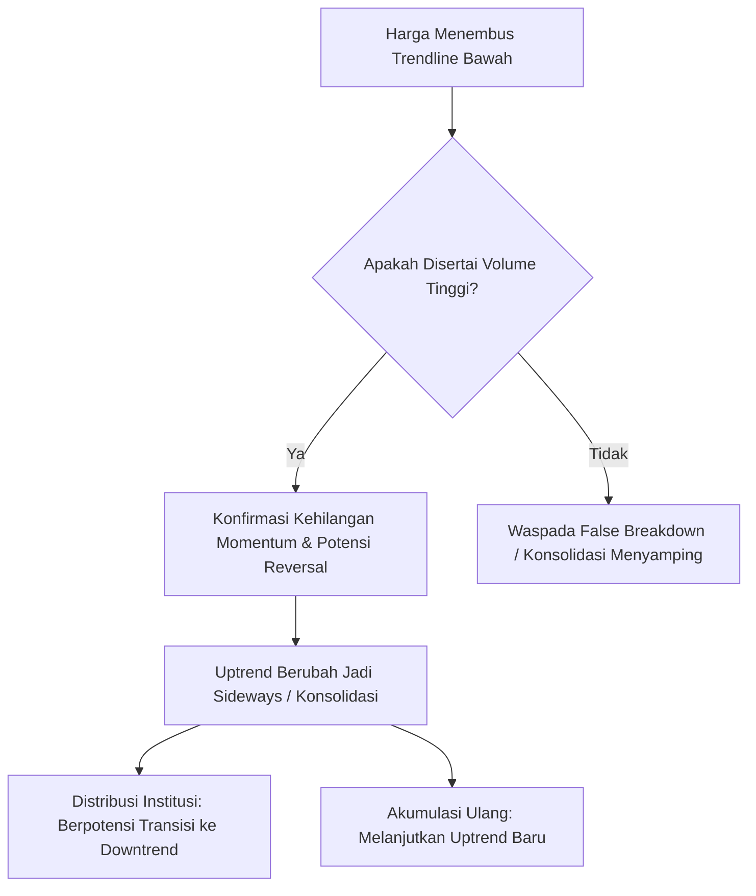

# BAB 5: Trend dan Klasifikasinya

> *"Trend is your friend until it bends."* — Pepatah klasik Wall Street ini bukan sekadar klise, melainkan fondasi absolut dari analisis teknikal terapan. Memahami arah aliran dana (*capital flow*) sebelum mengambil posisi beli atau jual adalah pembeda utama antara trader profesional yang membukukan *mega profit* dengan pelaku pasar ritel yang merugi.

---

## 1. Definisi Fundamental Trend

Dalam analisis teknikal modern, harga instrumen finansial (saham, forex, komoditas, kripto) tidak pernah bergerak dalam garis lurus vertikal naik atau turun. Sebaliknya, pasar bergerak dalam pola gelombang zig-zag yang membentuk serangkaian puncak (*peaks / highs*) dan lembah (*troughs / lows*). 

Arah dari rangkaian puncak dan lembah inilah yang secara objektif mendefinisikan **Trend**.

Secara fundamental, trend dibagi ke dalam 3 klasifikasi arah:

| Klasifikasi Trend | Karakteristik Struktur Puncak & Lembah | Implikasi Psikologi Pasar | Aksi Trader Profesional |
|:---|:---|:---|:---|
| **Uptrend (Bullish)** | **Higher Highs (HH)** dan **Higher Lows (HL)** | *Buyers* mendominasi pasar secara agresif; setiap penurunan harga dipandang sebagai peluang diskon (*buy the dips*). | Fokus mencari posisi *Long / Buy*, memaksimalkan *trailing stop*, dan membiarkan profit berlari (*run your profit*). |
| **Downtrend (Bearish)** | **Lower Highs (LH)** dan **Lower Lows (LL)** | *Sellers* memegang kendali penuh; reli kenaikan sesaat dipandang sebagai peluang melikuidasi barang (*sell on strength*). | Hindari menangkap pisau jatuh (*catching falling knives*); cari peluang *Short / Sell* atau pegang uang tunai (*Cash is King*). |
| **Sideways / Range-bound** | Puncak relatif sejajar (*Equal Highs*) & Lembah relatif sejajar (*Equal Lows*) | Keseimbangan temporer antara kekuatan permintaan (*demand*) dan penawaran (*supply*); konsolidasi sebelum ekspansi. | Strategi *Range Trading* (beli di support, jual di resistance) atau menunggu konfirmasi *breakout* dengan volume masif. |





---

## 2. Cara Menggambar Garis Trend (Trendline) yang Valid dan Benar

Garis trend (*trendline*) adalah salah satu perangkat paling sederhana namun paling berdaya guna dalam toolkit analis teknikal. Namun, banyak trader ritel melakukan kesalahan fatal dengan memaksakan garis agar cocok dengan ekspektasi subjektif mereka (*curve-fitting*).

### A. Kaidah Konstruksi Garis Trend
1. **Uptrend Line (Bullish Trendline)**:
   - Ditarik menghubungkan titik-titik lembah (*lows*) yang meninggi (**Higher Lows**).
   - Garis ini berada di **bawah** pergerakan harga dan berfungsi sebagai garis *support dinamis*.
2. **Downtrend Line (Bearish Trendline)**:
   - Ditarik menghubungkan titik-titik puncak (*highs*) yang menurun (**Lower Highs**).
   - Garis ini berada di **atas** pergerakan harga dan berfungsi sebagai garis *resistance dinamis*.

```
       UPTREND LINE (Support Dinamis)             DOWNTREND LINE (Resistance Dinamis)
       
             / (Peak 2)                                 \ (High 1)
            / \                                          \   /
           /   \ (HL 2)                                   \ / (LH 1)
          /     \                                          \   /
 (Peak 1)/       \                                          \ / (LH 2)
  /\    /                                                    \   
 /  \  /                                                      \
/    \/ (HL 1)                                                 \
----------------------------------               ----------------------------------
Garis ditarik di bawah lembah-lembah              Garis ditarik di atas puncak-puncak
```

### B. Aturan Jumlah Titik Sentuh (*Touch Points*)
- **Dua Titik (Tentative Trendline)**: Dua titik lembah atau puncak adalah syarat minimum untuk menarik sebuah garis trend percobaan (*tentative*). Garis ini belum dapat dianggap kokoh.
- **Tiga Titik (Confirmed / Valid Trendline)**: Konfirmasi resmi bahwa sebuah trendline valid terjadi ketika harga menguji garis tersebut untuk ketiga kalinya dan memantul (*rebound*) mempertahankan strukturnya.
- **Semakin banyak titik sentuh** tanpa adanya penembusan, semakin valid dan signifikan level support/resistance garis tersebut bagi pelaku pasar institusional.

### C. Kemiringan Ideal Garis Trend (~45 Derajat)
Menurut Edianto Ong, sudut kemiringan trendline mencerminkan kecepatan dan keberlanjutan psikologis pergerakan harga:
- **Sudut Normal (~45 Derajat)**: Menunjukkan laju apresiasi atau depresiasi modal yang sehat dan seimbang antara partisipasi harga dan waktu. Trend dengan sudut ini cenderung bertahan lama (*sustainable*).
- **Sudut Terlalu Curam (> 60 Derajat)**: Menunjukkan aksi spekulatif berlebihan atau euforia / *panic buying/selling*. Pola parabolik seperti ini sangat rapuh dan rentan mengalami koreksi tajam dalam waktu singkat.
- **Sudut Terlalu Landai (< 20 Derajat)**: Menunjukkan momentum yang lemah dan keraguan pasar. Trendline yang terlalu landai seringkali mudah ditembus tanpa menandakan pembalikan arah mayor, melainkan pergeseran ke arah konsolidasi.

---

## 3. Penembusan Garis Trend: Sinyal Peringatan Awal (*Early Warning*)

Penembusan (*trendline break*) adalah indikasi teknikal terpenting bahwa dinamika pasokan dan permintaan telah bergeser.

> [!IMPORTANT]
> **Prinsip Utama:** Penembusan garis trendline tidak selalu berarti pembalikan arah tren secara instan (dari uptrend langsung menjadi downtrend brutal). Dalam sebagian besar kasus, penembusan trendline pertama kali bertindak sebagai **sinyal peringatan dini (*early warning signal*)** bahwa laju tren telah kehilangan momentum akselerasinya dan berpotensi bertransisi menjadi fase konsolidasi (*sideways*) sebelum menentukan arah barunya.



Langkah defensif yang wajib dilakukan saat trendline tertembus:
1. **Perketat Stop Loss**: Geser trailing stop ke bawah swing low terakhir yang relevan.
2. **Kunci Sebagian Keuntungan (*Take Partial Profit*)**: Khususnya bagi swing trader atau momentum trader.
3. **Pantau Perilaku Pullback**: Perhatikan apakah harga memantul kembali untuk menguji bekas garis trend dari sisi berlawanan (fenomena *role reversal*).

---

## 4. Klasifikasi Trend Berdasarkan Teori Charles Dow

Berdasarkan formulasi Charles H. Dow yang diuraikan lebih lanjut oleh Edianto Ong, pergerakan trend di pasar modal dibagi menjadi tiga spektrum waktu yang beroperasi secara simultan, diibaratkan seperti dinamika lautan:

```
  ==============================================================
   DOW THEORY ANALOGY: OMBAK, GELOMBANG, DAN PASANG SURUT LAUT
  ==============================================================
   1. MAJOR TREND       --> Pasang Surut Lautan (The Tide)
   2. SECONDARY TREND   --> Ombak Besar (The Waves)
   3. MINOR TREND       --> Riak-Riak Kecil Permukaan Air (The Ripples)
  ==============================================================
```

### 1. Major Trend (Primary Trend)
- **Durasi**: Berlangsung dari 1 tahun hingga beberapa tahun (multi-year).
- **Karakteristik**: Arah utama dari keseluruhan pasar (*secular bull market* atau *secular bear market*). Pergerakan ini digerakkan oleh faktor fundamental makroekonomi, siklus suku bunga, dan pertumbuhan laba korporasi jangka panjang.
- **Saran Aksi**: Selalu posisikan arah portofolio utama searah dengan Major Trend.

### 2. Secondary Trend (Intermediate Trend)
- **Durasi**: Berlangsung antara 3 minggu hingga 3 bulan (atau beberapa bulan).
- **Karakteristik**: Merupakan koreksi teknikal penting yang berlawanan arah dengan Major Trend. Dalam *Bull Market*, secondary trend adalah fase koreksi sehat (*pullback / correction*) yang merefleksikan 33% hingga 66% (seringkali 50%) dari pergerakan major sebelumnya.
- **Saran Aksi**: Menjadi arena ideal bagi *Swing Trader* untuk mengakumulasi posisi pada harga diskon searah dengan Primary Trend.

### 3. Minor Trend (Near-Term Trend)
- **Durasi**: Berlangsung dari hitungan hari hingga kurang dari 3 minggu.
- **Karakteristik**: Riak-riak harian yang dipicu oleh berita sesaat, rilis data laba kuartalan spontan, rumor, atau volatilitas intraday.
- **Saran Aksi**: Sangat mudah dimanipulasi oleh pelaku pasar bermodal besar (*market makers / noise traders*). Investor institusi dan swing trader objektif menyaring kebisingan (*noise*) minor trend ini agar tidak terjebak *whipsaw*.

---

## 5. Ringkasan Eksekutif & Kaidah Eksekusi

1. **Struktur adalah Segalanya**: Jangan berspekulasi memprediksi puncak (*top picking*) pada struktur Higher Highs/Higher Lows. Biarkan harga membuktikan kelemahannya terlebih dahulu dengan membentuk Lower High dan penembusan support terdekat.
2. **Kaidah Tiga Titik**: Selalu prioritaskan trendline yang diuji minimal 3 kali. Trendline 2 titik hanyalah hipotesis kerja.
3. **Multi-Timeframe Alignment**: Identifikasi Primary Trend pada chart mingguan (*weekly*), tentukan Secondary Trend pada chart harian (*daily*), dan gunakan Minor Trend pada chart 4-jam atau 1-jam hanya untuk presisi titik entri (*timing entry*).
