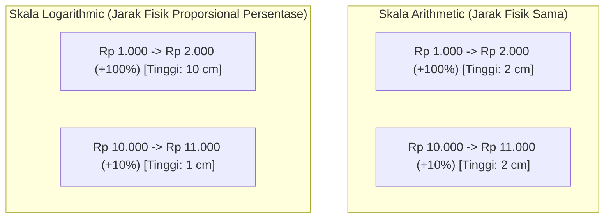

# BAB 6: Skala Arithmetic vs Skala Logarithmic

> *"Banyak analis pemula menarik garis trendline di chart mingguan atau bulanan tanpa menyadari bahwa skala sumbu harga yang mereka gunakan mendistorsi realitas matematika pergerakan harga."* — Edianto Ong

Pemilihan skala pada sumbu vertikal (sumbu-Y / harga) bukan sekadar preferensi estetika tampilan grafik. Ini adalah keputusan metodologis fundamental yang menentukan validitas garis trend, level support-resistance jangka panjang, serta pengenalan pola teknikal.

---

## 1. Definisi Komparatif: Arithmetic vs Logarithmic

Dalam perangkat lunak pemetaan grafik (*charting platform*), terdapat dua metode utama dalam memetakan perubahan harga:

| Dimensi Parameter | Skala Arithmetic (Linear Scale) | Skala Logarithmic (Semi-Log Scale) |
|:---|:---|:---|
| **Definisi Visual** | Jarak vertikal yang sama mewakili **perubahan nilai nominal harga yang identik**. | Jarak vertikal yang sama mewakili **perubahan persentase kenaikan/penurunan yang identik**. |
| **Kenaikan Rp 1.000** | Kenaikan dari Rp 1.000 ke Rp 2.000 memiliki jarak fisik yang sama persis dengan kenaikan dari Rp 10.000 ke Rp 11.000. | Kenaikan Rp 1.000 pada basis Rp 1.000 meregang jauh lebih tinggi dibanding kenaikan Rp 1.000 pada basis Rp 10.000. |
| **Rasio Relatif** | Mengabaikan persentase return modal; murni mengukur selisih poin absolut ($ atau Rp). | Menghargai *compounding return*; pergerakan +100% selalu berjarak vertikal sama di level harga berapapun. |
| **Jangkauan Ideal** | Kerangka waktu pendek (*short-term / intraday*) dan rentang fluktuasi harga yang sempit. | Kerangka waktu menengah-panjang (*weekly / monthly*) dan saham dengan volatilitas tinggi atau fase pertumbuhan masif. |

---

## 2. Mengapa Persentase Lebih Fundamental Dibandingkan Poin Nominal?

Di pasar modal, keuntungan modal seorang investor atau manajer portofolio dihitung berdasarkan **persentase pengembalian modal (*Return on Investment / ROI*)**, bukan pergeseran poin nominal.

Mari telaah ilustrasi komparasi berikut:

```
KASUS A: Saham Alpha bergerak dari Rp 1.000 ke Rp 2.000
   * Kenaikan nominal : +Rp 1.000
   * Kenaikan persentase: +100% (Uang investor berlipat ganda)

KASUS B: Saham Alpha kemudian bergerak dari Rp 10.000 ke Rp 11.000
   * Kenaikan nominal : +Rp 1.000 (Sama persis dengan Kasus A)
   * Kenaikan persentase: +10% (Hanya pertumbuhan tambahan marjinal)
```

Pada **Skala Arithmetic (Linier)**:
Jarak visual pergerakan Kasus A dan Kasus B digambar dengan panjang sumbu yang sama persis (misal: 2 cm). Ini memberikan ilusi visual yang keliru bahwa kedua peristiwa tersebut memiliki bobot kepentingan ekonomi yang setara bagi portofolio.

Pada **Skala Logarithmic (Semi-Log)**:
Pergerakan Kasus A (+100%) digambarkan sepuluh kali lipat lebih tinggi daripada pergerakan Kasus B (+10%). Representasi ini secara jujur mencerminkan pertumbuhan riil modal investor.



---

## 3. Kapan Wajib Menggunakan Skala Logarithmic (Semi-Log)?

Edianto Ong menekankan bahwa penggunaan skala semi-log menjadi **kewajiban mutlak (*mandatory*)** dalam kondisi berikut:

1. **Grafik Multi-Tahun (Long-Term Charts)**:
   Analisis time frame bulanan (*monthly*) atau mingguan (*weekly*) yang mencakup rentang waktu di atas 1 hingga 5 tahun.
2. **Saham Multi-Bagger / High Growth**:
   Saham-saham yang mengalami apresiasi harga lebih dari 100% hingga ribuan persen. Jika menggunakan skala linier pada saham yang melesat dari Rp 500 ke Rp 15.000, pergerakan historis di fase awal (saat di Rp 500 – Rp 2.000) akan terlihat seperti garis lurus mendatar yang kehilangan seluruh detail struktur gelombangnya.
3. **Periode Inflasi Tinggi atau Volatilitas Ekstrem**:
   Ketika nilai mata uang mengalami devaluasi tajam atau pasar mengalami fase *bubble* dan *hyper-inflation*.

---

## 4. Fenomena Distorsi Trendline: Pergeseran Visual Antar Skala

Salah satu bahaya terbesar dari kesalahan memilih skala adalah munculnya **False Trendline Breakout / Breakdown**.

### Fenomena Pergeseran Trendline:
- Pada tren naik (*uptrend*) jangka panjang, garis trendline yang ditarik pada **skala linier** akan menanjak dengan kemiringan yang semakin curam ke atas membentuk kurva hiperbolik semu.
- Akibatnya, pada skala linier, harga sering kali tampak seolah-olah telah menembus trendline ke bawah (*breakdown*), memicu sinyal jual palsu (*false sell signal*), padahal saham tersebut hanya kembali ke laju pertumbuhan persentase normalnya.
- Begitu chart dialihkan ke **skala semi-log**, garis trendline tetap utuh, rapi, dan membuktikan bahwa tren naik utama masih berjalan tanpa gangguan.

```
       DISTORSI PADA SKALA LINIER                 VALIDITAS PADA SKALA SEMI-LOG
       
       Harga                                      Harga
        |         /\  (Sinyal Sell Palsu!)         |           /\
        |        /  \                              |          /  \
        |       /    \  <--- "Tertembus"           |         /    \
        |      /      \      di Linier             |        /      \
        |    /^\       \                           |       /        \  (Memantul tepat
        |   /   \       \                          |     /^\         \  di trendline)
        |  /     \       \                         |    /   \         \/
        | /       \       \                        |   /     \        /
        |/_________v_______\________               |  /       \      /
        0                        Waktu             | /_________\____/___________
                                                   0                        Waktu
```

---

## 5. Panduan Praktis untuk Trader Modern

1. **Untuk Day Trading & Scalping (M1 - H1)**: 
   Gunakan **Skala Arithmetic**. Dalam rentang intraday, fluktuasi persentase harga relatif kecil (0.5% - 3%), sehingga perbedaan antara kedua skala hampir tidak kasat mata.
2. **Untuk Swing Trading & Position Trading (D1 - W1 - MN)**: 
   Jadikan **Skala Logarithmic** sebagai pengaturan *default* utama Anda. Seluruh perhitungan batas risiko, pengukuran target pola (*measured move*), dan penarikan garis tren jangka panjang menjadi jauh lebih presisi dan tahan uji.
3. **Periksa Keduanya**: Trader profesional sering kali mengamati kedua skala sebelum mengeksekusi order dalam jumlah besar untuk memastikan apakah garis resisten atau tren juga diperhatikan oleh pelaku pasar lain yang masih menggunakan skala linier.
