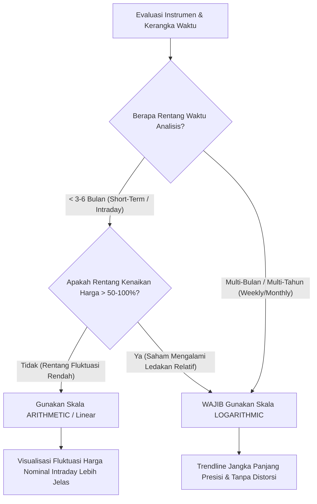
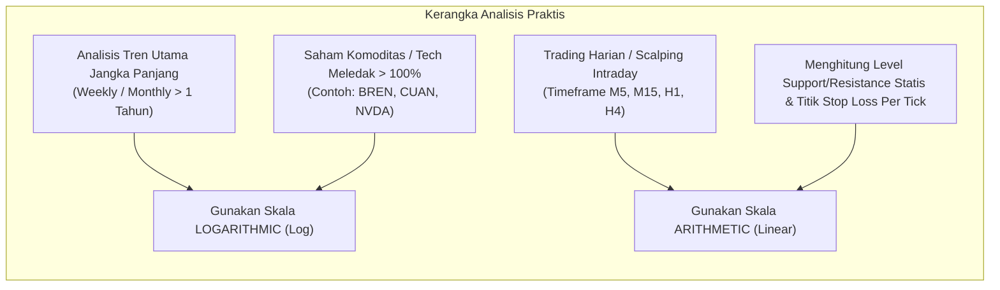

# BAB 6: Skala Arithmetic vs Skala Logarithmic

> *"Banyak analis dan trader pemula menarik garis trendline di grafik mingguan atau bulanan tanpa menyadari bahwa skala sumbu harga yang mereka pilih secara diam-diam mendistorsi realitas matematika pergerakan harga pasar."* — Edianto Ong

Dalam analisis teknikal, grafik (*chart*) adalah kanvas utama tempat Anda mengamati perilaku pasar. Namun, tahukah Anda bahwa sumbu vertikal (sumbu harga atau sumbu Y) memiliki dua mode perhitungan yang sangat berbeda?

Memilih antara **Skala Arithmetic (Linier)** dan **Skala Logarithmic (Semi-Log)** bukan sekadar persoalan estetika tampilan grafik. Ini adalah keputusan metodologis fundamental. Salah memilih skala pada kerangka waktu jangka panjang dapat menghasilkan garis tren (*trendline*) yang keliru, sinyal jual/beli palsu, serta estimasi risiko yang meleset jauh.

---

## 1. Analogi Dunia Nyata: Kenaikan Harga Bensin dan Uang Jajan

Untuk memahami perbedaan kedua skala ini tanpa pusing dengan rumus matematika rumit, bayangkan analogi berikut:

### Analogi A: Kenaikan Harga Bensin Rp 1.000
Bayangkan dua masa yang berbeda dalam sejarah:
1. **Tahun 1990-an**: Harga bensin masih **Rp 1.000 per liter**, lalu pemerintah menaikkannya sebesar **Rp 1.000** menjadi **Rp 2.000 per liter**. Kenaikan nominalnya adalah Rp 1.000, tetapi dampaknya terhadap dompet rakyat adalah **kenaikan 100% (dua kali lipat)**. Seluruh ongkos transportasi dan harga barang pokok melonjak drastis!
2. **Tahun 2024**: Harga bensin berada di **Rp 10.000 per liter**, lalu dinaikkan sebesar **Rp 1.000** menjadi **Rp 11.000 per liter**. Kenaikan nominalnya sama persis (+Rp 1.000), namun dampaknya terhadap dompet rakyat hanya **kenaikan 10%**. Bebannya jauh lebih ringan dan daya belinya tidak tergoncang separah tahun 1990-an.

```
+-------------------------------------------------------------------------+
|                  UJI DAMPAK PERSENTASE VS NOMINAL                       |
+-------------------------------------------------------------------------+
| Periode         | Harga Awal | Kenaikan Nominal | Harga Akhir | Dampak  |
|-----------------+------------+------------------+-------------+---------|
| Periode 1 (1990)| Rp 1.000   | +Rp 1.000        | Rp 2.000    | +100%   |
| Periode 2 (2024)| Rp 10.000  | +Rp 1.000        | Rp 11.000   | +10%    |
+-------------------------------------------------------------------------+
```

### Pertanyaan Kritis:
Apakah kedua kenaikan Rp 1.000 tersebut layak digambar dengan tinggi garis visual yang sama di grafik Anda?
- **Skala Arithmetic** menjawab: **YA**. Karena selisih nominalnya sama-sama Rp 1.000, maka tingginya digambar sama persis (misalnya sama-sama setinggi 2 cm di layar monitor).
- **Skala Logarithmic** menjawab: **TIDAK**. Kenaikan +100% adalah peristiwa ekonomi yang 10 kali lipat lebih dahsyat dibandingkan kenaikan +10%. Maka kenaikan +100% digambarkan jauh lebih tinggi dan proporsional.

Di pasar modal, uang Anda bertumbuh bukan berdasarkan poin rupiah absolut, melainkan berdasarkan **persentase pengembalian (*Return on Investment / ROI*)**. Oleh karena itu, memahami kapan harus memakai skala logaritmik adalah keharusan mutlak bagi setiap trader yang ingin mencetak *mega profit*.

---

## 2. Kamus Istilah Pemula (Glossary Box)

Sebelum melangkah lebih jauh, pahami definisi istilah-istilah kunci berikut:

| Istilah | Definisi Singkat & Padat |
|:---|:---|
| **Arithmetic Scale (Linear)** | Skala grafik di mana setiap kenaikan jarak vertikal (misal: 1 cm di layar) mewakili penambahan nilai nominal absolut yang konstan (misal: selalu Rp 500 atau $5). |
| **Logarithmic Scale (Semi-Log)** | Skala grafik di mana setiap kenaikan jarak vertikal yang sama mewakili persentase perubahan harga yang konstan (misal: setiap 1 cm mewakili kenaikan +20%). |
| **Multi-Bagger** | Saham atau aset yang harganya melesat berlipat-lipat ganda dari modal awal (misal: 2-bagger = naik 100%, 10-bagger = naik 1.000%). |
| **Distorsi Visual** | Efek ilusi optik pada grafik akibat skala yang tidak tepat, membuat pergerakan harga terlihat jauh lebih curam atau mendatar dari realitas aslinya. |
| **Semi-Logarithmic Chart** | Istilah teknis yang merujuk pada grafik yang sumbu vertikalnya (harga) menggunakan skala logaritmik, sedangkan sumbu horizontalnya (waktu) tetap linier reguler. |

---

## 3. Perbandingan Mendalam: Arithmetic vs Logarithmic

Berikut adalah tabel perbandingan sistematis antara kedua skala grafik:

| Dimensi Parameter | Skala Arithmetic (Linear) | Skala Logarithmic (Semi-Log) |
|:---|:---|:---|
| **Metode Pengukuran** | Mengukur **selisih nominal harga absolut** ($\Delta P = P_2 - P_1$). | Mengukur **rasio persentase perubahan harga** ($\% \Delta P = \frac{P_2 - P_1}{P_1} \times 100\%$). |
| **Jarak Vertikal** | Jarak antara Rp 1.000 ke Rp 2.000 sama persis dengan Rp 9.000 ke Rp 10.000. | Jarak antara Rp 1.000 ke Rp 2.000 (+100%) sama dengan jarak Rp 5.000 ke Rp 10.000 (+100%). |
| **Karakteristik Tren Bullish** | Tren naik jangka panjang terlihat menanjak hiperbolis / eksponensial seperti roket vertikal. | Tren naik jangka panjang terlihat stabil, beraturan, dan proporsional. |
| **Kesesuaian Time Frame** | Sangat cocok untuk **Time Frame Pendek** (Intraday, M5, M15, H1, H4, atau harian jangka pendek < 3 bulan). | Sangat wajib untuk **Time Frame Menengah-Panjang** (Daily > 6 bulan, Weekly, Monthly) dan multi-tahun. |
| **Kelebihan Utama** | Memetakan level support/resistance tick-by-tick dengan presisi untuk scalping dan day trading. | Menjaga integritas garis trendline jangka panjang dari distorsi visual akibat kenaikan harga masif. |
| **Kelemahan Utama** | Menghilangkan struktur pola historis saat saham mengalami apresiasi ratusan persen. | Kurang intuitif untuk pemula yang belum terbiasa melihat jarak grid harga yang tidak sama rata. |



---

## 4. Bahaya Distorsi Garis Tren (Trendline Distortion)

Salah satu kesalahan paling mahal yang sering dilakukan pemula adalah menarik garis tren naik (*uptrend line*) pada grafik jangka panjang menggunakan skala arithmetic. 

Mengapa ini berbahaya?
Ketika suatu saham mengalami reli multi-tahun (misal: naik dari Rp 500 ke Rp 5.000), pada skala arithmetic, kenaikan di harga atas (dari Rp 4.000 ke Rp 5.000) akan digambar setinggi langit, sedangkan pergerakan di harga bawah (dari Rp 500 ke Rp 1.000) terlihat gepeng rata di dasar grafik.

Akibatnya:
1. Garis tren pada skala linier akan melengkung tajam ke atas menyerupai tebing terjal.
2. Sedikit saja saham mengalami koreksi wajar (misalnya turun 10% untuk konsolidasi), harga akan langsung menembus ke bawah garis tren linier tersebut.
3. Trader pemula mengira ini adalah sinyal jual darurat (*breakdown trendline*) dan buru-buru membuang saham mereka dalam kepanikan.
4. Namun, ketika grafik diubah ke **skala logaritmik**, garis tren ternyata masih utuh sempurna, dan saham tersebut justru memantul tepat di atas garis tren untuk melanjutkan reli mencetak rekor baru (*all-time high*)!

```
         SKALA ARITHMETIC (LINIER)                   SKALA LOGARITHMIC (SEMI-LOG)
    
    Harga                                       Harga
     |           /\ (Sinyal Sell Palsu!)         |              /\
     |          /  \                             |             /  \
     |         /    \  <-- "Tembus Garis Tren"   |            /    \
     |        /      \     (Distorsi Visual)     |           /      \
     |       /        \                          |          /        \  (Memantul Akurat
     |     /^\         \                         |        /^\         \  di Atas Trendline!)
     |    /   \         v                        |       /   \         \/
     |   /     \                                 |      /     \        /
     |  /       \                                |     /       \      /
     | /_________\________________________       |    /_________\____/____________
     0                               Waktu       0                               Waktu
       Pergerakan bawah gepeng mendatar;           Proporsi pertumbuhan konstan;
       Koreksi kecil memicu false breakdown.       Struktur gelombang terbaca utuh.
```

---

## 5. Studi Kasus Riil: Saham Multi-Bagger (PT Bank Central Asia Tbk / BBCA)

Mari amati perjalanan historis saham berkapitalisasi besar seperti BBCA dalam kurun waktu 15 tahun (misal: dari rentang harga setara Rp 1.000 hingga menembus Rp 10.000+ setelah stock split).

### Skenario 1: Dianalisis dengan Skala Arithmetic
- Trader pemula membuka grafik bulanan (*Monthly Chart*) BBCA selama 15 tahun dengan skala linier default.
- Pergerakan harga pada 5 tahun pertama (saat harga masih di kisaran Rp 1.000 - Rp 2.500) terlihat seperti garis lurus yang hampir rata dengan tanah. Pola cup and handle, double bottom, atau channel tren yang terbentuk di tahun-tahun awal tampak mustahil untuk digambar garis trennya.
- Sebaliknya, pergerakan dalam 2 tahun terakhir (saat harga bergerak dari Rp 8.000 ke Rp 10.000) terlihat seperti lonjakan raksasa yang dominan, meskipun secara persentase hanya tumbuh 25%.
- Kesimpulan Analisis: Trader kehilangan konteks historis siklus akumulasi awal dan menarik garis tren yang terlalu curam di pucuk.

### Skenario 2: Dianalisis dengan Skala Logarithmic
- Begitu tombol `Log` diaktifkan di platform charting:
- Jarak vertikal saat BBCA naik dari Rp 1.000 ke Rp 2.000 (+100%) memiliki tinggi yang sama persis dengan saat BBCA naik dari Rp 5.000 ke Rp 10.000 (+100%).
- Garis tren naik utama (*major bullish trendline*) yang ditarik menghubungkan titik lembah (*major lows*) sejak krisis 2008 menjadi sebuah garis lurus sempurna dengan sudut kemiringan sekitar 45 derajat.
- Setiap kali terjadi krisis atau koreksi makro ekonomi (koreksi 20-30%), harga BBCA memantul dengan presisi luar biasa di atas garis tren logaritmik ini.
- Keputusan Trader: Trader yang menggunakan skala logaritmik dengan tenang melakukan akumulasi beli (*buy on weakness*) saat harga menguji garis tren, sementara trader yang menggunakan skala linier panik menjual karena mengira tren sudah patah.

---

## 6. Panduan Praktis Step-by-Step Pemula

Bagaimana cara mengaktifkan dan mengonfigurasi skala ini di platform perdagangan sehari-hari Anda?

### Langkah 1: Memeriksa Skala di TradingView
1. Buka chart instrumen apa pun di **TradingView**.
2. Arahkan kursor Anda ke sudut kanan paling bawah dari grafik (tepat di ujung kanan sumbu harga).
3. Anda akan melihat dua tombol kecil: `auto` dan `log`.
4. Klik tombol **`log`** (atau gunakan shortcut keyboard: tekan kombinasi tombol `Alt + L` pada Windows atau `Option + L` pada Mac).
5. Perhatikan perubahan tampilan sumbu harga: jarak angka di sumbu vertikal akan menyesuaikan secara proporsional sesuai persentase perubahan.

### Langkah 2: Aturan Pemilihan Skala Berdasarkan Tugas Analisis
Ikuti aturan praktis yang dirumuskan oleh Edianto Ong berikut ini:



### Langkah 3: Menggambar Garis Tren yang Benar
- Jika Anda menganalisis grafik mingguan (*Weekly*), **selalu aktifkan mode Log terlebih dahulu sebelum menarik garis tren**.
- Hubungkan titik-titik lembah (*Higher Lows*) pada mode Log.
- Jika Anda beralih ke grafik harian untuk eksekusi taktis, garis tren tersebut akan tetap memandu Anda dengan batas toleransi persentase yang akurat.

---

## 7. Kesalahan Fatal Pemula (Newbie Traps)

Berikut adalah 4 jebakan umum yang sering menjebak trader pemula terkait skala grafik:

1. **Membiarkan Skala Default Tanpa Sadar**:
   Mayoritas software trading dan aplikasi sekuritas lokal menyetel skala grafik ke mode *Arithmetic* secara default. Banyak pemula bahkan tidak mengetahui bahwa tombol *Log* itu ada, sehingga menarik seluruh garis analisis jangka panjang di atas kanvas yang terdistorsi.
2. **Panic Selling di Lembah Koreksi Saham Blue Chip**:
   Menjual saham unggulan yang sedang uptrend sehat hanya karena pada skala linier harga tampak "menembus garis tren ke bawah", padahal pada skala logaritmik garis tren belum tersentuh sama sekali.
3. **Mengabaikan Struktur Awal Saham Multi-Bagger**:
   Menganggap pergerakan saham di masa-masa awal tidak signifikan hanya karena visualnya tampak gepeng di skala linier. Anda melewatkan pola akumulasi bandar/institusi yang terbentuk di harga bawah.
4. **Menggunakan Skala Log untuk Scalping Tick Cepat**:
   Sebaliknya, menggunakan skala logaritmik saat melakukan *day trading* atau *scalping* saham dengan rentang pergerakan sempit (hanya 1-3 tick per hari) dapat membuat pergerakan harga terlihat tidak wajar dan menyulitkan pembacaan spread bid-offer. Gunakan skala linear untuk perdagangan jangka sangat pendek!

---

## 8. Ringkasan & Checklist Tindakan Bab 6

Sebelum melanjutkan ke Bab 7 mengenai Support dan Resistance, pastikan Anda mencentang checklist pemahaman berikut:

- [ ] Saya memahami bahwa keuntungan portofolio dihitung dari persentase kenaikan modal, bukan sekadar nominal poin.
- [ ] Saya mengetahui bahwa skala logaritmik menjaga jarak vertikal persentase tetap proporsional di seluruh level harga.
- [ ] Saya selalu mengaktifkan skala Log (`Alt + L`) saat menganalisis chart mingguan (*Weekly*) atau saham dengan kenaikan > 100%.
- [ ] Saya menggunakan skala linier (*Arithmetic*) saat mengeksekusi trading jangka pendek (*Intraday*) dan menghitung tick support/resistance.
- [ ] Saya tidak akan panik menjual saham jangka panjang sebelum memeriksa integritas garis tren pada skala logaritmik.
