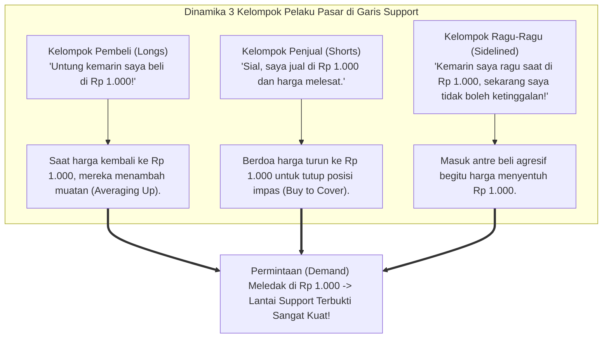
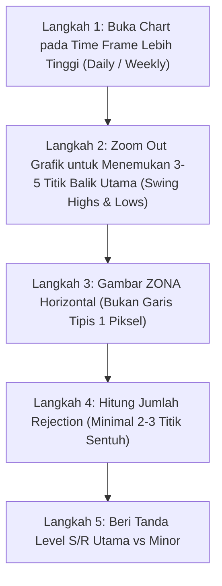

# BAB 7: Support dan Resistance

> *"Support dan Resistance adalah cermin psikologi massa yang paling jujur di pasar finansial. Di level-level inilah pertarungan antara rasa takut (fear) dan keserakahan (greed) termanifestasikan dalam volume transaksi riil."* — Edianto Ong

Jika ada satu konsep teknikal yang paling wajib dikuasai sebelum indikator matematika apa pun dipasang ke layar Anda, konsep itu adalah **Support dan Resistance (S&R)**. 

Banyak pemula mengira analisis teknikal adalah ilmu ramalan mistis atau formula rahasia algoritma. Padahal, pada hakikatnya analisis teknikal adalah studi tentang perilaku manusia di masa lalu yang berulang karena memori kolektif. Support dan Resistance adalah batas-batas psikologis di mana memori tersebut paling kuat bekerja.

---

## 1. Analogi Dunia Nyata: Lantai dan Atap Rumah 2 Lantai

Untuk memahami cara kerja Support dan Resistance tanpa kebingungan, gunakan analogi bangunan rumah bertingkat berikut:

```
+-------------------------------------------------------------------------+
|                  ANALOGI LANTAI & ATAP RUMAH BERTINGKAT                 |
+-------------------------------------------------------------------------+
|                                                                         |
|   [ LANTAI 2 ]  Atap / Plafon Rumah (RESISTANCE BARU)                   |
|                 ^                                                       |
|                 | (Bola memantul naik-turun di Lantai 2)                |
|                 v                                                       |
|   ============= Lantai 2 / Atap Lantai 1 (BEKAS RESISTANCE -> SUPPORT)  |
|                 ^                                                       |
|                 | (Bola melompat menembus plafon dengan tenaga dahsyat) |
|                 |                                                       |
|   [ LANTAI 1 ]  v                                                       |
|   ============= Lantai Dasar Rumah (SUPPORT LAMA)                       |
+-------------------------------------------------------------------------+
```

Bayangkan Anda sedang memantulkan bola basket karet di dalam ruangan **Lantai 1**:
1. **Support ibarat Lantai Keramik**: Ketika bola jatuh ke lantai, permukaan lantai yang keras menahan bola agar tidak amblas ke bawah tanah dan memantulkannya kembali ke atas. Di pasar, **Support adalah lantai harga** tempat minat beli (*buyers/demand*) menahan laju penurunan harga.
2. **Resistance ibarat Plafon/Atap Rumah**: Ketika bola dilempar ke atas, bola akan membentur langit-langit atap dan terpental kembali ke bawah. Di pasar, **Resistance adalah atap harga** tempat tekanan jual (*sellers/supply*) menahan laju kenaikan harga.
3. **Breakout (Menembus Atap)**: Jika seseorang menendang bola dengan tenaga sangat besar (didorong *volume transaksi raksasa*), bola itu dapat **menjebol atap lantai 1** hingga menembus ke ruangan **Lantai 2**!
4. **Role Reversal (Atap Berubah Menjadi Lantai)**: Begitu bola berada di Lantai 2 dan Anda memantulkannya lagi, apakah atap lantai 1 tadi masih berfungsi sebagai atap? **TIDAK!** Bekas atap lantai 1 tersebut kini menjadi **lantai pijakan baru (Support Baru)** bagi bola di Lantai 2. Inilah yang disebut prinsip *Role Reversal* (Pertukaran Peran).

---

## 2. Kamus Istilah Pemula (Glossary Box)

Pahami istilah-istilah wajib seputar Support dan Resistance berikut:

| Istilah | Definisi Praktis |
|:---|:---|
| **Support** | Zona atau level harga di mana antrean permintaan (*demand/buyers*) terkonsentrasi cukup masif untuk menghentikan kejatuhan harga dan memicu pantulan naik (*rebound*). |
| **Resistance** | Zona atau level harga di mana pasokan penawaran (*supply/sellers*) terkonsentrasi cukup kuat untuk menghentikan reli kenaikan dan memicu pembalikan turun (*pullback*). |
| **Breakout** | Peristiwa ketika harga berhasil menembus ke atas level resistance dengan volume perdagangan signifikan. |
| **Breakdown** | Peristiwa ketika harga berhasil jebol ke bawah level support dengan tekanan jual tinggi. |
| **Role Reversal** | Prinsip fundamental di mana support yang jebol bertukar fungsi menjadi resistance baru, atau resistance yang tembus bertukar fungsi menjadi support baru. |
| **Throwback** | Gerakan koreksi teknikal turun sesaat untuk menguji bekas resistance (*new support*) setelah terjadinya penembusan ke atas (*bullish breakout*). |
| **Pullback** | Gerakan pantulan teknikal naik sesaat untuk menguji bekas support (*new resistance*) setelah terjadinya penembusan ke bawah (*bearish breakdown*). |
| **Retest** | Perilaku harga yang kembali mendatangi level teknikal yang baru saja ditembus untuk menguji apakah level baru tersebut dipertahankan oleh pelaku pasar. |

---

## 3. Psikologi Tiga Kelompok Pelaku Pasar di Balik S&R

Mengapa level harga tertentu di masa lalu bisa menjadi batas penahan di masa depan? Edianto Ong menjabarkan dinamika psikologis dari 3 kelompok pelaku pasar di zona S&R:



1. **Kelompok Pembeli (Longs / Yang Sudah Punya Barang)**:
   Mereka yang membeli di support Rp 1.000 dan melihat harga naik ke Rp 1.300 merasa puas dan percaya diri. Ketika harga terkoreksi kembali ke Rp 1.000, mereka melihat ini sebagai peluang kedua untuk menambah kepemilikan modal (*buy the dips*).
2. **Kelompok Penjual (Shorts / Yang Terlanjur Cutloss/Jual Terlalu Cepat)**:
   Mereka yang menjual di Rp 1.000 merasa sangat menyesal saat melihat harga justru meroket. Di dalam hati mereka berjanji: *"Jika harga turun kembali ke Rp 1.000, saya akan segera membeli kembali agar tidak rugi modal atau impas."* Aksi menutup posisi jual atau membeli kembali ini secara mekanis menambah antrean beli!
3. **Kelompok Penonton (Sidelined / Ragu-Ragu)**:
   Mereka yang sebelumnya melihat harga di Rp 1.000 tetapi ragu-ragu membeli, lalu merasa kecewa saat harga terbang ke Rp 1.300. Begitu harga kembali ke Rp 1.000, mereka tidak mau mengulangi kesalahan yang sama dan langsung mengeksekusi order beli.

Pertemuan psikologis dari ketiga kelompok ini menciptakan lonjakan volume beli (*buying wave*) yang secara alamiah menjadikan level tersebut sebagai dinding benteng pertahanan. Hal serupa terjadi secara terbalik pada level Resistance.

---

## 4. Prinsip Role Reversal: Pertukaran Peran Support & Resistance

Hukum aksi harga yang paling fundamental menurut Edianto Ong adalah:
> **Level teknikal tidak pernah mati setelah ditembus; perannya hanya tertukar 180 derajat.**

```
          SKENARIO ROLE REVERSAL: RESISTANCE MENJADI SUPPORT
  
  Harga
    ^                 (Puncak Reli Baru)
    |                       /\
    |                      /  \     (Throwback / Retest)
    |                     /    \     /\  <=== Titik Entri Berprobabilitas Tinggi!
    |      (Breakout)    /      \   /  \      (Low Risk, High Reward)
  ==|=======/====\======/========\_/====\================== BEKAS RESISTANCE
    |      /      \    /                                    Kini Resmi Menjadi SUPPORT
    |     /        \  / 
    |    /          \/  (Support Lama)
    +--------------------------------------------------------> Waktu
```

### Mengapa Role Reversal Terjadi?
Saat Resistance Rp 1.500 berhasil dijebol dengan volume masif:
- Para pelaku pasar yang tadinya ragu kini menyadari bahwa pasokan barang di Rp 1.500 telah habis diserap oleh institusi (*smart money*).
- Ketika harga mengalami koreksi teknikal (*throwback*) kembali ke Rp 1.500, para pembeli baru menganggap level tersebut sebagai harga murah yang aman. 
- Di sisi lain, para penjual yang tadinya menjual di Rp 1.500 berusaha membeli kembali barang mereka sebelum tertinggal lebih jauh.
- Akibatnya, dinding atap Rp 1.500 berubah seketika menjadi lantai pelindung baru yang kokoh.

---

## 5. Panduan Step-by-Step Pemula: Menentukan S/R yang Valid

Banyak pemula kebingungan: *"Bagian candle mana yang harus dijadikan garis? Pucuk jarum (shadow) atau badan lilin (body)?"* Berikut panduan langkah demi langkah yang teruji:



### Langkah 1: Gunakan Kerangka Waktu Lebih Besar Dahulu (*Top-Down Analysis*)
- Jangan pernah mulai mencari Support/Resistance di timeframe 5 menit atau 15 menit. Anda akan melihat terlalu banyak "kebisingan" (*noise*).
- Selalu mulai dari chart **Harian (Daily)** atau **Mingguan (Weekly)** untuk memetakan level mayor institusi.

### Langkah 2: Cari Titik Balik Ekstrem (*Swing High & Swing Low*)
- Titik balik (*swing points*) adalah puncak di mana harga berhenti naik dan berbalik tajam ke bawah (Swing High), atau lembah di mana harga berhenti jatuh dan berbalik melesat ke atas (Swing Low).

### Langkah 3: Menghubungkan Titik Sentuh: Jarum vs Badan Candle
- **Aturan Praktis Edianto Ong**: Tarik kotak area (zona) yang mencakup **dari harga penutupan badan candle (close body) hingga ujung ekor jarum tertinggi/terendah (extreme wick)**.
- Dengan membuat zona persegi panjang transparan (*box area*), Anda tidak akan terjebak memperdebatkan selisih beberapa rupiah antara ekor jarum dan badan lilin.

### Langkah 4: Evaluasi Bobot Signifikansi (Aturan 3-Sentuhan)
Tidak semua garis horizontal memiliki bobot yang sama. Ukur kekuatannya berdasarkan parameter berikut:
1. **Jumlah Titik Sentuh (*Touch Points*)**:
   - 1 sentuhan = Titik referensi biasa.
   - 2 sentuhan = Level S/R tentatif (perlu diwaspadai).
   - 3 sentuhan atau lebih = **Major Confirmed Support/Resistance** (sangat kuat).
2. **Besaran Volume Saat Terjadi Penolakan (*Rejection*)**:
   Level S/R yang menghasilkan pantulan dengan volume transaksi sangat tinggi membuktikan kehadiran institusi besar di balik level tersebut.
3. **Usia Level S/R**:
   Level yang bertahan selama berbulan-bulan atau bertahun-tahun memiliki bobot psikologis yang jauh lebih besar daripada level yang baru terbentuk 2 hari lalu.

---

## 6. Studi Kasus Riil: Transaksi Swing Saham BBRI (Role Reversal)

Mari bedah skenario transaksi nyata pada saham PT Bank Rakyat Indonesia Tbk (BBRI):

```
+-------------------------------------------------------------------------+
|                  STUDI KASUS SWING ENTRY PADA BBRI                      |
+-------------------------------------------------------------------------+
| Parameter Transaksi       | Nilai Riil di Pasar                         |
|---------------------------+---------------------------------------------|
| Level Resistance Utama    | Rp 5.500 (Sudah diuji 3 kali gagal tembus)  |
| Peristiwa Breakout        | Hari Senin: Candle Marubozu Hijau ditutup   |
|                           | di Rp 5.650 dengan Volume 2x MA20           |
| Perilaku Hari Rabu-Kamis  | Throwback (koreksi wajar dengan volume tipis|
|                           | menguji area Rp 5.500 - Rp 5.525)           |
| Konfirmasi Masuk (Entry)  | Kamis Sore: Terbentuk Pinbar Rejection      |
|                           | Beli di Rp 5.550                            |
| Batas Toleransi Stop Loss | Di bawah zona support: Rp 5.375 (-3.1%)     |
| Target Take Profit (TP)   | Angka Psikologis berikutnya: Rp 6.000 (+8%) |
| Risk-to-Reward Ratio      | 1 : 2.5 (Sangat Sehat)                      |
+-------------------------------------------------------------------------+
```

### Hasil Eksekusi:
Setelah menguji bekas resistance Rp 5.500 yang kini bertukar peran menjadi support baru, pembeli institusional kembali masuk mendorong harga. Saham BBRI melesat mencapai target Rp 6.000 dalam tempo 3 minggu tanpa pernah menyentuh batas risiko stop loss di Rp 5.375.

---

## 7. Kesalahan Fatal Pemula (Newbie Traps)

Hindari 4 blunder mematikan yang sering menguras modal trader baru:

1. **Sindrom Sarang Laba-Laba (Chart Ruwet Penuh Garis)**:
   Menarik garis horizontal di setiap pucuk dan lembah kecil pada timeframe 5 menit hingga grafik tertutup puluhan garis warna-warni seperti benang kusut. Akibatnya, trader lumpuh menganalisis (*analysis paralysis*) karena di setiap tick harga selalu ada "garis penahan".
   > *Solusi*: Batasi maksimal hanya 3 sampai 4 zona S/R utama yang paling jelas terlihat saat Anda mengecilkan (*zoom out*) grafik harian.
2. **Membeli Tepat di Bawah Resistance**:
   Membeli saham karena melihat harganya sedang naik kencang (*green candle*), tanpa memeriksa bahwa hanya 1% di atasnya terdapat dinding resistance masif multi-bulan. Anda membeli di ruang sempit dengan risiko bantingan maksimal.
3. **Panik Cut Loss Saat Penetrasi Ekor Sesaat**:
   Memasang stop loss terlalu mepet tepat 1 perak di bawah garis support. Ketika harga menembus sesaat dengan ekor lilin (*wick*) untuk menyapu likuiditas lalu langsung memantul naik, trader ritel terkena cut loss dan tertinggal reli.
4. **Menganggap Support Kebal Selamanya**:
   Mempertahankan saham yang sedang meluncur bebas (*free fall*) dengan dalih "pasti mantul di support". Ingat: **Setiap support diciptakan untuk akhirnya ditembus**. Jika struktur harga dan volume menunjukkan pelemahan parah, jangan bertaruh melawan pasar.

---

## 8. Ringkasan & Checklist Tindakan Bab 7

- [ ] Saya selalu mengidentifikasi level Support (lantai) dan Resistance (atap) sebelum memutuskan beli atau jual.
- [ ] Saya memahami hukum Role Reversal: bekas resistance menjadi support baru, bekas support menjadi resistance baru.
- [ ] Saya menggambar S/R sebagai ZONA fleksibel (badan candle hingga ekor jarum), bukan garis tipis 1 piksel.
- [ ] Saya memprioritaskan level S/R yang memiliki minimal 3 titik sentuh pada grafik harian (*Daily Chart*).
- [ ] Saya tidak akan membeli saham yang berada tepat di bawah area resistance mayor tanpa adanya sinyal breakout terkonfirmasi.
