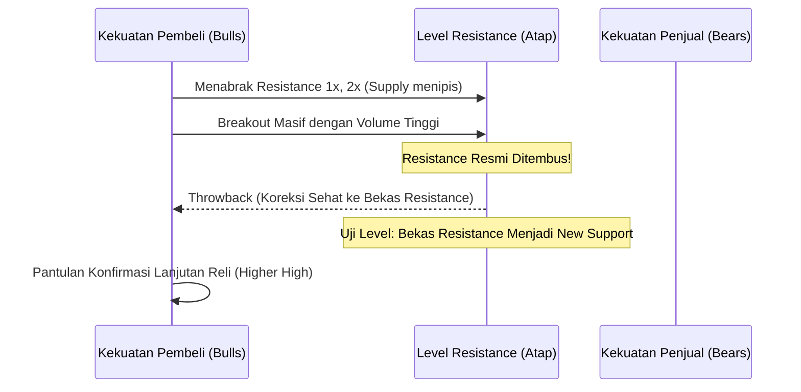

# BAB 7: Support dan Resistance

> *"Support dan Resistance adalah cermin psikologi massa yang paling jujur di pasar finansial. Di level-level inilah pertarungan antara rasa takut (fear) dan keserakahan (greed) termanifestasikan dalam volume transaksi riil."* — Edianto Ong

Konsep Support dan Resistance (S&R) merupakan pilar terpenting dalam analisis aksi harga (*price action*). Tanpa pemahaman mendalam mengenai dinamika di balik level-level ini, penggunaan indikator matematika secanggih apa pun akan kehilangan konteks pasarnya.

---

## 1. Anatomi dan Psikologi Pasar di Balik Support & Resistance

Secara teknikal:
- **Support (Lantai Harga)**: Level atau zona harga di mana minat beli (*demand*) dinilai cukup kuat untuk mengatasi tekanan jual (*supply*), sehingga menghentikan penurunan harga dan mendorong harga memantul ke atas.
- **Resistance (Atap Harga)**: Level atau zona harga di mana tekanan jual (*supply*) dinilai cukup masif untuk melampaui antrean beli (*demand*), sehingga menahan laju kenaikan harga dan memicu pembalikan ke bawah.

```
                  RESISTANCE (Zona Pasokan / Selling Pressure)
         /\              /\              /\
        /  \            /  \            /  \
       /    \          /    \          /    \
      /      \        /      \        /      \
     /        \      /        \      /        \
    /          \/    /          \/    /          \
               SUPPORT (Zona Permintaan / Buying Interest)
```

### Dinamika Psikologis Tiga Kelompok Pelaku Pasar:
Edianto Ong mengklasifikasikan psikologi pelaku pasar di zona S&R menjadi tiga entitas:

1. **Kelompok Pembeli (Longs)**:
   - Pelaku pasar yang telah membeli di area support merasa divalidasi ketika harga naik. Saat harga terkoreksi kembali mendekati area support tersebut, mereka termotivasi menambah muatan portofolio (*averaging up*).
2. **Kelompok Penjual (Shorts / Profit Takers)**:
   - Pelaku pasar yang menjual di area support merasa salah langkah saat harga melesat naik. Mereka berdoa agar harga turun kembali ke level impas (*breakeven*) agar mereka dapat menutup posisi tanpa menderita kerugian (*covering at zero loss*). Tindakan menutup posisi jual ini secara mekanis berarti **membeli**, yang semakin memperkuat lantai support!
3. **Kelompok Ragu-Ragu (Uncommitted / Sidelined)**:
   - Pelaku pasar yang sebelumnya menyaksikan harga memantul dari support tanpa sempat membeli kini bertekad: *"Jika harga turun kembali ke level itu, saya tidak akan menyia-nyiakan kesempatan ini lagi!"* Masuknya modal kelompok ini menciptakan lonjakan *demand* segar.

Kombinasi psikologis dari ketiga kelompok inilah yang secara alami menjadikan **Support** sebagai zona akumulasi beli yang kokoh. Hal yang berkebalikan terjadi di zona **Resistance**.

---

## 2. Penembusan (Breakout) dan Perilaku Retest: Pullback & Throwback

Pasar tidak bergerak dalam kurungan statis selamanya. Cepat atau lambat, keseimbangan pasokan dan permintaan akan pecah, memicu **Breakout**.

### Terminologi Standar:
- **Throwback**: Terjadi setelah **Resistance tertembus ke atas (*Upside Breakout*)**. Harga sempat reli, lalu mengalami koreksi teknikal turun kembali untuk menguji bekas garis resistance tersebut.
- **Pullback**: Terjadi setelah **Support tertembus ke bawah (*Downside Breakdown*)**. Harga sempat anjlok, lalu mengalami *technical rebound* naik kembali untuk menguji bekas garis support dari arah bawah.

*(Catatan: Dalam literatur populer, istilah "Pullback" sering kali digunakan secara umum untuk merujuk kedua fenomena retest tersebut).*



---

## 3. Prinsip Role Reversal (Pertukaran Peran)

Hukum paling krusial dalam aksi harga yang ditekankan Edianto Ong adalah **Prinsip Pertukaran Peran (*Role Reversal Principle*)**:

> [!IMPORTANT]
> Begitu sebuah level **Support berhasil ditembus secara meyakinkan ke bawah**, level tersebut akan bertukar peran secara otomatis menjadi **Resistance baru**.
> Sebaliknya, begitu sebuah level **Resistance berhasil ditembus secara meyakinkan ke atas**, level tersebut akan bertukar peran menjadi **Support baru**.

```
  KASUS ROLE REVERSAL: RESISTANCE BEJALAN MENJADI SUPPORT
  
  Harga
    ^             (Puncak Baru)
    |                  /\
    |                 /  \      (Throwback Menemui Support Baru)
    |    (Breakout)  /    \    /
    |       /\      /      \  /  <--- Titik Entri Berprobabilitas Tinggi!
====|======/==\====/========\/=========================== Bekas Resistance
    |     /    \  /                                       Kini Berubah Jadi SUPPORT
    |    /      \/
    |   / (Support Lama)
    +----------------------------------------------------> Waktu
```

### Mengapa Role Reversal Terjadi?
Faktor utamanya adalah **pergeseran penyesalan (*regret cycle*)**:
- Para trader yang membeli tepat di dekat level penembusan (*breakout*) kini berada dalam posisi untung. Ketika harga turun kembali menguji garis tersebut (*throwback*), mereka mempertahankannya sebagai benteng pertahanan terakhir.
- Para penjual yang sebelumnya menahan barang di resistance kini menyadari bahwa mereka telah melikuidasi aset di harga yang terlalu murah. Ketika harga mendekati level pelepasan awal mereka, mereka kembali masuk sebagai pembeli agresif.

---

## 4. Faktor-Faktor Penentu Bobot Signifikansi Support & Resistance

Tidak semua garis horizontal memiliki kekuatan yang setara. Edianto Ong menjabarkan kriteria obyektif untuk mengukur bobot sebuah zona S&R:

1. **Jangka Waktu (*Time Span*)**:
   - Level S&R yang terbentuk pada grafik mingguan (*weekly*) atau bulanan (*monthly*) jauh lebih kokoh dan berdampak signifikan dibandingkan level pada grafik harian atau intraday 15-menit.
2. **Frekuensi Sentuhan (*Number of Touches*)**:
   - Semakin sering sebuah level harga diuji tanpa berhasil ditembus, semakin valid level tersebut di mata konsensus pasar. Namun perlu diingat: jika sebuah level diuji terlalu sering dalam waktu singkat, level tersebut berangsur melemah karena cadangan *order* di titik itu telah habis terserap.
3. **Volume Transaksi yang Mengiringi (*Accompanying Volume*)**:
   - Level S&R yang terbentuk bersamaan dengan lonjakan volume luar biasa (*extreme high volume*) menandakan terjadinya transaksi institusional berskala besar (*institutional footprint*). Level ini menjadi zona pertahanan harga yang sangat kuat di masa mendatang.
4. **Kebaruan Waktu (*Recency*)**:
   - Reaksi pasar yang terjadi 3 minggu lalu jauh lebih relevan secara psikologis bagi partisipan aktif saat ini dibandingkan reaksi harga yang terjadi 3 tahun lalu.

---

## 5. Kaidah Eksekusi Trading Berbasis S&R

- **Jangan Mengejar Breakout Secara Buta (*Avoid Chasing Breakouts*)**: Membeli di puncak penembusan sering kali rentan terkena *false breakout* atau fluktuasi *throwback* yang mengguncang posisi (*shakeout*).
- **Trik Eksekusi Profesional**: Tunggu terjadinya *Throwback / Pullback* ke area role reversal, cari konfirmasi candlestick pembalikan arah (*Bullish Reversal Candle* seperti Pin Bar atau Engulfing), lalu letakkan *Stop Loss* terukur tepat di bawah batas zona toleransi support baru.
