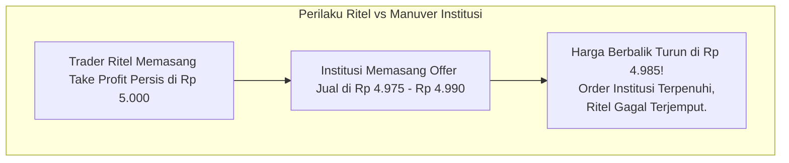

# BAB 8: Angka Psikologi (Round Numbers)

> *"Manusia menyukai keteraturan, kesederhanaan, dan angka-angka bulat. Kecenderungan kognitif alami ini terbawa langsung ke dalam pasar modal, menciptakan tumpukan order likuiditas raksasa di sekitar angka psikologis."* — Edianto Ong

Dalam lanskap pasar finansial, harga tidak hanya bereaksi terhadap level teknikal historis masa lalu, tetapi juga terhadap **Angka Psikologis (*Psychological Round Numbers*)**. Memahami cara kerja angka bulat adalah kunci untuk mengantisipasi di mana likuiditas tersembunyi dan bagaimana institusi besar mengeksekusi portofolio mereka.

---

## 1. Fenomena Kognitif di Balik Angka Bulat (*Round Number Effect*)

Secara psikologis, otak manusia cenderung melakukan pembulatan (*rounding bias*) untuk menyederhanakan perhitungan dan memproses informasi secara cepat:
- Seseorang lebih cenderung berkata *"Saya akan menjual saham ini jika sudah menyentuh Rp 5.000"* daripada memilih angka acak seperti *Rp 4.965* atau *Rp 5.035*.
- Dalam instrumen mata uang atau saham global: level $50, $100, $1.000, atau pada indeks seperti IHSG level 7.000, 7.500, 8.000 selalu menjadi magnet perhatian publik dan media massa.

Kecenderungan alami ini menyebabkan terjadinya **penumpukan antrean order beli dan jual (*Order Book Clustering*)** yang sangat padat tepat di sekitar angka-angka bulat tersebut, menciptakan dinding *Support* atau *Resistance* psikologis yang kasat mata.

```
       CONTOH TAMPILAN ORDER BOOK (MARKET DEPTH) DI ANGKA BULAT
       
       Harga (Bid/Offer)      Jumlah Lot Antrean (Depth)
       ----------------------------------------------------
       Rp 5.050               [ 12.000 lot ]
       Rp 5.025               [ 15.500 lot ]
       Rp 5.000 (ANGKA BULAT) [ 250.000 lot ] <=== DINDING RESISTENSI ALAMI
       Rp 4.975               [ 18.000 lot ]
       Rp 4.950               [ 21.000 lot ]
```

---

## 2. Tingkatan Hirarki Angka Psikologis

Edianto Ong membagi signifikansi angka psikologis berdasarkan tingkatan magnitudonya:

| Tingkatan | Contoh Karakteristik Harga | Efek Psikologis & Volatilitas |
|:---|:---|:---|
| **Major Milestone (Milestone Utama)** | Rp 1.000, Rp 5.000, Rp 10.000, $100, $1.000 | Mengundang liputan media finansial arus utama, sentimen publik meluap, dan terjadi pertempuran sengit (*clash of titans*) antara institusi pembeli dan penjual. |
| **Secondary Round Numbers (Angka Ratusan / Paruh)** | Rp 500, Rp 1.500, Rp 2.500, $50, $250 | Menjadi level target *take-profit* alami bagi para fund manager dan swing trader harian. |
| **Minor Round Numbers (Tingkat Puluhan)** | Rp 100, Rp 200, $10, $20 | Berfungsi sebagai support/resistance intraday minor; sering dilewati dengan cepat jika tren sedang kuat. |

---

## 3. Cara Trader Institusi Memanfaatkan Angka Bulat

Pelaku pasar institusional (reksa dana, *hedge funds*, *market makers*, dan *proprietary desks*) sangat menyadari perilaku trader ritel yang gemar menempatkan order di angka bulat. Mereka memanfaatkannya dengan dua strategi utama:



### A. Strategi *Front-Running Order*
Ketika jutaan lembar saham ditumpuk pada level jual Rp 5.000, harga sering kali mengalami tekanan pembalikan turun sebelum sempat menyentuh angka Rp 5.000 tersebut (misalnya berbalik tepat di Rp 4.975 atau Rp 4.990).
- Hal ini terjadi karena institusi cerdas (*smart money*) dengan sengaja memasang order keluar 1-3 tick lebih rendah di bawah angka bulat untuk menjamin eksekusi penuh (*guaranteed fill*) sebelum terjadi antrean panjang.
- Akibatnya, trader ritel yang bersikukuh menunggu angka genap Rp 5.000 mendapati posisi mereka tidak tereksekusi dan menyaksikan profit mereka menguap seketika.

### B. Perburuan Likuiditas (*Stop Hunting / Liquidity Sweeps*)
Sebaliknya, trader ritel yang membuka posisi *short* atau menjaga posisi *long* sering menempatkan titik *Stop Loss* tepat 1 tick di atas atau di bawah angka bulat (misal: stop loss di Rp 4.990 saat mempertahankan level Rp 5.000).
- Institusi sengaja mendorong harga menembus tipis angka bulat tersebut untuk memicu eksekusi massal stop loss ritel (*liquidity grab*).
- Likuiditas instan dari stop loss tersebut kemudian digunakan oleh institusi untuk menyerap posisi berlawanan dengan harga terbaik (*discounted entry*), sebelum membalikkan arah pasar secara agresif.

---

## 4. Panduan Taktis Eksekusi bagi Trader Objektif

Untuk membalikkan keadaan agar tidak menjadi korban fenomena angka bulat, Edianto Ong menyarankan aturan praktis berikut:

1. **Aturan Penempatan Target Take Profit**:
   - Jika Anda berada dalam posisi *Long*, **jangan pernah menaruh target TP tepat di angka bulat**. Pasang target Anda 1 hingga 3 tick di **bawah** angka bulat tersebut (contoh: jika target psikologis Anda Rp 2.000, pasang order jual limit di Rp 1.985 atau Rp 1.990).
2. **Aturan Penempatan Stop Loss**:
   - Berikan ruang bernapas ekstra (*buffer zone*). Jangan menaruh stop loss tepat di angka bulat atau 1 tick di bawahnya. Taruh stop loss beberapa tick di **bawah** angka bulat dengan memperhitungkan batas toleransi volatilitas pasar agar terhindar dari *stop hunt*.
3. **Validasi Penembusan Angka Bulat**:
   - Keberhasilan harga menembus angka bulat dengan volume transaksi tinggi sering kali memicu *FOMO buying* dari publik. Manfaatkan momentum akselerasi ini, namun jangan terburu-buru mengejar harga; tunggu konfirmasi *throwback* yang berhasil mempertahankan angka bulat tersebut sebagai *Support* baru.
