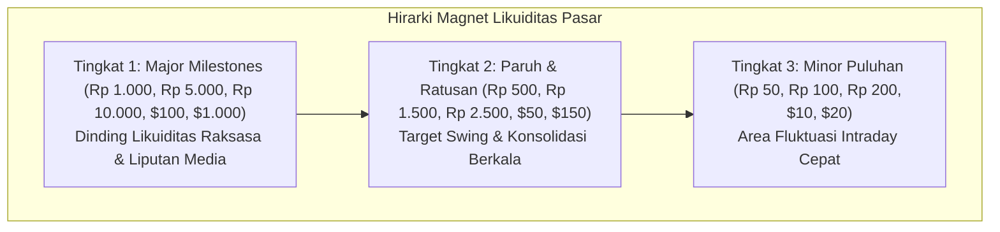
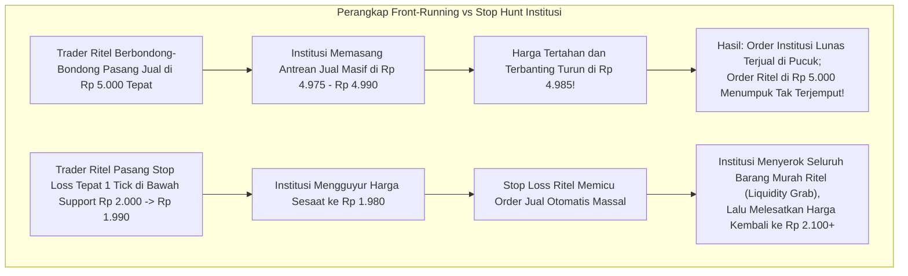

# BAB 8: Angka Psikologi (Round Numbers)

> *"Manusia menyukai keteraturan, kesederhanaan, dan angka-angka bulat. Kecenderungan kognitif alami ini terbawa langsung ke dalam pasar modal, menciptakan tumpukan order likuiditas raksasa di sekitar angka psikologis."* — Edianto Ong

Pernahkah Anda bertanya-tanya mengapa pergerakan harga saham sering kali tertahan tepat di angka-angka genap seperti Rp 1.000, Rp 5.000, atau Rp 10.000? Mengapa IHSG sering mengalami koreksi tajam saat menyentuh level keramat 7.000 atau 7.500? Mengapa pasangan mata uang EUR/USD selalu bergolak sengit di level 1.1000 atau Bitcoin di level $50.000 dan $100.000?

Jawabannya bukan kebetulan gaib, melainkan manifestasi dari **Angka Psikologis (*Psychological Round Numbers*)**. Memahami cara kerja angka bulat adalah kunci untuk membongkar di mana likuiditas raksasa tersembunyi dan bagaimana trader institusi mengeksploitasi kebiasaan trader ritel.

---

## 1. Analogi Dunia Nyata: Trik Harga Rp 99.000 di Supermarket

Untuk memahami bias psikologis ini, perhatikan kehidupan sehari-hari Anda saat berbelanja:

```
+-------------------------------------------------------------------------+
|                  BIAS KOGNITIF: CHARM PRICING DI SUPERMARKET            |
+-------------------------------------------------------------------------+
|                                                                         |
|  [ Label Harga Toko A ]        [ Label Harga Toko B ]                   |
|       Rp 99.900                      Rp 100.000                         |
|                                                                         |
|  Persepsi Otak Konsumen:       Persepsi Otak Konsumen:                  |
|  "Masih di bawah seratus ribu! "Sudah masuk seratus ribu,               |
|  Rasanya jauh lebih murah."    terasa mahal dan berat."                 |
|                                                                         |
|  Fakta Matematika:                                                      |
|  Selisihnya hanya Rp 100 (0,1%), tetapi efek psikologisnya sangat masif!|
+-------------------------------------------------------------------------+
```

Otak manusia diciptakan untuk menyederhanakan informasi yang kompleks:
- Ketika seseorang ditanya target harga menjual sahamnya, ia akan spontan menjawab: *"Nanti saya jual pas Rp 5.000."* Jarang sekali ada trader yang berkata: *"Saya akan pasang order jual persis di Rp 4.965 atau Rp 5.035."*
- Efek pembulatan alami ini (*rounding bias*) menyebabkan **ribuan trader dari seluruh penjuru dunia secara serentak memasang order di angka bulat yang sama**.
- Ketika jutaan lembar saham ditumpuk di satu harga genap, terbentuklah dinding tebal likuiditas di papan *order book* (*market depth*). Dinding inilah yang secara teknikal menciptakan **Support dan Resistance Psikologis Alami**.

---

## 2. Kamus Istilah Pemula (Glossary Box)

Berikut istilah-istilah esensial yang wajib dipahami mengenai angka psikologis:

| Istilah | Penjelasan Pemula |
|:---|:---|
| **Round Numbers** | Angka bulat berakhiran nol (seperti puluhan, ratusan, ribuan) yang menjadi titik fokus perhatian mental pelaku pasar. |
| **Order Book Clustering** | Penumpukan antrean order beli (*bid*) atau order jual (*offer/ask*) dalam jumlah luar biasa besar tepat di angka bulat. |
| **Front-Running Order** | Taktik memasang order 1-3 tick sebelum angka bulat untuk memastikan transaksi tereksekusi sebelum antrean panjang tersentuh. |
| **Stop Hunting (Liquidity Sweep)**| Manuver bandar/institusi yang sengaja mendorong harga sedikit melewati angka bulat untuk melibas stop loss ritel dan meraup likuiditas murah. |
| **Major Milestone** | Level angka bulat berskala besar yang menjadi sorotan berita media massa internasional/nasional (misal: IHSG 8.000, Gold $2.500, BBCA Rp 10.000). |
| **Century Numbers** | Angka bulat kelipatan seratus atau seribu (seperti $100, $200, Rp 1.000, Rp 2.000). |

---

## 3. Hirarki dan Tingkatan Angka Psikologis

Edianto Ong mengklasifikasikan kekuatan angka psikologis menjadi 3 tingkatan hirarki berdasarkan bobot dampaknya terhadap pasar:

| Tingkatan Hirarki | Contoh Level Harga | Dampak Psikologis & Karakteristik Pasar |
|:---|:---|:---|
| **Tingkat 1: Major Milestone (Puncak)** | • Saham: Rp 1.000, Rp 5.000, Rp 10.000<br/>• Indeks: IHSG 7.000, 8.000<br/>• Forex: EUR/USD 1.0000 (Parity), USD/JPY 150.00<br/>• Komoditas: Gold $2.000, Oil $100 | **Pertempuran Raksasa (*Clash of Titans*)**.<br/>Menjadi headline berita nasional, mengundang emosi keserakahan publik, dan memicu aksi jual/beli institusi skala global. |
| **Tingkat 2: Secondary Numbers (Paruh/Ratusan)** | • Saham: Rp 500, Rp 1.500, Rp 2.500, Rp 7.500<br/>• Forex: 1.0500, 1.1500<br/>• Kripto: BTC $65.000, $75.000 | **Target Profit Ayunan (*Swing Target*)**.<br/>Level favorit manajer investasi reksa dana untuk merealisasikan sebagian keuntungan (*partial take profit*). |
| **Tingkat 3: Minor Numbers (Puluhan)** | • Saham: Rp 100, Rp 200, Rp 350, Rp 450<br/>• Indeks: Poin kelipatan 50 | **Support/Resistance Intraday Cepat**.<br/>Sering berfungsi sebagai area pantulan minor harian, namun mudah ditembus jika tren sedang kuat. |



---

## 4. Cara Bandar & Institusi Memanfaatkan Angka Bulat

Pelaku pasar institusi (*Smart Money*) sangat memahami psikologi ritel. Mereka memanfaatkan angka psikologis untuk dua tujuan strategis:



### A. Jebakan Front-Running (Mendahului Antrean)
Bayangkan di saham ASII ada antrean penawaran jual (*offer*) sebesar 500.000 lot di harga bulat Rp 6.000.
- Trader institusi yang ingin merealisasikan keuntungan ratusan miliar tidak akan bersaing antre di urutan paling belakang di Rp 6.000.
- Mereka akan memasang order jual di **Rp 5.950 atau Rp 5.975** (1-2 tick di bawah angka bulat).
- Akibatnya: Begitu harga naik menyentuh Rp 5.975, barang institusi ludes terjual ke pembeli yang sedang euforia. Setelah barang institusi habis, dorongan beli lenyap, dan harga berbalik terjun bebas!
- Trader ritel yang memasang target pas di Rp 6.000 hanya bisa gigit jari melihat keuntungan mereka sirna karena kurang 1-2 tick saja.

### B. Jebakan Perburuan Stop Loss (*Stop-Loss Hunting*)
Banyak buku dasar trading mengajarkan: *"Jika membeli di dekat support Rp 2.000, pasanglah stop loss tepat di bawahnya, yaitu di Rp 1.990."*
- Karena jutaan ritel membaca buku yang sama, ribuan order stop loss tertumpuk tepat di Rp 1.990.
- Ingat: **Stop Loss untuk posisi beli secara mekanis adalah order JUAL pasar (*Market Sell Order*)**.
- Institusi besar yang kekurangan stok barang murah sengaja membanting harga turun sesaat menembus Rp 2.000 hingga menyentuh Rp 1.980.
- Pemicu stop loss ritel meledak seketika bagaikan domino. Banjir barang jualan panik ini langsung ditampung dengan senyum lebar oleh institusi dengan harga diskon.
- Begitu seluruh likuiditas stop loss terserap, harga ditarik meroket kembali ke Rp 2.100. Ritel merasa dicurangi dan berteriak *"Saham ini ada bandarnya!"*, padahal mereka sendiri yang meletakkan leher di titik paling jelas.

---

## 5. Panduan Taktis Eksekusi bagi Trader Cerdas

Edianto Ong merumuskan 4 aturan emas agar Anda terhindar dari perangkap angka bulat dan justru memanfaatkan likuiditas tersebut:

```
+-------------------------------------------------------------------------+
|                  ATURAN EMAS EKSEKUSI ANGKA PSIKOLOGIS                  |
+-------------------------------------------------------------------------+
| Target / Aksi        | Posisi Salah (Ritel Lugu)  | Posisi Cerdas (Pro) |
|----------------------+----------------------------+---------------------|
| Take Profit (Long)   | Pasang pas di Rp 5.000     | Pasang di Rp 4.960- |
|                      |                            | Rp 4.980 (1-3 tick) |
| Take Profit (Short)  | Pasang pas di Rp 2.000     | Pasang di Rp 2.020- |
|                      |                            | Rp 2.040            |
| Stop Loss (Long)     | Pasang pas di Rp 1.990     | Berikan buffer ATR  |
|                      | (1 tick di bawah support)  | (misal di Rp 1.950) |
| Konfirmasi Breakout  | Beli pas harga sentuh      | Tunggu Daily Close  |
|                      | Rp 1.005 secara intraday   | di atas Rp 1.030    |
+-------------------------------------------------------------------------+
```

### Langkah Praktis Saat Menetapkan Target Take Profit (TP):
1. Tentukan level angka bulat terdekat (misal: Rp 3.000).
2. Lihat fraksi harga (*tick size*) instrumen tersebut (misal fraksi Rp 3.000 adalah Rp 25 per tick).
3. Turunkan target take profit Anda sebanyak **2 hingga 3 tick**:
   $$\text{Target TP} = Rp\ 3.000 - (2 \times Rp\ 25) = Rp\ 2.950$$
4. Eksekusi ini menjamin order Anda diserap 100% lebih awal sementara ritel lain masih menunggu antrean Rp 3.000 yang belum tentu tersentuh.

### Langkah Praktis Saat Menetapkan Stop Loss (SL):
1. Identifikasi level support angka bulat (misal: Rp 1.000).
2. Jangan menaruh stop loss di Rp 990 atau Rp 980 karena area tersebut adalah sarang empuk perburuan likuiditas (*stop hunting pool*).
3. Letakkan stop loss di bawah batas toleransi persentase (misal: 3% di bawah Rp 1.000 = Rp 970) atau gunakan indikator volatilitas ATR (akan dibahas tuntas di Bab 9).

---

## 6. Studi Kasus Riil: Saham PT Telkom Indonesia Tbk (TLKM) di Level Rp 4.000

Mari telaah skenario riil pergerakan saham TLKM yang menguji angka psikologis mayor Rp 4.000:

```
DATA PERGERAKAN HARGA:
- Tren sebelumnya: Downtrend koreksi dari Rp 4.600 menuju area Rp 4.000.
- Level Rp 4.000 adalah angka bulat mayor dan support historis 52-week low.
- Di order book, antrean Bid di Rp 4.000 mencapai 450.000 lot.

HARI KE-1 (Senin):
- Tekanan jual asing masif. Harga turun menguji Rp 4.000, lalu sempat ditekan ke Rp 3.970 
  pada pukul 14:00 (jebakan penembusan support).
- Banyak trader pemula panik cut loss karena support Rp 4.000 "jebol".
- Tepat pukul 15:50 (Pre-closing), order beli institusi domestik masuk menyapu offer. 
  Saham ditutup kembali di Rp 4.020! Candle harian membentuk Hammer Pinbar berekor panjang.

HARI KE-2 (Selasa):
- Harga dibuka di Rp 4.030 dan bertahan kokoh di atas Rp 4.000 sepanjang hari.
- Volume akumulasi meningkat tajam.
- Trader cerdas yang paham pola angka psikologis masuk membeli di Rp 4.040 dengan Stop Loss 
  di bawah ekor kemarin (Rp 3.940).

HASIL:
- Dalam 3 minggu berikutnya, saham TLKM berhasil technical rebound hingga ke level Rp 4.380 
  menghasilkan keuntungan +8.4% bagi trader cerdas, sementara pemula yang panik cut loss di 
  Rp 3.970 gigit jari.
```

---

## 7. Kesalahan Fatal Pemula (Newbie Traps)

Berikut 4 kekeliruan umum pemula terkait angka psikologis:

1. **Keserakahan Angka Genap (*Exact Number Greed*)**:
   Menolak merealisasikan profit 20% hanya demi menunggu harga pas menyentuh angka genap (misal: modal beli Rp 800, harga sudah terbang ke Rp 990, tapi bersikukuh menunggu Rp 1.000 pas). Harga berbalik arah di Rp 995 dan keuntungan menguap seketika.
2. **Menempatkan Stop Loss di Titik Terang Bandar**:
   Menaruh stop order tepat di bawah angka bulat tanpa bantalan toleransi. Anda menyajikan likuiditas gratis kepada algoritma institusi yang memang diprogram berburu stop order di area tersebut.
3. **Membeli Hanya Karena Angka Bulat Murah**:
   Membeli saham yang sedang dalam status *falling knife* (hancur fundamentalnya) hanya dengan argumen: *"Harganya sudah turun ke Rp 1.000 bulat, pasti mantul!"* Jika perusahaan menuju kebangkrutan, angka bulat Rp 1.000 akan dilindas hingga ke Rp 500 bahkan Rp 50.
4. **FOMO Breakout di Angka Keramat**:
   Langsung memborong saham sesaat setelah harga menyentuh Rp 5.025 secara intraday tanpa menunggu konfirmasi penutupan pasar harian. Anda menjadi santapan empuk jebakan *Bull Trap*.

---

## 8. Ringkasan & Checklist Tindakan Bab 8

- [ ] Saya menyadari bahwa angka bulat (puluhan, ratusan, ribuan) adalah magnet likuiditas alami akibat bias psikologi massa.
- [ ] Saya selalu menempatkan target Take Profit (TP) 1 hingga 3 tick **sebelum** menyentuh angka psikologis.
- [ ] Saya tidak pernah memasang Stop Loss tepat 1 tick di bawah angka bulat; saya selalu memberikan ruang bantalan toleransi.
- [ ] Saya memperhatikan tumpukan lot di order book pada level angka bulat untuk mengidentifikasi dinding institusi.
- [ ] Saya menunggu konfirmasi candle harian sebelum meyakini bahwa sebuah level angka psikologis mayor telah berhasil ditembus secara permanen.
