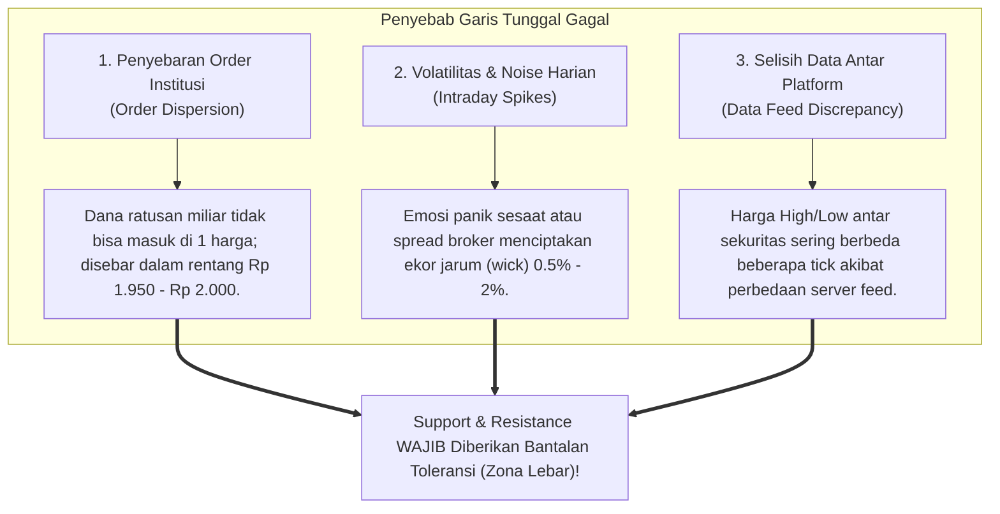

# BAB 9: Batas Toleransi

> *"Pasar bukanlah laboratorium sains yang kaku dan matematis sempurna. Menganggap level Support dan Resistance sebagai garis tipis setebal satu piksel adalah kekeliruan fatal yang menguras modal trader pemula."* — Edianto Ong

Berapa kali Anda mengalami peristiwa menyebalkan ini: Anda menandai level Support di Rp 1.000, lalu harga turun menyentuh Rp 990. Anda mengira support telah jebol sehingga Anda buru-buru melakukan *Cut Loss*. Namun, setengah jam kemudian harga berbalik melesat kencang ke Rp 1.200 tanpa Anda!

Mengapa hal itu terjadi? Karena Anda memperlakukan Support dan Resistance seperti kawat setrum tipis setebal 1 piksel di layar komputer. Di dunia nyata pasar finansial, level-level teknikal membutuhkan **Batas Toleransi (*Tolerance Buffer*)**.

---

## 1. Analogi Dunia Nyata: Peredam Kejut (Shockbreaker) Mobil

Untuk memahami batas toleransi, perhatikan analogi komponen suspensi kendaraan:

```
+-------------------------------------------------------------------------+
|                  ANALOGI SUSPENSI / SHOCKBREAKER MOBIL                  |
+-------------------------------------------------------------------------+
|                                                                         |
|  [ Mobil Tanpa Suspensi (Kaku) ]       [ Mobil dengan Shockbreaker ]    |
|                                                                         |
|  - Menabrak kerikil kecil setinggi     - Melibas lubang & gundukan      |
|    2 cm langsung membuat rangka ban      tanpa merusak bodi mobil.      |
|    dan as roda patah berantakan.                                        |
|  - Ritel menganggap penetrasi 5 perak  - Toleransi menyerap getaran     |
|    sebagai bencana kehancuran tren!      intraday; struktur tren utama  |
|                                          tetap aman dan terlindungi.    |
+-------------------------------------------------------------------------+
```

Bayangkan Anda mengendarai mobil di jalan raya:
- Jika jalan bergelombang sedikit, mobil tidak akan langsung terbalik karena ada **shockbreaker** yang meredam getaran naik-turun dalam batas toleransi beberapa sentimeter.
- Di pasar modal, **Batas Toleransi adalah shockbreaker bagi analisis teknikal Anda**. 
- Pasar dipenuhi oleh fluktuasi harian (*noise*), transaksi spekulan kecil, selisih spread bid-offer, serta berita mikro. Tanpa batas toleransi, Anda akan selalu "terguncang keluar" (*whipsawed*) dari posisi bagus Anda setiap kali ada riak kecil di permukaan air.

---

## 2. Kamus Istilah Pemula (Glossary Box)

Berikut adalah istilah-istilah teknikal utama yang wajib dikuasai di bab ini:

| Istilah | Definisi Pemula |
|:---|:---|
| **Tolerance Buffer** | Ruang bantalan persentase atau nilai volatilitas ekstra yang ditambahkan di atas resistance atau di bawah support untuk menguji keabsahan penembusan harga. |
| **Percentage Filter** | Metode penetapan toleransi dengan menghitung persentase tetap (misal: 1% - 3%) dari harga level teknikal. |
| **ATR (Average True Range)** | Indikator teknikal ciptaan J. Welles Wilder yang mengukur rata-rata rentang pergerakan volatilitas harga harian selama $N$ periode terakhir (biasanya 14 hari). |
| **Whipsaw** | Kondisi pasar ketika harga bergerak menembus level teknikal sesaat lalu berbalik arah secara liar, membuat trader rugi bolak-balik akibat terbawa sinyal palsu. |
| **Price Band (Zona Harga)** | Rentang harga berupa area persegi panjang fleksibel tempat terjadinya akumulasi/distribusi, bukan garis horizontal tipis tunggal. |
| **Overshoot** | Pergerakan harga yang sedikit melampaui batas level teknikal akibat dorongan inersia intraday sesaat sebelum kembali tenang. |

---

## 3. Mengapa Garis Tipis Selalu Gagal di Pasar Nyata?

Ada 3 faktor mekanis pasar yang menyebabkan Support dan Resistance selalu berupa **ZONA**, bukan garis tipis:



1. **Penyebaran Order (*Order Dispersion*)**:
   Institusi pengelola dana pensiun atau reksa dana besar yang ingin memborong Rp 50 miliar saham tidak mungkin mengeksekusi seluruh order di tepat harga Rp 2.000 (likuiditas tidak akan cukup menampung). Mereka membagi order tersebut menjadi ribuan lot kecil dari rentang Rp 1.970 hingga Rp 2.020. Akumulasi terjadi dalam **sebuah pita harga (*price band*)**.
2. **Volatilitas Intraday & Noise**:
   Selama jam perdagangan bursa berlangsung, sentimen pasar terus berfluktuasi. Ekor jarum (*shadow/wick*) sering kali tercipta hanya karena satu trader panik melepas posisi di pasar berlikuiditas tipis, lalu harga langsung kembali ke level normalnya.
3. **Perbedaan Data Antar Platform**:
   Perbedaan server data antara TradingView, Bloomberg, RTI, atau chart bawaan sekuritas lokal sering kali mencatat harga terendah (*low*) dengan selisih 1-2 tick. Mengandalkan garis setebal 1 piksel akan membuat analisis Anda sangat rapuh terhadap perbedaan teknis semacam ini.

---

## 4. Dua Metode Utama Menghitung Batas Toleransi Objektif

Edianto Ong mengajarkan dua pendekatan matematis yang objektif untuk menentukan seberapa lebar batas toleransi yang sehat:

```
+-------------------------------------------------------------------------+
|                  DUA METODE MENGHITUNG BATAS TOLERANSI                  |
+-------------------------------------------------------------------------+
| Parameter            | Metode 1: Filter Persentase | Metode 2: Filter ATR (Volatilitas) |
|----------------------+-----------------------------+------------------------------------|
| Dasar Perhitungan    | Persentase tetap dari harga | Rata-rata rentang volatilitas 14 hari |
| Formula Toleransi    | Level $\pm$ ($X\% \times$ Level)   | Level $\pm$ ($0.5$ hingga $1.0 \times ATR$)  |
| Saham Blue Chip      | 1% - 2%                     | 0.5x ATR                           |
| Saham Mid/Small Cap  | 3% - 5%                     | 1.0x ATR                           |
| Keunggulan           | Cepat, mudah dihitung di kepala | Dinamis, otomatis menyesuaikan pasar |
+-------------------------------------------------------------------------+
```

### Metode A: Filter Persentase (Percentage Filter)
Metode ini adalah metode klasik yang paling mudah dipraktikkan tanpa perlu bantuan indikator tambahan:
- **Saham Berkapitalisasi Besar (Blue Chip / LQ45)**:
  Terapkan batas toleransi sebesar **1% hingga 2%**. Saham berkapitalisasi besar memiliki likuiditas padat, sehingga pergerakan 1-2% sudah cukup mencerminkan pergeseran kekuatan modal.
- **Saham Lapis Dua / Tiga (Mid & Small Caps) / Pasar Kripto**:
  Terapkan batas toleransi sebesar **3% hingga 5%** karena instrumen ini memiliki rentang fluktuasi harian yang jauh lebih liar.

#### Contoh Perhitungan Persentase:
```
Saham ABC memiliki level Resistance di Rp 2.000 (Saham Lapis Dua, toleransi 3%).
- Batas Atas Toleransi = Rp 2.000 + (3% x Rp 2.000) = Rp 2.000 + Rp 60 = Rp 2.060.
- Kesimpulan Aksi: 
  Jika harga naik menembus Rp 2.010, Rp 2.020, atau Rp 2.040, harga masih dianggap berada 
  di dalam "Zona Uji Toleransi". 
  Penembusan baru dianggap SAH (Genuine Breakout) jika harga mampu ditutup di atas Rp 2.060!
```

### Metode B: Filter Volatilitas Dinamis (ATR Filter)
Pendekatan modern menggabungkan konsep Edianto Ong dengan indikator **Average True Range (ATR periode 14)** untuk menyesuaikan toleransi dengan kondisi pasar yang sedang tenang atau bergejolak:
- Jika pasar sedang tenang (*low volatility*), nilai ATR menyusut, sehingga zona toleransi otomatis menyempit.
- Jika pasar sedang badai (*high volatility*), nilai ATR membesar, sehingga zona toleransi otomatis melebar untuk melindungi posisi Anda dari goyangan ombak besar.

#### Rumus Praktis Penempatan Stop Loss dengan ATR:
$$\text{Stop Loss (Posisi Buy)} = \text{Level Support} - (1.0 \times \text{ATR 14})$$

---

## 5. Matriks Keputusan Berdasarkan Batas Toleransi

Gunakan diagram alur keputusan berikut untuk mengevaluasi apakah sebuah level teknikal benar-benar telah tertembus atau hanya sekadar goyangan sesaat:

```mermaid
flowchart TD
    A[Harga Menguji Level Kunci Support / Resistance] --> B{Apakah Harga Menembus Garis Utama?}
    B -- Tidak Tembus --> C[Level Bertahan Sempurna!<br/>Siapkan Skenario Rebound / Pantulan]
    B -- Ya, Ditembus Sesaat --> D{Apakah Penembusan Melewati Batas Toleransi Persentase / ATR?}
    D -- Tidak (Masih Dalam Ruang Toleransi) --> E[Penetrasi Minor / Noise Saja]
    E --> F[Zona Masih Utuh!<br/>Waspada Jebakan False Breakout / Reversal Balik Arah]
    D -- Ya (Menembus Jauh Melampaui Toleransi) --> G{Apakah Harga Ditutup (Daily Close) di Luar Toleransi?}
    G -- Tidak (Hanya Jarum Ekor / Wick) --> E
    G -- Ya (Candle Utuh Ditutup di Luar) --> H[BREAKOUT / BREAKDOWN Terkonfirmasi Sah!<br/>Ubah Bias Tren & Eksekusi Aksi Baru]
```

---

## 6. Studi Kasus Riil: Menghindari Whipsaw pada Saham ASII

Mari telaah kasus nyata pada saham PT Astra International Tbk (ASII):

```
PARAMETER TEKNIKAL:
- Level Support Kunci: Rp 5.000 (Angka bulat mayor).
- Klasifikasi Saham: Blue Chip (Gunakan Filter Toleransi 2%).
- Batas Bawah Toleransi: Rp 5.000 - (2% x Rp 5.000) = Rp 4.900.
- Nilai ATR 14 Harian: Rp 80.

KRONOLOGI PERDAGANGAN:
- Sesi 1 (Pukul 10:30): Sentimen pasar global memburuk. Tekanan jual mendadak membuat 
  saham ASII anjlok menembus Rp 5.000 hingga menyentuh level Rp 4.940.
  
PERILAKU TRADER PEMULA:
- Trader pemula yang memakai garis tipis kaku di Rp 5.000 langsung panik: 
  "Support Rp 5.000 jebol! Jual semua!" Mereka mengeksekusi cut loss di Rp 4.950.

PERILAKU TRADER OBJEKTIF (EDIANTIN ONGS PRINCIPLE):
- Trader objektif memeriksa: "Apakah Rp 4.940 telah melewati batas toleransi Rp 4.900?" 
  Jawabannya: BELUM (Rp 4.940 masih berada di dalam zona toleransi 2%).
- Mereka tetap tenang memantau hingga penutupan sesi 2.
- Sesi 2 (Pukul 15:45): Pembeli institusi memanfaatkan harga diskon tersebut untuk memborong. 
  Saham ASII ditarik naik dan resmi DITUTUP di level Rp 5.025!
  
HASIL AKHIR:
- Candle harian meninggalkan ekor bawah panjang (Hammer Rejection).
- Support Rp 5.000 TERBUKTI BERTAHAN.
- Trader pemula kehilangan barang di dasar lembah, sementara trader berdisiplin toleransi 
  sukses mengamankan modal mereka dan menikmati reli ke Rp 5.400.
```

---

## 7. Kesalahan Fatal Pemula (Newbie Traps)

Waspadai 4 kesalahan fatal terkait toleransi harga ini:

1. **Memasang Stop Loss Terlalu Ketat (Penny Pinching)**:
   Menempatkan stop loss hanya selisih 1 atau 2 tick di bawah garis support dengan alasan "memperkecil risiko". Di pasar yang bergerak, stop loss yang terlalu ketat hampir 100% pasti tersapu oleh volatilitas acak (*random noise*), membunuh akun Anda lewat ribuan potongan kerugian kecil (*death by a thousand cuts*).
2. **Toleransi Tanpa Batas (Moving the Goalposts)**:
   Sebaliknya, ada pemula yang menyalahartikan konsep toleransi dengan terus-menerus menggeser batas stop loss ke bawah saat harga terus anjlok (*"ah, ini masih batas toleransi wajar"*). Toleransi harus dihitung dan ditetapkan **SEBELUM** order dieksekusi, dan **DILARANG KERAS** digeser saat posisi sedang merugi!
3. **Mengabaikan Karakteristik Volatilitas Aset**:
   Menerapkan toleransi 1% yang sama untuk saham blue chip lambat dan koin kripto yang super liar. Pada aset bervolatilitas tinggi, toleransi 1% akan terpicu dalam hitungan 5 detik. Sesuaikan selalu lebar toleransi dengan karakteristik volatilitas instrumen.
4. **Membeli di Pucuk Toleransi Resistance**:
   Membeli dengan agresif saat harga baru naik 1% di atas resistance, padahal batas toleransi resistance instrumen tersebut adalah 3%. Anda membeli di titik paling rawan terjadinya *Bull Trap*.

---

## 8. Ringkasan & Checklist Tindakan Bab 9

- [ ] Saya selalu memperlakukan Support dan Resistance sebagai ZONA fleksibel dengan batas toleransi, bukan garis tipis 1 piksel.
- [ ] Saya menggunakan batas filter toleransi 1-2% untuk saham blue chip dan 3-5% untuk saham mid/small caps.
- [ ] Saya memasang Stop Loss di luar batas zona toleransi (menggunakan bantuan $1.0 \times$ ATR) agar tidak tersapu oleh ekor jarum harian.
- [ ] Saya tidak akan mengonfirmasi penembusan sebelum harga penutupan pasar (*Daily Close*) terbukti berada di luar batas toleransi.
- [ ] Saya telah menetapkan batas toleransi secara tertulis sebelum masuk posisi dan tidak pernah mengubahnya saat emosi sedang berjalan.
