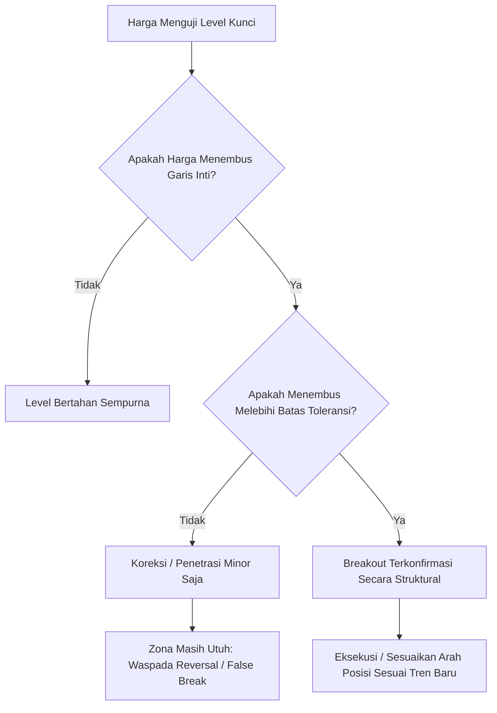

# BAB 9: Batas Toleransi

> *"Pasar bukanlah laboratorium sains yang kaku dan matematis sempurna. Menganggap level Support dan Resistance sebagai garis tipis setebal satu piksel adalah kekeliruan fatal yang menguras modal trader pemula."* — Edianto Ong

Pasar finansial digerakkan oleh dinamika manusia dan algoritma likuiditas yang senantiasa berfluktuasi. Oleh karena itu, konsep teknikal tingkat lanjut memandang level-level kunci bukan sebagai garis statis tunggal, melainkan sebagai **Zona / Area Fleksibel** yang membutuhkan **Batas Toleransi (*Tolerance Buffer*)**.

---

## 1. Mengapa Support & Resistance Adalah Zona, Bukan Garis Tipis?

Banyak trader pemula frustrasi ketika harga menembus level support yang mereka gambar sebesar 5 atau 10 perak, lalu seketika berbalik naik ratusan poin. Mereka mengira analisis mereka salah, padahal yang salah adalah asumsi ketelitian garisnya.

### Alasan Pasar Memerlukan Zona Toleransi:
1. **Penyebaran Order (*Order Dispersion*)**:
   Institusi besar tidak mengeksekusi puluhan miliar rupiah pada satu titik harga tunggal karena keterbatasan likuiditas. Mereka menyebar order akumulasi atau distribusi dalam rentang harga (*price band*), misalnya antara Rp 1.950 hingga Rp 2.000.
2. **Volatilitas Intraday & Noise**:
   Fluktuasi harian yang dipicu oleh berita mikro, spread bid-ask broker, dan transaksi spekulan menciptakan *overshoot* temporer yang menembus level teknikal tanpa mengubah sentimen dasar.
3. **Perbedaan Data Antar Charting Platform**:
   Perbedaan harga tertinggi (*high*) dan terendah (*low*) antar penyedia data (*data feed discrepancies*) sering kali menciptakan selisih kecil yang wajar.

```
       ILUSTRASI: GARIS STATIS TIPIS VS ZONA TOLERANSI FLEKSIBEL
       
   Pendekatan Ritel Kaku (Garis Tipis)      Pendekatan Profesional (Zona Toleransi)
   -----------------------------------      ---------------------------------------
   Harga                                    Harga
     |      /\                                |      /\
     |     /  \                               |     /  \
   ==|====/====\================== Rp 1.000   |    /    \   [====================] Rp 1.020
     |   /      \  (Ditembus 5 poin!          |   /      \  [  ZONA RESISTENSI   ]
     |  /        \  Dianggap "Breakout",      |  /        \/[  DENGAN TOLERANSI  ]
     | /          \ padahal langsung balik)   | /           [====================] Rp 980
     +--------------------------------        +------------------------------------
```

---

## 2. Metode Menentukan Batas Toleransi Objektif

Edianto Ong menjabarkan sejumlah metode sistematis untuk menentukan seberapa lebar batas toleransi yang sehat agar trader tidak mudah terkecoh oleh fluktuasi minor:

### A. Metode Filter Persentase (Percentage Filter)
Metode ini menetapkan batas penembusan minimum sebesar persentase tertentu dari harga instrumen:
- **Saham Blue Chip / Saham Berkapitalisasi Besar**: Filter persentase ideal adalah **1% hingga 2%**.
- **Saham Lapis Dua / Tiga (Mid & Small Caps) / Komoditas Berfluktuasi Tinggi**: Filter persentase disesuaikan menjadi **3% hingga 5%**.

> **Contoh Aplikasi:**  
> Saham XYZ memiliki level Resistance di Rp 1.000. Dengan menerapkan filter toleransi 3%, penembusan baru dianggap valid (*genuine breakout*) apabila harga penutupan harian berhasil ditutup di atas **Rp 1.030** (Rp 1.000 + 3%). Fluktuasi intraday yang hanya mencapai Rp 1.010 atau Rp 1.020 masih dikategorikan berada di dalam zona toleransi resistensi dan belum terkonfirmasi tembus.

### B. Metode Volatilitas Berbasis Average True Range (ATR Filter)
Untuk mengakomodasi volatilitas pasar yang dinamis, trader modern menggabungkan konsep Edianto Ong dengan indikator volatilitas **ATR (Average True Range)** periode 14:
- Menambahkan **0.5x hingga 1.0x ATR** dari level kunci sebagai batas zona toleransi.
- Jika ATR harian suatu saham bernilai Rp 50 dan support berada di Rp 2.000, maka batas bawah zona toleransi support berada di Rp 1.950 (Rp 2.000 - 1x ATR). Selama penutupan harga bertahan di atas Rp 1.950, support masih dinilai relevan dan bertahan.

---

## 3. Matriks Keputusan Berdasarkan Batas Toleransi



---

## 4. Manfaat Manajemen Risiko Menerapkan Batas Toleransi

1. **Mencegah *"Whipsaw"* Beruntun**:
   Trader yang tidak memiliki batas toleransi akan terlalu sering membuka dan menutup posisi secara panik hanya karena fluktuasi beberapa tick, menghasilkan biaya komisi transaksi yang menggerogoti portofolio.
2. **Penempatan Stop Loss yang Lebih Rasional**:
   Stop Loss diletakkan di luar zona toleransi (bukan tepat di garis), sehingga posisi terlindungi dari sapuan ekor lilin (*candlestick shadows / wicks*) yang sengaja diciptakan untuk memicu stop order sebelum harga melaju ke arah yang dianalisis.
3. **Penyaringan Sinyal Palsu (*Noise Filtering*)**:
   Memberikan ketenangan psikologis bagi trader untuk bersabar menunggu konfirmasi candle harian (*daily close*) daripada bereaksi secara emosional di tengah jam perdagangan bursa.
