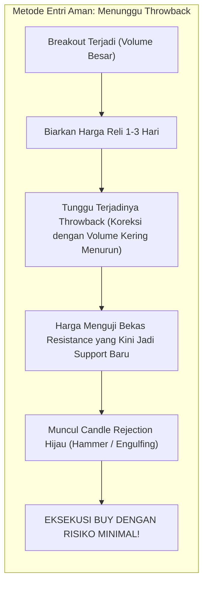

# BAB 10: Mengantisipasi False Breakout

> *"False Breakout adalah salah satu mesin transfer kekayaan paling efisien di pasar finansial: mentransfer uang dari tangan trader yang tidak sabar dan emosional ke tangan institusi profesional yang berdisiplin tinggi."* — Edianto Ong

Apakah Anda pernah mengalami momen pahit ini: Anda melihat sebuah saham menembus garis resistance dengan candle hijau panjang. Indikator teknikal berteriak beli, grup media sosial merayakan kenaikan, dan Anda buru-buru menekan tombol **BUY** karena takut ketinggalan kereta (*FOMO*). 

Namun, hanya berselang beberapa jam atau keesokan harinya, harga berbalik arah secara kejam, terjun bebas, dan meninggalkan Anda sendirian memegang barang di harga pucuk paling tinggi.

Selamat datang di dunia **False Breakout (Penembusan Palsu)**. Di bab ini, kita akan membongkar tuntas rahasia psikologi di balik jebakan ini, bagaimana membedakan penembusan asli dari yang palsu, serta bagaimana mengubah jebakan ini menjadi peluang cuan berprobabilitas tinggi.

---

## 1. Analogi Dunia Nyata: Umpan Cacing Pancing Ikan

Untuk memahami esensi dari *False Breakout*, bayangkan seorang pemancing ikan di danau:

```
+-------------------------------------------------------------------------+
|                  ANALOGI KAIL PANCING & UMPAN CACING                    |
+-------------------------------------------------------------------------+
|                                                                         |
|  [ Sudut Pandang Ikan Kecil (Trader Ritel) ]                            |
|  "Lihat! Ada cacing segar yang lezat bergerak bebas di atas air!"       |
|  -> Ikan langsung berenang cepat dan menyambar cacing tersebut          |
|     karena takut direbut oleh ikan lain (FOMO).                         |
|                                                                         |
|  [ Sudut Pandang Pemancing Cerdas (Institusi / Bandar) ]                |
|  Cacing itu sengaja dipasang di ujung kail besi tajam sebagai umpan     |
|  untuk memancing ikan besar keluar dari persembunyiannya.               |
|  -> Begitu ikan menyambar umpan, kail ditarik kencang ke atas!          |
|     Ikan tersangkut dan menjadi santapan sang pemancing.                |
+-------------------------------------------------------------------------+
```

Di pasar saham:
- **Cacing Lezat** adalah kenaikan harga beberapa tick di atas garis resistance yang sengaja dibuat mencolok oleh *smart money*.
- **Ikan Kecil** adalah trader ritel yang rakus dan tidak sabar menunggu konfirmasi.
- **Kail Besi** adalah guyuran order jual institusi yang menanti di balik layar untuk menghabisi modal para pembeli yang terlambat masuk.

---

## 2. Kamus Istilah Pemula (Glossary Box)

Kuasai istilah-istilah wajib seputar penembusan palsu berikut:

| Istilah | Penjelasan Sederhana |
|:---|:---|
| **False Breakout (Fakeout)** | Situasi di mana harga menembus level support atau resistance sesaat, memicu sinyal beli/jual, namun segera berbalik arah kembali ke dalam rentang sebelumnya. |
| **Bull Trap (Jebakan Banteng)**| Jebakan penembusan ke atas (*upside fakeout*) yang memikat pembeli (*bulls*) untuk masuk di pucuk, lalu harga anjlok drastis membakar modal mereka. |
| **Bear Trap (Jebakan Beruang)**| Jebakan penembusan ke bawah (*downside fakeout*) yang memicu kepanikan penjual (*bears*) untuk *cut loss*, lalu harga ditarik meroket naik meninggalkan mereka. |
| **Two-Day Rule (Aturan 2 Hari)**| Kaidah verifikasi waktu di mana breakout baru dinyatakan sah jika harga penutupan bertahan di luar zona penembusan selama 2 hari bursa berturut-turut. |
| **Liquidity Grab / Sweep** | Tindakan disengaja oleh pelaku pasar besar untuk memicu stop order ritel guna mengumpulkan volume transaksi dalam jumlah masif dengan harga terbaik. |
| **Fade the Breakout** | Strategi trading tingkat lanjut yang sengaja mengambil posisi berlawanan dengan arah penembusan setelah terkonfirmasi bahwa breakout tersebut gagal. |

---

## 3. Anatomi Dua Jebakan Klasik: Bull Trap vs Bear Trap

Edianto Ong membagi false breakout ke dalam dua skenario perang psikologis:

```
        BULL TRAP (Jebakan Pucuk Beli)               BEAR TRAP (Jebakan Dasar Jual)
        
        Harga                                        Harga
          |         /\ (Palsu! Ekor Penetrasi)         |
  ========|========/==\================= RESISTENSI    |====================================
          |       /    \                               |    \          / (Palsu! Guyuran Sesaat)
          |      /      \                              |=====\========/===================== SUPPORT
          |     /        \ (Anjlok Menghancurkan       |      \      /
          |    /          v Ritel yang Beli Pucuk)     |       \    /  (Melesat Terbang Membakar
          +------------------------------------        |        \  /    Posisi Ritel yang Cutloss)
                                                       |         \/
                                                       +------------------------------------
```

### A. Anatomi Bull Trap (Jebakan Banteng)
1. **Fase Pancingan**: Saham berkonsolidasi di bawah resistance Rp 2.000 selama berminggu-minggu. Tiba-tiba di pertengahan sesi 1, harga melesat ke Rp 2.050.
2. **Euforia Massa**: Berita saham di forum media sosial dipenuhi ajakan membeli (*"Breakout kencang! Siap terbang ke Rp 3.000!"*). Trader pemula berbondong-bondong memasang order HAKA (*Hajar Kanan*).
3. **Penyergapan Institusi**: Institusi besar yang memiliki persediaan jutaan lot memanfaatkan lonjakan antrean beli ritel ini untuk menjual seluruh inventaris mereka tanpa membuat harga anjlok saat proses jualan (*distribusi terselubung*).
4. **Kehancuran**: Menjelang penutupan sesi 2, seluruh pasokan beli ritel habis. Saham ditutup anjlok kembali di Rp 1.960. Candle harian membentuk jarum panjang (*Shooting Star / Upper Wick*). Keesokan harinya harga anjlok beruntun.

### B. Anatomi Bear Trap (Jebakan Beruang)
1. **Fase Teror**: Saham menguji support krusial Rp 1.000. Tiba-tiba harga diguyur turun ke Rp 960.
2. **Kepanikan Massal**: Muncul narasi menakutkan tentang prospek emiten. Trader pemula panik dan buru-buru memasang order jual *Cut Loss* demi "menyelamatkan sisa modal".
3. **Akumulasi Tersembunyi**: *Smart money* dengan tenang memasang jaring beli di harga Rp 960 - Rp 980 untuk menampung seluruh barang jualan panik ritel dengan harga obral diskon.
4. **Pembalikan Arah**: Setelah barang ritel diserap habis, harga ditarik kencang kembali ke Rp 1.040 sebelum penutupan. Candle harian membentuk pola *Hammer / Pinbar*. Pemula hanya bisa meratapi saham yang baru saja mereka jual melesat naik tanpa mereka.

---

## 4. Tiga Kriteria Emas Penguji Keaslian Breakout

Untuk menyaring apakah penembusan yang Anda lihat adalah **Breakout Asli (*Genuine*)** atau sekadar **Jebakan Palsu (*Trap*)**, Edianto Ong merumuskan **3 Kriteria Validasi Mutlak**:

```
+-------------------------------------------------------------------------+
|                  TIGA KRITERIA EMAS VALIDASI BREAKOUT                   |
+-------------------------------------------------------------------------+
| No | Parameter Uji        | Breakout Asli (Genuine)   | Breakout Palsu (Fakeout)  |
|----+----------------------+---------------------------+---------------------------|
| 1  | Harga Penutupan      | Candle harian DITUTUP di  | Hanya ekor jarum (wick)   |
|    | (Closing Price)      | luar batas zona toleransi | yang tembus; ditutup balik|
| 2  | Volume Transaksi     | Meledak > 1.5x - 2.0x     | Volume kering, sepi, atau |
|    | (Volume Expansion)   | di atas rata-rata MA20    | terjadi divergensi turun  |
| 3  | Filter Waktu         | Bertahan kokoh selama     | Hari kedua langsung anjlok|
|    | (Two-Day Rule)       | 2 hari bursa berturut-turut| amblas ke dalam area lama |
+-------------------------------------------------------------------------+
```

```mermaid
flowchart TD
    Start[Harga Menembus Level Kunci S/R] --> Q1{Uji 1: Apakah Harga Penutupan Harian (Daily Close) Berada di Luar Batas Toleransi?}
    Q1 -- Tidak (Hanya Jarum/Wick Sesaat) --> Reject[TOLAK SINYAL! Terkonfirmasi Rejection / False Breakout Sederhana]
    Q1 -- Ya, Ditutup di Luar Toleransi --> Q2{Uji 2: Apakah Volume Transaksi Meledak Minimal 1.5x - 2x Rata-rata MA20?}
    Q2 -- Tidak (Volume Kering / Divergensi) --> Caution[WASPADA! Kurang Partisipasi Modal Institusi -> Rawan Bull/Bear Trap]
    Q2 -- Ya (Volume Sangat Masif) --> Q3{Uji 3: Apakah Harga Mampu Bertahan Selama 2 Hari Bursa? (Two-Day Rule)}
    Q3 -- Tidak (Hari ke-2 Langsung Amblas) --> Emergency[TRAP TERJADI! Segera Eksekusi Cutloss Tanpa Ragu]
    Q3 -- Ya (Hari ke-2 Sukses Bertahan) --> Confirmed[GENUINE BREAKOUT TERKONFIRMASI!<br/>Sangat Aman Membuka Posisi Baru / Menambah Muatan]
```

---

## 5. Panduan Step-by-Step Pemula: Menghindari Jebakan & Mengeksekusi Entri

Jangan biarkan diri Anda menjadi korban. Ikuti panduan operasional langkah demi langkah berikut setiap kali Anda melihat peluang penembusan:

### Langkah 1: Tahan Diri dari Godaan Intraday (Kendalikan Jari Anda!)
- **Aturan Emas**: Jangan pernah membeli breakout hanya karena melihat pergerakan running trade yang cepat di jam 10 pagi.
- Pasar sesi pagi sering kali penuh dengan manipulasi bandar untuk menguji likuiditas. Tunggu hingga menjelang penutupan pasar sesi 2 (Pukul 15:45 - 15:59 WIB) untuk memastikan harga penutupan (*daily close*) bertahan sah di atas level resistance.

### Langkah 2: Periksa Konfirmasi Indikator Volume
- Buka indikator **Volume** pada chart harian Anda.
- Pasang garis **Moving Average periode 20 (MA20)** pada indikator volume.
- Bandingkan: Apakah batang volume hari penembusan tingginya minimal 1.5 kali lipat dari garis rata-rata MA20? Jika ya, ini membuktikan bahwa institusi besar ikut membeli bersama Anda. Jika volume kecil, tinggalkan saham tersebut!

### Langkah 3: Terapkan Strategi "Buy on Retest / Throwback" (Metode Paling Aman)
Daripada mengejar harga di pucuk hari penembusan (*breakout chasing*), metode trader profesional yang diajarkan Edianto Ong adalah **menunggu terjadinya koreksi wajar (*throwback*)**:



Keuntungan metode ini:
1. Anda mendapatkan harga beli yang jauh lebih murah.
2. Anda memiliki titik penempatan Stop Loss yang sangat dekat dan terukur (tepat di bawah support baru).
3. Anda terhindar 100% dari perangkap Bull Trap!

---

## 6. Studi Kasus Riil: Tragedi Bull Trap Saham BUMI

Mari kita bedah skenario transaksi nyata yang sering terjadi pada saham komoditas dengan likuiditas tinggi seperti PT Bumi Resources Tbk (BUMI):

```
DATA PERGERAKAN HARGA SAHAM BUMI:
- Resistance Kuat Multi-Minggu: Rp 150.
- Rata-rata Volume Harian MA20: 5.000.000 lot.

HARI KE-1 (Kamis):
- Pukul 10:30, harga mendadak terbang menembus Rp 150 hingga menyentuh Rp 158 (+5.3%).
- Forum trader heboh, ribuan ritel FOMO membeli di kisaran Rp 154 - Rp 157.
- Pukul 15:30, tekanan jual asing mengguyur pasar. Harga ditutup melemah di Rp 151.
- Catatan Volume: Volume transaksi harian hanya 4.200.000 lot (di bawah rata-rata MA20). 
  Uji Kriteria 2 GAGAL!

HARI KE-2 (Jumat):
- Sesuai Aturan Dua Hari (Two-Day Rule), kita menunggu konfirmasi kelanjutan.
- Pembukaan bursa: BUMI langsung dibuka turun di Rp 149 (kembali di bawah resistance Rp 150).
- Penutupan bursa Jumat: BUMI ditutup anjlok di level Rp 144 dengan candle merah pekat!
- Uji Kriteria 3 GAGAL TOTAL. Terkonfirmasi resmi sebagai BULL TRAP!

NASIB TRADER:
- Ritel yang mengejar breakout di Rp 157 kini menderita kerugian -8.3% hanya dalam 2 hari. 
  Banyak yang terjebak berbulan-bulan karena menolak cut loss.
- Trader cerdas yang menunggu konfirmasi Two-Day Rule berhasil menyelamatkan 100% modal mereka 
  tanpa tergores sedikit pun!
```

---

## 7. Kesalahan Fatal Pemula (Newbie Traps)

Berikut 4 blunder mematikan pemula yang harus Anda coret dari kebiasaan trading Anda:

1. **Sindrom FOMO Membeli di Pucuk Jarum (*Chasing the Spike*)**:
   Membeli saham yang sudah melesat naik 15% secara intraday karena takut tidak kebagian untung. Ingat pepatah bursa: *"Kereta di pasar modal selalu datang setiap hari; jangan melompat ke atas kereta yang sedang melaju kencang di tepi jurang."*
2. **Menolak Cut Loss Karena Gengsi (*Denial & Ego*)**:
   Ketika harga kembali masuk ke dalam area konsolidasi dan membuktikan bahwa breakout itu palsu, pemula menolak mengakui kesalahan dan mengubah statusnya dari *trader* menjadi *investor dadakan*. Kerugian 3% yang seharusnya bisa diselesaikan berubah menjadi bencana portofolio -40%.
3. **Mengabaikan Indikator Volume Transaksi**:
   Hanya melihat bentuk lilin hijau tanpa pernah menengok ke jendela indikator volume di bawah chart. Lilin hijau besar tanpa dukungan volume adalah fatamorgana di padang pasir.
4. **Tidak Mengenal Konsep Throwback / Retest**:
   Mengira jika tidak membeli saat itu juga, harga tidak akan pernah kembali lagi. Faktanya, lebih dari 70% breakout yang sah selalu memberikan kesempatan kedua berupa koreksi *throwback* sebelum reli sesungguhnya dimulai.

---

## 8. Ringkasan & Checklist Tindakan Bab 10

Sebelum Anda mengeksekusi trading breakout berikutnya, selalu buka dan centang checklist perlindungan ini:

- [ ] Saya tidak akan membeli saham saat jam perdagangan bursa pagi hanya karena tergiur kenaikan sesaat.
- [ ] Saya memastikan harga penutupan pasar (*Daily Close*) ditutup secara meyakinkan di luar batas toleransi.
- [ ] Saya telah memeriksa bahwa volume transaksi breakout minimal 1.5x hingga 2x di atas rata-rata Volume MA20.
- [ ] Saya menguji daya tahan harga menggunakan kaidah Aturan Dua Hari (*Two-Day Rule*).
- [ ] Saya memprioritaskan strategi masuk di saat terjadi koreksi *Throwback* ke bekas resistance.
- [ ] Jika harga penutupan kembali amblas ke bawah garis penembusan, saya berjanji mengeksekusi Stop Loss seketika tanpa kompromi!
