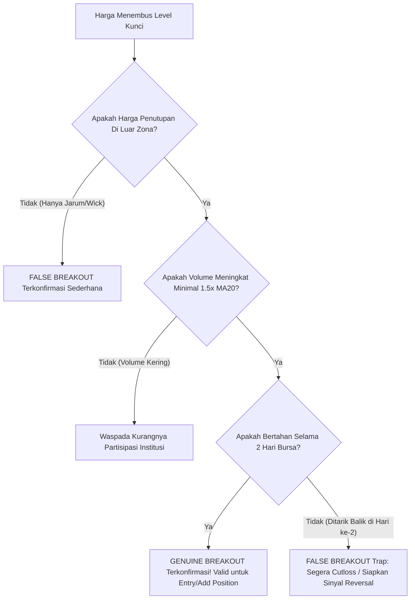

# BAB 10: Mengantisipasi False Breakout

> *"False Breakout adalah salah satu mesin transfer kekayaan paling efisien di pasar finansial: mentransfer uang dari tangan trader yang tidak sabar dan emosional ke tangan institusi profesional yang disiplin."* — Edianto Ong

Penembusan palsu (*False Breakout*) adalah mimpi buruk bagi mayoritas trader pemula. Situasi di mana harga tampak meyakinkan menembus batas resistance atau support, memancing trader untuk masuk posisi secara agresif, hanya untuk berbalik arah secara brutal sesaat kemudian.

Memahami anatomi false breakout bukan sekadar langkah defensif untuk menyelamatkan modal, melainkan juga salah satu strategi ofensif berpeluang cuan terbesar (*high probability reversal trading*).

---

## 1. Anatomi Jebakan Pasar: Bull Trap dan Bear Trap

Edianto Ong membagi false breakout ke dalam dua skenario klasik perang psikologi pasar:

```
          BULL TRAP (Jebakan Beli)                     BEAR TRAP (Jebakan Jual)
          
          Harga                                        Harga
            |         /\ (Palsu! Penetrasi Atas)         |
    ========|========/==\================= RESISTANCE    |====================================
            |       /    \                               |    \          / (Palsu! Penetrasi Bawah)
            |      /      \                              |=====\========/===================== SUPPORT
            |     /        \ (Anjlok Menghancurkan       |      \      /
            |    /          v Bulls yang Kejepit)        |       \    /  (Melesat Naik Membakar
            +------------------------------------        |        \  /    Posisi Short / Cutloss)
                                                         |         \/
                                                         +------------------------------------
```

### A. Bull Trap (Jebakan Banteng)
- **Kondisi**: Harga menembus ke atas level Resistance. Berita di media finansial tampak sangat positif, indikator teknikal menunjukkan momentum hijau, dan trader ritel berbondong-bondong membeli karena takut tertinggal kereta (*FOMO - Fear of Missing Out*).
- **Kenyataan**: Penembusan tersebut dipicu oleh aksi institusi yang sengaja menghabiskan antrean offer tipis untuk menarik minat beli publik. Begitu ritel masuk, institusi membombardir pasar dengan volume jual masif (*dumping inventory*). Harga langsung ditutup anjlok kembali di bawah level resistance. Ritel terjebak di pucuk (*trapped at the top*).

### B. Bear Trap (Jebakan Beruang)
- **Kondisi**: Harga menembus ke bawah level Support utama. Sentimen pasar dipenuhi kepanikan dan ketakutan (*panic selling*). Ritel yang memegang saham buru-buru melakukan *cut loss*, sementara trader agresif membuka posisi *short*.
- **Kenyataan**: Penembusan bawah tersebut adalah aksi sapuan likuiditas (*liquidity grab*) oleh *smart money* untuk mengumpulkan saham murah dalam skala besar. Setelah seluruh order panik terserap, harga ditarik naik kencang kembali ke atas support, meninggalkan trader panik yang gigit jari melihat saham yang baru saja mereka jual melesat naik.

---

## 2. Tiga Kriteria Validasi: Membedakan Genuine vs False Breakout

Untuk memfilter penembusan asli (*genuine breakout*) dari jebakan manipulatif, Edianto Ong merumuskan **3 Aturan Emas Validasi**:

### 1. Konfirmasi Harga Penutupan (Closing Price Confirmation)
- **Larangan**: Jangan pernah mengonfirmasi breakout hanya berdasarkan harga tertinggi/terendah intraday (*intraday spike/wick*).
- **Kaidah**: Breakout yang sah mensyaratkan **Harga Penutupan Pasar (*Daily Closing Price*)** secara meyakinkan berada di luar level support atau resistance (melebihi batas toleransi). Ekor lilin yang panjang menembus resistance namun ditutup kembali di bawahnya adalah tanda penolakan harga (*rejection*) yang nyata.

### 2. Aturan Dua Hari (The Two-Day Rule)
- Konfirmasi penembusan sejati sering kali membutuhkan konfirmasi waktu (*time filter*).
- **Kaidah**: Harga tidak hanya harus ditutup di luar level kunci pada hari pertama penembusan, melainkan harus mampu mempertahankan posisinya dan mencetak penutupan yang stabil pada **hari kedua perdagangan berturut-turut**. Jika pada hari kedua harga langsung amblas kembali ke dalam area sebelumnya, probabilitas terjadinya *trap* meningkat hingga di atas 80%.

### 3. Validasi Lonjakan Volume (Volume Expansion Check)
- Volume adalah bahan bakar di balik pergerakan harga. Tanpa volume, pergerakan harga hanyalah ilusi.
- **Breakout Asli**: Wajib diiringi oleh **lonjakan volume transaksi yang signifikan** (minimal 1.5x hingga 2x di atas rata-rata volume 20 hari terakhir / Volume MA20). Ini membuktikan adanya partisipasi institusi besar (*institutional accumulation*).
- **Breakout Palsu**: Terjadi dengan volume tipis atau bahkan menurun saat harga mencetak level tertinggi baru (*volume divergence*). Ini adalah indikasi kuat bahwa pasar kekurangan daya dorong dan hanya menunggu waktu untuk runtuh.



---

## 3. Protokol Penyelamatan Diri & Manajemen Risiko Saat Terjebak

Jika Anda telah telanjur masuk dan menyadari bahwa penembusan yang Anda ikuti ternyata adalah *False Breakout*, ikuti protokol darurat berikut:

1. **Akui Kesalahan Tanpa Kompromi (*Ruthless Acceptance*)**:
   - Pasar telah membuktikan bahwa analisis Anda tidak valid pada saat itu. Singkirkan harapan (*hope*) atau keinginan untuk melakukan *averaging down* pada posisi yang salah arah.
2. **Kaidah Eksekusi Stop Loss Seketika**:
   - Begitu harga penutupan kembali menembus ke dalam batas zona support/resistance yang baru saja ditembus, **segera likuidasi posisi (*cut loss*)**. Jangan menunggu hingga kerugian membengkak puluhan persen.
3. **Peluang *"Fade the Breakout"***:
   - Bagi trader tingkat lanjut, kegagalan penembusan (*failed breakout*) sering kali memicu pergerakan agresif ke arah berlawanan menuju batas berlawanan dari zona konsolidasi (dari pucuk langsung meluncur ke lantai bawah). Trader objektif dapat langsung membalik posisi (*flip position*) searah dengan arah bantingan modal institusi.
