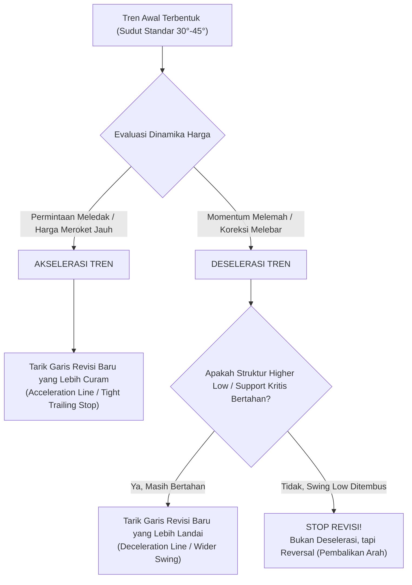

# Bab 11: Merevisi Trendline

> *"Tren pasar bukanlah garis statis yang dipahat di atas batu marmer, melainkan batas dinamis dari konsensus pasar yang terus bertransisi antara akselerasi dan deselerasi. Trader yang kaku akan dipatahkan oleh pasar; trader yang adaptif merevisi garisnya secara objektif."* — **Edianto Ong**

---

## 1. Hakikat Dinamika Tren: Mengapa Trendline Harus Direvisi?

Banyak pemula dalam analisis teknikal jatuh ke dalam pola pikir keliru: mereka menganggap bahwa sekali sebuah garis tren (*trendline*) ditarik dari dua titik lembah (*trough*) atau puncak (*peak*), maka garis itu akan berlaku abadi sebagai tembok ajaib pemandu harga. 

Kenyataan pasar jauh lebih dinamis. Harga bergerak berdasarkan pergeseran volume, likuiditas, psikologi massa, dan arus berita. Akibatnya, kecepatan laju harga (*rate of ascent* saat naik atau *rate of descent* saat turun) terus berubah sepanjang siklus pergerakannya.

### Analogi Membumi: Mobil Tancap Gas di Jalan Tol
Bayangkan Anda mengemudikan mobil di jalan tol bebas hambatan:
- **Kecepatan Normal (40–50 km/jam)**: Mobil melaju stabil dan santai menaiki tanjakan moderat. Ini setara dengan tren normal bersudut sehat (~45°).
- **Tancap Gas Mendadak (120 km/jam - Akselerasi)**: Pengemudi menginjak pedal gas dalam-dalam saat menyalip. Mobil melesat curam menjauhi jalur santai sebelumnya. Garis tren lama tertinggal jauh di bawah; Anda membutuhkan garis panduan baru yang lebih curam untuk memantau apakah kecepatan ekstrem ini masih bertahan atau mesin mulai *overheat*.
- **Kehabisan Bensin & Melambat (Deselerasi)**: Mesin batuk-batuk, laju mobil melambat ke 20 km/jam, dan sudut pendakian melandai. Mobil mungkin keluar dari jalur cepat awal, tetapi bukan berarti mobil langsung berbalik arah mundur menuruni bukit. Mobil hanya butuh penyesuaian sudut jalan yang lebih landai sebelum memutuskan lanjut mendaki atau putar balik.



---

## 2. Fenomena Akselerasi (Percepatan) dan Deselerasi (Perlambatan)

### A. Akselerasi Tren (*Trend Acceleration*)
Akselerasi terjadi ketika permintaan (*demand*) membanjiri pasar secara masif melebihi pasokan (*supply*) yang tersedia. Tekanan beli yang agresif memaksa harga naik dalam sudut yang semakin tegak.

**Karakteristik Visual & Volume:**
1. Sudut kemiringan garis tren meningkat tajam dari moderat (misalnya 35°–45°) menjadi sangat curam (60° hingga >75°).
2. Batang *candlestick* membesar (*wide-range candles*), sering kali diiringi celah lompatan harga (*gap up*).
3. Jarak vertikal antara posisi harga saat ini dengan *trendline* lama melebar drastis (>15–30%).
4. **Implikasi**: Menandakan fase euforia atau *Markup* lanjutan. Kondisi ini sangat menguntungkan bagi pemilik modal awal, namun sangat rapuh karena rawan terjadi klimaks pembelian (*buying climax*).

### B. Deselerasi Tren (*Trend Deceleration*)
Deselerasi mencerminkan berkurangnya momentum dorongan harga. Harga mulai mencetak puncak baru yang tidak lagi signifikan (*diminishing returns*), atau mengalami koreksi yang lebih dalam daripada ayunan sebelumnya.

**Karakteristik Visual & Volume:**
1. Garis tren awal tertembus ke bawah (*broken trendline*), namun harga tidak langsung terjun bebas melainkan tertahan oleh level *support* horizontal atau garis MA penting.
2. Ayunan harga melebar menjadi pola konsolidasi yang lebih santai (*flat channel* atau *broadening base*).
3. Indikator momentum (seperti MACD atau RSI) mulai memperlihatkan *bearish divergence* (harga membuat puncak lebih tinggi, namun osilator membuat puncak lebih rendah).
4. **Implikasi**: Tren utama belum tentu mati, melainkan berpindah ke ritme yang lebih santai. Trader perlu memperlebar garis tren (*fanning out*) agar tidak keluar posisi terlalu cepat (*whipsaw*).

---

## 3. Aturan Objektif Merevisi Trendline Tanpa Bias (Anti Curve-Fitting)

Kesalahan paling mematikan bagi pemula adalah **Curve-Fitting Bias**: yaitu memanipulasi posisi garis tren secara sepihak agar sesuai dengan keinginan psikologis (*wishful thinking*), misalnya tetap ingin merasa *bullish* padahal pasar sudah hancur.

Untuk menghindari jebakan tersebut, Edianto Ong menetapkan 3 aturan emas:

### Aturan 1: Pertahankan Integritas Titik Ekstrem (Low/High)
- Jangan pernah memotong badan lilin (*candle body*) secara sembarangan hanya demi membuat garis tampak "pas" atau menyentuh banyak titik.
- Garis revisi harus tetap bertumpu pada titik terendah ayunan (*Higher Low*) yang valid, di mana harga benar-benar memantul setelah teruji (*confirmed rejection*).

### Aturan 2: Prinsip 2 Titik Tentatif, 3 Titik Terkonfirmasi
- Setiap garis revisi baru yang ditarik dari 2 titik tumpu baru berstatus **Garis Tentatif (*Tentative / Provisional Line*)**.
- Garis revisi tersebut baru sah menjadi **Garis Terkonfirmasi (*Confirmed Trendline*)** apabila harga menguji garis tersebut untuk ketiga kalinya dan berhasil memantul kembali ke atas.

### Aturan 3: Klasifikasikan Hirarki Tren (Mayor vs Menengah vs Minor)
- Saat garis tren curam ditembus, **jangan langsung menghapus garis tren primer yang lebih landai**.
- Garis primer tetap berfungsi sebagai "jaring pengaman makro" (*macro framework*), sedangkan garis revisi sekunder menjadi kompas taktis harian.

| Skenario Pasar | Kondisi Garis Awal | Tindakan Revisi yang Benar |
| :--- | :--- | :--- |
| **Harga Meroket Cepat** | Jarak harga terhadap garis > 20% | Tarik garis revisi baru yang lebih curam (*Acceleration Line*) dari lembah minor terbaru untuk *trailing stop*. |
| **Harga Menembus Garis Tren tapi Memantul di Support Horizontal** | Garis awal tertembus tipis tanpa merusak struktur *Higher Low* | Perlebar sudut tren: hubungkan titik awal terendah dengan lembah baru yang lebih landai (*Deceleration Line*). |
| **Koreksi Menembus Garis & Menjebol Swing Low Kritis** | Struktur *Higher Low* resmi patah menjadi *Lower Low* | **STOP REVISI!** Ini bukan deselerasi, melainkan pembalikan tren (*Trend Reversal*). Ambil tindakan defensif (*Cut Loss / Exit*). |

---

## 4. Garis Tren yang Terlalu Curam dan Implikasinya

Sudut ideal sebuah garis tren jangka menengah yang sehat berada di kisaran **30° hingga 45°**. Sudut ini mencerminkan apresiasi harga yang seimbang antara kemajuan nilai dan periode istirahat yang wajar.

```
 Sudut 70°-80°  ===> [RAWAN RUNTUH] Akselerasi Ekstrem / Buying Climax / Parabolik
        |   /
        |  /
        | /
 Sudut 45° ===> [IDEAL & HEALTHY] Keseimbangan Sempurna Pembeli & Penjual
        |/
 Sudut 20° ===> [LANDAI / LEMAH] Konsolidasi Lebar / Deselerasi Lanjut
        +------------------
```

### Bahaya Garis Parabolik (Kemiringan > 60°):
1. **Ketiadaan Struktur Fondasi (*Lack of Structural Support*)**: Kenaikan vertikal tidak menyisakan zona akumulasi di sepanjang jalan. Akibatnya, saat harga berbalik arah, tidak ada lantai *support* terdekat yang mampu menahan kejatuhan harga.
2. **Klimaks Pembelian (*Buying Climax*)**: Sering kali merupakan babak penutup dari sebuah tren naik panjang. *Smart money* memanfaatkan euforia publik yang mengalami FOMO (*Fear of Missing Out*) untuk melepas barang secara besar-besaran.
3. **Kejatuhan Vertikal (*Free-Fall Drop*)**: Begitu garis tren 60°–80° ini jebol, harga umumnya tidak turun bertahap, melainkan ambruk secepat roket jatuh kembali ke asal akselerasi.

> [!WARNING]
> Jangan pernah mengandalkan garis tren bersudut > 60° sebagai acuan membeli baru untuk investasi jangka panjang. Garis akselerasi curam hanya difungsikan sebagai **Garis Trailing Stop Ketat** guna mengunci keuntungan sebelum pesta berakhir.

---

## 5. Kamus Istilah Pemula (Glossary Box)

> [!NOTE]
> - **Trend Acceleration**: Fenomena peningkatan kecepatan pendakian harga yang menghasilkan garis tren baru dengan sudut lebih curam.
> - **Trend Deceleration**: Fenomena penurunan kecepatan harga yang memaksa analis menarik garis tren baru yang lebih landai.
> - **Curve Fitting**: Kesalahan psikologis di mana trader terus menggeser garis tren sesuka hati agar tidak perlu mengakui bahwa analisisnya salah atau posisinya merugi.
> - **Tentative Trendline**: Garis tren yang baru menghubungkan 2 titik balik (*pivots*) dan masih menunggu konfirmasi sentuhan titik ke-3.
> - **Confirmed Trendline**: Garis tren yang telah tervalidasi oleh pantulan harga pada titik ke-3 dengan volume yang meyakinkan.
> - **Buying Climax**: Lonjakan harga vertikal dengan volume super besar yang menandai titik kelelahan akhir pembeli sebelum pembalikan arah tajam.

---

## 6. Studi Kasus Konkret: Saham PT Maju Makmur (MKMK)

Mari kita bedah skenario riil bagaimana seorang trader profesional menerapkan revisi *trendline*:

```
Grafik Perjalanan Saham MKMK:
Rp3.200 |                                    [Puncak Climax Rp3.200]
Rp2.800 |                                      /\
Rp2.400 |                              /      /  \  <- Tembus Garis Akselerasi di Rp2.600!
Rp2.000 |                      HL2    /      /
Rp1.600 |               /     (Rp1.800)     /
Rp1.200 |        HL1   /                   /
Rp800   | L0    (Rp1.100)
        +---------------------------------------------------
           [Garis Tren A (35°)]    [Garis Tren B / Akselerasi (65°)]
```

### Kronologi Transaksi:
1. **Fase Awal (Garis Tren A)**: Saham MKMK bergerak dari Rp800 (L0) ke Rp1.400, lalu terkoreksi ke Rp1.100 (HL1). Trader menarik **Garis Tren A** dengan sudut moderat 35°.
2. **Konfirmasi Titik Ketiga**: Harga naik ke Rp1.800 lalu terkoreksi tepat menyentuh Garis Tren A di Rp1.500 sebelum melambung lagi. Garis Tren A resmi terkonfirmasi.
3. **Terjadinya Akselerasi (Garis Tren B)**: Tiba-tiba beredar rumor akuisisi strategis. Volume meledak 4x lipat, harga meroket dari Rp1.500 ke Rp2.500 tanpa henti. Jarak harga ke Garis Tren A mencapai lebih dari 45%!
   - **Tindakan Trader**: Menunggu koreksi minor pertama di Rp2.200 (HL2), lalu menarik **Garis Tren B** (sudut curam 65°) yang menghubungkan Rp1.500 dan Rp2.200.
4. **Strategi Eksekusi**:
   - Garis Tren B dijadikan batas *Trailing Stop*. Selama harga berada di atas Garis Tren B, posisi dipertahankan (*ride the profit*).
   - Saat harga menyentuh Rp3.200 lalu berbalik turun dan menembus Garis Tren B di level Rp2.600, trader **mengeksekusi Profit Taking sebesar 70% posisi**.
   - Sisa posisi 30% ditahan dengan batas pengaman Garis Tren A (yang saat itu berada di level Rp1.900).
5. **Hasil Akhir**: Trader berhasil mengamankan porsi terbesar keuntungan di dekat puncak, tanpa panik dan tanpa bias emosional.

---

## 7. Kesalahan Fatal Pemula Saat Merevisi Trendline

1. **Memotong Badan Lilin Demi Mempertahankan Harapan**: Ketika garis tren ditembus lilin merah tebal, pemula memindahkan garis ke bawah memotong sumbu dan badan lilin sambil berbisik, *"Ah, cuma false break sebentar."* Ini adalah awal dari kehancuran modal.
2. **Membeli di Pucuk Garis Akselerasi Curam (FOMO)**: Tergiur melihat saham yang naik tegak lurus 75°, pemula membeli di pucuk tanpa menyadari bahwa rasio risiko terhadap keuntungan (*Risk-to-Reward*) sudah sangat buruk.
3. **Menghapus Garis Tren Utama Terlalu Cepat**: Ketika terjadi penembusan kecil, pemula langsung menghapus garis tren mayor dan mengira pasar sudah berubah menjadi *bearish*, padahal pasar hanya sedang melakukan deselerasi sehat.
4. **Tidak Menggunakan Konfirmasi Volume**: Menarik garis revisi tanpa memeriksa apakah lonjakan harga didukung oleh volume transaksi riil atau sekadar manipulasi likuiditas tipis.

---

## 8. Ringkasan Eksekutif Bab 11

- **Revisi adalah Tanda Kematangan Analisis**: Menyesuaikan sudut garis tren dengan laju kecepatan pasar yang baru adalah tindakan membaca kenyataan pasar secara jujur.
- **Akselerasi Membawa Berkah Sekaligus Bahaya**: Garis tren yang semakin curam memberi keuntungan kilat, tetapi wajib dipagari dengan *trailing stop* ketat karena sangat dekat dengan fase klimaks.
- **Deselerasi Menuntut Kesabaran**: Penembusan garis tren awal tidak otomatis berarti *downtrend*; amati apakah garis penyangga yang lebih landai mampu menahan penurunan.
- **Patuhi Batas Struktur**: Jika revisi garis sudah melampaui batas lembah penting (*Swing Low*), berhentilah merevisi—akui bahwa tren telah patah dan amankan modal Anda!
