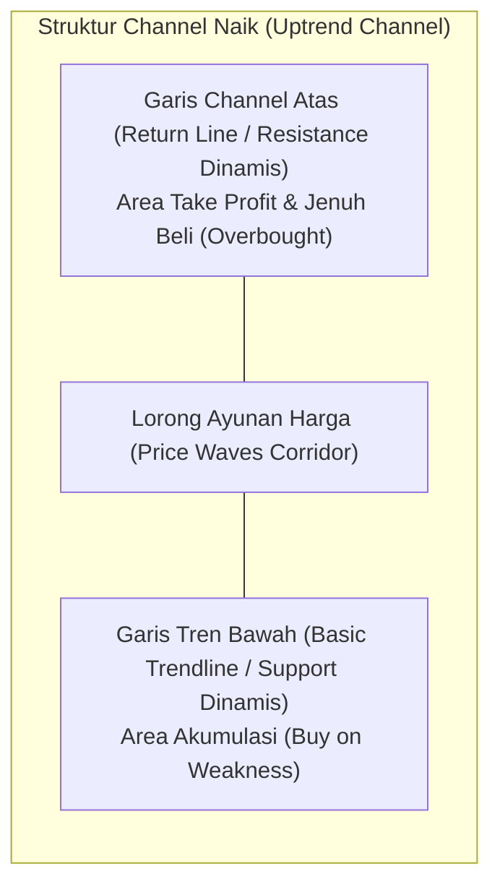
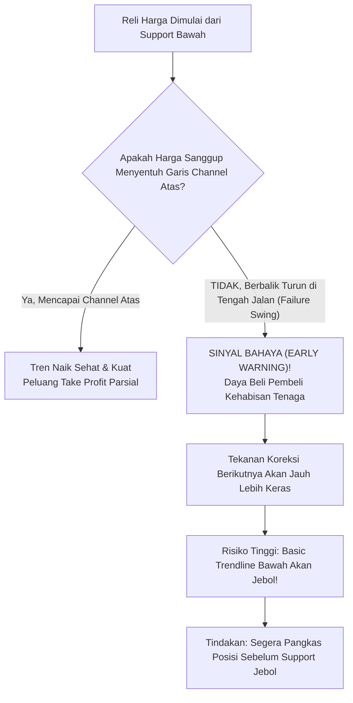

# Bab 12: Garis Channel (Channel Lines)

> *"Garis tren dasar memberitahu Anda ke mana arah angin bertiup, namun garis channel memperlihatkan seberapa jauh kapal Anda dapat berlayar sebelum terbentur karang kejenuhan pasar."* — **Edianto Ong**

---

## 1. Definisi dan Mekanisme Garis Channel

*Channel Lines* (sering disebut juga *Return Lines* atau Saluran Tren) adalah sepasang garis paralel yang membungkus pergerakan harga instrumen dalam sebuah lorong dinamis (*trading corridor*). 

Jika garis tren dasar (*basic trendline*) bertindak sebagai batas lantai pertahanan (*support* dalam *uptrend* atau *resistance* dalam *downtrend*), maka **Garis Channel** berfungsi sebagai batas plafon ekspansi maksimum pergerakan harga dalam siklus tersebut.

### Analogi Membumi: Rel Kereta Api Ganda & Sungai Bertebing
Bayangkan sebuah lintasan kereta api ganda yang menanjak ke puncak pegunungan:
- **Rel Bawah (Basic Trendline)**: Menahan seluruh beban gerbong agar tidak anjlok ke jurang. Selama roda kereta tetap berpijak di rel bawah, perjalanan mendaki tetap aman terkendali.
- **Rel Atas (Channel Line)**: Menjadi batas ruang gerak atap gerbong. Jika kereta melaju teratur, setiap ayunan ke atas akan memantul lembut di rel atas sebelum kembali bersandar pada rel bawah.
- **Anomali Kereta**: Jika tiba-tiba kereta melaju kencang tetapi **tidak sanggup mencapai rel atas** (*failure to reach channel*), itu sinyal bahwa lokomotif mulai kehabisan tenaga uap. Sebaliknya, jika kereta **menerobos menembus rel atas ke angkasa** (*parabolic breakout*), kereta berada dalam fase darurat akselerasi liar yang sebentar lagi terancam tergelincir.



---

## 2. Panduan Step-by-Step Menarik Garis Channel Paralel

Ketepatan analisis channel sangat bergantung pada **akurasi geometris paralel murni**. Menarik garis secara miring sembarangan tanpa kaidah proyeksi akan merusak seluruh kalkulasi target risiko dan imbal hasil (*Risk-to-Reward Ratio*).

### A. Konstruksi Uptrend Channel (Saluran Naik)
Berikut panduan 4 langkah mudah bagi pemula:

```
Langkah Menarik Uptrend Channel:
1. Hubungkan Lembah L1 dan Lembah L2 (Garis Tren Dasar)
2. Temukan Puncak P1 yang berada tepat di antara L1 dan L2
3. Gandakan garis dasar, geser secara PARALEL bertumpu pada puncak P1 (Garis Channel)
4. Tunggu pengujian puncak P2 untuk konfirmasi keabsahan channel

         P1 (Puncak Antara)        P2 (Konfirmasi Channel Atas)
            /\                       /\
           /  \                     /  \
          /    \                   /    \   <--- [Garis Channel Paralel]
         /      \                 /      \
        /        \               /        \
       /          \             /          \
      /            \           /            \
     /              \         /              \
    /                \       /                \
   /                  \     /                  \
L1 (Lembah Awal)       \   /                    \
                        \ /                      \
                         V                        V
                   L2 (Lembah Kedua)         L3 (Support Mantul)
   [Garis Tren Dasar Naik - Support] ---------------------------->
```

1. **Langkah 1**: Tarik garis tren dasar naik (*basic uptrend line*) dengan menghubungkan minimal dua lembah menaik (*Higher Lows*, L1 dan L2).
2. **Langkah 2**: Cari puncak tertinggi (*swing high*, P1) yang terbentuk di antara kurun waktu pembentukan L1 dan L2.
3. **Langkah 3**: Gunakan alat bantu *Parallel Channel Tool* pada software charting Anda (misal TradingView). Tarik garis sejajar dari garis tren dasar dan tempelkan tepat di puncak P1. Garis ini sekarang menjadi garis channel tentatif.
4. **Langkah 4**: Amati ayunan harga berikutnya. Jika reli berikutnya (P2) berbalik turun tepat saat menyentuh garis atas tersebut, maka *Uptrend Channel* Anda resmi terkonfirmasi (*Confirmed Channel*).

### B. Konstruksi Downtrend Channel (Saluran Turun)
1. **Langkah 1**: Buat *basic downtrend line* yang menghubungkan dua puncak menurun (*Lower Highs*, P1 dan P2).
2. **Langkah 2**: Identifikasi lembah terendah (*swing low*, L1) yang berada di antara kedua puncak tersebut.
3. **Langkah 3**: Buat garis paralel dari garis tren turun tersebut, lalu letakkan pada lembah L1.
4. **Langkah 4**: Konfirmasi terjadi apabila tekanan jual berikutnya memantul naik tepat pada garis batas bawah tersebut.

---

## 3. Fungsi Strategis Garis Channel dalam Trading

Bagi seorang *swing trader* maupun *trend follower*, garis channel memberikan 3 keunggulan taktis mutlak:

### 1. Menentukan Target Keuntungan Rasional (*Take Profit Zone*)
Banyak pemula paham cara membeli saat harga murah, tetapi menjadi serakah dan bingung kapan harus menjual sehingga keuntungan yang mengapung (*floating profit*) lenyap tersapu koreksi.
- **Strategi**: Dalam saluran naik, garis tren dasar adalah area akumulasi beli (*Buy on Weakness*), sedangkan garis channel atas adalah area realisasi keuntungan objektif (*Take Profit Zone*). Menjual sebagian posisi di dekat garis channel atas menghindarkan Anda dari kepanikan koreksi berkala.

### 2. Mengidentifikasi Titik Ekstrem (*Dynamic Overbought & Oversold*)
- **Overbought Dinamis**: Ketika harga menyentuh garis channel atas pada *uptrend*, rasio risiko terhadap keuntungan untuk membeli menjadi sangat buruk. Ini adalah area pantangan untuk mengejar harga beli (*No-Buy Zone*).
- **Oversold Dinamis**: Pada saluran turun (*downtrend channel*), sentuhan harga pada garis channel bawah mencerminkan kepanikan jual klimaks jangka pendek, membuka peluang pantulan teknikal kilat (*counter-trend scalping*).

### 3. Mengukur Stamina dan Kesehatan Tren
Kepatuhan harga terhadap garis channel mencerminkan keteraturan psikologi pasar. Perubahan pola interaksi harga dengan garis channel merupakan petunjuk paling andal mengenai masa depan tren tersebut.

---

## 4. Kegagalan Menyentuh Garis Channel (Failure Swing): Sinyal Dini Pelemahan Tren

Wawasan paling berharga dari Edianto Ong dalam buku *Technical Analysis for Mega Profit* adalah: **"Kelemahan sebuah tren pertama kali terdeteksi bukan dari garis support bawahnya, melainkan dari ketidakmampuannya mencapai garis plafon atasnya."**



```
Ilustrasi Visual Failure Swing:
Garis Channel Atas ---------------------------/--/-> (Plafon Target)
                          /\                 /  /
                         /  \               * <--- GAGAL MENCAPAI PLAFON!
                        /    \             / \     (Pembeli Kehabisan Bensin)
                       /      \           /   \
                      /        \         /     \
                     /          \       /       \
Garis Tren Bawah ---+------------\-----/---------\===> TEMBUS JEBOL KE BAWAH!
                                  \   /                 (Tren Resmi Patah)
                                   \ /
```

### Logika Psikologis Failure Swing:
Dalam tren naik normal, pembeli memiliki antusiasme yang cukup untuk mendorong harga sampai membentur batas resistensi saluran atas. Namun, jika harga berbalik arah di tengah lorong (*midpoint*) atau bahkan jauh sebelum menyentuh garis channel atas:
1. Ini bukti nyata bahwa minat beli publik mulai jenuh dan *smart money* enggan memborong di harga atas.
2. Penjual mulai mendominasi pasar jauh lebih cepat dari siklus biasanya.
3. Akibatnya, dorongan penurunan berikutnya hampir selalu memiliki momentum yang cukup kuat untuk **menembus garis tren dasar (*basic trendline*) ke bawah**.

---

## 5. Over-Extension: Penembusan Garis Channel (*Channel Breakout*)

Apa yang terjadi jika harga justru meledak menembus garis channel atas pada *uptrend*?

```
Ilustrasi Channel Breakout:
                                          /\  (Akselerasi Liar / Parabolik)
                                         /  \
Garis Channel Atas --------------/------/----\------------------------
                                /      /
                               /  /\  /
                              /  /  \/
Garis Tren Dasar ------------+--/-------------------------------------
```

1. **Akselerasi Tren (*Parabolic Advance*)**: Penembusan garis channel atas bukan berarti saluran turun, melainkan ledakan euforia luar biasa (*super bullish*). Tren mengalami percepatan drastis.
2. **Kebutuhan Menggambar Saluran Baru**: Saluran lama sudah usang (*obsolete*). Trader harus menggambar channel baru dengan sudut kemiringan yang lebih curam.
3. **Peringatan Klimaks Beli (*Exhaustion Move*)**: Penembusan garis channel atas jarang sekali bertahan lama secara sehat. Sering kali ini adalah manuver tarikan terakhir bandar (*blow-off top*) untuk memancing ritel FOMO sebelum pembalikan arah tajam terjadi.

---

## 6. Kamus Istilah Pemula (Glossary Box)

> [!NOTE]
> - **Channeling**: Seni memetakan koridor harga paralel dengan garis tren dasar dan garis pengembalian (*return line*).
> - **Return Line**: Garis resistensi paralel pada tren naik atau garis support paralel pada tren turun.
> - **Failure Swing**: Kegagalan harga untuk menyentuh garis channel pembatas, yang mengindikasikan pelemahan momentum tren sebelum garis tren dasar tertembus.
> - **Channel Breakout**: Penembusan harga ke luar lorong channel, menandakan akselerasi ekstrem (jika menembus plafon) atau pembalikan tren total (jika menembus lantai).
> - **Buy on Weakness (BoW)**: Strategi membeli saat harga terkoreksi mendekati garis lantai tren dasar dengan konfirmasi pantulan lilin.
> - **Sell on Strength (SoS)**: Strategi menjual saham saat harga mendekati garis plafon channel atas untuk mengamankan margin keuntungan tertinggi.

---

## 7. Studi Kasus Konkret: Trading Saluran Saham PT Energi Semesta (ENRG)

Mari kita telaah simulasi trading menggunakan Garis Channel pada saham PT Energi Semesta (ENRG):

```
Data Pergerakan Harga ENRG:
- Lembah 1 (L1) = Rp2.000
- Puncak 1 (P1) = Rp2.600
- Lembah 2 (L2) = Rp2.300 (Menyentuh garis tren dasar naik)
- Puncak 2 (P2) = Rp3.000 (Tepat menyentuh garis channel atas paralel P1)
```

### Rencana Eksekusi Trader:
1. **Identifikasi Channel**: Trader menggambar saluran paralel dengan menghubungkan L1 (Rp2.000) dan L2 (Rp2.300), lalu memproyeksikan garis sejajar di puncak P1 (Rp2.600).
2. **Eksekusi 1 (Buy on Weakness)**: Pada saat harga menyentuh L2 di Rp2.300 dan membentuk pola *Bullish Pinbar*, trader masuk membeli di Rp2.320 dengan *Stop Loss* ketat di Rp2.240 (di bawah L2).
3. **Eksekusi 2 (Take Profit di Garis Channel Atas)**:
   - Harga melaju menuju P2. Sesuai proyeksi garis channel atas, target berada di Rp3.000.
   - Saat harga menyentuh Rp3.000 dan muncul *Shooting Star*, trader **menjual 50% posisi di Rp2.980** untuk merealisasikan profit +28%.
4. **Deteksi Sinyal Failure Swing**:
   - Sisa 50% posisi ditahan dengan harapan pengujian channel berikutnya.
   - Harga terkoreksi ke Rp2.700 (L3), memantul, tetapi hanya mampu naik sampai **Rp2.850**—jauh di bawah garis channel atas yang seharusnya berada di Rp3.300!
   - Terjadi **Failure Swing** yang nyata.
   - Trader tidak menunggu garis dasar jebol; ia segera **menjual sisa 50% posisi di Rp2.820**.
5. **Konfirmasi Pasca Penjualan**: Benar saja, dua hari kemudian harga ambruk menembus garis tren dasar di Rp2.650 dan longsor menuju Rp2.200. Trader sukses mengamankan portofolio secara maksimal.

---

## 8. Kesalahan Fatal Pemula Terkait Garis Channel

1. **Membeli di Garis Channel Atas Karena Euforia**: Pemula sering membeli justru saat harga menyentuh garis atas karena melihat lilin hijau panjang dan volume ramai, padahal itu adalah area jenuh beli paling rawan koreksi.
2. **Menarik Garis Channel Tidak Paralel**: Menggambar garis channel secara bebas tanpa sudut yang sama persis dengan garis tren dasar. Hal ini menghasilkan proyeksi harga yang menyesatkan.
3. **Mengabaikan Sinyal Failure Swing**: Menganggap remeh kegagalan harga mencapai garis channel atas dan tetap bersikeras menahan posisi hingga garis tren bawah hancur lebur.
4. **Menjual Terlalu Cepat Tanpa Menunggu Channel Atas**: Terlalu takut dan keluar posisi di tengah lorong (*midpoint*) padahal tren masih sangat perkasa menuju garis atas.

---

## 9. Ringkasan Eksekutif Bab 12

| Kondisi Harga | Status Teknikal | Tindakan Trading yang Disarankan |
| :--- | :--- | :--- |
| **Harga Memantul di Garis Bawah** | Uji Support Sehat | Akumulasi Beli (*Buy on Weakness*). Stop loss di bawah swing low. |
| **Harga Menyentuh Garis Atas** | Jenuh Beli Relatif (*Overbought*) | Realisasi keuntungan parsial (30–50%). Pasang Trailing Stop. Dilarang HAKI beli baru. |
| **Terjadi Failure Swing (Gagal Capai Garis Atas)** | Kelelahan Momentum (*Exhaustion*) | Ambil tindakan defensif segera. Jual sebagian besar posisi sebelum support bawah jebol. |
| **Jebol Garis Bawah (*Breakdown*)** | Pembalikan Tren (*Reversal*) | Likuidasi total seluruh sisa posisi. Tren naik resmi berakhir. |
