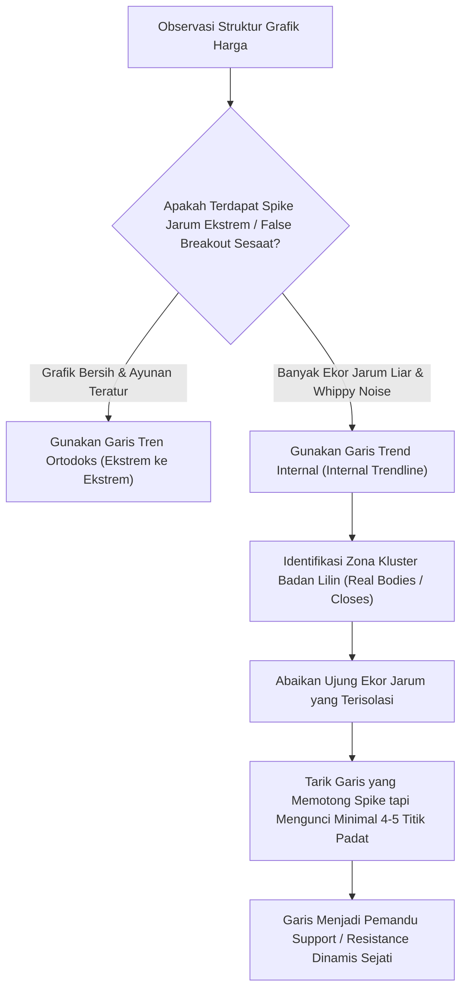

# Bab 13: Garis Trend Internal (Internal Trendlines)

> *"Garis tren ortodoks terobsesi pada ujung ekor harga paling ekstrem, namun garis tren internal mendengarkan detak jantung pasar: di mana likuiditas sejati dan volume transaksi paling padat bertukar tangan."* — **Edianto Ong**

---

## 1. Definisi dan Konsep Dasar Garis Trend Internal

Dalam literatur analisis teknikal standar, pemula selalu diajarkan untuk menarik garis tren ortodoks (*Orthodox Trendline*) yang bersandar secara kaku pada titik-titik harga paling ujung—yaitu pucuk ekor (*shadows/wicks*) tertinggi atau terendah dari sebuah *candlestick*.

Meskipun aturan ini rapi di atas kertas, kenyataan grafik di bursa efek sering kali dipenuhi anomali likuiditas sesaat: lonjakan berita kilat (*news spike*), transaksi *crossing* pembukaan sesi, atau aksi perburuan stop loss (*stop-hunting*) oleh pelaku pasar bermodal besar. Jika seorang analis memaksakan garis tren harus melewati ekor-ekor jarum ekstrem tersebut, sudut garis yang dihasilkan kerap menjadi melenceng jauh dari realitas arah pasar yang sesungguhnya.

**Garis Trend Internal (*Internal Trendline*)** adalah garis tren adaptif yang ditarik melintasi **zona konsentrasi kepadatan harga terbanyak (*price cluster points*)**, dengan sengaja mengabaikan lonjakan harga ekstrem sesaat (*extreme price spikes*).

### Analogi Membumi: Garis Rata-Rata Pohon di Hutan & Tol Tanpa Bahu Jalan
- **Garis Ortodoks (Ujung Daun Terluar)**: Bayangkan Anda memotret tepian deretan pohon cemara di lereng bukit. Jika Anda menarik garis yang wajib menyentuh ujung daun tertinggi dari satu ranting yang menjulang liar ditiup badai kemarin sore, garis batas hutan Anda akan menjadi miring tidak karuan.
- **Garis Internal (Batang dan Tajuk Rimbun)**: Garis yang ditarik melewati batang pohon utama dan tajuk rimbun di mana 90% massa dedaunan berada. Garis inilah yang menunjukkan batas tanah hutan sesungguhnya. Ranting liar yang mencuat sesaat dianggap sebagai derau (*noise*) alami yang diabaikan.



```
Perbandingan Penarikan Garis:
A. Garis Tren Ortodoks (Kaku pada Ekor - Rawan Terdistorsi):
          /\ (Spike Berita Sesaat)
         /  \              /\
   /\   /    \            /  \
  /  \_/      \__________/    \_____ (Hanya bertumpu pada 2 titik ekor jarum)

B. Garis Tren Internal (Bertumpu pada Kluster Kepadatan Transaksi):
          | (Spike diabaikan)
       ---|------------------------- [Garis Internal memotong jarum spike,
   ---/---|-------------------------  namun bersandar pada 5-6 pertemuan padat]
  /  /    |            /\
 /  /                 /  \
```

---

## 2. Metodologi Step-by-Step Menggambar Garis Trend Internal

Menggambar garis tren internal bukanlah tindakan menggambar garis secara acak. Ia menuntut disiplin pengamatan visual yang terukur:

### Langkah 1: Ubah Tampilan Sementara ke Grafik Garis (*Line Chart*)
Jika Anda ragu membedakan mana pergerakan harga sejati dan mana ekor jarum palsu:
- Ubah jenis grafik Anda dari *Candlestick* menjadi *Line Chart* (grafik garis berbasis harga penutupan / *closing price*).
- Grafik garis secara otomatis memotong seluruh ekor jarum (*high/low wicks*) dan menyajikan kurva konsensus nilai murni penutupan pasar.
- Amati di mana garis tren mengalir dengan mulus.

### Langkah 2: Identifikasi Zona Kluster Harga (*Price Clusters*)
Kembalikan grafik ke tampilan *Candlestick*. Cari area di mana:
- Banyak badan lilin (*real bodies*) saling bertumpuk atau memantul di level kemiringan yang sama.
- Terdapat kumpulan titik balik (*pivots*) kecil yang konsisten.

### Langkah 3: Abaikan Spike yang Terisolasi (*Spike Filtering*)
Jika terdapat satu atau dua *candle* dengan ekor sangat panjang akibat berita kejutan (*flash news*) yang langsung ditarik kembali dalam hitungan menit/jam:
- Biarkan garis memotong ekor jarum tersebut (*cut through the shadows*).
- Ingat prinsip ini: **Ekor lilin mencerminkan emosi sesaat, sedangkan badan lilin mencerminkan kesepakatan harga institusi.**

### Langkah 4: Maksimalkan Jumlah Sentuhan Berkualitas (*Maximize Quality Touches*)
Tarik garis lurus yang mampu menyentuh sebanyak mungkin titik pertemuan harga:
- Menyentuh minimal 4 hingga 5 titik kluster badan lilin.
- Titik sentuhan dapat berupa perpaduan antara bekas *resistance* lama yang ditembus dan kini menjadi *support* baru (*internal role reversal*).

---

## 3. Kapan Garis Trend Internal Lebih Unggul Dibanding Garis Konvensional?

Tidak semua grafik memerlukan garis internal. Namun pada tiga kondisi pasar berikut, garis internal memberikan akurasi jauh melampaui garis ortodoks:

### A. Pasar dengan Volatilitas Liar (*Whippy & Stop-Hunting Markets*)
Pada saham-saham berkapitalisasi menengah atau komoditas yang kerap mengalami guncangan ekor jarum akibat aksi bandar memancing *stop loss* ritel, garis konvensional akan mudah sekali tertembus (*false breakdown*). Garis internal tetap kokoh menyaring derau tersebut dan menjaga posisi Anda tetap aman.

### B. Pola Pembalikan Membulat (*Rounding Formations*)
Ketika pasar sedang membentuk dasar membulat (*rounding bottom*) atau puncak melebar (*broadening pattern*), lembah atau puncaknya tidak membentuk sudut tajam segitiga, melainkan lengkungan bertahap. Garis tren internal mampu menangkap tulang punggung (*backbone*) tren dari akumulasi institusi secara jauh lebih presisi.

### C. Fokus Transaksi Berbasis Harga Penutupan (*Close-Centric Analysis*)
Bagi manajer investasi reksa dana dan investor institusi besar, harga penutupan (*closing price*) adalah satu-satunya harga resmi untuk valuasi portofolio harian (*mark-to-market*). Garis internal yang bersandar pada harga penutupan mencerminkan jejak keputusan institusional tersebut.

---

## 4. Keunggulan Komparatif: Konvensional vs. Internal

| Parameter Evaluasi | Garis Trend Konvensional (Ortodoks) | Garis Trend Internal (Cluster-Based) |
| :--- | :--- | :--- |
| **Titik Tumpu Titik Garis** | Ujung ekor absolut (*Absolute High / Low*) | Badan lilin, harga penutupan, & kluster transaksi |
| **Toleransi Penembusan Ekor** | Nol (garis tidak boleh terpotong harga sama sekali) | Fleksibel (ekor anomali sengaja dipotong demi kestabilan) |
| **Tingkat Objektivitas** | Mekanis kaku (mudah ditarik oleh pemula) | Berbasis keahlian membaca kepadatan likuiditas |
| **Ketahanan Noise / Sinyal Palsu** | Rendah (sering memicu *False Breakout / Whipsaw*) | Sangat Tinggi (tahan terhadap manipulasi ekor sesaat) |
| **Peran Utama dalam Trading** | Penempatan Stop Loss kaku & level breakout ekstrem | Menemukan nilai wajar dinamis (*Dynamic Fair Value*) |

---

## 5. Kamus Istilah Pemula (Glossary Box)

> [!NOTE]
> - **Internal Trendline**: Garis tren yang ditarik melewati zona kepadatan transaksi badan lilin dan mengabaikan lonjakan ekor jarum sesaat.
> - **Orthodox Trendline**: Garis tren klasik yang bertumpu murni pada ujung ekor harga tertinggi atau terendah absolut.
> - **Price Cluster (Kluster Harga)**: Area konsentrasi pada grafik di mana banyak batang candlestick saling bertumpuk dan menguji level harga yang sama.
> - **Spike / Wick / Shadow**: Ekor jarum tipis pada candlestick yang mencerminkan fluktuasi harga sesaat sebelum harga ditarik kembali saat penutupan.
> - **Stop-Hunting**: Manuver pasar di mana harga sengaja didorong menembus level support/resistance historis sesaat untuk melikuidasi stop loss ritel sebelum berbalik arah.
> - **Dynamic Fair Value**: Level harga wajar yang terus bergerak seiring waktu yang menjadi tempat berkumpulnya konsensus transaksi pasar.

---

## 6. Studi Kasus Konkret: Mengatasi Noise Saham PT Tambang Mulia (TMBG)

Mari kita amati bagaimana penggunaan garis internal menyelamatkan portofolio trader pada saham komoditas PT Tambang Mulia (TMBG):

```
Skenario Grafik Saham TMBG:
Hari ke-10: Harga stabil membentuk rentang menanjak Rp1.000 -> Rp1.200 -> Rp1.400.
Hari ke-15: Pengumuman rilis data inflasi global mendadak. 
            Harga anjlok seketika dalam 15 menit ke Rp1.250 (membentuk ekor jarum bawah sangat panjang),
            lalu pada penutupan sesi langsung ditarik kembali menguat ditutup di Rp1.380.
Hari ke-20: Harga kembali normal mendaki ke Rp1.500.
```

### Jebakan Garis Ortodoks vs Solusi Garis Internal:
1. **Trader A (Menggunakan Garis Ortodoks)**:
   - Terpaksa merevisi garis tren bawahnya agar menyentuh ekor jarum Rp1.250.
   - Akibatnya, garis trennya menjadi sangat landai dan tidak masuk akal (miring ke bawah), kehilangan seluruh referensi sudut tren naik awal.
   - Lebih parah lagi, saat terjadi fluktuasi normal di kemudian hari pada level Rp1.350, Trader A bingung menentukan apakah tren masih naik atau sudah turun.
2. **Trader B (Menerapkan Garis Trend Internal Edianto Ong)**:
   - Mengidentifikasi bahwa ekor jarum Rp1.250 adalah *noise* akibat kepanikan berita global yang hanya berlangsung 15 menit.
   - Trader B menarik **Garis Trend Internal** yang tetap bertumpu pada badan lilin konsolidasi Rp1.000, Rp1.200, dan harga penutupan Rp1.380, dengan sengaja membiarkan ekor Rp1.250 memotong garisnya.
   - **Hasil Taktis**: Ketika saham TMBG terkoreksi normal pada Hari ke-25 ke level Rp1.420 dan menyentuh garis internal tersebut, Trader B dengan percaya diri melakukan **Buy on Weakness**. Saham TMBG langsung melesat menuju Rp1.700. Trader B meraup untung besar, sedangkan Trader A kehilangan arah karena terjebak garis ortodoks yang terdistorsi.

---

## 7. Kesalahan Fatal Pemula Terkait Garis Trend Internal

1. **Memotong Badan Lilin Sesuka Hati (Subjektivitas Buta)**: Pemula sering salah kaprah mengira garis internal memperbolehkan mereka memotong badan lilin di mana saja semaunya demi mempertahankan posisi rugi. **Ingat: Ekor jarum boleh dipotong, tetapi badan lilin utama penutupan tidak boleh dibelah sembarangan!**
2. **Mengabaikan Volume Kluster**: Menarik garis internal melintasi area harga sepi transaksi tanpa ada volume transaksi pendukung (*High Volume Node*).
3. **Mengabaikan Konfirmasi Titik Sentuh**: Menganggap garis internal valid hanya dengan 2 titik sentuh. Mengingat sifatnya yang mengabaikan ekor, garis internal **wajib memiliki minimal 4 titik sentuhan kluster** agar diakui keandalannya.
4. **Tidak Menggunakan Konfirmasi Pola Lilin**: Membeli semata-mata karena harga menyentuh garis internal tanpa menunggu konfirmasi pola pembalikan lilin (*reversal candle confirmation*) seperti *Hammer* atau *Bullish Engulfing*.

---

## 8. Ringkasan Eksekutif Bab 13

- **Lihat Kepadatan, Bukan Ujung Ekor**: Konsensus nilai sejati sebuah saham tercermin pada kluster kepadatan transaksi badan lilin, bukan pada ekor jarum emosional sesaat.
- **Saring Derau Pasar**: Garis tren internal adalah alat terbaik untuk menyaring *false breakdown* dan manuver *stop-hunting* pada saham bervolatilitas tinggi.
- **Gunakan Garis Penutupan (*Close*) Sebagai Jangkar**: Jika bingung membedakan noise dan tren murni, gunakan bantuan grafik garis (*line chart*) untuk memandu penarikan garis internal.
- **Disiplin 4 Titik Sentuh**: Jangan pernah mengandalkan garis internal yang hanya menyentuh 2 titik; validitas garis internal dibangun atas konsistensi multi-titik sentuhan.
