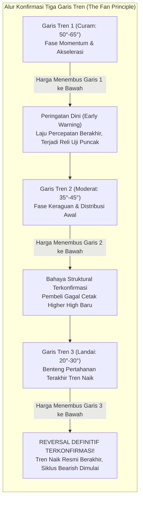
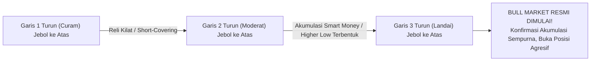

# Bab 14: The Fan Principle (Prinsip Kipas)

> *"Pembalikan arah tren bukanlah peristiwa kilat yang meledak dalam semalam, melainkan proses erosi struktural bertahap yang membongkar pertahanan harga lapis demi lapis layaknya kipas lipat yang merekah."* — **Edianto Ong**

---

## 1. Konsep Dasar The Fan Principle (Prinsip Kipas)

Dalam dinamika pasar finansial, tren yang kuat dan telah berlangsung lama hampir tidak pernah langsung berbalik arah 180° secara mendadak (*V-reversal*) tanpa meninggalkan jejak teknikal. Sebaliknya, pasar selalu melewati proses transisi psikologis: dari fase akselerasi penuh euforia, melambat menjadi keraguan (*hesitation*), memasuki fase distribusi rahasia, hingga akhirnya kehilangan seluruh daya dukung struktural.

**The Fan Principle (Prinsip Kipas)**, yang berakar dari kaidah klasik *The Three Trendline Rule*, adalah salah satu instrumen paling elegan dan objektif dalam analisis teknikal untuk mengidentifikasi dan mengonfirmasi pembalikan tren (*trend reversal*) secara bertahap dan pasti.

### Analogi Membumi: Kipas Lipat Bambu Tiga Ruas & Patahnya Tiga Tiang Jembatan
Bayangkan sebuah jembatan gantung yang kokoh ditopang oleh tiga tiang pancang berurutan atau bilah kipas lipat bambu:
- **Tiang 1 (Bilah Kipas Curam - Garis Tren 1)**: Tiang penahan laju lari awal yang paling agresif. Ketika tiang ini patah atau bilah pertama terbuka, jembatan belum roboh; jembatan hanya bergoyang dan tertahan oleh tiang kedua. Penumpang mulai waspada.
- **Tiang 2 (Bilah Kipas Moderat - Garis Tren 2)**: Tiang penyangga struktur utama. Ketika tiang kedua ikut retak dan patah, situasi darurat menyala. Struktur jembatan telah melengkung parah dan sebagian besar muatan harus segera dievakuasi.
- **Tiang 3 (Bilah Kipas Landai - Garis Tren 3)**: Tiang pertahanan terakhir yang paling landai. Begitu tiang ketiga ini runtuh ke bawah, jembatan hancur lebur jatuh ke dasar jurang. Runtuhnya tiang ketiga menandai akhir riwayat struktur jembatan lama secara definitif.



---

## 2. Anatomi Geometris Tiga Garis Tren (The Three Trendline Rule)

Prinsip Kipas menuntut penarikan **tiga garis tren berturut-turut** yang semuanya berpangkal dari **satu titik dasar terendah yang sama (*Single Origin Low*)**:

```
Geometri Grafik Prinsip Kipas (Pembalikan dari Tren Naik ke Tren Turun):

                       Puncak Utama (Peak)
                            /\
                           /  \        Puncak Lebih Rendah (Lower High 1)
                          /    \            /\
                         /      \          /  \
                        /        \        /    \       Puncak Lebih Rendah 2 (LH 2)
                       /          \      /      \          /\
                      /  (1)       \    /  (2)   \        /  \
                     /              \  /          \      /    \
                    /                \/            \    /      \
                   /                 L1             \  /   (3)  \ ===> JEBOL GARIS 3!
                  /                                  \/          \      (BEAR MARKET SAH)
                 /                                   L2           V
                /
Titik Pangkal -+-------------------------------------------------------------
              Garis 1 (Curam)      Garis 2 (Moderat)       Garis 3 (Landai)
```

1. **Titik Pangkal Asal (*Origin Point*)**: Titik terendah awal dimulainya siklus *uptrend* besar.
2. **Lembah 1 (L1)**: Titik balik lembah setelah reli pertama menembus garis 1.
3. **Lembah 2 (L2)**: Titik balik lembah setelah reli kedua gagal mencetak puncak baru dan menembus garis 2.
4. **Bilah Ketiga**: Garis lurus yang ditarik dari titik pangkal melewati L2. Sudut kemiringan garis ini sangat landai (sering kali <30°).

---

## 3. Tiga Tahapan Konfirmasi Pembalikan Arah dan Psikologi Pelaku Pasar

Edianto Ong merinci dinamika psikologis di balik setiap garis dalam The Fan Principle:

### Tahap 1: Penembusan Garis 1 (Peringatan Dini / Early Warning)
- **Karakteristik Garis**: Garis 1 ditarik melalui dua titik lembah akselerasi awal. Kemiringannya sangat curam (50°–65°).
- **Aksi Harga**: Harga terkoreksi dan menembus Garis 1 ke bawah.
- **Kondisi Psikologis Pasar**: Euforia publik mulai terhenti sesaat, namun sentimen *bullish* masih sangat kental. Pelaku pasar menganggap ini hanya koreksi biasa dan bersiap melakukan *buy on dip*.
- **Tindakan Trader Bijak**: Ini **bukan** sinyal untuk melakukan *panic selling* atau aksi *short* liar. Trader hanya perlu berhenti menambah posisi baru dan mulai merealisasikan keuntungan pada porsi kecil (*scaling out*). Harga biasanya akan memantul kembali (*pullback*) untuk menguji puncak sebelumnya.

### Tahap 2: Penembusan Garis 2 (Kelemahan Struktural Nyata)
- **Karakteristik Garis**: Setelah memantul dari penembusan Garis 1, harga mencoba naik kembali tetapi **gagal menembus rekor tertinggi sebelumnya (*Failure Swing / Lower High*)**. Harga lalu berbalik turun dan membentuk lembah L1. Garis 2 ditarik dari titik pangkal melewati L1 dengan sudut moderat (35°–45°).
- **Aksi Harga**: Harga bergerak turun dan menembus Garis 2 ke bawah.
- **Kondisi Psikologis Pasar**: Mulai timbul keraguan di kalangan pelaku pasar. Pihak institusi besar (*smart money*) diam-diam memanfaatkan setiap sisa pantulan untuk mendistribusikan barang (*distribution phase*).
- **Tindakan Trader Bijak**: Sinyal bahaya berbunyi keras! Pangkas minimal 50% portofolio Anda. Naikkan batas *Trailing Stop* secara ketat tepat di bawah ayunan Garis 2.

### Tahap 3: Penembusan Garis 3 (Konfirmasi Mutlak Pembalikan Tren)
- **Karakteristik Garis**: Harga kembali melakukan pantulan teknikal lemah (*weak bounce*), mencetak puncak yang jauh lebih rendah (*Lower High kedua*), lalu membentuk lembah L2. Garis 3 ditarik dari titik pangkal melewati L2. Sudut garis ini sangat landai (20°–30°).
- **Aksi Harga**: Harga menembus Garis 3 ke bawah dengan konfirmasi lonjakan volume penjualan (*high selling volume*).
- **Kondisi Psikologis Pasar**: Keputusasaan massal (*capitulation*). Pembeli menyerah total, tidak ada lagi dana segar yang menopang harga, dan penjual panik membuang barang di sembarang harga.
- **Tindakan Trader Bijak**: **EXIT 100%! Likuidasi seluruh sisa posisi tanpa ragu.** Begitu Garis 3 tertembus, struktur tren naik dinyatakan mati total. Pola pembalikan arah besar seperti *Head and Shoulders* atau *Triple Top* biasanya terkonfirmasi bersamaan dengan penembusan Garis 3 ini.

---

## 4. Matriks Keputusan Trading The Fan Principle

| Elemen Garis | Sudut Kemiringan | Fase Siklus Pasar | Bobot Risiko | Tindakan Eksekusi Portofolio |
| :--- | :--- | :--- | :--- | :--- |
| **Garis 1 (Line 1)** | 50° – 65° (Curam) | Akselerasi / Euforia Penuh | Rendah - Sedang | *Hold / Profit Taking* sebagian kecil (20–30%). Dilarang tambah posisi baru. |
| **Garis 2 (Line 2)** | 35° – 45° (Moderat) | Distribusi / Kelelahan Pembeli | Tinggi | Pangkas posisi 50%. Naikkan batas stop loss ketat di bawah Garis 2. |
| **Garis 3 (Line 3)** | 20° – 30° (Landai) | Penyerahan Total (*Capitulation*) | Ekstrem Fatal | **EXIT TOTAL (100% Cash)**. Pembeli dilarang keras melawan arus pasar (*Stay Out*). |

---

## 5. Penerapan Prinsip Kipas pada Pembalikan Tren Bawah (Downtrend ke Uptrend)

Prinsip Kipas berlaku secara simetris sempurna pada dasar pasar (*bottom reversal*) saat siklus *bearish* bertransisi menjadi siklus *bullish*:



1. **Garis 1 Turun (Curam) Tertembus ke Atas**: Kepanikan jual mereda. Terjadi pantulan akibat penutupan posisi jual (*short-covering bounce*). Jangan buru-buru mengira pasar langsung pulih.
2. **Garis 2 Turun (Moderat) Tertembus ke Atas**: Institusi mulai mengumpulkan barang secara rahasia (*smart money accumulation*). Harga berhasil mencetak *Higher Low* pertama.
3. **Garis 3 Turun (Landai) Tertembus ke Atas**: **Bull Market Baru Terkonfirmasi Secara Definitif!** Resistensi garis tren terakhir berhasil dirobohkan dengan volume masif. Ini adalah lampu hijau resmi untuk melakukan pembelian agresif (*aggressive positioning*).

---

## 6. Kamus Istilah Pemula (Glossary Box)

> [!NOTE]
> - **The Fan Principle**: Metode konfirmasi pembalikan arah tren yang mewajibkan penembusan beruntun atas 3 garis tren dengan kemiringan yang semakin melandai.
> - **Three Trendline Rule**: Aturan klasik analisis teknikal yang menyatakan bahwa tren baru dinyatakan sah berbalik hanya setelah garis tren ketiga tertembus.
> - **Lower High (LH)**: Puncak ayunan harga baru yang gagal melampaui puncak ayunan harga sebelumnya, mencerminkan terkikisnya tenaga pembeli.
> - **Capitulation**: Momen ketika pelaku pasar yang sebelumnya bertahan akhirnya menyerah dan menjual seluruh kepemilikannya secara serentak karena putus asa.
> - **Scaling Out**: Strategi menutup posisi trading secara bertahap (misal 30%, 50%, lalu 100%) untuk mengunci profit sekaligus membatasi risiko.
> - **Origin Point**: Titik nol terendah (pada uptrend) atau tertinggi (pada downtrend) yang menjadi jangkar pangkal ketiga garis kipas.

---

## 7. Studi Kasus Konkret: Mengawal Kejatuhan Saham PT Konstruksi Prima (KPRM)

Mari kita pelajari contoh nyata implementasi The Fan Principle pada saham PT Konstruksi Prima (KPRM):

```
Kronologi Harga KPRM:
- Titik Pangkal (Origin): Rp1.000
- Puncak Euforia: Rp4.000 (Didukung Garis 1 sudut 60°)
- Retest 1: Koreksi ke Rp3.200 (menembus Garis 1), memantul ke Rp3.800 (LH1 - gagal tembus Rp4.000)
- Lembah 1 (L1): Rp3.000 -> Ditarik Garis 2 dari Rp1.000 melewati Rp3.000 (sudut 40°)
- Retest 2: Menembus Garis 2 di Rp2.900, memantul lemah ke Rp3.300 (LH2)
- Lembah 2 (L2): Rp2.600 -> Ditarik Garis 3 dari Rp1.000 melewati Rp2.600 (sudut 25°)
- Final Breakdown: Harga anjlok menembus Garis 3 di level Rp2.500 dengan volume masif!
```

### Eksekusi Manajemen Risiko Trader:
1. **Saat Garis 1 Tembus di Rp3.500**: Trader tidak panik. Mengingat posisi harga sudah melipatgandakan modal dari Rp1.000, trader **menjual 30% posisi** di Rp3.500 untuk mengamankan modal pokok.
2. **Saat Garis 2 Tembus di Rp2.900**: Trader menyadari struktur *Lower High* di Rp3.800 mengonfirmasi adanya distribusi. Trader **menjual lagi 40% posisi** di Rp2.900. Total posisi keluar kini mencapai 70%.
3. **Saat Garis 3 Tembus di Rp2.500**: Prinsip Kipas menyatakan pertahanan terakhir telah runtuh. Pola *Head and Shoulders* raksasa terkonfirmasi. Trader **melikuidasi sisa 30% posisi tanpa ampun di Rp2.480**.
4. **Hasil Akhir**: Sebulan kemudian, saham KPRM hancur lebur kembali ke Rp1.200. Berkat The Fan Principle, trader berhasil mengamankan rata-rata harga jual di level Rp3.000-an dan terhindar dari kehancuran modal total.

---

## 8. Kesalahan Fatal Pemula Terkait The Fan Principle

1. **Keluar Terlalu Cepat Hanya Karena Garis 1 Tembus (Premature Panic)**: Pemula sering panik menjual seluruh barangnya saat garis curam pertama tertembus, padahal pasar masih sering melakukan reli kedua untuk menguji puncak.
2. **Menolak Keluar Saat Garis 3 Tembus (Batu Karang Emosional)**: Mengabaikan penembusan Garis 3 karena merasa harga sudah "turun banyak dari pucuk" sehingga menolak *cut loss*, hingga akhirnya modal tergerus habis saat pasar memasuki fase *bear market* penuh.
3. **Menarik Garis Kipas dari Titik Pangkal yang Berbeda**: Prinsip Kipas mewajibkan ketiga garis bertumpu pada **satu titik asal yang sama**. Mengambil titik pangkal sembarangan merusak kesimetrisan pembacaan sudut kipas.
4. **Menangkap Pisau Jatuh Sebelum Garis 3 Downtrend Tertembus**: Mencoba membeli di dasar lembah sebelum ketiga garis kipas pada tren turun tertembus ke atas secara sah.

---

## 9. Ringkasan Eksekutif Bab 14

- **Tiga Garis Membawa Kepastian**: The Fan Principle menyaring kebingungan antara koreksi biasa dan pembalikan tren sejati melalui aturan objektif 3 garis tren bertahap.
- **Garis 1 = Peringatan, Garis 2 = Bahaya, Garis 3 = Vonis Mati**: Ikuti ritme ini dalam mengamankan posisi portofolio Anda secara teratur dan dingin tanpa emosi.
- **Pangkal Tunggal adalah Kunci**: Pastikan seluruh garis kipas memancar dari satu titik asal ekstrem yang sama untuk menjaga akurasi pembacaan sudut momentum.
- **Disiplin Eksekusi**: Mengetahui prinsip ini tidak ada gunanya jika Anda menolak menekan tombol *Sell* saat Garis 3 telah resmi jebol ke bawah!
