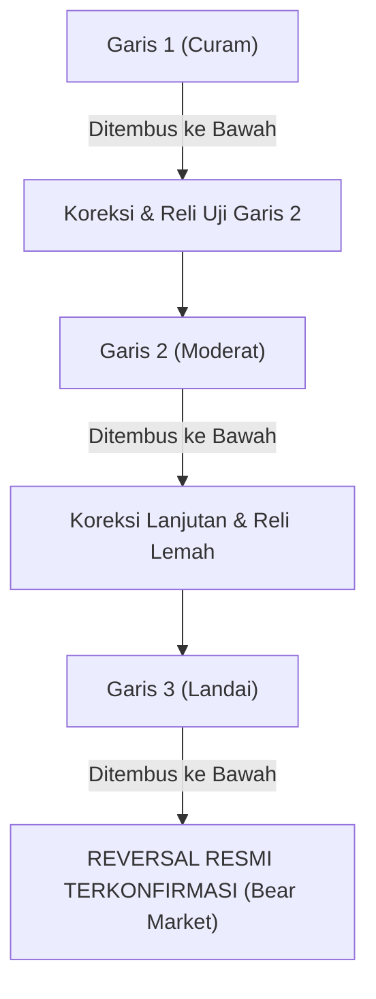

# Bab 14: The Fan Principle (Prinsip Kipas)

> *"Pembalikan arah tren bukanlah satu peristiwa kilat yang terjadi dalam semalam, melainkan sebuah proses erosi bertahap yang membongkar pertahanan tren lapis demi lapis layaknya kipas yang terkembang."* — **Edianto Ong**

---

## 1. Konsep Dasar The Fan Principle (Prinsip Kipas)

Dalam dinamika pasar finansial, tren yang kuat jarang sekali langsung berbalik arah 180° secara mendadak (*V-reversal*) tanpa meninggalkan jejak teknikal. Sebaliknya, pasar biasanya melewati serangkaian fase transisi: dari akselerasi, melambat menjadi konsolidasi, hingga akhirnya kehilangan daya dukung secara permanen.

**The Fan Principle (Prinsip Kipas)**, yang berakar dari aturan klasik *Three Trendline Rule*, adalah salah satu instrumen paling elegan dalam analisis teknikal untuk mengonfirmasi pembalikan tren (*trend reversal*) secara objektif dan bertahap. 

Prinsip ini didasarkan pada pengamatan geometris bahwa ketika tren melemah, analis harus menarik garis-garis tren baru yang semakin melandai. Pola susunan tiga garis tren yang merekah dari satu titik acuan menyerupai bentuk kipas tangan yang terbuka (*fan*).

---

## 2. Anatomi Tiga Garis Tren (The Three Trendline Rule)

Pembalikan tren penuh dikonfirmasi melalui penembusan berurutan atas **tiga garis tren utama**:

```
 MERMAID DIAGRAM: THE FAN PRINCIPLE (DOWNTREND REVERSAL / PEMBALIKAN TREN NAIK)
```



Secara visual pada grafik harga (misalnya pembalikan dari *Uptrend* menjadi *Downtrend*):

```
                       Puncak Utama (Peak)
                            /\
                           /  \        Puncak Lebih Rendah (Lower High)
                          /    \            /\
                         /      \          /  \
                        /        \        /    \       Puncak Rendah Lanjutan
                       /          \      /      \          /\
                      /  (1)       \    /  (2)   \        /  \
                     /              \  /          \      /    \
                    /                \/            \    /      \
                   /                                \  /   (3)  \ ===> PENEMBUSAN GARIS 3
                  /                                  \/          \      (Bear Market Sah)
                 /
                /
 Titik Asal /--+-------------------------------------------------------------
              Trendline 1 (Curam)   Trendline 2 (Moderat)   Trendline 3 (Landai)
```

---

## 3. Tiga Tahapan Konfirmasi Pembalikan Arah

Edianto Ong merinci tahapan psikologis dan teknis dari masing-masing garis:

### Tahap 1: Penembusan Garis 1 (Peringatan Dini / Early Warning)
- **Kondisi Garis**: Garis 1 ditarik melalui dua titik lembah awal yang merepresentasikan fase dorongan terkuat tren (*momentum phase*). Kemiringannya biasanya curam (45°–60°).
- **Aksi Harga**: Harga menembus Garis 1 ke bawah.
- **Makna Pasar**: Ini **bukan** sinyal untuk langsung melakukan aksi jual panik atau *short sell* agresif. Penembusan Garis 1 hanya mengindikasikan bahwa laju percepatan tren telah berakhir (*trend deceleration*). Pasar sering kali melakukan reli kembali (*pullback*) untuk menguji puncak sebelumnya.

### Tahap 2: Penembusan Garis 2 (Konfirmasi Kelemahan Struktural)
- **Kondisi Garis**: Setelah memantul dari penembusan Garis 1, harga gagal mencetak rekor tertinggi baru (*Higher High*) atau hanya mencetak puncak marjinal, lalu membentuk lembah baru yang lebih landai. Garis 2 ditarik dari titik asal yang sama melewati lembah kedua ini.
- **Aksi Harga**: Harga bergerak turun dan menembus Garis 2 ke bawah.
- **Makna Pasar**: Sinyal bahaya berbunyi keras. Pembeli (*bulls*) terbukti tidak mampu mempertahankan sudut kemiringan tren standar. Distribusi institusional sedang berlangsung. Trader harus mulai mengurangi eksposur portofolio dan memperketat stop-loss.

### Tahap 3: Penembusan Garis 3 (Konfirmasi Mutlak Pembalikan Tren)
- **Kondisi Garis**: Harga kembali mencoba reli lemah dan membentuk puncak ketiga yang jelas-jelas lebih rendah (*Lower High*). Garis 3 ditarik dari titik asal menghubungkan lembah ketiga. Sudut garis ini sangat landai (sering kali di bawah 30°).
- **Aksi Harga**: Harga menembus Garis 3 ke bawah dengan peningkatan volume penjualan.
- **Makna Pasar**: **Reversal Terkonfirmasi Secara Definitif!** Menurut Prinsip Kipas, begitu Garis 3 berhasil ditembus, struktur tren naik dinyatakan mati total. Formasi pembalikan arah mayor (seperti *Head and Shoulders* atau *Triple Top*) biasanya telah selesai terbentuk bersamaan dengan tembusnya Garis 3 ini.

---

## 4. Matriks Transisi Prinsip Kipas (The Fan Reversal Matrix)

| Garis Tren | Sudut Karakteristik | Status Sentimen Pasar | Tindakan Eksekusi Portofolio |
| :--- | :--- | :--- | :--- |
| **Garis 1 (Line 1)** | 50° – 65° (Agresif) | Euforia / Momentum Penuh | Ambil profit parsial (*scaling out*). Jangan tambah posisi baru. |
| **Garis 2 (Line 2)** | 35° – 45° (Normal) | Keraguan / Distribusi Awal | Pangkas posisi 50%. Naikkan trailing stop tepat di bawah Garis 2. |
| **Garis 3 (Line 3)** | 20° – 30° (Defensif) | Keputusasaan / Penyerahan Bulls | **Exit 100% (Liquidate)**. Posisi *Short* atau *Cash 100%* menjadi keharusan. |

---

## 5. Penerapan Prinsip Kipas pada Bottom Reversal (Downtrend ke Uptrend)

Prinsip Kipas berlaku simetris pada pasar *bearish* yang bertransisi menuju pasar *bullish*:
1. **Garis 1 (Bearish Curam)** ditembus ke atas: Sinyal bahwa kepanikan jual mereda. Terjadi *short-covering bounce*.
2. **Garis 2 (Bearish Moderat)** ditembus ke atas: Akumulasi awal oleh investor institusional (*smart money*). Harga mulai membentuk *Higher Low*.
3. **Garis 3 (Bearish Landai)** ditembus ke atas: Konfirmasi sah dimulainya siklus *Bull Market* baru. Trader institusi mulai melakukan *aggressive positioning*.

---

## 6. Nilai Praktis Prinsip Kipas bagi Manajemen Risiko

The Fan Principle membebaskan trader dari dua kesalahan psikologis paling mematikan:
1. **Terlalu Cepat Keluar (*Premature Exit*)**: Trader yang panik hanya karena garis curam pertama tertembus sering kali kehilangan sisa reli besar berikutnya. Garis 2 dan 3 menjaga trader tetap objektif.
2. **Terlalu Lama Bertahan (*Bagholding Denial*)**: Trader yang menyangkal kejatuhan harga akan dipaksa menerima kenyataan saat Garis 3 jebol. Penembusan Garis 3 adalah garis merah batas toleransi terakhir sebelum bencana *bear market* yang meluluhlantakkan modal.
