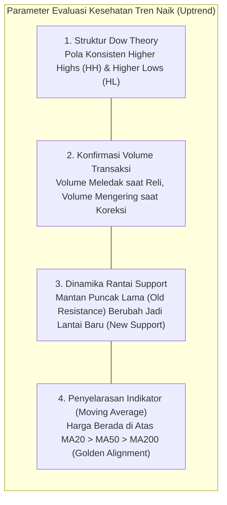
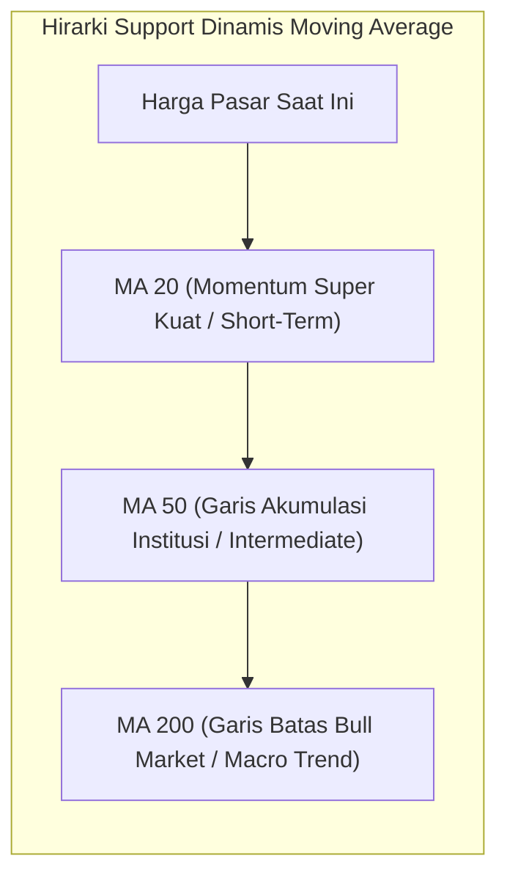
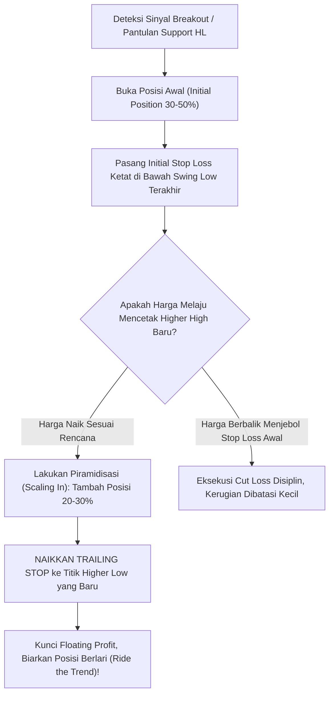

# Bab 15: Uptrending Charts (Grafik Tren Naik)

> *"Dalam tren naik yang sejati, setiap koreksi harga adalah hadiah likuiditas bagi mereka yang sabar dan berdisiplin, bukan ancaman kepunahan modal. Belajarlah menunggangi gelombang, bukan melawannya."* — **Edianto Ong**

---

## 1. Anatomi dan Karakteristik Komprehensif Uptrend yang Sehat

Sebuah saham atau instrumen finansial yang berada dalam siklus tren naik (*uptrend*) yang sehat memiliki struktur geometris dan perilaku psikologis yang sangat teratur. Mengacu pada fondasi klasik Dow Theory, tren naik didefinisikan secara matematis melalui dua kondisi wajib:
1. **Puncak yang Lebih Tinggi (*Higher Highs / HH*)**: Setiap gelombang dorongan (*impulse wave*) sanggup mencetak rekor harga baru melampaui puncak sebelumnya.
2. **Lembah yang Lebih Tinggi (*Higher Lows / HL*)**: Setiap gelombang koreksi (*pullback*) selalu berhenti dan memantul di atas lembah sebelumnya.

### Analogi Membumi: Eskalator Naik yang Nyaman & Tangga Lantai Bertingkat
Bayangkan Anda sedang menaiki eskalator otomatis menuju lantai teratas sebuah pusat perbelanjaan:
- **Eskalator Berjalan Stabil (Tren Naik Sehat)**: Anda melangkah santai mengikuti gerakan eskalator. Sesekali Anda mungkin berhenti sejenak untuk membetulkan tali sepatu (koreksi harga sehat), tetapi lantai pijakan Anda terus membumbung naik secara konstan.
- **Bukan Lift Rusak**: Kenaikan harga yang sehat tidak bergerak vertikal 90° seperti roket kembang api yang rawan kehabisan bahan bakar dan jatuh menukik. Tren yang berkelanjutan naik seperti tangga: **Mendaki 3 anak tangga (Reli) -> Mundur 1 anak tangga untuk menarik napas (Konsolidasi/Pullback) -> Lalu melangkah lagi 3 anak tangga berikutnya.**



```
Struktur Geometris Tren Naik Sehat:
                 HH3 (Rp3.000)
                 /\
           HH2  /  \
          (Rp2.500) \
           /\  /     \
     HH1  /  \/       \
    (Rp2.000)/  HL2    \
     /\  /  (Rp2.200)   \
    /  \/                \
   /   HL1                \
  /  (Rp1.700)
 /
L0 (Titik Awal Rp1.400)
```

### Karakteristik Vital Uptrend Sehat:
1. **Kepatuhan Terhadap Prinsip Pergantian Peran (*Principle of Role Reversal*)**: Puncak lama yang berhasil ditembus (*previous resistance*) secara konsisten bertindak sebagai lantai penyangga baru (*new support*) saat koreksi terjadi.
2. **Resistensi Rapuh, Support Baja**: Pada tren naik sejati, setiap dinding resistensi penjual ditembus dengan mudah dan cepat, sedangkan setiap lantai *support* pembeli dipertahankan dengan sangat gigih.
3. **Durasi Ayunan Asimetris**: Durasi waktu saat harga bergerak naik (*impulse phase*) jauh lebih panjang dan bertenaga dibandingkan durasi waktu saat harga terkoreksi (*corrective phase*).

---

## 2. Hubungan Harmonis Volume: Reli vs Koreksi (Volume-Price Confirmation)

Dalam analisis teknikal klasik, volume perdagangan adalah bahan bakar utama yang menggerakkan mesin harga. Tanpa konfirmasi volume, sebuah reli hanyalah ilusi manipulasi.

```
Pola Hubungan Ideal Harga dan Volume dalam Uptrend:
HARGA  :   /\             /\             /\
          /  \           /  \           /  \
         /    \_________/    \_________/    \_________
VOLUME : |||||          |||||          |||||
         |||||   ..     |||||   ..     |||||   ..
        [RELI] [PULLBACK] [RELI] [PULLBACK] [RELI] [PULLBACK]
```

### A. Volume Saat Reli (*Expanding Volume on Advances*)
- Ketika harga melesat ke atas mencetak *Higher High*, volume transaksi **wajib meningkat tajam (*expanding volume*)**.
- Ini membuktikan kehadiran akumulasi institusional aktif (*smart money accumulation*). Lembaga pengelola dana besar bersedia membayar harga lebih mahal untuk menyerap seluruh pasokan yang ada.

### B. Volume Saat Koreksi / Pullback (*Contracting Volume on Retracements*)
- Ketika harga mengalami penurunan teknikal (*pullback*), volume transaksi **wajib menyusut drastis (*drying up / contracting volume*)**.
- Penyusutan volume membuktikan bahwa koreksi tersebut bukan dipicu oleh aksi jual institusi besar (*distribution*), melainkan sekadar aksi ambil untung kecil (*minor profit taking*) oleh trader harian ritel.

> [!IMPORTANT]
> Waspadalah jika terjadi penurunan harga yang disertai lonjakan volume transaksi sangat besar (*high volume sell-off*). Sekalipun garis tren belum jebol, itu adalah sinyal peringatan dini bahwa institusi sedang mendistribusikan barang keluar secara diam-diam!

---

## 3. Penyelarasan Indikator: Moving Average & Perilaku Osilator

### A. Moving Average (MA) sebagai Lantai Penyangga Dinamis (*Dynamic Support*)
Dalam tren naik yang kuat, garis *Moving Average* bertindak sebagai bantalan pegas yang memantulkan harga setiap kali terjadi koreksi:
- **MA 20 (Tren Jangka Pendek / Momentum Line)**: Menopang saham-saham *super-growth* yang sedang mengalami akselerasi tinggi. Selama harga bertahan di atas MA 20, tren naik berada dalam kekuatan penuh.
- **MA 50 (Tren Jangka Menengah / Institutional Line)**: Garis pertahanan paling krusial bagi manajer investasi dan *swing trader*. Setiap koreksi yang menyentuh MA 50 dan memantul adalah peluang emas untuk melakukan **Buy on Weakness**.
- **MA 200 (Tren Jangka Panjang / Major Bull Line)**: Garis penentu batas antara pasar *bullish* dan *bearish*.
- **Susunan Sempurna (*Golden Alignment*)**: Posisi garis berurutan dari atas ke bawah: **Harga > MA 20 > MA 50 > MA 200** yang kesemuanya mengarah melengkung ke atas menandakan kondisi *Strong Bullish Trend*.



### B. Mitos Overbought pada Indikator Osilator (RSI & Stochastic)
Salah satu kesalahan paling fatal bagi pemula adalah menjual seluruh sahamnya begitu indikator RSI menyentuh level 70 (*Overbought*):
- **Overbought Persistence**: Dalam tren naik yang sangat perkasa (*raging bull*), indikator RSI dapat bertahan di zona *overbought* (>70 bahkan >80) selama berminggu-minggu tanpa harga mengalami penurunan berarti. Kondisi jenuh beli bukanlah sinyal jual otomatis, melainkan bukti keberadaan momentum beli yang luar biasa dahsyat!
- **Pergeseran Zona RSI (*Bull Market Range Shift*)**: Pada tren naik yang sehat, rentang osilasi RSI bergeser ke atas: bergerak antara level **40 hingga 80**. Level 40–50 bertindak sebagai lantai pendukung saat harga terkoreksi, dan harga hampir tidak pernah menyentuh zona jenuh jual (*oversold* < 30).

---

## 4. Seni Menunggangi Tren (*Riding the Trend*) dan Manajemen Posisi

### A. Tiga Fase Siklus Psikologi Pasar dalam Tren Naik:
1. **Fase Incredulity (Ketidakpercayaan)**: Pasar baru bangkit dari dasar, publik sangat skeptis dan menganggap kenaikan harga hanya tipuan sesaat (*dead-cat bounce*). Hanya institusi cerdas yang berani mengakumulasi.
2. **Fase Awareness (Penyadaran)**: Laba bersih perusahaan membaik, analis sekuritas mulai menaikkan target harga, harga menembus MA 200 dengan volume masif. Trader profesional mulai masuk beramai-ramai.
3. **Fase Euphoria & Greed (Keserakahan)**: Publik awam mulai berbondong-bondong membuka rekening saham, media massa memberitakan reli spektakuler setiap hari, dan orang-orang mengabaikan risiko. Inilah saatnya bersiap mengamankan keuntungan!

### B. Protokol Taktis: Cut Losses Short, Let Profits Run
Edianto Ong menekankan bahwa rahasia kekayaan trader bukan terletak pada seberapa sering prediksinya benar, melainkan seberapa besar keuntungan yang diraih saat berada di posisi yang benar:



---

## 5. Kamus Istilah Pemula (Glossary Box)

> [!NOTE]
> - **Higher High (HH)**: Puncak harga tertinggi baru yang berhasil melampaui puncak harga tertinggi sebelumnya pada grafik.
> - **Higher Low (HL)**: Lembah harga terendah baru yang terbentuk di atas level lembah terendah sebelumnya, menandakan pembeli semakin agresif.
> - **Trailing Stop**: Perintah stop loss dinamis yang terus dinaikkan mengikuti kenaikan harga untuk mengunci keuntungan yang sudah diperoleh.
> - **Scaling In (Pyramiding)**: Teknik menambah jumlah lot saham secara bertahap hanya ketika posisi awal sudah menghasilkan keuntungan dan tren terkonfirmasi berlanjut.
> - **Golden Alignment**: Kondisi di mana susunan Moving Average berbaris rapi (MA20 > MA50 > MA200) dan semuanya mengarah ke atas.
> - **Bullish Consolidation**: Periode jeda mendatar (*sideways*) yang sehat dengan volume menyusut sebelum harga melanjutkan reli kenaikan berikutnya.

---

## 6. Studi Kasus Konkret: Mengawal Portofolio Saham PT Berkah Alam (BRKH)

Mari kita bedah rencana eksekusi komprehensif pada saham PT Berkah Alam (BRKH):

```
Profil Pergerakan Saham BRKH:
- Breakout dari Base: Menembus resistensi Rp1.000 dengan volume raksasa.
- Reli Gelombang 1: Melesat ke Rp1.400 (HH1), volume tebal.
- Koreksi Gelombang 1: Turun ke Rp1.200 (HL1), volume mengering drastis 70%.
- Reli Gelombang 2: Melambung menembus Rp1.400 menuju Rp1.800 (HH2).
- Koreksi Gelombang 2: Menguji kembali level Rp1.550 (HL2) tepat di atas MA 20.
```

### Eksekusi Step-by-Step Trader:
1. **Titik Pembelian Awal (Initial Entry)**:
   - Saat koreksi pertama menyentuh Rp1.200 (HL1) dan muncul *Bullish Hammer* dengan volume mengering, trader membeli **30% porsi modal di level Rp1.220**.
   - *Initial Stop Loss* dipasang di Rp1.140 (tepat di bawah HL1). Risiko terukur hanya 6,5%.
2. **Piramidisasi Pertama (*Scaling In*)**:
   - Harga melesat menembus puncak Rp1.400. Trader menambah pembelian sebesar **30% lagi di Rp1.420** (*breakout buying*).
   - *Trailing Stop* untuk seluruh posisi dinaikkan dari Rp1.140 ke **Rp1.220** (posisi modal awal kini sudah bebas risiko / *risk-free*).
3. **Piramidisasi Kedua & Pengawalan Trailing Stop**:
   - Harga mencapai Rp1.800 (HH2), lalu terkoreksi sehat ke Rp1.550 (HL2) tepat memantul di garis MA 20.
   - Trader menambah sisa posisi **20% di level Rp1.580**.
   - *Trailing Stop* seluruh posisi dinaikkan lagi ke **Rp1.500** (di bawah HL2).
4. **Hasil Akhir**: Ketika saham BRKH akhirnya mencapai klimaks di Rp2.400 dan berbalik turun menembus trailing stop di Rp2.100, trader keluar dengan total akumulasi laba portofolio melebihi **+65%**, tanpa pernah menanggung risiko kerugian modal yang membahayakan.

---

## 7. Kesalahan Fatal Pemula dalam Menghadapi Uptrend

1. **Menjual Terlalu Cepat (*Cutting Winners Too Soon*)**: Merasa panik saat melihat sahamnya sudah untung 5% atau 10%, lalu langsung buru-buru menjualnya karena takut untungnya hilang, padahal saham tersebut sedang berada di awal siklus kenaikan ratusan persen.
2. **Menolak Membeli Karena Menganggap "Harganya Sudah Terlalu Mahal"**: Takut membeli saham yang sedang mencetak *All-Time High*, padahal saham terbaik yang berpotensi melipatgandakan modal (*multi-bagger*) selalu diawali dengan mencetak rekor harga tertinggi baru.
3. **Melakukan Counter-Trend Shorting**: Berusaha menebak-nebak puncak (*picking tops*) dengan menjual atau memasang posisi berlawanan arah pada saham yang sedang melaju kencang ke atas.
4. **Membeli di Pucuk Ekstrem Tanpa Menunggu Koreksi**: Mengalami FOMO dan memborong saham saat lilin hijau sudah membentang 4 hari berturut-turut, lalu panik dan menjual rugi saat terjadi koreksi normal menuju *Higher Low*.

---

## 8. Ringkasan Eksekutif Bab 15

- **Tren adalah Sahabat Terbaik Anda (*Trend is Your Friend*)**: Jangan pernah mendebat tren pasar; ikuti arah laju harga dengan patuh.
- **Dua Pilar Dow Theory**: Selama pola *Higher Highs* dan *Higher Lows* masih utuh, struktur tren naik dinyatakan sehat dan aman.
- **Konfirmasi Volume**: Volume wajib meledak saat harga mendaki dan wajib menyusut sepi saat harga beristirahat dalam fase koreksi.
- **Manfaatkan Trailing Stop**: Amankan keuntungan Anda bukan dengan menebak puncak secara serakah, melainkan dengan membiarkan trailing stop di bawah swing low memandu batas akhir perjalanan Anda.
