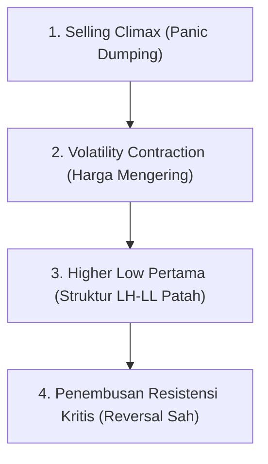

# Bab 16: Downtrending Charts

> *"Pasar saham membutuhkan waktu berbulan-bulan untuk mendaki tangga keuntungan secara perlahan, namun hanya butuh beberapa hari untuk meluncur bebas menuruni lift kehancuran."* — **Edianto Ong**

---

## 1. Karakteristik Komprehensif Saham dalam Tren Turun (*Downtrend*)

Tren turun (*downtrend*) adalah fase pasar yang paling merusak kekayaan (*wealth-destroying*) bagi investor yang tidak berdisiplin. Berdasarkan prinsip klasik Dow Theory, tren turun terdefinisi secara objektif melalui:
- **Puncak yang Lebih Rendah (*Lower Highs / LH*)**: Setiap upaya reli gagal mencapai puncak sebelumnya.
- **Lembah yang Lebih Rendah (*Lower Lows / LL*)**: Setiap tekanan jual baru berhasil menembus dasar harga sebelumnya menuju titik terendah baru.

```
 STRUKTUR GEOMETRIS DOWNTREND:
 P0 (Puncak Awal)
   \
    \    LH1
     \   /\
      \ /  \    LH2
      LL1   \   /\
             \ /  \
             LL2   \ ===> Tekanan Terus Menerus
                    LL3
```

### Ciri-Ciri Utama Downtrend:
1. **Kehancuran Garis Support**: Setiap level *support* historis yang dianggap "kuat" selalu ditembus dengan mudah ke bawah.
2. **Resistensi yang Tak Tertembus**: Mantan *support* yang jebol segera berubah fungsi menjadi benteng resistensi kokoh (*Resistance*) yang menolak setiap reli kenaikan.
3. **Kecepatan Penurunan yang Asimetris**: Penurunan harga sering kali berlangsung jauh lebih cepat, keras, dan penuh kekacauan likuiditas dibandingkan fase kenaikan sebelumnya akibat dominasi psikologi ketakutan (*fear*) dan kepanikan likuidasi margin (*margin calls*).

---

## 2. Jebakan Kognitif: Ilusi "Sudah Murah" dan Runtuhnya Valuasi

Salah satu kesalahan paling mematikan bagi pelaku pasar ritel adalah melakukan pembelian saham yang sedang mengalami *downtrend* parah semata-mata karena ilusi harga yang "tampak murah":

### A. The "Price-Anchor" Bias
Jika saham blue-chip turun dari Rp10.000 ke Rp5.000, otak manusia secara naluriah menganggap saham tersebut sedang "diskon 50%". Kenyataannya:
- Saham yang turun 90% adalah saham yang awalnya turun 80%, lalu harganya anjlok lagi 50% dari titik tersebut.
- Dalam *bear market*, batas bawah harga tidak ditentukan oleh rasio Price-to-Earnings (PER) atau Book Value (PBV), melainkan oleh **ketiadaan daya beli pembeli (*absence of bids*)**.

### B. Rasionalisasi Fundamental yang Keliru
Trader yang terjebak dalam *downtrend* sering kali berubah menjadi "investor jangka panjang dadakan". Mereka mulai mencari-cari berita positif, dividen historis, atau opini analis untuk membenarkan kerugian portofolio yang kian membesar, alih-alih memotong kerugian (*stop loss*).

---

## 3. Anatomi Reli Semu: The Dead-Cat Bounce

> *"Bahkan seekor kucing yang sudah mati pun akan memantul jika dilemparkan dari gedung bertingkat yang cukup tinggi."* — Peribahasa Kuno Wall Street.

```
 MEKANISME DEAD-CAT BOUNCE:
 \
  \ (Aksi Jual Panik)
   \
    \            /\ (Pantulan Semu / Dead-Cat Bounce)
     \          /  \    [Volume Tipis / Short-Covering]
      \________/    \
      (Titik Nadir   \
         Sesaat)      \====> LONGSOR KE TIKIT TERENDAH BARU (LL)
```

### Karakteristik Dead-Cat Bounce:
1. **Pemicu Pantulan**: Reli mendadak ini bukan disebabkan oleh kembalinya investor institusi besar, melainkan oleh aksi *short-covering* (penutupan posisi jual kosong) oleh spekulan atau pembelian sporadis oleh ritel yang terjebak *bargain hunting*.
2. **Karakter Volume**: Kenaikan harga terjadi dengan volume yang relatif tipis atau menunjukkan kelelahan cepat (*volume fading*).
3. **Kerapuhan Struktur**: Kenaikan berhenti secara mendadak tepat di bawah MA 20 atau di level *support* lama yang baru saja tertembus.
4. **Kelanjutan Tragedi**: Begitu reli semu ini kehabisan pembeli, harga berbalik longsor dengan kecepatan berlipat ganda, mencetak titik terendah baru (*new Lower Low*), dan mengunci trader baru yang baru saja masuk di pucuk pantulan.

---

## 4. Bahaya Menangkap Pisau Jatuh (*Catching a Falling Knife*)

Membeli saham di tengah penurunan tajam vertikal ibarat berusaha menangkap pisau yang sedang meluncur jatuh dari langit: tangan Anda hampir pasti terluka parah sebelum sempat menggenggam gagangnya.

### Risiko Fatal Catching a Falling Knife:
- **Ketidakpastian Kedalaman Jurang**: Tidak ada alat teknikal yang dapat memastikan secara pasti di mana titik terendah absolut (*absolute bottom*) suatu keruntuhan harga.
- **Runtuhnya Manajemen Modal**: Melakukan *averaging down* pada tren turun mengikat modal likuid pada aset yang sekarat, menutup peluang masuk ke instrumen lain yang sedang *uptrend*.

---

## 5. Mengidentifikasi Tanda-Tanda Awal Pembentukan Dasar (*Bottoming Process*)

Pasar tidak membalik dari tren turun ke tren naik dalam satu titik tajam. Pembentukan dasar adalah **proses waktu dan akumulasi (*base building process*)**.

Edianto Ong menguraikan tahapan objektif bagaimana mengenali akhir dari siklus *bear market*:



### Tanda-Tanda Konfirmasi Bottoming yang Sah:
1. **Klimaks Penjualan (*Selling Climax*)**: Terjadinya gelombang kepanikan luar biasa besar dengan volume raksasa (*ultra-high volume*), di mana pemegang saham terakhir menyerah (*capitulation*), namun lilin harga ditutup dengan ekor bawah panjang (*hammer* atau *absorption candle*).
2. **Penghentian Tren Turun (*Sideways Range / Base Building*)**: Penurunan berhenti mencetak *Lower Low*. Harga mulai bergerak mendatar membentuk rentang harga sempit (*trading range*) selama berminggu-minggu atau berbulan-bulan.
3. **Penyusutan Volume Ekstrem**: Volume transaksi mengering ke tingkat terendah historis, menandakan pasokan penjual telah habis terkuras (*supply exhaustion*).
4. **Terbentuknya Higher Low Pertama**: Harga mengalami reli kecil, terkoreksi, namun koreksi tersebut **berhasil bertahan di atas titik terendah klimaks sebelumnya**.
5. **Penembusan Dinamis & Statis**: Harga berhasil menembus ke atas *downtrend line* utama, melompat ke atas MA 50/MA 200, dan menembus garis leher (*neckline*) dari pola akumulasi (seperti *Double Bottom* atau *Inverted Head and Shoulders*).

---

## 6. Tabel Komparasi: Uptrending vs Downtrending Charts

| Parameter | Karakter Uptrend Sehat (Bab 15) | Karakter Downtrend Mematikan (Bab 16) |
| :--- | :--- | :--- |
| **Struktur Puncak & Lembah** | *Higher Highs & Higher Lows* | *Lower Highs & Lower Lows* |
| **Karakteristik Volume** | Tinggi saat reli, mengering saat pullback | Tinggi saat longsor, tipis saat reli pantulan |
| **Fungsi Level Kritis** | Support dipertahankan, resistance dijebol | Support dijebol, resistance menolak kenaikan |
| **Moving Average** | MA 20 > MA 50 > MA 200 (Menyebar Naik) | MA 20 < MA 50 < MA 200 (Menyebar Turun) |
| **Psikologi Dominan** | *Greed, Optimism, Patience* | *Fear, Panic, Denial, Bargain Hunting Trap* |
| **Strategi Portofolio** | *Buy on Weakness / Ride the Trend* | **Cash 100% / Cut Loss Cepat / No Averaging Down** |

---

## 7. Kesimpulan

Bertahan di pasar modal bukan tentang seberapa banyak keuntungan yang dapat Anda raih saat pasar *bullish*, melainkan seberapa utuh modal Anda terlindungi saat badai *downtrend* menghantam. Menghormati struktur tren turun dengan berdiam diri di posisi kas adalah bentuk kecerdasan trading tertinggi yang diajarkan oleh Edianto Ong.
