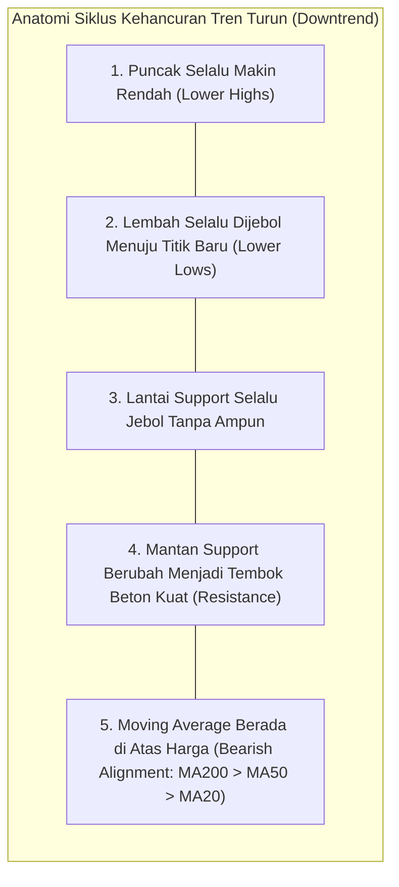
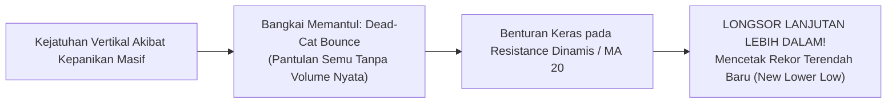
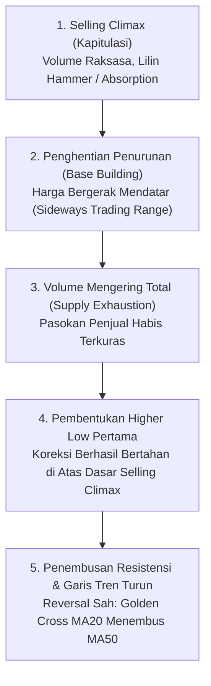

# Bab 16: Downtrending Charts (Grafik Tren Turun)

> *"Pasar saham membutuhkan waktu berbulan-bulan untuk mendaki tangga keuntungan secara perlahan dan hati-hati, namun hanya membutuhkan beberapa hari untuk meluncur bebas menuruni lift kehancuran modal. Lindungi modal Anda sebelum pasar merampasnya."* — **Edianto Ong**

---

## 1. Karakteristik Komprehensif Saham dalam Tren Turun (*Downtrend*)

Tren turun (*downtrend*) adalah fase pasar yang paling merusak kekayaan (*wealth-destroying*) bagi investor ritel yang tidak memiliki disiplin manajemen risiko. Berdasarkan prinsip klasik Dow Theory, tren turun didefinisikan secara matematis melalui dua kondisi terukur:
1. **Puncak yang Lebih Rendah (*Lower Highs / LH*)**: Setiap upaya kenaikan harga (*technical rally*) selalu gagal mencapai puncak tertinggi sebelumnya.
2. **Lembah yang Lebih Rendah (*Lower Lows / LL*)**: Setiap tekanan jual baru berhasil menembus dasar lantai harga sebelumnya menuju titik nadir yang lebih dalam.

### Analogi Membumi: Jurang Longsor & Lift Putus Kabel
Bayangkan sebuah tebing bukit yang tanahnya labil dan mengalami longsor bertahap:
- **Longsor Bertingkat**: Saat batu tebing pertama runtuh ke bawah, debu berterbangan dan batu sempat tertahan sejenak di lereng perantara (koreksi semu). Namun, karena tanah dasar sudah keropos, lereng penahan ikut ambrol membawa bongkahan batu jatuh ke dasar jurang yang jauh lebih dalam.
- **Lift Putus Kabel vs Eskalator Naik**: Naik ke lantai 10 butuh energi dan waktu mendaki anak tangga satu per satu (*uptrend lambat dan teratur*), tetapi jatuh dari lantai 10 ke lantai dasar hanya butuh waktu gravitasi beberapa detik (*downtrend cepat, panik, dan mematikan*).



```
Struktur Geometris Tren Turun (Downtrend):
P0 (Puncak Awal Rp5.000)
  \
   \    LH1 (Rp4.200 - Gagal Tembus Puncak)
    \   /\
     \ /  \    LH2 (Rp3.400 - Pantulan Semu)
     LL1   \   /\
   (Rp3.600)\ /  \    LH3 (Rp2.600)
             LL2  \   /\
           (Rp2.800)\ /  \
                     LL3  \ ===> Tekanan Terus Menggerus Modal
                   (Rp2.000)
```

### Ciri-Ciri Utama Perilaku Pasar Downtrend:
1. **Kehancuran Garis Support**: Setiap level *support* historis yang dianggap "kuat", "fondasi baja", atau "harga psikologis" selalu ditembus ke bawah dengan mudah.
2. **Resistensi yang Tak Tertembus**: Mantan *support* yang baru saja jebol segera berubah fungsi menjadi benteng resistensi kokoh (*Resistance*) yang menolak mentah-mentah setiap upaya harga untuk naik kembali.
3. **Kecepatan Penurunan yang Asimetris**: Penurunan harga berlangsung jauh lebih cepat, ganas, dan berdarah-darah dibandingkan fase kenaikan sebelumnya akibat dominasi psikologi ketakutan massal (*fear*) dan kepanikan likuidasi margin paksa (*forced margin calls*).

---

## 2. Jebakan Kognitif: Ilusi "Sudah Murah" dan Runtuhnya Valuasi

Salah satu kesalahan paling mematikan bagi pelaku pasar ritel adalah melakukan pembelian saham yang sedang mengalami tren turun parah semata-mata karena ilusi harga yang "tampak sangat murah":

### A. The "Price-Anchor" Bias (Jebakan Jangkar Harga)
Jika sebuah saham *blue-chip* turun dari Rp10.000 ke Rp5.000, otak manusia secara naluriah menganggap saham tersebut sedang "diskon 50%". Kenyataannya:
- **Hukum Matematika Pasar**: Saham yang turun 90% adalah saham yang awalnya sudah turun 80%, lalu dari titik tersebut **harganya anjlok lagi 50%!**
- Di pasar *bearish*, batas bawah harga tidak ditentukan oleh rasio Price-to-Earnings (PER), Price-to-Book Value (PBV), atau perkiraan target analis, melainkan semata-mata oleh **ketiadaan daya beli pembeli (*complete absence of bids*)**.

### B. Rasionalisasi Fundamental yang Keliru
Trader yang tidak disiplin dan modalnya tersangkut dalam *downtrend* sering kali mengalami metamorfosis psikologis yang berbahaya: mereka mendadak berubah menjadi **"investor jangka panjang dadakan"**. 

Mereka mulai rajin membaca berita lama, menghitung hasil dividen historis, atau mencari pembenaran di forum media sosial untuk menghibur diri, alih-alih mengeksekusi *Cut Loss* demi menyelamatkan sisa modal.

---

## 3. Anatomi Reli Semu: The Dead-Cat Bounce

> *"Bahkan seekor bangkai kucing yang sudah mati pun akan memantul jika dijatuhkan dari gedung bertingkat yang cukup tinggi. Jangan pernah tertipu oleh pantulan mayat!"* — Pepatah Legendaris Wall Street.



```
Mekanisme Terjadinya Dead-Cat Bounce:
\
 \ (Aksi Jual Panik / Margin Call)
  \
   \            /\ (Pantulan Semu: Dead-Cat Bounce)
    \          /  \    [Volume Tipis / Short-Covering Saja]
     \________/    \
     (Dasar Sesaat) \
                     \====> LONGSOR KE TITIK TERENDAH BARU (LL)
                            (Menelan Korban Baru yang Beli di Pucuk Pantulan)
```

### Karakteristik Vital Dead-Cat Bounce:
1. **Pemicu Pantulan**: Reli mendadak ini bukan disebabkan oleh kembalinya investor institusi besar, melainkan sekadar oleh aksi *short-covering* (penutupan posisi untung oleh trader spekulan) atau pembelian sporadis oleh ritel yang terjebak ilusi diskon (*bargain hunting*).
2. **Karakter Volume Tipis (*Fading Volume*)**: Kenaikan harga terjadi dengan volume yang sangat kurus dan cepat kehabisan tenaga.
3. **Kerapuhan Struktur**: Kenaikan harga berhenti secara mendadak tepat di bawah MA 20 atau di level *support* lama yang baru saja jebol.
4. **Kelanjutan Tragedi**: Begitu reli semu ini kehabisan pembeli, harga berbalik ambruk dengan kecepatan ganda, menjebol lantai harga sebelumnya, dan mengunci trader baru yang baru saja masuk di pucuk pantulan.

---

## 4. Bahaya Menangkap Pisau Jatuh (*Catching a Falling Knife*)

Membeli saham di tengah penurunan tajam vertikal ibarat berusaha menangkap pisau dapur yang sedang meluncur jatuh dari langit: tangan Anda hampir pasti terluka parah berlumuran darah sebelum sempat menggenggam gagangnya.

### Bahaya Fatal Tindakan Melakukan Averaging Down di Saham Downtrend:
1. **Mengikat Modal Likuid pada Aset yang Sekarat**: Setiap rupiah yang Anda setorkan untuk membeli saham *downtrend* adalah modal mati yang kehilangan kesempatan (*opportunity cost*) untuk menghasilkan keuntungan pada saham-saham lain yang sedang berada dalam siklus *uptrend*.
2. **Risiko Likuidasi & Suspensi Bursa**: Saham yang mengalami tren turun berkepanjangan sering kali berujung pada restrukturisasi utang, gagal bayar (*default*), penurunan ke papan pemantauan khusus (notasi khusus), hingga penghentian sementara perdagangan (*suspension*) oleh bursa efek.

---

## 5. Mengidentifikasi Tanda-Tanda Awal Pembentukan Dasar (*The Bottoming Process*)

Pasar saham tidak berbalik arah dari tren turun ke tren naik dalam satu titik tajam segitiga. Pembentukan dasar adalah **proses waktu, pengujian ketahanan, dan akumulasi likuiditas (*base building process*)**.

Edianto Ong menguraikan tahapan objektif bagaimana mengenali akhir dari siklus *bear market*:



### Checklist Verifikasi Bottoming yang Sah:
1. **Klimaks Penjualan (*Selling Climax / Capitulation*)**: Terjadinya aksi jual panik massal dengan volume raksasa (*ultra-high volume*). Lilin harga ditutup dengan ekor bawah sangat panjang (*hammer candle* atau *absorption bar*), membuktikan adanya institusi raksasa yang menyerap seluruh kepanikan pasar.
2. **Penghentian Penurunan (*Trading Range*)**: Harga berhenti mencetak *Lower Low*. Fluktuasi harga mulai bergerak mendatar (*sideways*) membentuk koridor sempit selama berminggu-minggu atau berbulan-bulan.
3. **Pengeringan Pasokan (*Supply Exhaustion*)**: Volume transaksi menyusut drastis ke level terendah historis. Ini bukti bahwa tidak ada lagi orang yang mau menjual di harga tersebut.
4. **Terbentuknya Higher Low Pertama**: Harga mencoba naik kecil, lalu terkoreksi kembali, namun koreksi tersebut **berhasil bertahan di atas titik terendah klimaks sebelumnya**.
5. **Penembusan Garis Tren Utama (*Breakout of Downtrend Line*)**: Harga melesat menembus ke atas garis resistensi tren turun utama dengan lonjakan volume, diikuti oleh perpotongan *Golden Cross* indikator moving average (MA 20 memotong ke atas MA 50).

---

## 6. Kamus Istilah Pemula (Glossary Box)

> [!NOTE]
> - **Lower High (LH)**: Puncak harga ayunan baru yang gagal mencapai ketinggian puncak sebelumnya pada tren turun.
> - **Lower Low (LL)**: Lembah harga ayunan baru yang berhasil menembus dasar lembah sebelumnya menuju rekor harga terendah baru.
> - **Dead-Cat Bounce**: Pantulan harga semu jangka pendek dengan volume tipis di tengah tren turun hebat sebelum harga longsor lebih dalam.
> - **Catching a Falling Knife**: Kebiasaan nekat membeli saham yang sedang terjun bebas demi mengejar harga murah tanpa adanya sinyal pembalikan arah terkonfirmasi.
> - **Averaging Down**: Tindakan terus menambah porsi pembelian pada saham yang posisinya sedang merugi dengan harapan menurunkan harga rata-rata beli.
> - **Selling Climax (Kapitulasi)**: Gelombang kepanikan jual terakhir di mana investor ritel menyerah total dan membuang sahamnya di harga berapa pun, yang diserap oleh smart money.
> - **Base Building**: Proses konsolidasi mendatar jangka panjang di mana harga saham membentuk fondasi akumulasi sebelum memulai tren naik baru.

---

## 7. Studi Kasus Konkret: Tragedi Saham PT Logam Samudera (LMSM)

Mari kita telaah kisah nyata yang menjadi pelajaran abadi di pasar modal pada saham PT Logam Samudera (LMSM):

```
Kronologi Kejatuhan Saham LMSM:
- Puncak All-Time High: Rp8.000
- Gelombang 1: Ambruk ke Rp5.000, lalu memantul semu ke Rp5.800 (LH1).
- Gelombang 2: Jebol ke Rp3.800 (LL1), memantul semu ke Rp4.400 (LH2).
- Gelombang 3: Jebol ke Rp2.500 (LL2), memantul semu ke Rp3.000 (LH3).
- Titik Nadir Akhir: Terpuruk ke level Rp500!
```

### Nasib Tragis Trader Pemula (Investor Emosional):
1. **Di Rp5.000**: Membeli 100 lot karena menganggap saham sudah diskon 37% dari Rp8.000.
2. **Di Rp3.800**: Bukannya *cut loss*, ia panik dan melakukan *Averaging Down* dengan membeli lagi 200 lot karena merasa *"ini perusahaan bagus, harga PBV sudah di bawah 1x"*.
3. **Di Rp2.500**: Modal darurat dicairkan, membeli lagi 300 lot untuk menurunkan harga rata-rata menjadi Rp3.300.
4. **Hasil Akhir**: Ketika harga LMSM terus meluncur ke level Rp500 dan sahamnya disuspensi bursa, seluruh tabungan hidup sang pemula musnah menguap hingga 85%.

### Panduan Disiplin Trader Profesional (Edianto Ong Way):
1. **Di Rp7.200**: Saat garis tren naik patah dan muncul *Lower High* pertama di Rp7.400, trader langsung mengeksekusi **Cut Loss / Stop Loss** total. Modal terselamatkan utuh 95%.
2. **Selama Penurunan (Rp7.000 -> Rp2.000)**: Trader berdiri di pinggir lapangan (*Cash is King*), menolak menyentuh saham LMSM betapa pun murahnya rumor yang beredar.
3. **Fase Akumulasi Baru (Rp600 - Rp800)**: Setelah saham membentuk pola *Double Bottom* selama 4 bulan di rentang Rp600–Rp700, volume transaksi mengering, lalu harga menembus garis leher (*neckline*) di Rp820 dengan volume masif, barulah trader masuk kembali dengan risiko yang sangat terukur.

---

## 8. Kesalahan Fatal Pemula dalam Menghadapi Downtrend

1. **Melakukan Averaging Down pada Saham Tren Turun**: Ini adalah dosa nomor satu yang paling banyak membunuh akun trading pemula. Jangan pernah menyiram modal segar ke dalam ember yang bocor!
2. **Berpikir Bahwa "Harga Saham Tidak Mungkin Turun Lebih Jauh Lagi"**: Pasar selalu bisa membuktikan bahwa saham yang murah bisa menjadi jauh lebih murah hingga mendekati nol.
3. **Terjebak Dead-Cat Bounce**: Membeli secara agresif saat saham yang sedang turun tiba-tiba naik 3–5% dalam satu hari tanpa konfirmasi struktur volume dan pola dasar yang sah.
4. **Merasa Rugi Hanya "Loss di Kertas" (*Paper Loss*)**: Menolak mengakui kenyataan bahwa kerugian portofolio yang mengapung adalah kerugian nyata yang telah memusnahkan daya beli dan likuiditas Anda.

---

## 9. Ringkasan Eksekutif Bab 16

| Parameter Analisis | Karakteristik Tren Turun (*Downtrend*) |
| :--- | :--- |
| **Struktur Pola Puncak & Lembah** | Wajib mencetak *Lower Highs (LH)* dan *Lower Lows (LL)* secara beruntun. |
| **Status Level Support** | Seluruh support rapuh dan mudah dijebol; mantan support berubah menjadi tembok resistensi. |
| **Strategi Portofolio Terbaik** | **Cash is King**. Berdiri di luar pasar atau amankan posisi defensif 100%. |
| **Larangan Keras Trading** | Dilarang keras melakukan *Catching a Falling Knife* dan dilarang *Averaging Down*. |
| **Syarat Boleh Masuk Kembali** | Wajib menunggu proses *Bottoming* selesai: ada *Selling Climax*, *Higher Low* pertama terbentuk, dan garis resistensi downtrend tertembus sah dengan volume besar. |
