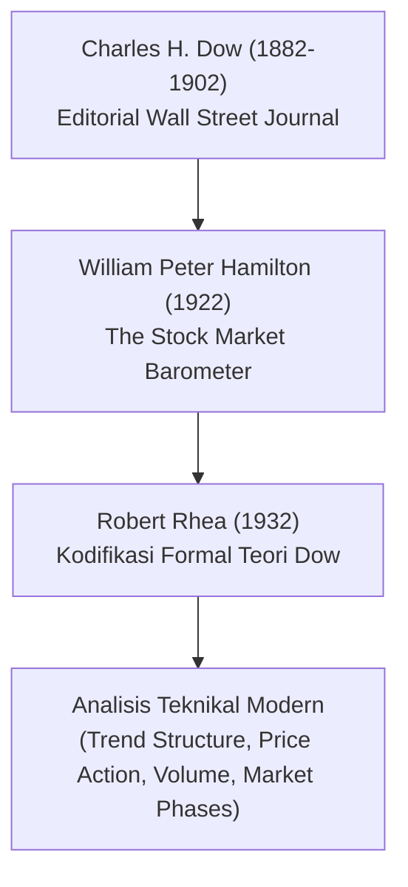
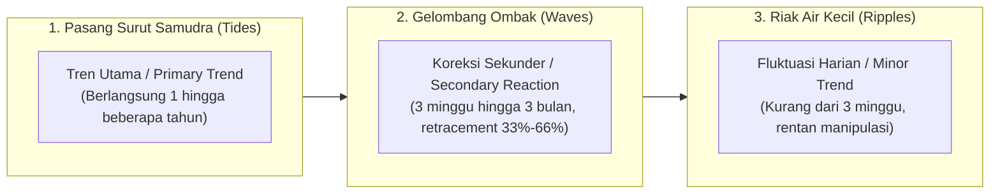
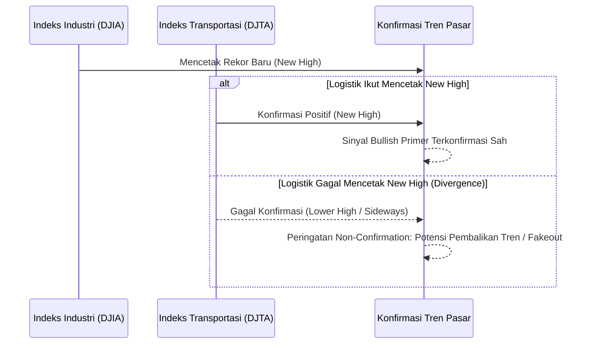
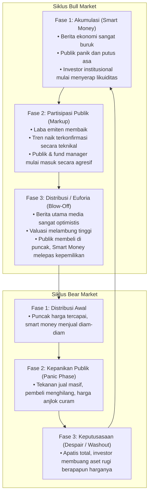
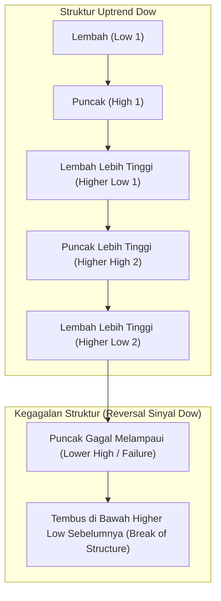

# Bab 17: Konfrontasi Dow Theory

> "Teori Dow bukanlah sistem mekanis untuk meramal harga puncak atau lembah secara presisi, melainkan kompas navigasi makro yang memetakan pasang surut gelombang ekonomi dan psikologi pasar secara objektif."  
> — **Edianto Ong**, *Technical Analysis for Mega Profit*

---

## 1. Hakikat dan Sejarah Teori Dow

Teori Dow (*Dow Theory*) adalah batu penjuru (*cornerstone*) dari seluruh bangunan analisis teknikal modern. Dirumuskan oleh **Charles H. Dow** (1851–1902)—pendiri *The Wall Street Journal* dan pencetus indeks *Dow Jones Industrial Average (DJIA)*—teori ini awalnya tidak ditulis sebagai satu buku teks terpadu, melainkan dipublikasikan dalam rangkaian editorial harian. Setelah wafatnya Dow, para pemikir pasar terkemuka seperti **William Peter Hamilton** (*The Stock Market Barometer*, 1922), **Robert Rhea** (*The Dow Theory*, 1932), dan **E. George Schaefer** merekonstruksi dan menyusun prinsip-prinsip tersebut menjadi doktrin analisis pergerakan pasar saham yang utuh.

Edianto Ong menekankan bahwa memahami analisis teknikal kontemporer tanpa menguasai Teori Dow ibarat mempelajari kalkulus tanpa mengerti aritmatika dasar. Seluruh konsep modern—mulai dari struktur tren *Higher High/Higher Low*, *support & resistance*, analisis volume, hingga divergensi indikator—berakar langsung dari hukum-hukum alamiah yang diuraikan oleh Charles Dow.

---

## 2. Bedah Kritis Prinsip Utama Teori Dow

Edianto Ong menggarisbawahi prinsip-prinsip fundamental Dow yang harus dikonfrontasi dan diintegrasikan oleh setiap trader profesional:

### A. Rata-Rata Mendiskon Segalanya (*The Averages Discount Everything*)
Harga indeks atau saham merupakan resultante matematis dari seluruh harapan, ketakutan, pengetahuan fundamental, neraca perdagangan, suku bunga bank sentral, hingga peristiwa force majeure yang diketahui maupun yang diantisipasi oleh seluruh pelaku pasar dunia. Pasar adalah mekanisme diskonto masa depan (*forward-looking discounting machine*).

### B. Tiga Kategori Pergerakan Pasar (*The Three Market Movements*)
Charles Dow menganalogikan pergerakan pasar saham dengan dinamika pergerakan air laut:

1. **Tren Primer (*Primary Trend*):** Pasang atau surutnya air laut. Mewakili gelombang ekonomi makro, berlangsung dari satu tahun hingga bertahun-tahun (kondisi *Bull Market* atau *Bear Market* sejati). Arah tren primer inilah yang menentukan nasib sebagian besar modal investor.
2. **Reaksi Sekunder (*Secondary Reaction*):** Gelombang ombak yang melawan arah pasang surut. Merupakan koreksi tajam di tengah tren primer, biasanya memakan waktu 3 minggu hingga 3 bulan, dan mengoreksi sepertiga hingga dua pertiga (33% – 66%, sering kali 50%) dari pergerakan tren primer sebelumnya.
3. **Fluktuasi Minor (*Minor Trend*):** Riak-riak kecil di permukaan air. Berlangsung hitungan hari hingga kurang dari 3 minggu. Dow memperingatkan bahwa tren minor sangat dipengaruhi oleh kebisingan harian (*noise*), spekulasi jangka pendek, dan dapat dimanipulasi oleh operator pasar, sehingga berbahaya jika dijadikan dasar analisis jangka panjang.

### C. Prinsip Konfirmasi Antar Indeks (*The Averages Must Confirm Each Other*)
Salah satu postulat paling krusial dari Teori Dow adalah bahwa **tidak ada sinyal tren baru yang valid jika hanya terjadi pada satu indeks secara terisolasi**. 

Pada era Dow, perekonomian Amerika Serikat ditopang oleh manufaktur dan distribusi barang. Dow menciptakan dua indeks:
* **Dow Jones Industrial Average (DJIA):** Mencerminkan kapasitas produksi barang industri.
* **Dow Jones Railroad Average (sekarang Transportation Average / DJTA):** Mencerminkan pengiriman barang hasil produksi ke konsumen.

Logika ekonominya tak terbantahkan: Jika pabrik memproduksi barang dalam jumlah rekor (DJIA mencetak *new high*), namun perusahaan kereta api/kargo tidak mengalami peningkatan volume pengiriman barang (DJTA tidak mencetak *new high*), maka ada penumpukan inventori di gudang yang menandakan pelemahan ekonomi riil. Pasar berada dalam bahaya koreksi besar.

---

## 3. Tiga Fase Pasar Menurut Dow (*The Three Phases of Market Trends*)

Edianto Ong membedah anatomi psikologis pergerakan tren primer ke dalam tiga fase sekuensial yang selalu berulang:

### 1. Fase Akumulasi (*Accumulation Phase*)
* **Kondisi Makro & Psikologis:** Terjadi di akhir tren penurunan (*bear market* yang melelahkan). Berita ekonomi makro berada pada titik terburuk, laporan keuangan perusahaan merugi, dan mayoritas publik mengalami keputusasaan (*despair*) serta trauma terhadap pasar saham.
* **Perilaku Partisipan:** Para pemodal cerdas (*Smart Money*, *insiders*, investor nilai berpengalaman) menyadari bahwa harga aset telah jatuh jauh di bawah nilai intrinsiknya. Mereka mulai membeli secara perlahan dan hati-hati tanpa memicu lonjakan harga, menyerap barang-barang yang dilepas oleh investor ritel yang panik.
* **Karakteristik Grafik:** Volatilitas menurun drastis, pergerakan harga cenderung mendatar (*sideways* berpanjangan), volume transaksi tipis namun mulai stabil.

### 2. Fase Partisipasi Publik (*Public Participation / Absorption Phase*)
* **Kondisi Makro & Psikologis:** Pertumbuhan ekonomi mulai pulih, pendapatan emiten berbalik positif, dan analis sekuritas mulai menaikkan target harga.
* **Perilaku Partisipan:** Para *trend follower*, manajer investasi reksa dana, dan masyarakat umum mulai menyadari tren naik yang sedang berlangsung. Minat beli meluas ke berbagai sektor, menciptakan efek *snowball* likuiditas.
* **Karakteristik Grafik:** Tren naik terstruktur dengan formasi *Higher Highs* dan *Higher Lows* yang rapi. Volume transaksi meningkat seiring kenaikan harga. Ini adalah fase terpanjang dan paling menguntungkan bagi trader teknikal.

### 3. Fase Distribusi / Euforia (*Distribution Phase*)
* **Kondisi Makro & Psikologis:** Optimisme pasar mencapai tingkat delirium. Berita di televisi dan halaman depan media massa memberitakan rekor kenaikan pasar saham. Orang awam yang sebelumnya tidak pernah trading mulai berbondong-bondong membuka rekening efek karena tergiur keuntungan instan.
* **Perilaku Partisipan:** *Smart Money* yang telah melakukan akumulasi di fase pertama mulai melepas portofolio mereka (*unloading position*) secara bertahap kepada publik yang sedang haus membeli pada harga puncak.
* **Karakteristik Grafik:** Volatilitas liar dengan lilin harian yang panjang (*wide-range candles*), sering muncul gap atas (*runaway/exhaustion gaps*), volume perdagangan meledak luar biasa tetapi kenaikan harga mulai tersendat (*churning*). Pola pembalikan seperti *Double Top* atau *Head and Shoulders* mulai terbentuk.

---

## 4. Definisi Tren dan Validitas Sinyal Pembalikan

Menurut Teori Dow, tren diasumsikan tetap aktif dan berlaku sampai ada bukti definitif bahwa tren tersebut telah berbalik arah (*A trend is assumed to remain in effect until definitive signals indicate that it has reversed*).

### Sinyal Pembalikan Tren Naik (*Uptrend Reversal*)
Sebuah tren naik dikatakan patah bukan sekadar karena harga terkoreksi, melainkan jika terpenuhi dua syarat struktural:
1. Harga membentuk puncak yang lebih rendah (*Lower High*) dari puncak sebelumnya.
2. Harga kemudian jatuh menembus di bawah lembah koreksi sebelumnya (*Break of Prior Low*).

---

## 5. Aplikasi Modern di Bursa Saham (IHSG vs Indeks Sektoral / Blue Chips)

Meskipun Charles Dow merumuskannya lebih dari seabad yang lalu dengan membandingkan industri rel kereta api dan manufaktur AS, filosofi **Konfirmasi Antar Sektor** mutlak relevan di bursa modern, khususnya Bursa Efek Indonesia (BEI):

### 1. Konfirmasi IHSG vs Indeks Likuid (IDX30 / LQ45)
* **Kasus Konfirmasi Sehat:** IHSG mencetak rekor tertinggi baru (*New All-Time High*) didorong dan dikonfirmasi oleh IDX30 dan LQ45 yang juga mencetak *New High*. Ini menandakan arus modal asing (*foreign inflow*) dan manajer investasi institusional benar-benar masuk ke penggerak utama pasar (saham-saham kapitalisasi besar / *Big Caps* perbankan, telekomunikasi, dan konsumen).
* **Kasus Non-Confirmation (Divergensi Berbahaya):** IHSG mencetak *New High*, tetapi indeks LQ45 atau IDX30 justru bergerak menyamping atau menurun (*Lower High*). Kenaikan IHSG semata-mata dipicu oleh manipulasi atau kenaikan saham berkapitalisasi masif tertentu dengan *free float* kecil (konglomerasi/spekulatif), sementara saham perbankan dan pilar ekonomi riil sedang didistribusikan. Ini adalah alarm bahaya klasik Teori Dow bahwa penurunan masif akan segera menyusul.

### 2. Konfirmasi Indeks Sektoral Terhadap Tren Makro
Di bursa komoditas dan saham Indonesia, pergerakan indeks sektor energi (*IDXENERGY*) atau barang baku (*IDXBASIC*) harus sejalan dengan pergerakan harga komoditas fisik acuan (Batubara Newcastle, Nikel LME, Minyak Mentah Brent). Kenaikan harga saham tambang tanpa konfirmasi harga komoditas fisik merupakan anomali spekulatif yang berumur pendek.

---

## 6. Ringkasan & Kaidah Emas Edianto Ong

1. **Hormati Arah Tren Primer:** Jangan pernah melawan arus pasang surut utama samudra. Beli saat *Bull Market* primer dan amankan kas saat *Bear Market* primer.
2. **Tunggu Konfirmasi Penuh:** Jangan berasumsi pembalikan tren telah selesai sebelum struktur *Higher High/Higher Low* (untuk pembalikan naik) atau *Lower High/Lower Low* (untuk pembalikan turun) terbentuk secara definitif.
3. **Waspadai Divergensi Antar Sektor:** Ketika indeks utama melaju sendirian tanpa didukung oleh armada penggerak intinya, kurangi eksposur risiko dan bersiaplah menghadapi pembalikan pasar.
