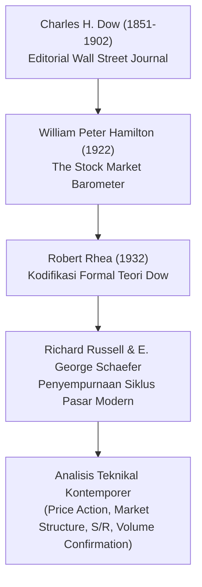
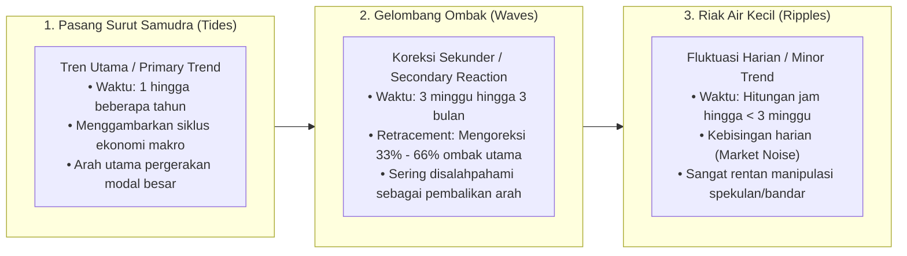
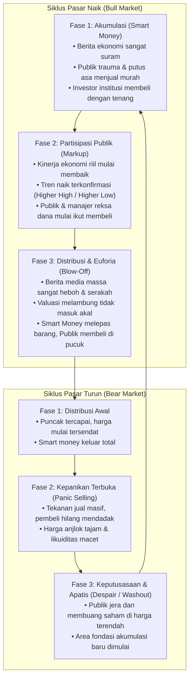
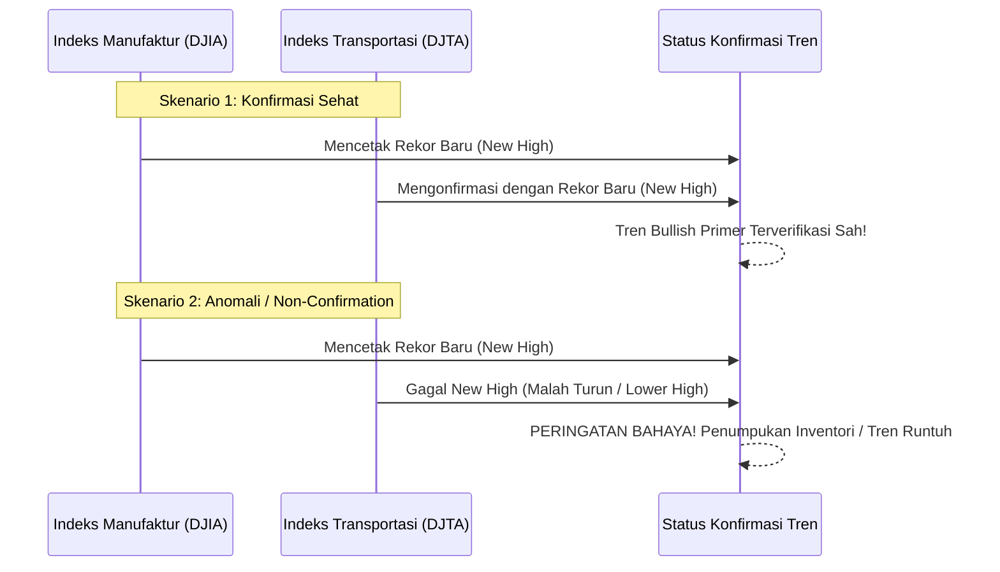
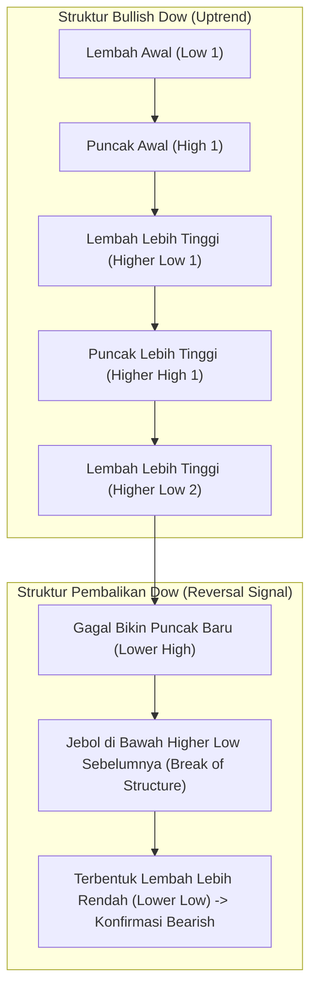

# Bab 17: Konfrontasi Dow Theory — Kompas Samudra & Struktur Fondasi Pasar

> "Teori Dow bukanlah sistem mekanis untuk meramal harga pucuk atau lembah secara presisi besok pagi. Teori Dow adalah kompas navigasi samudra makro yang memetakan pasang surut gelombang ekonomi dan psikologi massa secara objektif. Mengabaikan Teori Dow ibarat berlayar di tengah badai samudra tanpa kompas dan kemudi."  
> — **Edianto Ong**, *Technical Analysis for Mega Profit*

---

## 1. Hakikat dan Sejarah Teori Dow

Teori Dow (*Dow Theory*) adalah batu penjuru (*cornerstone*) sekaligus DNA dari seluruh bangunan analisis teknikal modern. Konsep ini pertama kali dirumuskan oleh **Charles H. Dow** (1851–1902)—seorang jurnalis keuangan brilian, pendiri harian *The Wall Street Journal*, sekaligus arsitek pencetus indeks legendaris *Dow Jones Industrial Average (DJIA)*.

Menariknya, Charles Dow sendiri tidak pernah menulis buku teks khusus mengenai teori ini. Prinsip-prinsip ini berawal dari rangkaian tulisan editorial harian yang ia tulis untuk mengamati perilaku ekonomi Amerika Serikat pada era revolusi industri. Setelah wafatnya Dow pada tahun 1902, para pemikir pasar terkemuka menyusun dan merapikan catatan-catatan tersebut menjadi doktrin analisis pasar yang sistematis:
- **William Peter Hamilton** melalui mahakaryanya *The Stock Market Barometer* (1922).
- **Robert Rhea** yang mengkodifikasikan aturan formalnya dalam buku klasik *The Dow Theory* (1932).
- **E. George Schaefer** dan **Richard Russell** yang memperluas penerapannya pada era modern pasca-Perang Dunia.

Edianto Ong menekankan bahwa mempelajari indikator teknikal canggih (seperti MACD, Stochastic, Bollinger Bands) tanpa memahami Teori Dow ibarat belajar mengendarai mobil balap Formula 1 tanpa memahami cara kerja setir dan rem. Seluruh konsep modern—mulai dari struktur tren *Higher High/Higher Low*, *Support & Resistance*, hukum volume, hingga siklus *Bandar/Smart Money*—semuanya bertumpu pada fondasi yang diletakkan oleh Charles Dow.

---

## 2. Analogi Dunia Nyata: Pasang Surut Air Laut vs Ombak vs Riak Air

Untuk menjelaskan pergerakan pasar saham yang terlihat acak dan membingungkan bagi pemula, Charles Dow merumuskan analogi alamiah yang paling terkenal dalam sejarah keuangan: **Dinamika Pergerakan Air Samudra**.

Bayangkan Anda berdiri di tepi pantai berpasir pada sore hari. Bagaimana cara Anda mengetahui apakah air laut sedang bergerak **pasang naik (air pasang)** atau sedang **surut menuju tengah laut (air surut)**?

Jika Anda hanya menatap buih riak air (*ripples*) selama 5 menit, Anda akan bingung: satu buih air maju 10 sentimeter, buih berikutnya mundur 15 sentimeter. Namun, jika Anda menancapkan sebatang tongkat di pasir basah dan memperhatikan batas terjauh sapuan ombak besar (*waves*), Anda akan segera menyadari:
- Bila setiap gelombang ombak menyapu pasir **lebih tinggi dan lebih jauh** dari sapuan ombak sebelumnya, maka **air laut sedang pasang (Bull Market / Primary Uptrend)**.
- Bila setiap gelombang ombak surut menyapu titik yang **semakin rendah dan semakin mundur**, maka **air laut sedang surut (Bear Market / Primary Downtrend)**.

### Tiga Kategori Pergerakan Pasar menurut Dow:
1. **Pasang Surut Samudra (Primary Trend / Tren Utama):** Berlangsung dari 1 tahun hingga bertahun-tahun. Merefleksikan kondisi fundamental ekonomi makro, ekspansi bisnis emiten, dan suku bunga bank sentral. Sebagai trader pemula, **arah pasang surut inilah yang menentukan 80% keuntungan atau kerugian portofolio Anda**. Jangan pernah mencoba berenang melawan arah pasang surut samudra!
2. **Gelombang Ombak Pantai (Secondary Reaction / Koreksi Sekunder):** Berlangsung antara 3 minggu hingga 3 bulan. Merupakan gelombang koreksi tajam yang bergerak melawan arah tren primer (misalnya: penurunan harga sementara di tengah pasar *bullish*). Koreksi ini biasanya menghapus sepertiga hingga dua pertiga (33% hingga 66%, umumnya 50%) dari keuntungan reli sebelumnya. Pemula sering kali panik dan menjual rugi di titik ini karena mengira pasar sudah kiamat.
3. **Riak Air dan Buih Busa (Minor Trend / Fluktuasi Harian):** Berlangsung hitungan jam hingga kurang dari 3 minggu. Merupakan *noise* (kebisingan pasar) murni akibat berita harian, rumor grup obrolan saham, atau aksi manipulasi transaksi jangka pendek. Dow menegaskan bahwa tren minor **tidak memiliki signifikansi ekonomi** dan menjadi perangkap utama bagi pemula yang gemar memelototi grafik setiap menit.

---

## 3. Enam Prinsip Utama Teori Dow yang Wajib Dikuasai

Edianto Ong membedah enam pilar doktrin Charles Dow yang menjadi hukum alam pergerakan bursa:

### 1. Rata-Rata Mendiskon Segalanya (*The Averages Discount Everything*)
Harga indeks pasar atau saham mencerminkan penjumlahan total (*resultante*) dari seluruh harapan, ketakutan, analisis fundamental, rilis data inflasi, bencana alam, hingga perang dagang yang sudah maupun yang berpotensi terjadi. Pasar adalah mesin diskonto masa depan (*forward-looking mechanism*). Jangan mendebat harga pasar dengan berkata *"Seharusnya saham ini naik karena labanya bagus!"*—karena harga yang tertera di papan bursa telah menyerap seluruh informasi tersebut.

### 2. Tiga Kategori Tren Pasar (*Three Trends of the Market*)
Pasar bergerak dalam tiga dimensi waktu: Tren Primer (*Tide*), Tren Sekunder (*Wave*), dan Tren Minor (*Ripple*), sebagaimana telah diilustrasikan dalam analogi pantai di atas.

### 3. Tiga Fase dalam Siklus Tren Primer (*The Three Phases of Primary Trends*)
Setiap siklus tren besar selalu melalui tiga fase psikologis massa yang berulang:

- **Fase Akumulasi (*Accumulation*):** Terjadi di akhir tren turun panjang. Berita ekonomi berada di titik terburuk, perusahaan merugi, dan publik depresi. Di sini, para pemodal cerdas (*Smart Money*, institusi, *insider*) mulai menyerap saham-saham diskon secara diam-diam tanpa menaikkan harga secara mencolok.
- **Fase Partisipasi Publik (*Public Participation / Big Move*):** Ekonomi mulai pulih, laba korporasi meningkat, dan tren naik teknikal terkonfirmasi. Publik luas, analis sekuritas, dan pengelola dana mulai memborong saham. Ini adalah fase terpanjang dan paling menguntungkan bagi *trend followers*.
- **Fase Distribusi / Euforia (*Distribution*):** Berita utama surat kabar dan media sosial membicarakan cuan instan saham. Ibu rumah tangga dan orang awam berbondong-bondong membuka rekening sekuritas. Di puncak euforia inilah *Smart Money* menjual (*dumping*) ratusan juta lembar saham mereka kepada publik yang haus membeli di harga tertinggi (*buying at the top*).

### 4. Indeks Rata-Rata Harus Saling Mengonfirmasi (*The Averages Must Confirm Each Other*)
Pada era Charles Dow, perekonomian ditopang oleh dua sektor vital:
- **DJIA (Dow Jones Industrial Average):** Mencerminkan kapasitas manufaktur/pabrik penghasil barang.
- **DJTA (Dow Jones Transportation Average):** Mencerminkan armada kereta api/kapal kargo yang mengirimkan barang ke konsumen.

Logikanya sangat sederhana dan logis: Jika pabrik memproduksi barang dalam jumlah rekor (DJIA naik), namun perusahaan kargo tidak mengalami peningkatan volume pengiriman (DJTA turun), berarti barang menumpuk di gudang karena konsumen tidak membelinya. Penurunan ekonomi akan segera menyusul! Tidak ada tren naik yang sah jika kedua indeks ini saling bertolak belakang (*divergence*).

### 5. Volume Transaksi Mengonfirmasi Tren (*Volume Must Confirm the Trend*)
Volume adalah bahan bakar mesin penggerak harga:
- Dalam tren naik yang sehat (*Healthy Uptrend*): Volume harus **meningkat saat harga bergerak naik**, dan volume harus **menciut/mengering saat harga mengalami koreksi turun**.
- Dalam tren turun yang berbahaya (*Severe Downtrend*): Volume harus **meningkat saat harga anjlok**, dan volume mengecil saat harga memantul semu (*dead cat bounce*).

### 6. Tren Diasumsikan Tetap Berlaku Sampai Muncul Sinyal Pembalikan yang Pasti (*A Trend Remains Intact Until Definitive Reversal*)
Hukum inersia fisika Newton berlaku di pasar modal: benda yang bergerak cenderung tetap bergerak searah kecuali ada gaya penahan luar yang lebih besar. Jangan pernah berasumsi tren telah berbalik arah hanya karena harga turun selama dua hari. Tren naik tetap sah sampai terbentuk pola struktural pembalikan arah (*Lower High* dan *Lower Low*).

---

## 4. Definisi Struktur Tren: Higher High vs Lower Low

Bagaimana cara seorang pemula menentukan struktur tren tanpa menebak-nebak? Dow menetapkan aturan geometris yang objektif:

### Syarat Tren Naik (*Uptrend*):
- **Higher High (HH):** Setiap kali harga melesat naik, puncak baru harus lebih tinggi daripada puncak sebelumnya.
- **Higher Low (HL):** Setiap kali harga terkoreksi turun, lembah penurunan harus tetap berada di atas lembah penurunan sebelumnya.

### Syarat Sinyal Pembalikan Tren (*Failure / Reversal Structure*):
Tren naik dinyatakan resmi mati dan berganti menjadi tren turun jika dan hanya jika terjadi dua hal berurutan:
1. Harga naik namun gagal mencetak *Higher High* baru (membentuk **Lower High / LH**).
2. Harga kemudian longsor menembus ke bawah titik lembah (*Higher Low*) sebelumnya, sehingga resmi mencetak **Lower Low (LL)**.

---

## 5. Kamus Istilah Pemula (Glossary Box)

| Istilah | Terjemahan Bebas | Arti Praktis untuk Pemula |
| :--- | :--- | :--- |
| **Primary Trend** | Tren Primer | Gelombang arah utama pasar saham (1–3 tahun). Arah angin sakal atau buritan portofolio Anda. |
| **Secondary Reaction** | Reaksi Sekunder | Koreksi tajam melawan tren primer (3 minggu–3 bulan). Tempat terbaik membeli saham di harga diskon. |
| **Minor Trend** | Tren Minor | Riak harga harian (< 3 minggu). Penuh kebisingan (*noise*) dan rawan tipuan *bandar*. |
| **Accumulation** | Akumulasi | Periode di mana *Smart Money* / investor besar memborong saham murah dari ritel yang sedang panik. |
| **Distribution** | Distribusi | Periode di mana *Smart Money* menjual saham di pucuk kepada ritel yang sedang euforia/FOMO. |
| **Non-Confirmation** | Tidak Terkonfirmasi | Anomali di mana indeks manufaktur naik tetapi indeks pengiriman turun. Tanda bahaya tren akan patah. |
| **Higher High (HH)** | Puncak Lebih Tinggi | Puncak kenaikan harga baru yang berhasil melampaui puncak harga sebelumnya (tanda kekuatan pembeli). |
| **Higher Low (HL)** | Lembah Lebih Tinggi | Titik terendah koreksi yang tidak lebih dalam dari lembah sebelumnya (tanda penjual sudah melemah). |

---

## 6. Studi Kasus Konkret: Rekonstruksi IHSG & Saham Big Caps Perbankan

Mari kita uji prinsip Teori Dow pada pasar modal riil Indonesia (Bursa Efek Indonesia - BEI).

### Skenario: Konfirmasi IHSG vs Indeks Sektoral / Saham Blue Chips
- **Latar Belakang:** Pada kuartal tertentu, IHSG melonjak mencetak rekor tertinggi baru dari level 7.000 menuju 7.350 (*New All-Time High*).
- **Pengamatan Lapangan:**
  - Saham pilar penggerak ekonomi riil di indeks LQ45/IDX30 (seperti BBCA, BBRI, BMRI, TLKM) ternyata **tidak mencetak harga puncak baru**, melainkan bergerak mendatar (*sideways*) bahkan mencetak *Lower High*.
  - Lonjakan IHSG ternyata hanya dipicu oleh saham konglomerasi spekulatif berkapitalisasi pasar jumbo dengan persentase saham publik (*free float*) yang sangat kecil.
- **Diagnosis Teori Dow:** Ini adalah kasus **Non-Confirmation (Divergensi Negatif Antar Sektor)** yang nyata! Papan produksi utama ekonomi (sektor keuangan & konsumer) menolak mengonfirmasi kenaikan indeks acuan.
- **Tindakan Trader Bijak:**
  1. Jangan tergiur euforia pemberitaan media yang berteriak *"IHSG Tembus Rekor Baru!"*.
  2. Mulai lakukan pengetatan *trailing stop* pada portofolio Anda.
  3. Kunci keuntungan sebagian (*take profit*) dan perbanyak porsi kas (*cash balance*).
- **Hasil:** Dua minggu kemudian, saham spekulatif tersebut mengalami *auto-rejection* bawah berhari-hari, dan IHSG terjun bebas 400 poin kembali ke level 6.950. Trader yang berpegang pada Teori Dow terselamatkan dari kehancuran portofolio.

---

## 7. Kesalahan Fatal Pemula Terkait Teori Dow

1. **Memperdagangkan Riak Harian Sambil Mengabaikan Pasang Surut Samudra:**
   Banyak pemula sibuk *scalping* atau melakukan pembelian di grafik 5 menit saat tren primer mingguan sedang terjun bebas (*bear market*). Membeli saham di tengah *bear market* primer ibarat mencoba mendayung kano melawan air terjun Niagara.
2. **Terjebak Euforia di Fase Distribusi:**
   Membeli saham setelah harganya naik 300% hanya karena membaca berita optimis di media massa atau tergiur pameran portofolio cuan para *influencer* saham. Ingat: ketika semua orang di warung kopi membicarakan saham yang sama, *Smart Money* sedang mengantongi uang dan bersiap menutup pintu keluar.
3. **Mendahului Sinyal Pembalikan (*Front-Running the Turn*):**
   Menebak-nebak pucuk (*catching the top*) dengan berkata *"Saham ini sudah naik terlalu tinggi, pasti besok jatuh!"*, lalu membuka posisi jual atau keluar terlalu dini padahal struktur grafik masih konsisten mencetak *Higher High* dan *Higher Low*. Biarkan pasar sendiri yang membuktikan bahwa trennya telah berakhir.
