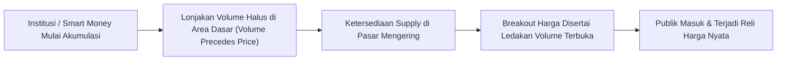
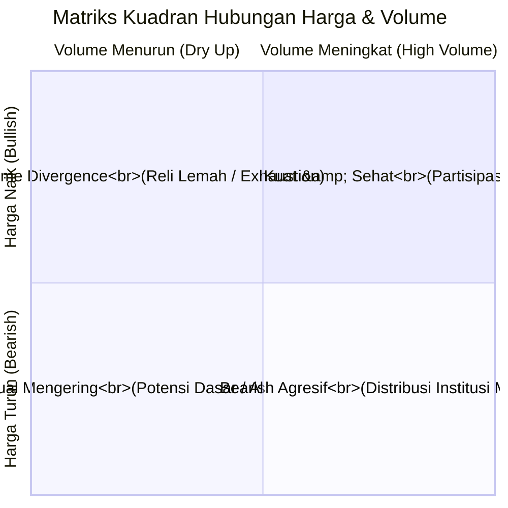
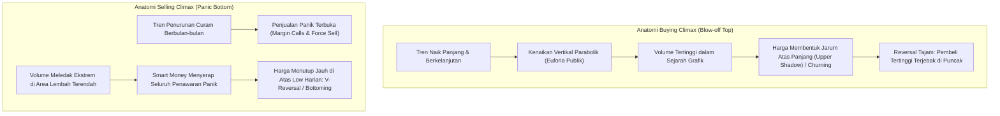

# Bab 18: Volume Transaksi

> "Volume adalah bahan bakar mesin penggerak harga. Grafik harga menunjukkan apa yang sedang terjadi, namun volume perdagangan mengungkapkan seberapa besar tenaga keyakinan di balik peristiwa tersebut."  
> — **Edianto Ong**, *Technical Analysis for Mega Profit*

---

## 1. Hakikat dan Prinsip Dasar Volume

Dalam analisis teknikal, **Volume** adalah jumlah lembar saham atau total nilai kontrak yang berpindah tangan antara pembeli dan penjual selama periode waktu tertentu. Jika harga merepresentasikan *kesepakatan nilai saat ini*, maka volume merepresentasikan *kuantitas komitmen finansial* yang terlibat dalam kesepakatan tersebut.

### Prinsip *"Volume Precedes Price"* (Volume Mendahului Harga)
Aksioma fundamental yang ditekankan Edianto Ong dalam bab ini adalah: **Volume selalu mendahului harga**.
Sebelum tren harga yang signifikan meledak ke atas atau longsor ke bawah, jejak akumulasi atau distribusi institusional berskala besar selalu bocor dan terekam terlebih dahulu pada lonjakan atau pengeringan volume transaksi. 

Investor institusional (*Smart Money*) mengelola dana triliunan rupiah. Mereka tidak dapat masuk atau keluar dari suatu saham dalam satu detik tanpa menimbulkan riak volume yang mencolok di grafik harian. Dengan mengamati perilaku volume, seorang trader dapat mengendus manuver pemodal besar sebelum pergerakan harga eksponensial terjadi.

---

## 2. Matriks Hubungan Harga dan Volume (*Price-Volume Matrix*)

Interaksi antara arah pergerakan harga dan perubahan volume menghasilkan empat kondisi psikologis pasar yang fundamental:

Berikut adalah uraian mendalam dari keempat kombinasi tersebut:

| Pola Hubungan | Perilaku Pasar | Makna Psikologis & Aksi Institusional | Implikasi Teknikal |
| :--- | :--- | :--- | :--- |
| **Harga Naik + Volume Naik** | Kenaikan harga diiringi lonjakan volume transaksi yang ekspansif di atas rata-rata moving average volume (misal MA-20). | **Bullish Sehat / Kuat.** Pembeli institusional bersedia membayar harga yang lebih tinggi untuk menyerap pasokan yang ada. Permintaan (*Demand*) jauh melampaui penawaran (*Supply*). | **Konfirmasi Kelanjutan Tren Naik.** Posisi buy aman dipertahankan; waktu ideal untuk *pyramiding / add position*. |
| **Harga Naik + Volume Turun** | Harga terus mencetak *New High*, tetapi volume transaksi harian semakin menciut dan di bawah rata-rata. | **Volume Divergence (Peringatan Kelelahan).** Kenaikan harga terjadi semata-mata karena ketiadaan penjual agresif, bukan karena dorongan pembeli baru. Daya beli (*buying power*) mulai kehabisan amunisi. | **Sinyal Waspada (Warning).** Rentan terjadi pembalikan tren mendadak atau *bull trap*. Hindari membuka posisi baru; ketatkan *trailing stop*. |
| **Harga Turun + Volume Naik** | Penurunan harga disertai lonjakan volume transaksi yang sangat besar. | **Distribusi Agresif / Bearish Kuat.** Institusi dan investor besar sedang melepas kepemilikan saham mereka secara agresif (*dumping*) tanpa mempedulikan penurunan harga. Penawaran (*Supply*) mendominasi pasar secara mutlak. | **Konfirmasi Penurunan Kuat.** Hindari menangkap pisau jatuh (*don't catch a falling knife*). Sinyal keluar (*Cut Loss / Exit*) yang mutlak. |
| **Harga Turun + Volume Turun** | Harga mengalami penurunan secara perlahan, namun volume transaksi harian terus mengecil dan mengering. | **Tekanan Jual Mengering.** Penjual agresif mulai habis. Penurunan harga hanyalah koreksi teknikal (*pullback/retracement*) normal di dalam tren naik yang lebih besar. | **Koreksi Sehat / Potensi Reversal.** Mengindikasikan pembentukan dasar (*base*) baru; area potensial untuk *buy on weakness* saat muncul konfirmasi pantulan harga. |

---

## 3. Fenomena Ekstrem: Selling Climax vs Buying Climax

Edianto Ong memberikan perhatian khusus pada dua anomali volume ekstrem yang kerap menjadi penanda titik balik terpenting dalam siklus pergerakan saham:

### A. Buying Climax (*Blow-Off Top*)
* **Karakteristik Visual:** Terjadi setelah tren naik berjalan lama. Grafik harga menunjukkan reli hampir vertikal (parabolik) disertai lilin harian yang sangat panjang dan gap atas (*exhaustion gap*).
* **Perilaku Volume:** Volume perdagangan harian meledak ke tingkat historis tertinggi yang belum pernah terlihat sebelumnya.
* **Mekanisme Pasar:** Publik yang terjangkit sindrom FOMO (*Fear Of Missing Out*) berebut membeli di harga tertinggi karena terbuai berita bombastis. Pada saat bersamaan, *Smart Money* menyuplai seluruh permintaan publik tersebut dengan menjual habis seluruh persediaan saham mereka (*distribution transfer*).
* **Konsekuensi:** Begitu daya beli publik habis, harga kehilangan penopang dan langsung berbalik arah runtuh dengan cepat (*crash*).

### B. Selling Climax (*Capitulation Bottom*)
* **Karakteristik Visual:** Terjadi di ujung akhir tren penurunan yang dalam dan berkepanjangan. Terjadi kejatuhan harga secara bebas (*free-fall*) dengan lilin merah lebar dan gap bawah.
* **Perilaku Volume:** Terjadi ledakan volume raksasa di tengah kepanikan mutlak.
* **Mekanisme Pasar:** Investor ritel yang menggunakan margin mengalami *force liquidation* (*margin call*), membuang saham dengan status pasar reguler (*auto reject bawah*). Publik mengalami kapitulasi mental dan bersumpah tidak akan kembali ke pasar saham. Pada detik keputusasaan itulah, institusi besar masuk dengan tenang menampung ratusan ribu lot saham di harga obral (*absorption*).
* **Konsekuensi:** Muncul ekor bawah yang sangat panjang (*long lower shadow/hammer*), menandakan dasar pasar (*market bottom*) telah terbentuk dan pembalikan tren naik baru segera dimulai.

---

## 4. Indikator dan Alat Bantu Analisis Volume

Untuk mempermudah pembacaan interaksi volume secara objektif, Edianto Ong menyarankan penggunaan beberapa alat bantu teknikal:

1. **Volume Moving Average (Volume MA):** Garis rata-rata bergerak (biasanya periode 20 atau 50 hari) yang diplot langsung di atas batang volume. Batang volume yang menembus garis Volume MA mengonfirmasi signifikansi transaksi institusional.
2. **On Balance Volume (OBV):** Diciptakan oleh Joseph Granville, indikator kumulatif yang menambahkan volume saat harga ditutup naik dan mengurangi volume saat harga ditutup turun. Divergensi antara garis OBV dan grafik harga sering mendahului pembalikan arah harga secara akurat.
3. **Volume Profile / Volume at Price:** Menampilkan distribusi volume pada level harga horizontal, bukan pada sumbu waktu vertikal. Membantu mengidentifikasi area *Point of Control (POC)* di mana konsentrasi akumulasi terbesar terjadi.

---

## 5. Ringkasan & Kaidah Emas Analisis Volume

1. **Konfirmasi Breakout Wajib dengan Volume:** Suatu penembusan level *resistance* atau pola grafik (*chart pattern*) tanpa disertai lonjakan volume minimal 1,5 hingga 2 kali lipat dari rata-rata hariannya adalah **Breakout Palsu (*False Breakout / Bull Trap*)**.
2. **Volume adalah Indikator Kebenaran:** Harga bisa dimanipulasi dengan modal kecil pada menit-menit akhir penutupan bursa (*marking the close*), namun volume perdagangan kumulatif seharian penuh mencerminkan likuiditas riil yang mustahil dipalsukan.
3. **Waspadai Volume Tanpa Kemajuan Harga (*Churning*):** Jika volume sangat besar namun pergerakan harga sempit dan mandek di area *resistance*, itu adalah bukti nyata bahwa distribusi institusi sedang berlangsung secara intensif.
