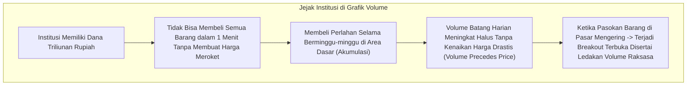
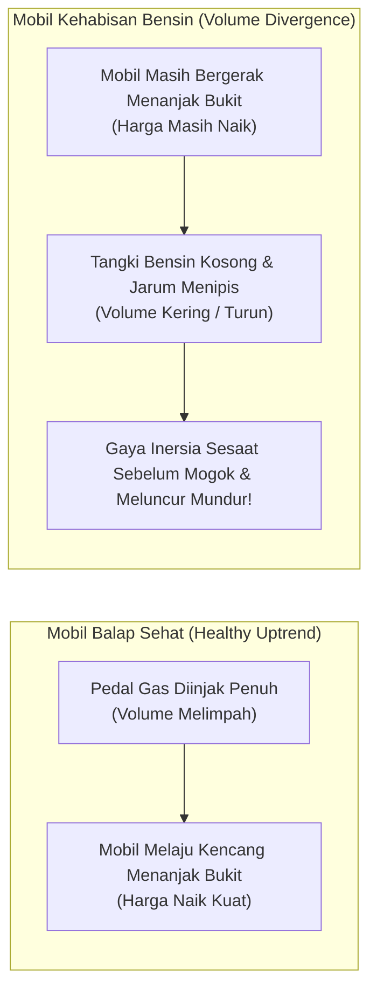
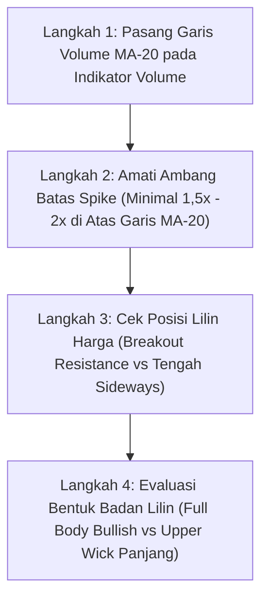

# Bab 18: Volume Transaksi — Bahan Bakar Mesin Penggerak Harga

> "Volume adalah bahan bakar bensin bagi mesin penggerak harga. Grafik harga menunjukkan apa yang sedang terjadi di atas panggung, namun volume transaksi membocorkan rahasia seberapa besar tenaga keyakinan dan modal riil di balik layar pertunjukan tersebut."  
> — **Edianto Ong**, *Technical Analysis for Mega Profit*

---

## 1. Hakikat dan Prinsip Dasar Volume

Dalam analisis teknikal, **Volume** adalah total lembar saham, jumlah lot, atau akumulasi nilai kontrak uang yang berpindah tangan antara pembeli dan penjual dalam rentang waktu tertentu (misalnya dalam 1 lilin harian, mingguan, atau 1 jam).

Jika harga merepresentasikan **kesepakatan nilai sesaat** antara dua pihak, maka volume merepresentasikan **bobot komitmen finansial nyata** yang dipertaruhkan dalam kesepakatan tersebut.

### Prinsip Fundamental: *"Volume Precedes Price"* (Volume Mendahului Harga)
Aksioma emas yang ditekankan Edianto Ong dalam buku *Technical Analysis for Mega Profit* adalah: **Volume selalu bergerak mendahului pergerakan harga**.

Sebelum sebuah saham meledak naik berlipat ganda (*breakout rally*) atau longsor ratusan persen (*bearish crash*), jejak transaksi pemodal besar (*Smart Money / Institusi*) selalu bocor dan terekam terlebih dahulu pada grafik volume harian. Mengapa demikian?

Dana pensiun, reksa dana raksasa, dan konglomerat pengelola aset (*institutional funds*) tidak bisa menyembunyikan transaksi mereka. Mereka ibarat seekor gajah yang mencoba berendam di dalam kolam renang anak-anak: tidak peduli seberapa hati-hati gajah tersebut melangkah, air di kolam renang pasti akan meluap. Luapan air itulah yang kita baca sebagai **Volume Transaksi**.

---

## 2. Analogi Dunia Nyata: Bahan Bakar Bensin Mobil Balap

Bayangkan sebuah mobil balap yang sedang dipacu di lintasan sirkuit:

- **Kasus 1 (Uptrend Kuat Sehat):** Mobil balap melaju kencang menaiki tanjakan curam diiringi semburan bensin melimpah dari injektor ke ruang mesin. Kecepatan mobil bertambah (harga naik) dan konsumsi bahan bakar meningkat sepadan (volume tinggi). Ini adalah pergerakan yang sehat dan berkelanjutan!
- **Kasus 2 (Divergensi Volume / Waspada Mogok):** Mobil balap terlihat masih bergerak naik mendekati puncak bukit, namun pedal gas sebenarnya sudah dilepas dan tangki bensin kosong melompong. Mobil tersebut bergerak maju semata-mata karena sisa daya dorong (*inersia*) sesaat. Begitu inersia habis di puncak bukit, mobil akan berhenti total dan meluncur jatuh ke belakang dengan kecepatan tinggi. Inilah gambaran saham yang harganya naik tetapi volumenya terus menciut!

---

## 3. Matriks 4 Hubungan Harga & Volume (*Price-Volume Matrix*)

Edianto Ong menyusun panduan praktis empat kuadran interaksi harga dan volume yang wajib dihafal di luar kepala oleh setiap trader:

Berikut adalah rincian mendalam dari keempat kombinasi tersebut:

| Pola Hubungan | Dinamika Pasar | Makna Psikologis & Aksi Institusional | Tindakan Trader Pemula |
| :--- | :--- | :--- | :--- |
| **Harga Naik + Volume Naik** | Lilin harga hijau panjang disertai lonjakan batang volume di atas garis rata-rata (Volume MA-20). | **Bullish Sehat / Kuat.** Pembeli institusi rela membayar harga lebih tinggi untuk menyerap seluruh barang yang dijual di pasar. Permintaan (*Demand*) jauh melampaui penawaran (*Supply*). | **Tahan Posisi (HOLD) / Tambah Posisi (Add on Breakout).** Ini adalah kondisi tren terbaik untuk membiarkan keuntungan Anda berlari (*let your profits run*). |
| **Harga Naik + Volume Turun** | Harga terus mencetak rekor baru (*New High*), namun batang volume harian semakin kerdil dan di bawah rata-rata. | **Divergensi Volume (Volume Divergence).** Kenaikan harga bukan karena dorongan pembeli baru, melainkan karena ketiadaan penjual pasif sesaat. Pasar kehabisan bahan bakar bensin. | **WASPADA TINGGI! Pasang Trailing Stop Ketat.** Jangan buka posisi beli baru (*no new entry*). Bersiap merealisasikan keuntungan sebelum harga terbalik mendadak. |
| **Harga Turun + Volume Naik** | Lilin harga merah lebar disertai ledakan volume transaksi raksasa. | **Distribusi Agresif / Bearish Murni.** Pemodal besar sedang membuang barang (*dumping*) tanpa memedulikan kejatuhan harga. Pasar didominasi oleh kepanikan mutlak. | **KELUAR SEGERA (Cut Loss / Exit).** Jangan pernah mencoba menangkap pisau jatuh (*don't catch a falling knife*). Kerugian besar selalu berawal dari mengabaikan sinyal ini. |
| **Harga Turun + Volume Turun** | Harga merayap turun perlahan, namun volume transaksi harian mengering drastis mendekati nol. | **Kekeringan Tekanan Jual (Dry-Up).** Tekanan jual dari penjual agresif sudah habis. Penurunan harga hanyalah koreksi teknikal sehat (*pullback / retracement*) sementara di dalam tren naik yang lebih besar. | **Siapkan Amunisi Beli (Buy on Weakness).** Amati level *Support*. Begitu muncul lilin pembalikan arah dengan volume mulai naik, masuk ke pasar. |

---

## 4. Dua Titik Ekstrem: Buying Climax vs Selling Climax

Dalam kondisi pasar tertentu, volume dapat melonjak ke tingkat yang luar biasa ekstrem (*Volume Spike 3 hingga 5 kali lipat*). Fenomena ini menandakan titik balik psikologis massa yang paling dramatis dalam siklus bursa:

```mermaid
flowchart TD
    subgraph BuyingClimax["1. Anatomi Buying Climax (Pucuk Euforia)"]
        BC1["Uptrend Curam Parabolik Berlangsung Lama"] --> BC2["Berita Heboh & Sentimen Super Bullish Masif di Media"]
        BC2 --> BC3["Volume Meledak ke Rekor Tertinggi Historis Grafik"]
        BC3 --> BC4["Harga Membentuk Lilin Jarum Atas Panjang (Shooting Star / Upper Wick)"]
        BC4 --> BC5["Smart Money Selesai Bongkar Muatan -> Harga Longsor Drastis"]
    end

    subgraph SellingClimax["2. Anatomi Selling Climax (Dasar Kapitulasi)"]
        SC1["Downtrend Panjang & Kejatuhan Harga Menyakitkan"] --> SC2["Panic Selling Terbuka: Margin Call & Force Sell Masal"]
        SC2 --> SC3["Volume Transaksi Meledak Raksasa di Lilin Merah Lebar"]
        SC3 --> SC4["Smart Money Masuk Menyerap Ratusan Ribu Lot Murah"]
        SC4 --> SC5["Harga Menutup Jauh di Atas Low Harian (Hammer) -> Dasar Pasar Terbentuk"]
    end
```

### A. Buying Climax (*Blow-Off Top*)
- **Gambaran Visual:** Terjadi di ujung reli panjang. Harga meroket vertikal selama beberapa hari berturut-turut, menembus batas atas garis tren.
- **Perilaku Volume:** Volume transaksi harian meledak ke level tertinggi dalam beberapa bulan atau tahun terakhir.
- **Psikologi Massa:** Investor pemula yang didera sindrom FOMO (*Fear of Missing Out*) panik takut tertinggal kereta dan berebut membeli di harga pucuk. Pada saat yang sama, *Smart Money* tersenyum lebar menyuplai barang dan membongkar seluruh portofolio mereka (*unloading*). Begitu daya beli ritel habis, harga langsung rontok tanpa ada yang menahan.

### B. Selling Climax (*Capitulation Bottom*)
- **Gambaran Visual:** Terjadi di ujung tren penurunan berbulan-bulan. Harga terjun bebas tak terkendali dengan lilin merah raksasa.
- **Perilaku Volume:** Terjadi lonjakan volume raksasa yang belum pernah terlihat selama masa kejatuhan harga.
- **Psikologi Massa:** Investor ritel yang menggunakan fasilitas pinjaman (*margin trading*) mengalami gagal bayar (*force sell*). Publik panik luar biasa, merasa saham tersebut akan bangkrut, dan membuang seluruh kepemilikan mereka pada harga obral berapapun yang ada di papan bid. Di detik keputusasaan itulah, tangan-tangan institusi raksasa masuk dengan tenang menyerap ratusan ribu lot saham di harga diskon super murah (*absorption*). Pasar menemukan lantai dasarnya (*bottom*).

---

## 5. Panduan Step-by-Step Pemula: Cara Membaca Lonjakan Volume (Volume Spike)

Bagaimana cara seorang pemula membedakan lonjakan volume yang valid dari kebisingan harian? Ikuti 4 langkah sistematis berikut:

1. **Langkah 1: Pasang Indikator Garis Volume MA-20:**
   Di aplikasi charting Anda (TradingView, chart sekuritas), buka indikator Volume dan tambahkan garis rata-rata pergerakan bergerak (*Moving Average*) dengan periode 20 hari (Volume MA-20). Garis ini adalah garis batas penentu normalitas volume.
2. **Langkah 2: Amati Ambang Batas Lonjakan (*Volume Threshold*):**
   Batang volume harian dikatakan signifikan secara institusional jika tingginya **minimal 1,5 hingga 2 kali lipat** lebih tinggi daripada garis Volume MA-20 tersebut. Batang volume yang berada di bawah garis MA-20 dikategorikan sebagai volume sepi ritel biasa.
3. **Langkah 3: Periksa Posisi Lilin Harga Terhadap Level Kunci:**
   - Jika lonjakan volume terjadi saat harga **menembus garis *Resistance*** mendatar yang kokoh, ini adalah **Valid Breakout**.
   - Jika lonjakan volume terjadi di antah berantah di tengah area *sideways*, waspadai manipulasi transaksi semu (*wash sale/cross transaction*).
4. **Langkah 4: Evaluasi Bentuk Fisik Lilin Harga (*Candle Spread*):**
   - **Konfirmasi Kuat:** Volume 2x MA-20 disertai lilin hijau berbadan tebal (*Marubozu / Full Body*) yang ditutup di dekat harga tertingginya (*close near high*).
   - **Perangkap (Churning/Trap):** Volume 3x MA-20 tetapi badan lilin sangat kecil atau meninggalkan ekor atas yang sangat panjang (*Shooting Star*). Ini bukti penjual institusi sedang menyiram pasar dengan aksi jual!

---

## 6. Kamus Istilah Pemula (Glossary Box)

| Istilah | Terjemahan Bebas | Arti Praktis untuk Pemula |
| :--- | :--- | :--- |
| **Volume Spike** | Lonjakan Volume | Batang volume yang mendadak melompat tinggi melebihi rata-rata harian (biasanya 2x MA-20). Tanda ada modal besar masuk/keluar. |
| **Volume Dry-Up** | Pengeringan Volume | Batang volume yang menciut kerdil mendekati dasar grafik. Tanda pasokan penawaran barang di pasar sudah habis terhisap. |
| **Buying Climax** | Puncak Pembelian Panik | Ledakan volume ekstrem di akhir tren naik yang menandai puncak euforia sebelum harga runtuh. |
| **Selling Climax** | Puncak Penjualan Panik | Ledakan volume raksasa di dasar penurunan saat ritel terkapitulasi, diserap oleh bandar untuk memulai tren baru. |
| **Churning** | Perputaran Semu di Pucuk | Volume raksasa tetapi pergerakan harga mandek dan sempit. Tanda institusi sedang membagikan barang secara diam-diam. |
| **On Balance Volume (OBV)** | Indikator OBV | Garis indikator kumulatif volume yang menambahkan volume saat harga tutup naik dan mengurangi saat harga tutup turun. |
| **Breakout Volume** | Volume Penerobosan | Ledakan volume yang wajib hadir saat harga menembus level resistensi agar penembusan dinyatakan sah. |

---

## 7. Studi Kasus Konkret: Mengidentifikasi Breakout Saham Riil

Mari kita amati skenario transaksi konkret pada saham berfundamental baik di Bursa Efek Indonesia:

### Skenario: Penembusan Resistance Saham XYZ
- **Kondisi Dasar:** Saham XYZ telah bergerak mendatar (*sideways*) selama 3 bulan di rentang Rp 1.900 hingga Rp 2.000. Rata-rata volume harian adalah 20.000 lot.
- **Hari Breakout (Senin, 10:30 WIB):**
  - Harga saham XYZ melesat menembus level batas atas Rp 2.000 dan bertengger di Rp 2.060 (+3%).
  - Volume perdagangan pada penutupan bursa mencapai **65.000 lot** (lebih dari 3 kali lipat di atas rata-rata harian 20.000 lot).
  - Badan lilin hijau tebal ditutup di level Rp 2.050, dekat dengan harga tertinggi harian Rp 2.070.
- **Analisis Trader Berpengalaman:**
  - Penembusan level Rp 2.000 didukung oleh lonjakan volume riil yang masif.
  - Ini adalah bukti valid bahwa pemodal institusi telah memborong habis seluruh antrean order jual (*offer*) di Rp 2.000.
- **Rencana Eksekusi Trading (*Trading Plan*):**
  - **Titik Masuk (Entry):** Beli di Rp 2.050 - Rp 2.060 pada penutupan bursa, atau antre di area *pullback* retest Rp 2.000–Rp 2.020 keesokan harinya.
  - **Penempatan Stop Loss:** Pasang *Stop Loss* aman di bawah batas *support breakout* dan lembah lilin hari penembusan, yaitu di **Rp 1.960** (risiko kerugian terukur ~4.5%).
  - **Target Profit:** Berdasarkan lebar rentang konsolidasi Rp 1.900 ke Rp 2.000 (lebar 100 poin), target proyeksi harga minimum adalah: Rp 2.000 + Rp 100 = **Rp 2.100**, dan target sekunder Rp 2.200.
- **Hasil:** Tiga minggu kemudian harga saham XYZ melesat mulus mencapai Rp 2.250 tanpa pernah menyentuh level stop loss Rp 1.960.

---

## 8. Kesalahan Fatal Pemula Terkait Volume

1. **Membeli Breakout yang "Sepi Bensin" (*Low Volume Breakout*):**
   Melihat harga saham melompati garis resistensi lalu buru-buru membeli, tanpa memperhatikan bahwa volume transaksi hari itu sangat kecil dan di bawah rata-rata. Penembusan tanpa bensin volume 80% akan berakhir sebagai **Breakout Palsu (*Bull Trap*)** yang segera menyeret harga jatuh kembali.
2. **Panik Menjual Saat Terjadi Koreksi Bervolume Kering (*Panic Selling on Pullback*):**
   Ketika saham yang dibeli mengalami koreksi turun 2%, pemula langsung panik dan menjual rugi. Padahal jika diperhatikan, batang volume penurunannya sangat tipis mengering (*dry up*). Itu hanyalah istirahat sehat pasar sebelum terbang lebih tinggi!
3. **Mengabaikan Gejala Churning di Area Resistance:**
   Terus menahan saham saat volume harian meledak gila-gilaan namun harga saham tidak mampu naik lebih tinggi dan terus membentuk ekor atas panjang. Ini adalah tanda distribusi masif dari *Smart Money* yang sedang bersiap meninggalkan Anda di pucuk.
