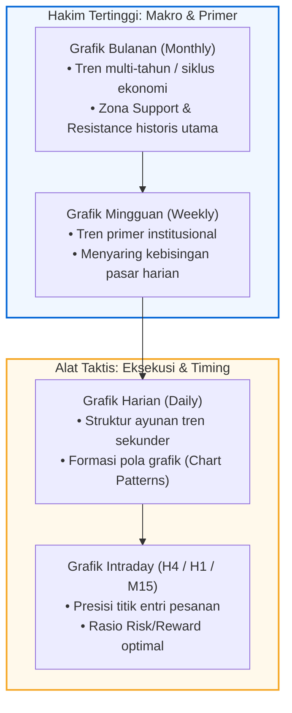
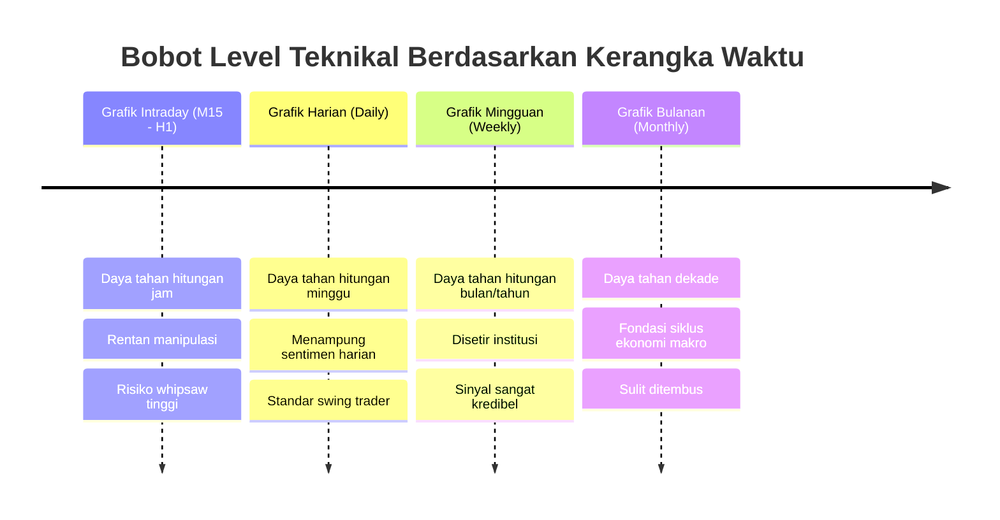
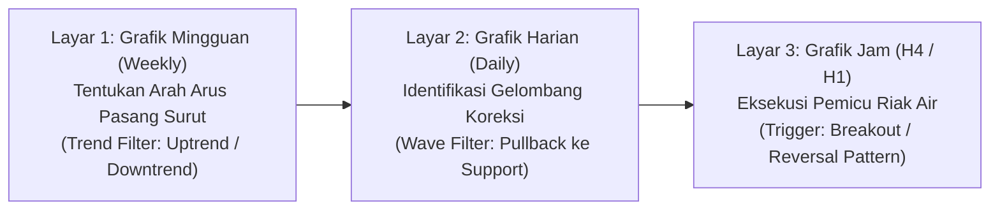

# Bab 19: Long-Term vs Short-Term Charts

> "Jangan pernah membiarkan riak ombak jangka pendek mengaburkan pandangan Anda terhadap arah pasang surut samudra. Grafik jangka panjang selalu menjadi hakim tertinggi bagi grafik jangka pendek."  
> — **Edianto Ong**, *Technical Analysis for Mega Profit*

---

## 1. Hirarki Kerangka Waktu (*Timeframe Hierarchy*)

Salah satu kelemahan paling fatal yang sering menjerat trader pemula adalah **Rabun Pasar (*Market Myopia*)**—terlalu terpaku pada pergerakan lilin harian (*daily*) atau bahkan grafik intra-hari (*hourly/15-minute*), hingga benar-benar buta terhadap struktur tren makro yang sedang mengendalikan instrumen tersebut.

Edianto Ong menggarisbawahi prinsip hirarki waktu yang mutlak:
1. **Grafik Bulanan (*Monthly Chart*):** Menggambarkan tren sekuler dan siklus makro ekonomi multi-tahun. Menjadi penentu arah strategis aset.
2. **Grafik Mingguan (*Weekly Chart*):** Menggambarkan tren primer (*Primary Trend*). Menyaring kebisingan harian (*noise filtering*) dan menunjukkan level *support/resistance* institusional yang sesungguhnya.
3. **Grafik Harian (*Daily Chart*):** Menggambarkan tren sekunder dan merupakan medan tempur utama untuk perencanaan *swing trading*.
4. **Grafik Jam/Menit (*Intraday Charts - H4/H1/M15*):** Berfungsi sebagai mikroskop taktis untuk menentukan titik presisi eksekusi (*entry timing*) dan meminimalkan risiko stop-loss.

---

## 2. Mengapa Grafik Jangka Panjang Selalu Mendikte Grafik Jangka Pendek?

Ditinjau dari dinamika likuiditas pasar, alasan mengapa grafik *long-term* selalu mengalahkan grafik *short-term* adalah:

1. **Kekuatan Likuiditas Institusional:** Dana pensiun global, manajer aset berdana triliunan, dan *sovereign wealth funds* tidak mengambil keputusan investasi berdasarkan grafik 15 menit atau grafik harian. Mereka menyusun portofolio berbasis grafik mingguan dan bulanan. Kekuatan modal kolektif merekalah yang membentuk tren jangka panjang.
2. **Bobot Level Support & Resistance:** Garis *support* pada grafik bulanan yang bertahan selama 5 tahun memiliki daya pantul ratusan kali lebih kuat dibandingkan garis *support* pada grafik 5 menit yang baru berusia 2 jam.
3. **Penyaringan Sinyal Palsu (*Noise Reduction*):** Berita sentimen harian, rumor media sosial, dan aksi spekulasi bandar sering kali memicu *false breakout* pada grafik harian, namun pada grafik mingguan pergerakan tersebut hanyalah sebuah ekor lilin (*wick*) kecil yang sama sekali tidak mengubah arah tren primer.

---

## 3. Metodologi Analisis Tiga Kerangka Waktu (*Triple Timeframe Strategy*)

Diadaptasi dari konsep legendaris *Triple Screen Trading System* karya Dr. Alexander Elder dan diperkaya oleh pengalaman praktis Edianto Ong di bursa Indonesia, setiap keputusan trading wajib melewati saringan tiga lapis kerangka waktu:

### Langkah 1: Layar Pertama — Grafik Mingguan (Menentukan Arah)
* **Tujuan:** Mengetahui siapa yang memegang kendali pasar dalam skala besar.
* **Aturan:** Jika grafik mingguan berada dalam tren turun (*downtrend* di bawah MA-50 Weekly), **DILARANG KERAS** mencari posisi beli (*long position*) pada grafik harian, meskipun ada indikator harian yang memberikan sinyal *oversold*. Jangan pernah berenang melawan arus pasang surut samudra.

### Langkah 2: Layar Kedua — Grafik Harian (Menemukan Gelombang Koreksi)
* **Tujuan:** Menemukan peluang ketika gelombang koreksi jangka pendek bergerak berlawanan dengan arah arus mingguan.
* **Aturan:** Jika tren mingguan adalah *bullish*, tunggu hingga grafik harian mengalami koreksi teknikal (*pullback*) ke area *support*, garis *uptrend line*, atau nilai retracement Fibonacci (50% - 61.8%).

### Langkah 3: Layar Ketiga — Grafik Jam / H1 (Pemicu Titik Masuk)
* **Tujuan:** Menentukan waktu presisi untuk masuk pasar sesaat setelah koreksi jangka pendek berakhir.
* **Aturan:** Ketika harga di grafik harian menyentuh area *support*, turun ke grafik H1 untuk mencari formasi pembalikan mikro (seperti *Bullish Engulfing*, *Double Bottom*, atau penembusan garis *downtrend* mikro). Hal ini memungkinkan trader memasang batas risiko (*Stop Loss*) yang sangat ketat di bawah lembah mikro, sehingga menghasilkan rasio *Risk-to-Reward* yang luar biasa tinggi (1:3 atau lebih baik).

---

## 4. Studi Kasus Nyata: Jebakan Myopia vs Peluang Multi-Timeframe

### Kasus: Jebakan "Dead Cat Bounce" pada Saham Downtrend
Banyak trader pemula melihat saham yang telah anjlok 40% tiba-tiba mengalami kenaikan 7% dalam satu hari dengan volume lumayan di grafik harian. Mereka segera melakukan pembelian karena menganggap saham tersebut "sudah murah dan mulai bangkit".

Namun, ketika grafik mingguan dibuka:
* Harga masih berada jauh di bawah garis *downtrend resistance* multi-bulan.
* Tren mingguan mencetak *Lower High* dan *Lower Low* yang konsisten.
* Kenaikan 7% harian tersebut ternyata hanyalah pantulan koreksi teknikal (*secondary reaction*) sebelum harga longsor kembali mencetak rekor terendah baru.

Sebaliknya, seorang analis yang menguasai integrasi multi-timeframe akan:
1. Menolak membeli saham yang tren mingguannya *bearish*.
2. Memusatkan modal hanya pada saham-saham yang grafik mingguannya mencetak formasi *base breakout* atau *uptrend* sehat.
3. Menggunakan grafik harian semata-mata untuk mengoptimalkan harga beli.

---

## 5. Ringkasan & Kaidah Emas Multi-Timeframe Edianto Ong

1. **Gunakan Faktor Rasio 4 hingga 6:** Saat mengombinasikan kerangka waktu, gunakan kelipatan 4 sampai 6 antara kerangka waktu makro dan mikro (misal: Bulanan ke Mingguan [~4x], Mingguan ke Harian [~5x], Harian ke 4-Jam [~6x], Harian ke 1-Jam [~6x]).
2. **Kesesuaian dengan Gaya Trading:**
   * **Investor Jangka Panjang:** Grafik Bulanan (Arah) + Grafik Mingguan (Eksekusi).
   * **Swing Trader:** Grafik Mingguan (Arah) + Grafik Harian (Koreksi) + Grafik H1 (Eksekusi).
   * **Day Trader:** Grafik Harian (Arah) + Grafik H1 (Koreksi) + Grafik M15/M5 (Eksekusi).
3. **Prinsip Veto Kerangka Waktu Lebih Besar:** Jika grafik mingguan memberi sinyal SELL atau bahaya, batalkan seluruh rencana BUY pada grafik harian tanpa kompromi.
