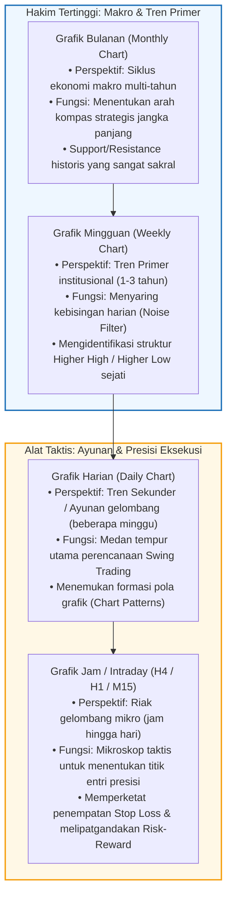
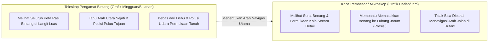
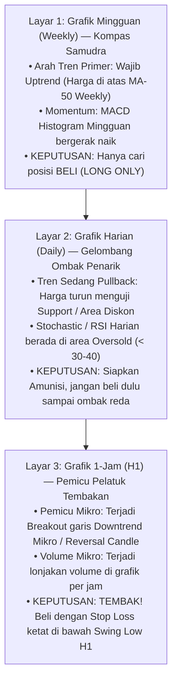
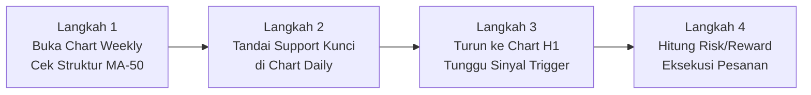

# Bab 19: Long-Term vs Short-Term Charts — Menyelaraskan Sudut Pandang Makro dan Mikro

> "Jangan pernah membiarkan riak ombak jangka pendek membutakan mata Anda dari arah pasang surut samudra. Grafik jangka panjang selalu menjadi hakim tertinggi bagi grafik jangka pendek."  
> — **Edianto Ong**, *Technical Analysis for Mega Profit*

---

## 1. Hirarki Kerangka Waktu (*Timeframe Hierarchy*)

Salah satu kelemahan paling mematikan yang hampir selalu menjebak trader pemula adalah penyakit yang disebut **Rabun Pasar (*Market Myopia*)**.

Banyak pemula yang baru belajar analisis teknikal langsung membuka grafik 5 menit, 15 menit, atau grafik harian (*daily*), lalu sibuk mengamati setiap tarikan lilin hijau dan merah dengan penuh kecemasan. Mereka melihat indikator RSI sudah *oversold* di grafik 15 menit dan langsung memborong saham, tanpa pernah menyadari bahwa pada grafik mingguan (*weekly*) dan bulanan (*monthly*), saham tersebut sedang berada di dasar jurang tren turun (*severe downtrend*) yang mematikan.

Edianto Ong menegaskan hukum hirarki waktu yang tidak bisa ditawar: **Kerangka waktu yang lebih besar selalu mendikte dan mengendalikan kerangka waktu yang lebih kecil**. Sebagus apa pun sinyal beli yang Anda temukan di grafik 5 menit, sinyal tersebut akan musnah dalam sekejap jika berbenturan dengan garis *Resistance* tren turun utama pada grafik mingguan.

---

## 2. Analogi Dunia Nyata: Teleskop Bintang vs Kaca Pembesar

Untuk memahami bagaimana kerangka waktu yang berbeda saling melengkapi, gunakan analogi peralatan optik berikut:

- **Teleskop Pengamat Bintang (Grafik Mingguan & Bulanan):**
  Jika Anda tersesat di tengah samudra pada malam hari, Anda menggunakan teleskop untuk melihat rasi bintang Biduk Besar guna menentukan di mana arah Kutub Utara yang sejati. Anda tidak peduli dengan cipratan buih air di lambung perahu. Grafik mingguan memberi tahu Anda apakah pasar sedang berada di musim semi yang subur (*Bull Market*) atau musim dingin yang membeku (*Bear Market*).
- **Kaca Pembesar / Mikroskop (Grafik Harian & Jam):**
  Ketika Anda sudah tahu arah kapal menuju dermaga, Anda membutuhkan kaca pembesar untuk melihat detail kecil, seperti mengikat tali tambang ke pasak dermaga dengan presisi. Grafik 1 jam membantu Anda masuk ke pasar pada harga terbaik tanpa harus terkena risiko kerugian (*drawdown*) yang terlalu dalam.
- **Kesalahan Fatal:** Menggunakan kaca pembesar untuk menentukan arah mata angin samudra! Anda akan tersesat dan karam menabrak karang.

---

## 3. Metodologi Analisis Tiga Kerangka Waktu (*Triple Timeframe Strategy*)

Diadaptasi dari filosofi sistem *Triple Screen* yang dipopulerkan oleh Dr. Alexander Elder dan disempurnakan oleh Edianto Ong dalam transaksi saham di Bursa Efek Indonesia, setiap transaksi profesional wajib melewati tiga lapis saringan:

### Langkah 1: Layar Pertama — Grafik Mingguan (Menentukan Arah Strategis)
- **Pertanyaan Inti:** *Siapa yang sedang menguasai pasar saat ini, Banteng (Bull) atau Beruang (Bear)?*
- **Aturan Disiplin:** Jika grafik mingguan berada dalam tren turun (*downtrend* di bawah garis Moving Average 50 mingguan), Anda **DIHARAMKAN MEMBELI SAHAM**, tidak peduli sebagus apa pun berita korporasi yang Anda dengar. Anda hanya diperbolehkan mencari posisi beli jika grafik mingguan menunjukkan struktur *Uptrend* (*Higher High* dan *Higher Low*).

### Langkah 2: Layar Kedua — Grafik Harian (Menemukan Gelombang Diskon)
- **Pertanyaan Inti:** *Kapan gelombang koreksi jangka pendek selesai memberikan harga diskon?*
- **Aturan Disiplin:** Setelah tahu bahwa tren mingguan adalah *bullish*, kita tidak membeli saat harga sedang melambung tinggi di pucuk harian. Kita sabar menunggu hingga harga pada grafik harian mengalami penurunan koreksi (*pullback*) ke area *Support* horizontal, garis tren naik, atau area indikator teknikal yang sedang *oversold*.

### Langkah 3: Layar Ketiga — Grafik Jam / H1 (Menarik Pelatuk dengan Presisi)
- **Pertanyaan Inti:** *Di detik berapa tepatnya pembeli mulai mengambil alih kendali kembali?*
- **Aturan Disiplin:** Kita beralih ke grafik 1-jam (H1) untuk mencari titik entri presisi. Begitu harga pada grafik H1 menembus garis *downtrend* mikro atau membentuk pola lilin pembalikan arah (misal: *Bullish Engulfing* per jam) disertai lonjakan volume, kita langsung melakukan pembelian.
- **Keunggulan:** Stop loss yang dipasang di bawah lembah grafik H1 menjadi sangat dekat (misalnya hanya berisiko 2%), sementara target keuntungan mengikuti tren mingguan yang berpotensi memberikan profit 15% hingga 30%. Ini menghasilkan rasio *Risk-to-Reward* fantastis (1:5 atau lebih tinggi).

---

## 4. Panduan Step-by-Step Pemula: Menyelaraskan 3 Layar Grafik

Berikut adalah panduan praktis langkah demi langkah yang dapat Anda buka di platform trading setiap kali menyusun analisis:

1. **Langkah 1: Buka Grafik Mingguan (Weekly Chart)**
   - Pasang indikator EMA-20 dan MA-50 Weekly.
   - Pastikan harga berada di atas kedua garis rata-rata tersebut.
   - Cek apakah puncak dan lembah terakhir membentuk *Higher High* dan *Higher Low*. Jika ya, Anda mendapatkan lampu hijau untuk berburu saham ini.
2. **Langkah 2: Buka Grafik Harian (Daily Chart)**
   - Tarik garis *Support* horizontal dan amati area Fibonacci Retracement (misal area 50%–61.8%).
   - Tunggu hingga harga menyentuh area pertahanan tersebut. Amati apakah batang volume penjualan harian mulai menciut/mengering (*dry up*).
3. **Langkah 3: Buka Grafik 1 Jam (H1 Chart)**
   - Tarik garis tren turun mikro (*micro downtrend line*) yang menghubungkan penurunan selama 3–5 hari terakhir.
   - Pasang order beli otomatis ketika harga menembus ke atas garis tren mikro tersebut.
4. **Langkah 4: Tetapkan Manajemen Risiko Terukur**
   - Letakkan garis *Stop Loss* 1 atau 2 tik di bawah lembah terendah grafik 1 jam.
   - Proyeksikan level *Take Profit* di puncak tertinggi grafik harian sebelumnya.
   - Pastikan rasio potensi keuntungan minimal 2 kali lipat dari risiko kerugian Anda ($RRR \ge 1:2$).

---

## 5. Kamus Istilah Pemula (Glossary Box)

| Istilah | Terjemahan Bebas | Arti Praktis untuk Pemula |
| :--- | :--- | :--- |
| **Market Myopia** | Rabun Pasar | Kesalahan pemula yang hanya memandangi grafik jangka pendek (5 menit) hingga buta arah tren besar. |
| **Triple Screen System** | Sistem 3 Layar | Metode menyaring keputusan trading menggunakan 3 kerangka waktu berbeda secara berurutan. |
| **Noise** | Kebisingan Pasar | Fluktuasi harga acak jangka pendek yang tidak mengubah arah tren fundamental ekonomi. |
| **Macro Trend** | Tren Makro | Arah pergerakan harga pada grafik bulanan/mingguan yang disetir oleh institusi global. |
| **Pullback** | Gerak Mundur Sementara | Penurunan harga jangka pendek yang sehat di tengah tren naik utama untuk mengambil napas. |
| **Risk-to-Reward Ratio (RRR)** | Rasio Risiko terhadap Hasil | Perbandingan antara jumlah uang yang siap Anda relakan jika rugi vs potensi keuntungan yang ditargetkan. |
| **Dead Cat Bounce** | Pantulan Kucing Mati | Pantulan harga naik sesaat pada saham yang sedang terjun bebas sebelum harga kembali longsor lebih dalam. |

---

## 6. Studi Kasus Konkret: Jebakan "Dead Cat Bounce" Saham ABC

Mari kita pelajari contoh nyata di Bursa Efek Indonesia bagaimana trader pemula tertipu karena tidak melihat grafik jangka panjang:

### Skenario: Saham ABC Melompat 8% dalam Sehari
- **Sudut Pandang Pemula (Grafik Harian):**
  - Saham ABC telah turun berbulan-bulan dari Rp 3.000 ke Rp 1.500 (-50%).
  - Tiba-tiba pada hari Rabu, harga saham ABC melonjak dari Rp 1.500 menjadi Rp 1.620 (+8%) dalam satu hari dengan volume yang lumayan ramai.
  - Komunitas media sosial heboh: *"Saham ABC sudah murah meriah dan mulai berbalik arah! Beli sekarang sebelum ketinggalan!"*
  - Trader pemula langsung memborong seluruh tabungannya di harga Rp 1.620.
- **Sudut Pandang Trader Profesional (Grafik Mingguan):**
  - Trader profesional membuka grafik mingguan (Weekly) saham ABC.
  - Terlihat jelas bahwa struktur tren mingguan masih mencetak *Lower High* dan *Lower Low* yang sangat solid sejak 6 bulan lalu.
  - Garis MA-50 mingguan berada jauh di level Rp 2.100 dan mengarah curam ke bawah.
  - Kenaikan 8% tersebut ternyata hanyalah pantulan koreksi teknikal semu (*Dead Cat Bounce*) yang membentur garis batas resistensi tren turun mingguan.
- **Hasil Akhir:** Tiga hari berselang, kenaikan saham ABC tertahan di Rp 1.650, lalu terhempas jatuh kembali hingga menyentuh Rp 1.200 dalam 3 minggu berikutnya. Trader pemula terjebak menderita kerugian -25%, sementara trader profesional yang disiplin berhasil menyelamatkan modalnya.

---

## 7. Kesalahan Fatal Pemula Terkait Timeframe

1. **Mengubah Kerangka Waktu Saat Posisi Merugi (*Timeframe Hopping*):**
   Awalnya membuka posisi sebagai *Day Trader* di grafik 15 menit dengan batas stop loss Rp 1.000. Ketika harga menembus Rp 1.000, bukannya disiplin *cut loss*, pemula malah mengganti tampilan ke grafik harian sambil menghibur diri: *"Ah, di grafik harian support-nya masih di Rp 900, saya jadi swing trader saja"*. Ketika tembus Rp 900, ia ganti ke grafik bulanan: *"Saya jadi investor jangka panjang saja"*. Ini adalah jalan pintas menuju kebangkrutan!
2. **Trading Melawan Arah Tren Mingguan:**
   Membeli saham hanya karena indikator RSI di grafik harian sudah menyentuh level jenuh jual (*oversold*), padahal tren mingguan sedang dalam fase kapitulasi *bearish*. Ingat: saham yang sedang *downtrend* kuat bisa tetap berada di area *oversold* selama berbulan-bulan sambil terus anjlok 50% lebih dalam.
3. **Menganalisis Terlalu Banyak Timeframe Sekaligus (*Analysis Paralysis*):**
   Membuka grafik 1 menit, 3 menit, 5 menit, 15 menit, 1 jam, 4 jam, harian, dan mingguan sekaligus secara bersamaan. Akibatnya, grafik 5 menit memberi sinyal BUY, grafik 15 menit memberi sinyal SELL, grafik 1 jam memberi sinyal NEUTRAL. Trader akhirnya bingung, stres, dan mengalami kelumpuhan analisis. Batasi analisis Anda pada **maksimal 3 kerangka waktu** yang saling melipat 4x hingga 6x.
