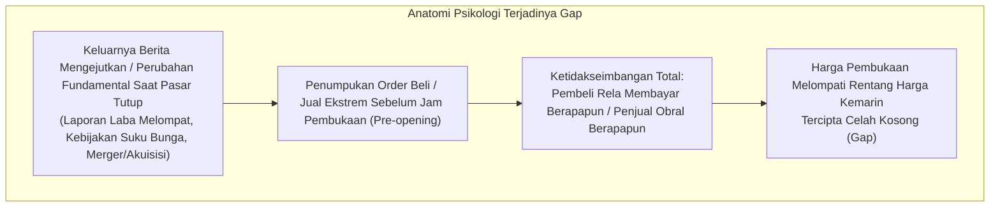
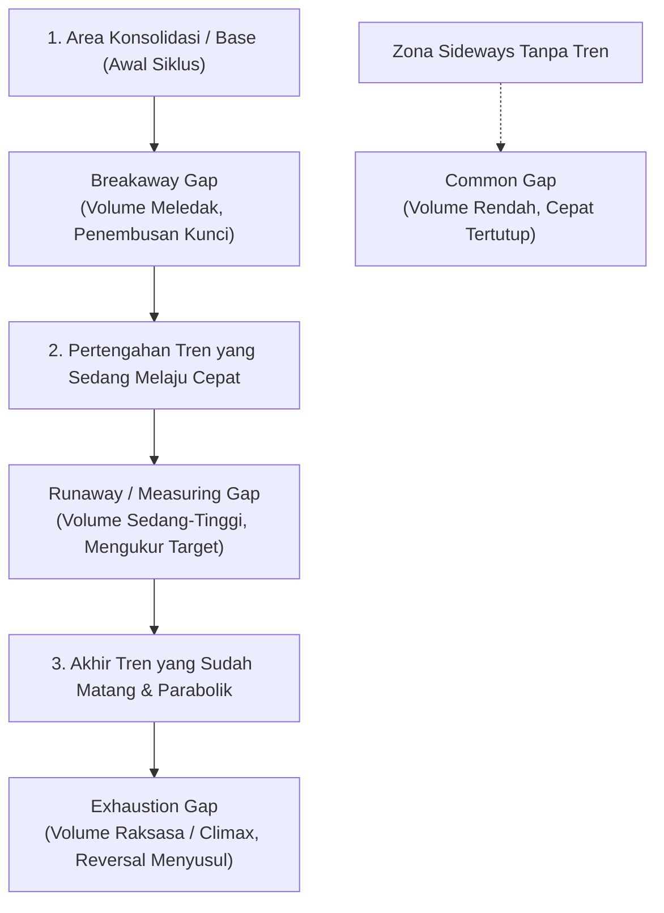
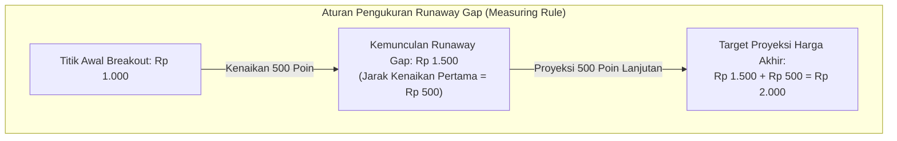

# Bab 20: Analisis Gap (Celah Harga)

> "Gap adalah cermin dari ketidakseimbangan ekstrem antara penawaran dan permintaan yang terjadi dalam sekejap mata. Celah harga bukan sekadar kekosongan pada grafik, melainkan jejak lompatan emosi massa yang menyimpan rahasia kelanjutan atau akhir dari suatu tren."  
> — **Edianto Ong**, *Technical Analysis for Mega Profit*

---

## 1. Definisi dan Psikologi di Balik Gap

Dalam analisis teknikal, **Gap (Celah Harga)** adalah area kosong pada grafik batang atau candlestick di mana tidak ada transaksi perdagangan yang terjadi sama sekali di antara dua periode waktu yang berurutan. 

* **Gap Up (Celah Atas):** Terjadi ketika harga terendah (*Low*) suatu periode perdagangan berada lebih tinggi daripada harga tertinggi (*High*) periode perdagangan sebelumnya.
* **Gap Down (Celah Bawah):** Terjadi ketika harga tertinggi (*High*) suatu periode perdagangan berada lebih rendah daripada harga terendah (*Low*) periode perdagangan sebelumnya.

Edianto Ong menekankan mitos yang keliru di kalangan pemula: *"Semua gap pasti akan ditutup kembali (*All gaps must be filled*)"*. Faktanya, ada jenis-jenis gap tertentu yang **tidak pernah tertutup** selama berminggu-minggu, berbulan-bulan, atau bahkan bertahun-tahun seiring bergeraknya instrumen dalam tren mega-profit. Mengabaikan konteks jenis gap dapat berakibat fatal bagi seorang trader.

---

## 2. Empat Jenis Gap Klasik dan Signifikansi Stratejik

Edianto Ong mengklasifikasikan gap menjadi empat kategori esensial berdasarkan posisi kemunculannya dalam siklus pergerakan tren dan perilaku volume yang menyertainya:

### 1. Common Gap (Area Gap / Pattern Gap)
* **Lokasi Pembentukan:** Terjadi di dalam area konsolidasi atau rentang perdagangan mendatar (*trading range / sideways*), tanpa adanya penembusan level batas atas maupun batas bawah.
* **Karakteristik Volume:** Volume transaksi biasanya rendah atau sedang-sedang saja, tidak menunjukkan antusiasme institusional.
* **Perilaku Penutupan (*Gap Fill*):** Celah harga ini biasanya **segera tertutup kembali (*filled*)** dalam beberapa hari atau minggu, saat harga berosilasi bolak-balik di dalam rentang *support* dan *resistance*.
* **Strategi Trading:** Abaikan gap ini untuk sinyal tren. Sebaliknya, trader rentang (*range traders*) dapat memanfaatkannya untuk strategi *fading* (menjual di batas atas rentang atau membeli di batas bawah).

### 2. Breakaway Gap (Gap Penerobosan)
* **Lokasi Pembentukan:** Muncul tepat saat harga menembus keluar (*breakout*) dari pola konsolidasi besar yang berlangsung lama (seperti penembusan garis *neckline Head & Shoulders*, batas atas *Ascending Triangle*, atau garis *resistance Rectangle*).
* **Karakteristik Volume:** **WAJIB disertai lonjakan volume transaksi yang masif** (sering kali 2 hingga 3 kali lipat di atas rata-rata volume harian). Ini mencerminkan institusi besar yang menyapu bersih seluruh pasokan penawaran di level *resistance*.
* **Perilaku Penutupan (*Gap Fill*):** **SANGAT JARANG ditutup dalam waktu dekat.** Jika gap ini sampai tertutup kembali dalam beberapa hari, itu merupakan sinyal bahwa penembusan tersebut adalah perangkap (*false breakout / bull trap*). Celah harga ini justru akan bertindak sebagai zona *support* kuat yang baru di masa depan.
* **Strategi Trading:** Ini adalah salah satu sinyal beli paling menguntungkan (*high probability entry*). Beli segera saat penembusan terkonfirmasi, dengan *stop-loss* dipasang ketat tepat di bawah batas bawah celah (*gap low*).

### 3. Runaway Gap / Measuring Gap (Gap Kelanjutan)
* **Lokasi Pembentukan:** Terjadi di pertengahan tren naik atau turun yang sedang bergerak kuat dan stabil, tanpa ada hambatan level *resistance* di sekitarnya.
* **Karakteristik Volume:** Disertai volume transaksi yang stabil atau meningkat secara sehat, menandakan antusiasme pasar yang belum mereda.
* **Aturan Pengukuran (*Measuring Rule*):** Disebut juga *Measuring Gap* karena secara empiris gap ini muncul kira-kira **tepat di tengah-tengah perjalanan total tren**. Jarak dari awal penembusan (*breakout*) ke titik kemunculan *runaway gap* dapat diproyeksikan ke depan dari titik gap untuk memperkirakan target harga akhir dari tren tersebut.
* **Perilaku Penutupan (*Gap Fill*):** Tidak ditutup selama tren masih berlangsung kuat. Menjadi level *trailing support* dinamis.

### 4. Exhaustion Gap (Gap Kelelahan)
* **Lokasi Pembentukan:** Muncul di ujung akhir tren naik atau tren turun yang sudah berjalan sangat panjang dan mulai bergerak vertikal (*parabolik*).
* **Karakteristik Volume:** Disertai volume transaksi yang sangat spektakuler dan meledak ekstrem (*climax volume*), mencerminkan kepanikan beli (*buying climax*) atau kepanikan jual (*selling climax*).
* **Perilaku Penutupan (*Gap Fill*):** **Tertutup dengan sangat cepat**, biasanya dalam hitungan satu hingga lima hari bursa. Penutupan kembali *exhaustion gap* merupakan konfirmasi mutlak bahwa tren utama telah kehilangan tenaga dan pembalikan arah besar sedang dimulai.
* **Strategi Trading:** Jangan pernah membeli saham saat muncul gap jenis ini. Ini adalah sinyal darurat untuk merealisasikan seluruh keuntungan (*take profit*) dan mengamankan kas.

---

## 3. Formasi Spesial: Island Reversal (Pembalikan Pulau)

Salah satu formasi paling mematikan dan langka yang dibahas Edianto Ong adalah **Island Reversal (Pembalikan Pulau)**. Pola ini menandai pembalikan arah tren yang sangat dahsyat dan berumur panjang.

### Anatomi Island Reversal Top (Pembalikan Puncak):
1. **Exhaustion Gap Naik:** Harga melompat ke atas meninggalkan celah terbuka di bawahnya diiringi volume tinggi.
2. **Klaster Pulau:** Selama beberapa hari (1 hingga beberapa hari), harga diperdagangkan dalam rentang sempit di atas gap tersebut, membentuk sebuah "pulau" lilin yang terpisah dari daratan pergerakan harga sebelumnya.
3. **Breakaway Gap Turun:** Tiba-tiba, harga dibuka anjlok melompat ke bawah dengan celah baru yang sejajar dengan celah kenaikan sebelumnya.
4. **Implikasi Psikologis:** Seluruh trader dan investor yang membeli saham di area "pulau" tersebut secara instan terjebak dalam kerugian (*trapped longs*). Ketika harga terus longsor, kepanikan mereka memicu gelombang penjualan susulan yang mempercepat tren penurunan baru.

---

## 4. Matriks Ringkasan Identifikasi Tipe Gap

| Tipe Gap | Letak pada Tren | Kondisi Volume | Ditutup Cepat? | Makna Strategis |
| :--- | :--- | :--- | :--- | :--- |
| **Common Gap** | Di dalam fase sideways | Rendah / Sedang | Ya (1-3 hari) | Tidak ada arah tren; abaikan sinyal breakout. |
| **Breakaway Gap** | Awal mula breakout level kunci | Sangat Tinggi (Institusional) | Tidak (Jarang sekali) | Sinyal entri tren baru; pasang stop loss di bawah gap. |
| **Runaway Gap** | Pertengahan tren aktif | Sedang menuju Tinggi | Tidak selama tren berjalan | Titik ukur proyeksi target kelanjutan tren. |
| **Exhaustion Gap** | Ujung akhir tren parabolik | Ekstrem (Climax) | Ya (Sangat cepat) | Akhir dari tren; sinyal segera take profit. |
| **Island Reversal** | Titik puncak / dasar ekstrim | Tinggi di kedua gap | Terisolasi | Pembalikan arah absolut dengan probabilitas sangat tinggi. |

---

## 5. Kaidah Emas Analisis Gap Edianto Ong

1. **Konfirmasi Gap dengan Batang Penutupan:** Jangan menyimpulkan jenis gap semata-mata pada detik pertama pembukaan bursa. Perhatikan harga penutupan hari tersebut (*closing price*) dan volume kumulatifnya.
2. **Uji Validitas Breakaway:** Jika sebuah *breakaway gap* langsung tertutup kembali pada hari berikutnya, keluar dari posisi seketika; pasar telah menipu Anda (*bull trap*).
3. **Gap sebagai Benteng Support & Resistance:** Celah kosong antara harga tertinggi kemarin dan harga terendah hari ini bertindak sebagai medan gravitasi penahan harga di masa depan.
