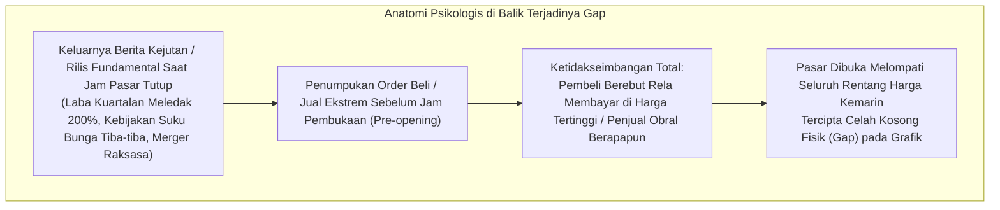
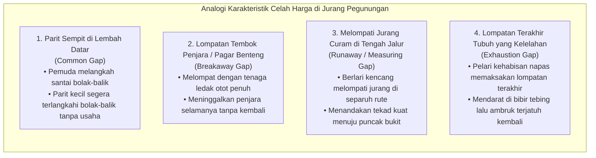
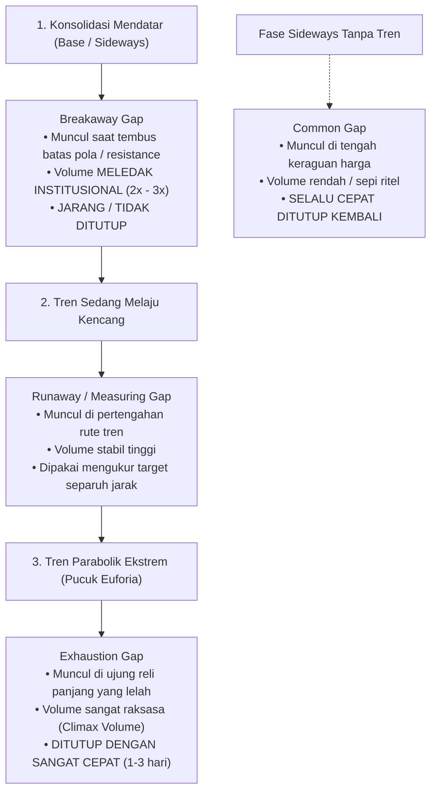
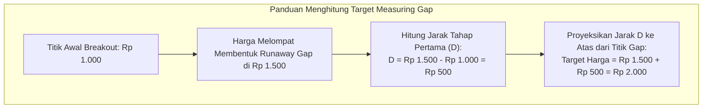
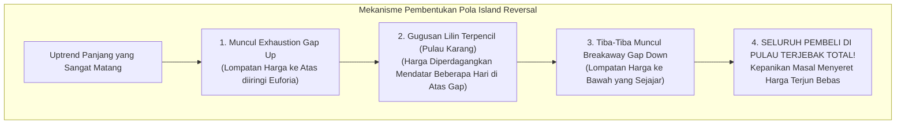

# Bab 20: Analisis Gap (Celah Harga) — Membaca Jejak Lompatan Emosi Pasar

> "Gap adalah cermin dari ketidakseimbangan ekstrem antara penawaran dan permintaan yang meledak dalam sekejap mata. Celah harga bukan sekadar ruang kosong tanpa arti pada grafik, melainkan jejak lompatan emosi massa yang menyimpan rahasia besar: apakah suatu tren baru saja lahir, sedang melaju kencang, atau justru sedang sekarat."  
> — **Edianto Ong**, *Technical Analysis for Mega Profit*

---

## 1. Definisi dan Psikologi Terjadinya Gap

Dalam analisis teknikal, **Gap (Celah Harga)** adalah area kosong vertikal pada grafik batang (*bar chart*) atau lilin (*candlestick chart*) di mana tidak ada transaksi jual-beli sama sekali yang terlaksana di antara dua periode perdagangan yang berurutan.

- **Gap Up (Celah Atas):** Terjadi ketika harga terendah (*Low*) suatu hari perdagangan berada **lebih tinggi** daripada harga tertinggi (*High*) hari perdagangan sebelumnya.
- **Gap Down (Celah Bawah):** Terjadi ketika harga tertinggi (*High*) suatu hari perdagangan berada **lebih rendah** daripada harga terendah (*Low*) hari perdagangan sebelumnya.

### Mitos Keliru Pemula: *"Semua Gap Pasti Akan Tertutup"*
Salah satu mitos paling berbahaya yang sering beredar di kalangan pemula adalah dogma kaku: *"Semua celah harga (gap) pada akhirnya pasti akan ditutup kembali (*all gaps must be filled*)"*. 

Edianto Ong menegaskan bahwa pandangan ini adalah **kekeliruan fatal yang sangat merugikan**. Ada jenis-jenis celah harga tertentu—terutama *Breakaway Gap* dan *Runaway Gap*—yang **tidak pernah ditutup kembali selama bertahun-tahun** seiring bergeraknya saham dalam siklus tren *mega-profit*. Jika Anda nekat melawan arah tren hanya karena berharap celah tersebut tertutup, Anda bisa menyaksikan modal Anda tergerus habis.

---

## 2. Analogi Dunia Nyata: Lompatan Jurang Menyeberangi Tebing

Untuk memahami perilaku dan psikologi di balik celah harga, bayangkan seorang penjelajah yang sedang mendaki pegunungan terjal:

- **Parit Kecil di Halaman (Common Gap):** Anda sedang berjalan santai di tanah datar lalu melangkahi parit kecil selebar 30 cm. Anda bisa melangkah maju dan melangkah mundur kapan saja. Parit kecil itu tidak mengubah rute perjalanan Anda.
- **Lompatan Melewati Pagar Penjara (Breakaway Gap):** Seorang tahanan melompati pagar berduri benteng penjara dengan mengerahkan seluruh tenaga ototnya. Begitu mendarat di luar pagar, ia berlari sekencang-kencangnya menuju hutan bebas. Ia tidak akan pernah mau kembali melompati pagar penjara itu lagi!
- **Lompatan Melintasi Jurang di Tengah Tebing (Runaway Gap):** Di tengah jalur pendakian yang sedang menanjak terjal, sang pendaki melompati jurang batu selebar 1 meter. Lompatan berani ini menegaskan bahwa ia sudah menempuh separuh perjalanan dan pasti akan menuntaskan separuh perjalanan sisanya menuju puncak.
- **Lompatan Terakhir yang Kehabisan Tenaga (Exhaustion Gap):** Setelah mendaki 12 jam nonstop tanpa makan dan minum, di dekat puncak tebing sang pendaki memaksakan diri melompati celah batu terakhir dengan sisa tenaga terakhir. Begitu mendarat, kedua kakinya lemas gemetar, ia pingsan, dan tergelincir jatuh kembali ke bawah.

---

## 3. Empat Jenis Gap Klasik & Ciri-Ciri Khasnya

Edianto Ong membagi celah harga menjadi empat kategori berdasarkan posisi kemunculannya pada siklus tren serta volume transaksi yang mengiringinya:

### 1. Common Gap (Celah Biasa / Area Gap)
- **Lokasi Terjadinya:** Terbentuk di dalam rentang perdagangan mendatar (*sideways / trading range*), jauh dari level *breakout* penting.
- **Karakteristik Volume:** Batang volume rendah atau sedang-sedang saja, mencerminkan ketidakhadiran pemodal besar (*lack of institutional conviction*).
- **Perilaku Penutupan (*Gap Fill*):** **Hampir selalu ditutup kembali dalam waktu sangat singkat** (1 hingga beberapa hari kerja) saat harga berayun bolak-balik di antara batas lantai dan atap rentang *sideways*.
- **Taktik Trading:** Abaikan gap ini! Jangan menganggapnya sebagai sinyal tren baru.

### 2. Breakaway Gap (Celah Penerobosan)
- **Lokasi Terjadinya:** Terbentuk tepat ketika harga melompati keluar dari pola konsolidasi besar yang telah berlangsung berminggu-minggu atau berbulan-bulan (misal: melompati *Neckline Head & Shoulders*, atap *Ascending Triangle*, atau garis *Resistance* kuat).
- **Karakteristik Volume:** **WAJIB disertai lonjakan volume transaksi masif** (minimal 2x hingga 3x lipat volume rata-rata harian). Ini adalah cap stempel bahwa *Smart Money* menyapu bersih seluruh antrean penawaran penjual.
- **Perilaku Penutupan (*Gap Fill*):** **SANGAT JARANG ditutup dalam waktu dekat.** Jika celah ini sampai tertutup kembali dalam 2–3 hari, itu menandakan sinyal palsu (*Bull Trap*). Celah ini di masa depan akan berubah fungsi menjadi benteng pertahanan (*Support*) terkuat.
- **Taktik Trading:** Ini adalah sinyal entri paling menguntungkan (*High Probability Buy*). Beli segera saat penembusan terkonfirmasi dan pasang *Stop Loss* ketat di bawah batas bawah celah gap.

### 3. Runaway Gap / Measuring Gap (Celah Pengukur Kelanjutan)
- **Lokasi Terjadinya:** Muncul di pertengahan tren naik atau turun yang sedang melaju kencang dan sehat, tanpa ada hambatan resistensi di sekitarnya.
- **Karakteristik Volume:** Volume transaksi stabil tinggi atau meningkat secara wajar, menandakan keyakinan pasar yang belum pudar.
- **Metode Pengukuran (*Measuring Rule*):** Celah ini memiliki keajaiban matematis: **hampir selalu muncul tepat di separuh (50%) perjalanan total sebuah tren**. Jarak dari awal penembusan (*Breakout Point*) ke titik gap dapat diproyeksikan ke depan dari titik gap untuk memperkirakan di mana harga akan mencapai target akhirnya.
- **Perilaku Penutupan (*Gap Fill*):** Tidak ditutup selama tren utama masih melaju kuat. Menjadi level pertahanan *trailing stop*.

### 4. Exhaustion Gap (Celah Kelelahan / Napas Terakhir)
- **Lokasi Terjadinya:** Muncul di ujung akhir tren naik atau turun yang sudah berjalan sangat panjang dan mulai bergerak vertikal parabolik.
- **Karakteristik Volume:** Volume transaksi harian meledak ke tingkat spektakuler tertinggi (*Climax Volume*), mencerminkan kepanikan beli (*Buying Climax*) dari masyarakat awam yang histeris.
- **Perilaku Penutupan (*Gap Fill*):** **DITUTUP DENGAN SANGAT CEPAT**, biasanya hanya dalam tempo 1 hingga 5 hari bursa berikutnya. Begitu celah kelelahan tertutup ke bawah, pasar secara resmi mendeklarasikan bahwa tren telah mati dan pembalikan arah besar telah dimulai.
- **Taktik Trading:** JANGAN PERNAH MEMBELI SAHAM DI SINI! Ini adalah sinyal darurat untuk menjual seluruh kepemilikan Anda (*Take Profit*) dan segera beralih mengamankan kas.

---

## 4. Panduan Step-by-Step Pemula: Menghitung Target Runaway Gap

Bagaimana cara seorang pemula memanfaatkan rumus ajaib *Measuring Gap* untuk menghitung target take profit secara objektif? Ikuti panduan hitungan berikut:

### Rumus Pengukuran:
$$\text{Jarak Awal } (D) = \text{Harga Titik Runaway Gap} - \text{Harga Titik Breakout Awal}$$
$$\text{Target Proyeksi Akhir} = \text{Harga Titik Runaway Gap} + D$$

Misalnya:
1. Saham BBRI menembus pola *base* di harga **Rp 4.000** (Titik Breakout).
2. Tiga minggu kemudian saat tren sedang kencang, terbentuk *Runaway Gap* di level **Rp 4.800**.
3. Jarak $D = \text{Rp } 4.800 - \text{Rp } 4.000 = \text{Rp } 800$.
4. Target proyeksi kenaikan tren adalah: $\text{Rp } 4.800 + \text{Rp } 800 = \mathbf{Rp\ 5.600}$.
5. Trader pemula dapat memasang pesanan *Take Profit* bertahap di sekitar area Rp 5.500 - Rp 5.600 dengan tenang tanpa emosi.

---

## 5. Formasi Spesial: Island Reversal (Pembalikan Pulau)

Salah satu formasi pembalikan arah paling mematikan dan memiliki tingkat keandalan tertinggi di pasar bursa adalah **Island Reversal (Pembalikan Pulau)**:

### Mengapa Dinamakan "Pulau"?
Perhatikan visualisasinya pada grafik:
1. Harga melompat naik ke atas meninggalkan celah kosong di bawahnya (*Exhaustion Gap*).
2. Selama 3 hingga 5 hari bursa, harga terkonsolidasi dalam rentang sempit di atas awan, terpisah dari daratan pergerakan harga sebelumnya.
3. Tiba-tiba bursa dibuka anjlok melompat ke bawah (*Gap Down*) di level yang sejajar, meninggalkan celah kosong kedua.
4. Klaster lilin beberapa hari tersebut kini tampak seperti sebuah **pulau karang terpencil di tengah laut** yang sepenuhnya dikepung oleh air laut (celah kosong kiri dan kanan).
5. **Implikasi Psikologis:** Seluruh trader yang membeli saham di pulau tersebut langsung mengalami kerugian (*trapped buyers*). Begitu menyadari mereka terkunci tanpa bisa keluar, aksi jual panik massal meledak dan menyeret harga terjun bebas ke jurang penurunan baru. Jika Anda melihat pola ini terbentuk di pucuk, **segera buang saham Anda di detik itu juga!**

---

## 6. Kamus Istilah Pemula (Glossary Box)

| Istilah | Terjemahan Bebas | Arti Praktis untuk Pemula |
| :--- | :--- | :--- |
| **Gap Up** | Celah Lonjakan Atas | Harga pembukaan hari ini dibuka jauh lebih tinggi dari harga tertinggi kemarin tanpa ada transaksi di antaranya. |
| **Gap Down** | Celah Anjlok Bawah | Harga pembukaan hari ini dibuka jauh lebih rendah dari harga terendah kemarin. Tanda kepanikan penjual. |
| **Gap Fill / Closed** | Penutupan Celah | Kondisi saat harga bergerak kembali melintasi dan menutupi area kosong celah yang sempat tercipta sebelumnya. |
| **Breakaway Gap** | Celah Penerobosan | Celah bervolume masif yang memecahkan level resistensi penting. Tanda lahirnya tren baru yang sangat kuat. |
| **Runaway Gap** | Celah Pengukur | Celah yang muncul di pertengahan rute tren. Dipakai mengukur target profit separuh perjalanan. |
| **Exhaustion Gap** | Celah Kelelahan | Celah bervolume klimaks di pucuk reli yang menandai napas terakhir pembeli sebelum harga berbalik runtuh. |
| **Island Reversal** | Pembalikan Pulau | Formasi gugusan lilin terpencil yang diapit oleh celah gap naik dan celah gap turun. Sinyal pembalikan arah paling mematikan. |

---

## 7. Studi Kasus Konkret: Mengidentifikasi Breakaway vs Exhaustion Gap

Mari kita bedah skenario transaksi nyata untuk menguji ketajaman analisis Anda:

### Kasus: Saham Tambang PT Komoditas Makmur
- **Latar Belakang:** Saham ini berkonsolidasi di rentang harga Rp 1.000 – Rp 1.050 selama 2 bulan. Volume rata-rata harian adalah 10.000 lot.
- **Fase A: Terjadinya Breakaway Gap**
  - Pada hari Senin, harga dibuka melompat langsung di level **Rp 1.090** (meninggalkan celah kosong dari Rp 1.050 ke Rp 1.090).
  - Volume pada penutupan hari itu meledak mencapai **35.000 lot** (3,5x rata-rata) dan ditutup menguat di Rp 1.150.
  - *Keputusan Trader Cerdas:* Beli saham di Rp 1.150 atau tunggu retest di Rp 1.100. Pasang Stop Loss ketat di level Rp 1.040 (di bawah celah gap).
- **Fase B: Terjadinya Runaway Gap**
  - Tiga minggu kemudian, harga saham melesat mulus hingga menyentuh Rp 1.500.
  - Tiba-tiba di hari Selasa, harga melonjak membentuk celah baru dari Rp 1.500 ke Rp 1.540 dengan volume ramai sehat.
  - *Perhitungan Target:* Jarak awal $D = \text{Rp } 1.500 - \text{Rp } 1.050 = \text{Rp } 450$. Proyeksi target akhir tren adalah: $\text{Rp } 1.540 + \text{Rp } 450 = \mathbf{Rp\ 1.990}$.
- **Fase C: Terjadinya Exhaustion Gap di Dekat Target**
  - Setelah saham menyentuh level Rp 1.950, media sosial viral membicarakan saham ini.
  - Keesokan paginya, harga dibuka melompat membentuk *Gap Up* liar ke **Rp 2.100** (+8%) dengan volume transaksi meledak di rekor tertinggi sejarah 120.000 lot.
  - Namun pada siang hari, harga ditutup melemah di Rp 1.980 meninggalkan ekor atas panjang, dan dua hari kemudian harga anjlok menembus ke bawah Rp 1.950 (celah gap tertutup total).
  - *Diagnosis Akhir:* Ini adalah **Exhaustion Gap** yang sempurna! Trader yang disiplin langsung menjual seluruh portofolionya di Rp 1.980 dan mengantongi keuntungan hampir 100%, sementara pemula yang baru membeli di Rp 2.100 terjebak di pucuk.

---

## 8. Kesalahan Fatal Pemula Terkait Gap

1. **Membeli Saham Saat Terjadi Common Gap di Tengah Sideways:**
   Melihat saham melompat 3% di dalam rentang mendatar lalu terburu-buru membeli, hanya untuk menyaksikan harga turun kembali dua hari kemudian menutupi celah tersebut. Ingat: celah di tengah area *sideways* tidak memiliki tenaga pendorong tren.
2. **Nekat Melawan Arah Breakaway Gap (*Fading the Breakaway*):**
   Melihat saham melonjak menembus resistensi dengan volume meledak, lalu pemula malah melakukan *short sell* atau menjual sahamnya sambil berucap: *"Tenang saja, semua gap pasti ditutup, nanti saya beli lagi di bawah"*. Saham tersebut kemudian melesat naik 200% tanpa pernah kembali menyentuh level celah tersebut!
3. **Mengira Exhaustion Gap Sebagai Tanda Kenaikan Tanpa Batas:**
   Membeli saham di hari kemunculan *Exhaustion Gap* karena tergiur lonjakan volume raksasa dan berita heboh di grup saham. Padahal, volume klimaks di pucuk reli adalah tanda pesta pembagian barang bandar (*distribusi*) telah usai.
