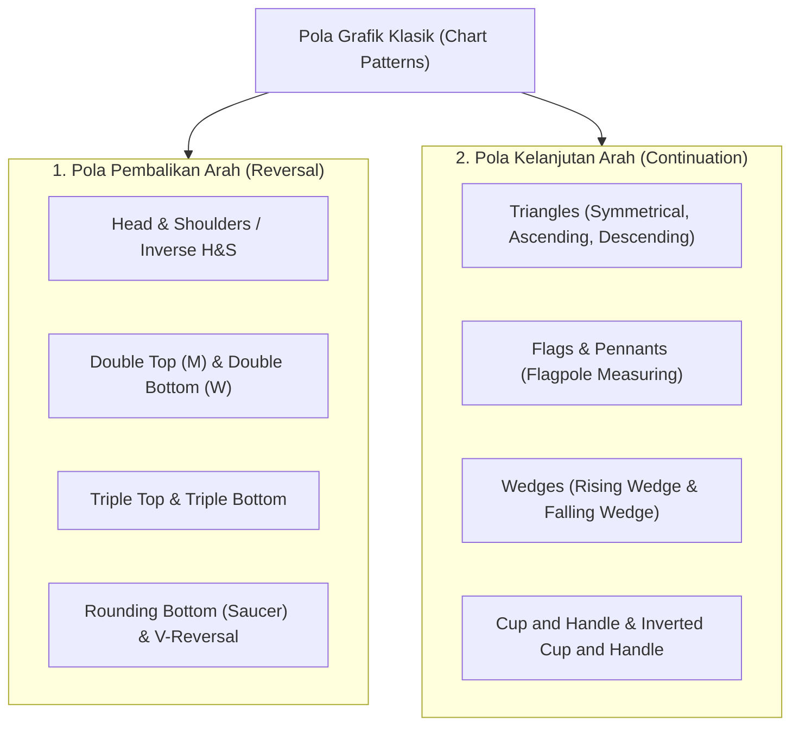
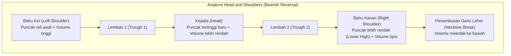
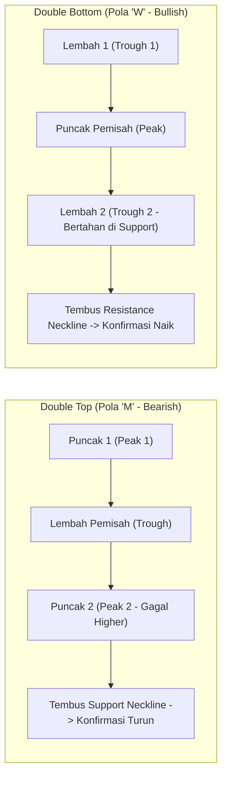
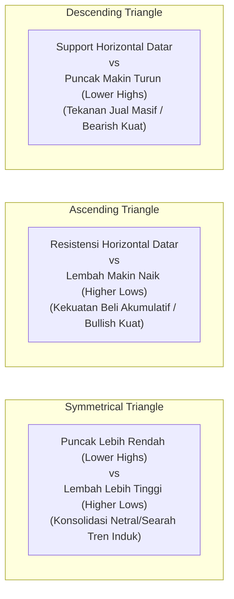
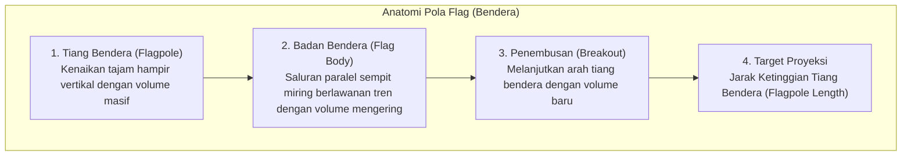
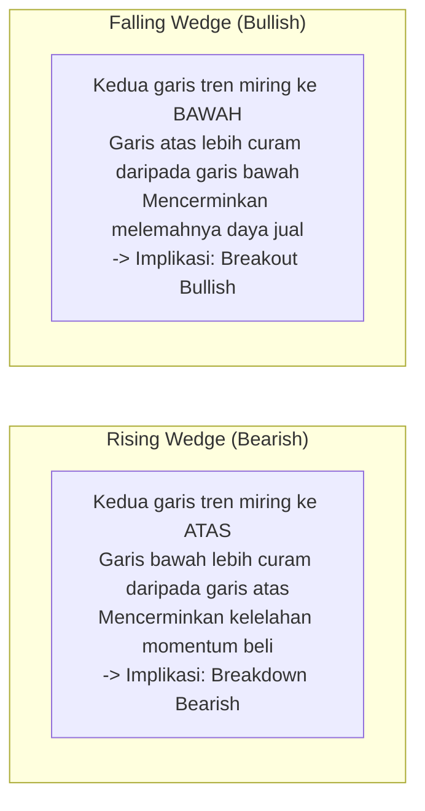
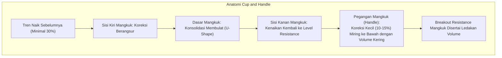

# Bab 21: Chart Patterns (Pola Grafik Klasik)

> "Pola grafik bukanlah sekadar bentuk geometris abstrak di atas kertas, melainkan rekaman jejak pertarungan emosi manusia—keserakahan, ketakutan, dan keputusasaan—yang terpatri secara konsisten di setiap era pasar finansial."  
> — **Edianto Ong**, *Technical Analysis for Mega Profit*

---

## 1. Hakikat dan Klasifikasi Pola Grafik

Dalam analisis teknikal barat modern, **Pola Grafik (*Chart Patterns*)** adalah konfigurasi pergerakan harga yang berulang yang merefleksikan pergeseran keseimbangan antara kekuatan beli (*demand*) dan kekuatan jual (*supply*). 

Edianto Ong membagi seluruh pola grafik klasik ke dalam dua keluarga besar:
1. **Pola Pembalikan Arah (*Reversal Patterns*):** Menandakan bahwa tren yang sedang berlangsung saat ini telah kehilangan momentum dan bersiap untuk berbalik arah secara fundamental.
2. **Pola Kelanjutan Arah (*Continuation Patterns*):** Menandakan bahwa pasar sedang mengambil jeda napas (*pause/consolidation*) sementara untuk menyerap likuiditas, sebelum melanjutkan perjalanannya searah dengan tren utama sebelumnya.

---

## 2. Pola Pembalikan Arah (*Reversal Patterns*)

### A. Head and Shoulders & Inverse Head and Shoulders

Pola *Head and Shoulders (H&S)* adalah raja dari seluruh pola pembalikan puncak (*top reversal pattern*). Pola ini menandai transisi dari tren naik (*uptrend*) yang teratur menuju kejatuhan tren turun (*downtrend*).

* **Komponen Struktural:**
  1. **Left Shoulder (Bahu Kiri):** Terbentuk di akhir tren naik yang kuat, diiringi volume transaksi yang besar saat mencetak puncak baru.
  2. **Head (Kepala):** Harga berhasil melesat lebih tinggi mencetak rekor tertinggi baru, namun perhatikan bahwa volume transaksi pada fase ini sering kali **lebih kecil** daripada volume di bahu kiri (tanda awal *divergence*).
  3. **Right Shoulder (Bahu Kanan):** Upaya reli terakhir para pembeli, namun gagal total mencapai tinggi kepala (*Lower High*), diiringi volume yang sangat mengering.
  4. **Neckline (Garis Leher):** Garis tren yang menghubungkan kedua titik lembah koreksi. Garis ini bisa mendatar, miring ke atas, atau miring ke bawah.
* **Metode Pengukuran Target (*Measuring Target*):**
  Ukur jarak vertikal dari titik puncak tertinggi (*Head*) lurus ke bawah hingga menyentuh garis *Neckline* ($H$). Setelah terjadi penembusan (*breakout*) di bawah *Neckline*, proyeksikan jarak $H$ tersebut ke bawah dari titik penembusan. Target minimum penurunan adalah:  
  $$\text{Target Harga} = \text{Level Penembusan Neckline} - H$$

#### Pola Inverse Head and Shoulders (Bullish Reversal)
Merupakan cermin terbalik dari pola di atas yang muncul di dasar tren turun (*bottom reversal*). Garis leher bertindak sebagai *resistance*. **Syarat Mutlak:** Penembusan garis leher ke atas (*breakout*) **WAJIB disertai lonjakan volume transaksi yang masif** untuk mengonfirmasi bahwa institusi telah selesai melakukan akumulasi.

---

### B. Double Top & Double Bottom

#### 1. Double Top (Pola "M")
* **Karakteristik:** Terjadi setelah tren naik yang panjang. Harga membentuk Puncak 1, terkoreksi ke lembah perantara, lalu mencoba menembus naik kembali namun tertahan di sekitar ketinggian Puncak 1 membentuk Puncak 2.
* **Kriteria Volume:** Puncak 1 diiringi volume besar, sedangkan Puncak 2 diiringi volume yang jauh lebih kecil, memperlihatkan hilangnya minat beli publik.
* **Konfirmasi:** Sinyal jual terkonfirmasi saat harga ditutup menembus ke bawah garis lembah (*support neckline*).

#### 2. Double Bottom (Pola "W")
* **Karakteristik:** Terjadi di akhir tren penurunan. Harga membentuk Lembah 1, memantul sementara, lalu turun kembali menguji area terendah namun berhasil bertahan membentuk Lembah 2.
* **Target Pengukuran:** Jarak vertikal dari lembah terendah ke garis puncak perantara diproyeksikan ke atas dari titik *breakout*.

---

### C. Triple Top & Triple Bottom
Merupakan variasi dari *Double Top/Bottom* di mana kekuatan beli atau jual melakukan tiga kali upaya pengujian level ekstrem sebelum akhirnya menyerah. Pola ini membutuhkan waktu pembentukan lebih lama dan memiliki daya ledak pembalikan arah yang sangat masif ketika garis konfirmasinya berhasil ditembus.

---

### D. Rounding Bottom (Saucer) & V-Reversal
* **Rounding Bottom (Mangkuk Bulat / Saucer):** Menandakan proses transisi yang sangat bertahap dan halus dari penurunan menuju kenaikan. Volume transaksi membentuk kurva parabola cekung yang sejajar dengan grafik harga: mengering di titik tengah mangkuk dan mengembang saat harga mulai merangkak naik meninggalkan dasar mangkuk.
* **V-Reversal (Pembalikan Bentuk V):** Kebalikan dari mangkuk bulat, pola ini terjadi akibat sentimen kejutan mendadak (*shock news*) yang menghasilkan *selling climax* ekstrem yang diserap seketika oleh *smart money*, membalikkan harga 180 derajat dalam waktu sangat singkat tanpa konsolidasi.

---

## 3. Pola Kelanjutan Arah (*Continuation Patterns*)

### A. Pola Segitiga (*Triangles*)

Pola segitiga mencerminkan kontraksi volatilitas di mana rentang harga menyempit di antara dua garis tren yang saling mendekat (*converging trendlines*). Volume perdagangan **selalu mengering** selama pola terbentuk dan meledak saat *breakout*.

1. **Symmetrical Triangle (Segitiga Simetris):** Garis tren atas miring ke bawah dan garis tren bawah miring ke atas dengan kemiringan berimbang. Merupakan zona keraguan pasar. Breakout biasanya mengikuti arah tren sebelum pola segitiga terbentuk.
2. **Ascending Triangle (Segitiga Naik - Sangat Bullish):** Batas atas berupa garis horizontal datar (*resistance* konstan di mana ada penjual pasif yang menahan), sedangkan batas bawah berupa garis tren miring ke atas (*Higher Lows* di mana pembeli semakin agresif masuk). Penembusan ke atas biasanya sangat eksplosif.
3. **Descending Triangle (Segitiga Turun - Sangat Bearish):** Batas bawah berupa garis horizontal datar (*support* konstan), sedangkan batas atas miring ke bawah (*Lower Highs*). Menandakan pembeli yang bertahan di level *support* perlahan kehabisan modal, dan ketika *support* jebol, harga akan terjun bebas.

---

### B. Flags & Pennants (Bendera & Umbul-Umbul)

Merupakan salah satu pola kelanjutan arah jangka pendek yang paling andal dan dinamis di pasar yang bergerak cepat.

* **Flag (Bendera):** Memiliki "tiang bendera" (*flagpole*) yang terbentuk dari kenaikan harga vertikal tajam, diikuti saluran paralel sempit (*channel*) yang sedikit miring berlawanan dengan arah tren utama (membentuk kain bendera).
* **Pennant (Umbul-Umbul):** Mirip dengan flag, namun badan konsolidasinya berbentuk segitiga simetris mini.
* **Aturan Pengukuran (*Flagpole Target*):** Ukur ketinggian tiang bendera awal dari titik mulai reli hingga puncak sebelum bendera terbentuk. Proyeksikan ketinggian tiang tersebut ke atas dari titik *breakout* kain bendera.

---

### C. Pola Baji (*Wedges*)

Berbeda dari segitiga, kedua garis tren pada pola baji (*wedge*) **miring ke arah yang sama**, namun menyempit saling mendekat.

1. **Rising Wedge (Baji Naik):** Kedua garis tren miring ke atas. Pola ini terlihat *bullish* bagi pemula, namun sesungguhnya adalah sinyal jebakan kelelahan beli (*bearish bias*). Sering kali berakhir dengan kejatuhan harga menembus garis bawahnya.
2. **Falling Wedge (Baji Turun):** Kedua garis tren miring ke bawah. Tekanan jual semakin melemah seiring penyempitan rentang. Pola ini memiliki probabilitas tinggi untuk menembus ke atas (*bullish breakout*).

---

### D. Cup and Handle (Mangkuk dan Pegangan)

Dipopulerkan oleh William J. O'Neil dan diuraikan secara mendalam oleh Edianto Ong sebagai pola kelanjutan tren naik super-profitabel:

* **Karakteristik Utama:**
  1. **Bentuk Mangkuk (Cup):** Harus membentuk kurva "U" yang halus dan membulat, bukan bentuk "V" yang tajam. Kedalaman mangkuk idealnya berkisar antara 15% hingga 35% dari titik puncak sebelumnya.
  2. **Pegangan (Handle):** Terbentuk di dekat batas atas mangkuk, berupa saluran koreksi kecil yang miring ke bawah dengan penurunan tidak melebihi sepertiga kedalaman mangkuk. Volume perdagangan pada fase pegangan harus **mengering drastis**.
  3. **Breakout:** Sinyal beli terkonfirmasi ketika harga menembus level puncak *rim* mangkuk dengan volume transaksi yang meledak di atas rata-rata harian.
  4. **Target Keuntungan:** Jarak kedalaman mangkuk (dari dasar mangkuk ke garis *resistance rim*) diproyeksikan ke atas dari titik *breakout*.

---

## 4. Matriks Ringkasan Karakteristik Seluruh Pola Grafik

| Nama Pola | Klasifikasi | Arah Ekspektasi | Kondisi Volume Saat Pola | Volume Saat Breakout |
| :--- | :--- | :--- | :--- | :--- |
| **Head and Shoulders** | Reversal | Bearish (Turun) | Mengecil dari bahu kiri ke kanan | Wajib Tinggi |
| **Inverse Head & Shoulders**| Reversal | Bullish (Naik) | Mengering di dasar kepala | Mutlak Sangat Tinggi |
| **Double Top (M)** | Reversal | Bearish (Turun) | Puncak 2 lebih rendah volumenya | Tinggi saat tembus support |
| **Double Bottom (W)** | Reversal | Bullish (Naik) | Lembah 2 volume tipis | Wajib Tinggi |
| **Ascending Triangle** | Continuation | Bullish (Naik) | Mengering bertahap | Sangat Tinggi |
| **Descending Triangle** | Continuation | Bearish (Turun) | Mengering bertahap | Tinggi saat tembus support |
| **Symmetrical Triangle** | Continuation | Mengikuti tren induk| Mengering drastis | Sangat Tinggi |
| **Flag & Pennant** | Continuation | Mengikuti arah tiang | Sangat tipis di kain bendera | Meledak Tinggi |
| **Rising Wedge** | Reversal / Cont. | Bearish (Turun) | Menurun saat harga naik | Tinggi saat tembus garis bawah |
| **Falling Wedge** | Reversal / Cont. | Bullish (Naik) | Menurun saat harga turun | Wajib Meledak Tinggi |
| **Cup and Handle** | Continuation | Bullish (Naik) | Membentuk mangkuk U, kering di handle | Sangat Besar di rim resistance |

---

## 5. Kaidah Emas Trading Berbasis Chart Pattern

1. **Jangan Mendahului Pola (*Never Anticipate*):** Suatu pola grafik hanyalah sebuah hipotesis hingga harga secara resmi **menembus dan menutup (*closing*) di luar garis konfirmasi/neckline**. Membeli sebelum *breakout* terjadi sama dengan berjudi.
2. **Volume adalah Hakim Pembuktian:** Penembusan pola tanpa lonjakan volume institusional memiliki probabilitas kegagalan (*false breakout*) lebih dari 60%.
3. **Penyusunan Stop-Loss yang Rasional:** Tempatkan selalu *stop-loss* tepat di belakang struktur pola yang baru saja ditembus (misal di bawah *Right Shoulder*, di bawah *Handle*, atau di bawah garis batas bawah segitiga).
